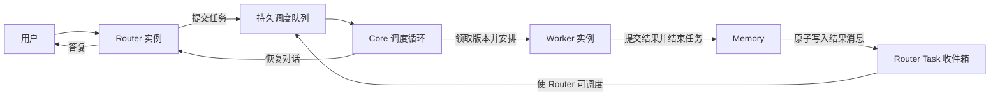

# Agent Harness 架构设计

版本：v0.16 · 状态：架构草案 · 日期：2026-11-18

## 1. 系统组成

Harness 负责一条执行链：**用户输入 → Router 决策 → 任务入队 → Worker 执行 → 结果送达 Router → 用户答复**。

| 对象 | 性质与职责 |
| --- | --- |
| Router | Agent 角色，负责用户交互、分派及汇总；实际执行者是可替换的 Router 实例 |
| Worker | Agent 角色，负责推进任务；可分派子任务并等待结果 |
| Harness 运行库（Core） | 普通程序代码，包含任务调度、收件箱消费和模型交互的提交规则；不是另一个 agent 或服务 |
| Memory System | 持久保存工作、Context、任务和消息；原子分配版本执行权并保存结果 |
| 宿主插件 | 将运行库接入 dsh 等现有 agent 程序的具体代码，复用宿主的模型和工具执行能力 |

Router 使用统一用户记忆，按需读取跨项目资料。Agent 实例可以在独立进程或宿主进程内运行，其生命周期独立于 Task 和 Context。项目只是资料组织方式。

Core 在独立模式下直接调用模型 SDK、工具函数；在 dsh 模式下由插件连接 dsh 的现有 agent 循环。两种模式使用相同的调度与提交规则，不同时发起同一次模型调用。

## 2. 工作、运行实例和持久状态

| 概念 | 定义 |
| --- | --- |
| Session | 一项工作的资料边界，可以包含多个任务、Context 和并行实例 |
| Task | 一个可分派目标，具有约束、完成条件、父任务、返回地址和续接版本 |
| Agent 实例 | 实际执行者，持有任务、角色配置和有效 Context 领取；退出后可替换 |
| Context 版本 | Memory 中不可变的 LLM 上下文；一次完整交互形成后继版本 |
| Task 收件箱 | 以 Task ID 寻址，保存尚未处理的输入、纠正、取消和结果通知 |

Router 的持续用户对话作为一项工作，拥有自己的 Session、Context、长期 Task 和收件箱；独立委派的工作另建 Session，通过返回地址连接 Router。没有输入时 Router Task 处于 waiting，不要求一个 Router 进程常驻。

同一工作的子任务默认共用 Session，使用独立 Context 或派生版本。执行领取以 `(contextId, versionId)` 为粒度；同一版本最多一个有效执行者，不同版本可并行。每个任务保存自己的续接位置，不读取 Context 的全局最新版本。

Turn、Run、Interaction 分别记录对话轮次、执行尝试和模型交互，不作为额外运行实体。Router 与 Worker 共用循环规则，通过指令、工具和结束条件区分行为；路由策略是角色配置，不另设 Policy agent 或 Controller agent。

## 3. Core 的具体职责

Core 是可被独立程序或宿主插件调用的运行库。其状态包括运行中的实例映射、并发名额和待提交操作；权威任务、消息和 Context 保存在 Memory。

| 入口或循环 | 实际执行内容 |
| --- | --- |
| 接收用户输入 | 调用 sendMessage 写入 Router Task 收件箱，触发一次调度检查 |
| 分派任务 | 校验角色权限和目标，调用 submitTask，持久受理后返回 TaskAccepted |
| 调度循环 | 读取可执行 Task，按角色与可用名额选择任务，领取版本，启动或恢复实例 |
| 实例控制监听 | 读取任务收件箱，投递普通输入或取消信号；维护领取有效期 |
| 模型交互提交 | 调用前持久保存输入，调用后持久提交输出、消息消费和续接版本 |
| 结束任务 | 校验完成条件和结果引用，调用 finishTask；等待时调用 releaseClaim 释放名额 |

共享循环指共用代码，每个实例仍具有独立执行位置。在独立模式中 Core 推进模型/工具步骤；宿主模式中这些规则挂接在宿主的可等待边界，保留宿主原有循环。



图中的队列和收件箱是 Memory 内的持久数据，不是独立服务。内存通知仅用于降低调度延迟。

## 4. 分派、调度与回传

### 4.1 Router 如何分派

Router 模型可调用 `delegate_task` 工具，提供任务目标、约束、工作归属及所需上下文来源。工具实现是 Core 的普通函数：

1. 新工作先建立 Session 和初始 Context；同一工作中的子任务复用 Session。
2. 使用模型工具调用身份生成稳定 Task ID，调用 submitTask，明确 `parentTaskId` 和 `returnTo`。
3. Memory 原子保存子任务、独立 Context 起点、目标输入和待调度标记。
4. 工具立即返回 TaskAccepted；Router 保存本轮答复后结束，不等待 Worker 完成。

Router 决定“做什么”，调度器决定“何时、由哪个实例执行”。分派工具不直接把提示词发送给某个进程，也不占用一个等待到任务完成的工具调用。

### 4.2 调度器如何安排 Worker

首版采用有界并发和队列顺序调度：为 Router 保留对话名额，Worker 使用独立的 `maxWorkers` 名额。相同优先级按入队顺序处理；同一 Task 同时只有一个有效推进者。

调度器通过 receive 读取候选 Task，确认本地有名额后调用 claimContext。Memory 同时核对任务状态、续接版本和执行权。竞争调度器只有一个可成功；失败方不启动实例。领取成功后，Core 将目标、输入和精确版本交给所选执行环境。活跃领取由独立定时任务续期，控制消息监听不阻塞模型调用；失去领取后停止发起新动作。

父任务等待子结果时，保存续接位置和等待条件，调用 releaseClaim 释放领取及 Worker 名额；子任务完成后父任务重新入队。这样即使 Worker 名额已满，等待父任务也不会阻止其子任务启动。

任务结果早于父任务注册等待时，releaseClaim 必须检查已到达消息并保持任务可调度，避免丢失唤醒。

### 4.3 Worker 如何回复 Router

Worker 按自身任务续接版本执行。最终输出先通过 commitInteraction 保存，再由 Core 核对完成条件并调用 finishTask。

finishTask 在 Memory 内原子完成四件事：写入任务终态和结果引用、释放执行领取、向 returnTo 写入唯一结果消息、按接收任务状态更新可调度标记。顶层任务的 returnTo 是 Router Task；子任务的 returnTo 是父 Task。

Router 的下一次执行从自己的收件箱读取结果消息，按需读取 Worker 的结果原文，再产生新的对话轮次。结果通知不是原 delegate_task 的第二次返回，也不直接改写 Router 已保存的 Context。

若 Router 正在运行，结果留在收件箱，由现有实例在下一边界处理；若正在等待，调度器先领取其续接版本，再启动或恢复实例。收到消息本身不绕过领取，也不创建第二个有效执行者。

### 4.4 内部消息机制

| 通路 | 持久载荷 | 到达后的动作 |
| --- | --- | --- |
| 用户 → Router | 输入 ID、文本内容引用 | Router 空闲则入队，运行中则等待下一对话边界 |
| Router/父任务 → Worker | 目标输入、补充或纠正引用 | 写入目标 Task 收件箱，在下一交互边界纳入 Context |
| Worker → Router/父任务 | Task ID、终态、结果版本和消息引用 | 接收任务可调度，恢复后读取结果 |
| 取消控制 | 取消消息 ID、目标 Task、作用范围 | 控制监听器立即请求中断宿主；核对停止状态后提交终态 |

消息按 Task ID 寻址，不以进程 ID 或 contextId 作为唯一地址。一个 Task 收件箱按持久顺序消费。成功处理输入时，commitInteraction 同时确认对应消息；控制消息由相关释放或终态操作确认。

首版使用 Memory 事务存储中的任务队列和收件箱，不引入单独消息中间件。Core 使用长轮询 receive；同进程可补充事件通知。唤醒丢失只增加延迟，重读持久队列即可恢复，不能把内存事件当作唯一交付依据。

执行 Session 的 Event 是审计元数据流；队列和收件箱是协作状态。消息正文只保存为 Context 待处理内容或结果引用，不复制到 Event。普通进度供状态查询，不逐条触发 Router 模型调用。

### 4.5 故障与取消

| 场景 | 处理 |
| --- | --- |
| submitTask 响应丢失 | 用相同 Task ID 重试，复用已有任务和起点 |
| Worker 在输出提交后失联 | 先读取已提交版本及任务状态，再恢复未完成的终态提交或下一步骤 |
| finishTask 响应丢失 | 重试不重复创建返回消息 |
| Router 离线或通知重复 | 收件箱保留结果；以消息 ID 对应唯一处理记录，重复消息不再创建答复 |
| 执行领取到期 | 旧凭证失效，任务进入待核对范围；调度器重新安排实例，先核对未完成调用 |
| 取消运行任务 | 先保存取消请求，再通知宿主；请求已接收不等于外部动作已经停止 |
| Memory 不可用 | 不启动需要新领取或预先保存输入的调用，不确认未持久化结果 |

网络投递采用至少一次语义，处理依靠稳定身份和原子提交去重。版本领取限制有效提交，不能保证失联进程立即停止，也不保证外部副作用只发生一次。

## 5. 模型循环与 Memory 边界

### 5.1 一次交互

```text
持有任务及版本 Claim
  → 从 Task 收件箱选择输入
  → startInteraction：保存实际输入及来源消息 ID
  → 调用模型
  → commitInteraction：保存输出、确认消息、发布后继版本、更新任务位置
  → 执行工具或继续 / 等待 / 结束
```

模型输出中的工具调用先保存，再执行工具；工具结果保存为后续 Context 输入。未知结果保留待核对状态，不直接重复执行。最后一轮输出也必须提交。

输入基于确定版本和明确追加内容，保持消息顺序及配置。压缩或恢复先调用 deriveContext 创建显式版本，再由持有执行权的操作选择采用；不会修改其他任务分支。Memory 后台维护提供候选，Core 决定当前任务何时使用。

### 5.2 最小 Memory 契约

本节不另列一套接口。Harness 只依赖 [最小在线接口](integration-protocol.md#3-最小在线接口)的 13 个操作：工作资料 4 个、版本执行 5 个、任务与消息 4 个。参数、幂等规则及原子边界均以该协议为准。

createSession/getProfile/getTask/readContent 等旧的独立入口已收敛到 openSession、read 和 recall；任务输入与结果通知统一采用 Task 收件箱。摘要刷新、画像整合和 Session 维护由 Memory 后台执行，不进入在线执行循环的必需调用链。

## 6. 对接 dsh 的具体方案

### 6.1 插件是什么

`genvagent-dsh` 是安装到 dsh 的一份 Cordis 插件。它引用 Harness 运行库和 Memory 客户端，注册任务工具、启动队列消费，并把 dsh 的 Agent、输入和模型请求映射到本系统任务。它不启动第二套 agent 框架。

dsh 官方接口提供 `apply(ctx)` 插件入口、`ctx.tools.register()` 工具注册，以及 `ctx.agents.create()` 创建 AgentHandle。`Agent.followup()`、`steer()` 和 `cancel()` 分别提供下一轮输入、步骤边界补充及取消能力。[插件示例](https://github.com/deepseek-ai/deepseek-harness/blob/master/docs/cookbook/extension-cookbook.md)、[Agent 契约](https://github.com/deepseek-ai/deepseek-harness/blob/master/docs/subsystems/core.md)

| 本系统动作 | 插件中的具体实现 |
| --- | --- |
| 接收用户输入 | 接入入口先调用 Core 将输入保存到 Router Task 收件箱；调度取得执行权后再交给 dsh，不让原生入口绕过持久受理 |
| 注册 Router 分派能力 | 用 ctx.tools.register 注册 delegate_task；其函数调用 Core 分派逻辑并返回 TaskAccepted |
| 启动 Worker | 队列任务领取成功后调用 ctx.agents.create，使用 Memory 版本转换出的合法 seed 和 Worker 角色配置 |
| 绑定执行位置 | 保存 dsh Agent/原生 Session ID → Task ID、Memory Session ID、ContextRef、Claim 的映射 |
| 向 Router 交付结果 | 在有效领取下 receive 取出消息，插件保留消息 ID 映射，调用 handle.agent.followup 开启新的原生轮次 |
| 补充或取消 | 将纠正映射为 agent.steer，将取消映射为 agent.cancel；完成确认仍以持久状态为准 |
| 释放实例 | 使用创建时持有的 AgentHandle.dispose，任务及 Context 留在 Memory |

多个 dsh Agent 可以具有不同原生 Session ID，同时映射到同一个 Memory 工作 Session 的不同 Context 版本。原生 Session 用作宿主运行投影，不能以其“最后一条记录”覆盖 Memory 的任务续接位置。

### 6.2 何时保存模型输入和输出

dsh 的 `agent/pre-step` 位于请求派生之前，只处理本步骤输入，不能据此声称取得最终模型请求。完整请求可在 `llm/stream` waterfall 读取；官方契约规定由 agent loop 构造的请求不可改写，监听器通过 `next()` 继续调用模型。[请求与流接口](https://github.com/deepseek-ai/deepseek-harness/blob/master/docs/subsystems/llm-streaming.md)

插件在该边界执行以下流程：

1. 根据发起调用的 dsh Agent 定位 Task 和有效 Claim，仅处理本插件绑定的会话模型请求。
2. 核对完整请求与 Memory 基础版本及明确新增输入一致，调用 startInteraction，成功后才进入 next()。
3. 转发模型流并收集完整输出；成功结束前等待 commitInteraction，随后放行成功结束，使 dsh 继续执行工具或下一步骤。
4. 出错或中断保留交互状态，不发布成功版本。重试按调用身份和已提交结果核对，不能再次推进相同交互。

`session/event` 可以捕获原生记录，但普通事件回调不能代替可等待的远程提交。工具结果与结束处理需要在下一请求或停止边界等待持久写入；finishTask 必须晚于最终结果持久化。

Host 的压缩、系统指令或工具配置变化必须显式进入新版本。若无法还原所需 seed、核对请求或覆盖全部调用路径，该版本插件只开放检索和 Trace 导入，不宣称支持可恢复执行。

### 6.3 一次实际分派

```text
用户向 dsh Router R 输入任务
  → 插件先调用 sendMessage(Router Task)，调度器领取 Router 续接版本
  → 插件调用 R.followup(用户输入)
  → R 的模型调用 delegate_task
  → 插件调用 submitTask，返回 TaskAccepted
  → Core 调度循环取得任务 P 和执行名额
  → claimContext(P) 得到 C@v4 及 Claim
  → ctx.agents.create(...) 返回 Worker 的 AgentHandle
  → handle.agent.followup(任务输入)
  → dsh 原生循环执行；llm/stream 钩子负责输入与版本提交
  → 插件核对最终结果，调用 finishTask(P, resultRef)
  → Memory 向 Router Task 收件箱写入结果
  → Core 重新领取等待中的 Router Task，恢复其续接版本
  → 插件调用 R.followup(结果消息)
  → R 开始新轮次，读取结果并答复用户
```

这里的启动、投递和取消是插件调用 dsh 方法的几段代码，不再设置通用 Driver 层。工具最终返回、原生轮次结束和整个 Agent 的 idle 状态并不等价；插件按 Task 完成条件及已提交结果结束任务，不能仅凭 whenIdle 判定任务成功。

核对依据为 2026-11-18 的官方 master 文档。上述是接入设计，插件尚未实现；实施时固定提交版本并验证 seed、请求边界、流式完成与取消行为。pi 接入采用同一任务和消息协议，具体调用点另行核对。

## 7. 最小运行数据

| 数据 | 保存位置与用途 |
| --- | --- |
| Task | Memory：身份、角色、工作归属、父任务、返回地址、续接版本、状态及结果 |
| Message | Memory：身份、目标 Task、类型、来源、内容引用和处理状态 |
| Claim / Interaction | Memory：有效执行者、代次、基础版本、调用状态与提交结果 |
| 实例绑定 | Harness：Task → 本地或 dsh AgentHandle、Claim、在途交互；可根据持久状态重建 |
| 调度配置 | Harness：Router 名额、maxWorkers、队列等待和领取续期参数 |

同一进程可承载 Router 和多个 Worker；多进程共享 Memory 队列，以原子领取协调。父任务等待时释放名额，Router 与 Worker 分开限流，避免并行工作耗尽用户交互能力。

## 8. 验证重点

- Router 分派后立即得到持久受理结果；Worker 执行期间仍可处理用户输入。
- 两个调度器竞争同一任务时仅一个获得有效执行权；不同 Context 版本可并行。
- 父任务释放名额等待子结果；结果早于等待注册时仍能恢复。
- Worker、Router 或服务重启后，任务和消息可重读；重复完成不重复通知，重复通知不生成第二份答复。
- dsh 实际请求与持久 Context 一致，成功结果提交后才继续后续动作。
- 取消与未知结果分别记录，不将请求取消等同于已经停止。

文件句柄等资源恢复、CLM 路由实验和复杂调度策略不作为首版依赖。
