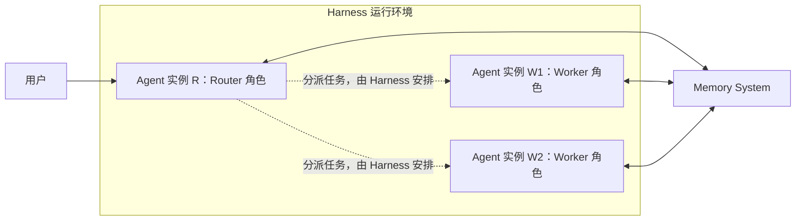

# Agent Harness 架构设计

版本：v0.15 · 状态：架构草案 · 日期：2026-11-18

## 1. 系统定位与边界

Agent Harness 是运行 Agent 的程序框架，负责执行循环、任务调度、模型与工具调用，以及 Memory 接入。Core 是这些执行规则的核心代码；Harness 可独立运行，也可嵌入 dsh、pi 等宿主。

实际工作由 Agent 实例执行，Router 与 Worker 表示实例承担的角色。Memory System 保存 Session、任务、Context 版本及执行状态，并提供版本领取和提交保证。Harness 本地持有运行副本、连接和临时资源，恢复依据来自 Memory。

长期知识维护、Session 摘要和 Trace 导入属于 Memory。文件句柄、工具资源及外部环境的完整恢复不在首版范围内。

## 2. 概念模型

### 2.1 Agent 实例与角色

**Agent 实例是实际推进工作的运行实体。** 实例具有执行身份、角色配置、当前任务和所领取的 Context 版本，运行执行循环并调用模型与工具。它可以由独立进程承载，也可以是宿主进程中的执行任务；实例与操作系统进程不要求一一对应。

**Router 与 Worker 是角色。** 两种角色共用执行循环代码，通过指令、可用工具和行为约束区分职责。

| 角色 | 实例职责 | 行为约束 |
| --- | --- | --- |
| Router | 接收用户输入，回应、澄清、分派、补充任务及汇总结果 | 使用短对话轮次，不同步等待长任务完成 |
| Worker | 推进具体任务，调用模型与工具，产生结果或待处理问题 | 可连续执行多步，也可分派子任务 |

用户通过 Router 交互；承担该角色的实例可在授权范围内检索统一用户记忆，Worker 实例按任务需要读取资料。subagent 表示任务中的父子关系，其执行者仍是 Worker 实例。

实例的生命周期独立于工作状态。实例暂停或退出后，任务及 Context 版本仍保存在 Memory；替换实例从指定续接位置继续。持续的 Router 对话也不依赖同一个进程或实例常驻。

### 2.2 工作与上下文

| 持久对象 | 含义及使用规则 |
| --- | --- |
| Session | 组织一项工作的资料，可容纳多个 Task、Context 和并行执行实例 |
| Task | 具有目标、约束和完成条件的执行目标；保存父子关系、工作归属、起点及续接版本 |
| Context 及版本 | 用于 LLM 交互的有序内容；具体版本不可变，由 Memory 保存，实例加载运行副本 |
| Version Claim | Memory 原子分配的具体版本执行权；同一版本最多一个有效持有者，不同版本可并行 |
| Event | 执行 Session 内的单一元数据流；正文保存在 Context 或其内容引用中 |

Task 描述执行目标，Agent 实例是执行者；重新分配执行者不改变任务身份。实例领取确定版本，追加本轮输入，完成 LLM 交互后提交后继版本。每个任务保存自己的续接引用，Context 不设置全局唯一 head。

Router 对话可使用独立 Session 和稳定续接位置；分派任务按工作归属选择目标 Session。同一工作的子任务默认共享 Session，使用不同 Context 或不同派生版本。fork 不要求新建 Session。

### 2.3 执行记录

| 记录 | 描述范围 |
| --- | --- |
| Turn | Router 处理一次用户输入或重要通知的对话轮次，可包含多次 LLM 交互 |
| Run | 某 Agent 实例推进 Task 或 Turn 的一次执行尝试，关联实例身份、驱动方式和执行位置 |
| Interaction | 一次 LLM 调用的基础版本、追加输入和输出；完成后发布后继版本 |
| Action | 执行循环发出的动作，包括模型调用、工具调用、任务分派、等待或结束 |

这些记录描述执行过程，不是额外的 Agent 实例。一个 Turn 可分派多个 Task，Task 可经历多个 Run；更换实例可建立新的 Run。Action 与 Interaction 通过稳定身份关联，动作完成不等于任务完成。

任务输入承载补充、纠正和取消，任务通知承载等待、完成和失败等变化。二者均持久保存，读取不等于处理完成。普通进度用于查询，不逐条触发模型调用。

### 2.4 概念分类

| 层次 | 对象 | 性质 |
| --- | --- | --- |
| 运行实体 | Router 实例 R、Worker 实例 W1/W2 | 实际执行工作，具有独立运行状态 |
| 职责角色 | Router、Worker | 定义实例承担的职责 |
| 持久对象 | Session、Task、Context 版本、领取和事件 | 定义工作归属、执行内容与协调状态 |
| 执行记录 | Turn、Run、Interaction、Action | 标识轮次、尝试、交互及动作 |
| 实现代码 | 执行循环、调度、Driver、Adapter、Memory Client | 随程序运行，不作为额外 Agent 调度 |
| 行为配置与策略 | 角色指令、工具定义、Router Policy | 影响实例如何作出决定 |

## 3. 架构与实现边界

### 3.1 运行时关系



图中实例可位于同一进程或不同进程。每个实例执行 Core 提供的循环，持有自己的运行状态；共享代码不表示共享执行位置，也不要求串行运行。

### 3.2 Core 内部代码模块

| 模块 | 职责 |
| --- | --- |
| 共享执行循环 | 为每个实例读取状态、准备输入、发出动作、处理结果并决定继续、等待或结束 |
| 任务调度（Dispatcher） | 持久登记任务，选择或创建实例，管理排队、并发、父子关系、取消和恢复 |
| Context 管理 | 选择确定版本和追加材料，通过 Memory 执行 fork、恢复与 compact |
| 模型与工具接入 | 定义运行能力端口，由 Runtime Driver 或宿主实现实际调用与结果核对 |
| Memory 接入 | 封装版本领取、幂等提交、任务输入、通知确认和资料检索 |

这些模块属于 Harness 的程序实现，不是独立 Agent。Router 实例与 Worker 实例使用同一组模块，其执行范围和结束条件由角色及任务约束决定。

### 3.3 角色配置与路由策略

角色配置定义指令、可用工具、资料范围、模型及执行预算。Router Policy 表示在当前上下文中选择回应、澄清、分派或继续任务的行为策略；首版由 Router 指令、工具定义和当前模型交互共同实现，可保留替换策略的扩展点。

| 名称 | 在本设计中的定位 |
| --- | --- |
| Router Controller / Worker Controller | 对应角色的执行控制逻辑，统一由共享执行循环承担，不设置独立 Agent |
| Router Policy | 角色配置与可替换决策策略，不是独立进程，也不要求额外模型调用 |

一次 Router 执行中，共享循环加载上下文并调用模型，模型产生答复或任务操作建议；Core 校验并执行建议，保存结果，再继续或结束。路由判断与执行控制在同一实例的执行过程中配合，不构成两个 agent 之间的调用。

### 3.4 执行循环与运行驱动

执行循环及其状态转换规则属于 Core：

```text
读取执行状态 → 准备输入 → 发出 Action → 接收结果 → 提交状态 → 继续 / 等待 / 结束
```

Runner 或 Host 提供外层事件驱动，Runtime Driver 负责实际调用。独立模式由 Runner/Driver 发起调用；插件模式由 Host 发起调用，Adapter 在请求边界推进 Core。同一 Run 采用唯一驱动方式，避免重复执行同一 Action。

同一 Router 对话分支的 Turn 按顺序推进；该约束不扩展为 Session 级写入锁。多个 Worker 实例可并行推进同一 Session，乃至同一 Context 的不同版本。

## 4. 执行语义

### 4.1 LLM 交互提交

两种角色的 Agent 实例均通过共享循环执行以下协议：

1. 根据任务或对话续接引用，确认指定版本的有效领取；未持有时向 Memory 原子领取，关联任务时校验其当前状态。
2. 将用户输入、任务通知、工具结果和选取材料保存为本轮追加输入，调用 startInteraction 建立持久交互。
3. Driver 使用固定基础版本、追加输入和已确定配置调用模型。
4. Core 接收输出，通过 commitContextVersion 发布后继版本；Memory 校验领取凭证及交互身份，并一致更新完成事件、输入消费和续接位置。
5. 继续执行时将领取转移至后继版本；等待或结束时释放领取。

最后一次模型输出必须随版本提交，不能依赖下一轮调用补存。重试同一次已提交 Interaction 返回已有结果；失效凭证不能提交后继版本。正文不进入 Event，也不维护独立 Worker History。

模型生成的工具调用先作为输出持久化，再交给 Driver 执行；工具结果以关联调用身份保存为 Context 待处理内容，供后续交互使用。结果未知时先核对状态，不将未知结果标记为成功。

### 4.2 Router 角色与异步分派

输入先进入持久队列，并关联稳定的 Router 对话任务及续接位置。Harness 安排 Router 实例处理对应 Turn，按需检索用户资料和 Session 摘要，随后通过模型交互决定回应、澄清或任务操作。

实例提出分派操作后，Core 的任务调度模块创建或核对目标 Session、Context 起点和 Task，并按稳定任务身份幂等登记。操作返回 `TaskAccepted(taskId)` 后，Router 实例即可保存回复并结束 Turn；调度模块独立安排 Worker 实例执行。

Task 完成后，通过持久通知触发新的 Router Turn。完成结果不作为原分派工具调用的第二次返回。通知身份用于定位唯一 Turn，回复持久化后才确认消费；重复通知复用已有 Turn 和回复记录。

当前模型调用期间到达的输入保持排队，在后续安全边界处理，不修改在途请求。处理下一 Turn 时，可继续使用原 Router 实例，也可安排替换实例从对话续接位置恢复；无需等待已分派任务完成。

### 4.3 Worker 角色与子任务

调度模块为可执行 Task 选择或创建 Worker 实例，为本次尝试登记 Run，并领取任务约定版本。领取失败时重新核对任务状态，释放无用资源，不通过另建 Session 绕过冲突。

Worker 实例在交互边界读取未处理输入，通过共享循环推进任务。需要并行工作时，Core 根据分派操作创建子 Task，并由其他实例执行不同版本；从同一内容起点出发的子任务先 fork，再分别领取。父任务的执行实例可以继续，也可以保存续接位置、释放领取并等待结果。

子结果以版本和消息引用交付。执行父任务的实例从该任务的续接版本读取结果，核对最新约束后形成新增输入。任务完成持久保存结果、释放领取并发送通知，不自动结束整个 Session。

### 4.4 补充、取消与恢复

安全边界指前序结果已持久确认、下一动作尚未发起的位置。取消请求可先交 Driver，中断结果另行核对。

| 场景 | 处理规则 |
| --- | --- |
| 用户补充或纠正 | Router 写入目标任务输入；父任务传播到适用子任务；各分支在安全边界消费，不改写已发布版本 |
| 取消 Turn | 停止当前对话动作，不自动取消已分派 Task |
| 取消 Task | 明确目标及子任务传播范围，保存请求并调用 Driver 取消；接收取消不代表外部动作已经停止 |
| 暂停或更换实例 | 保存续接引用及待处理状态，释放或回收旧领取；替换实例关联新的 Run，重新领取明确版本 |
| 未完成动作 | 根据持久 Interaction、Task 和 Driver 状态核对结果，再决定重试、继续等待或终止 |
| Memory 不可用 | 停止发起需要新领取或预先持久化的新动作；已有结果待恢复后核对提交，不确认尚未保存的完成状态 |

版本领取保证唯一有效提交，不保证旧进程已停止，也不保证外部副作用只发生一次。恢复不依赖 Session 级锁、Context 最后存储版本或事件正文重放。

### 4.5 Context 策略

首版采用追加与显式 compact。召回材料和工具结果作为明确输入保存；消息顺序、配置和来源保持可追溯，不增加可自由改写的 Context → ModelInput 层。

compact 保留目标、约束、重要精确值、未完成工具交换及可取回来源，经校验后发布派生版本。回滚仅改变指定任务的续接位置，并明确追加仍然有效的要求。其他分支不受影响。

Memory Agent 可以提供压缩候选、记忆修订和 notes；Harness 在后续安全边界选择采用。后台维护和 Host 原生压缩均不得静默替换正在使用的版本。

## 5. 接口边界

以下为逻辑接口，不冻结 SDK 签名。Harness 可作为库暴露这些能力，无需独立 HTTP 部署。

### 5.1 Core 与运行环境

| 接口 | 提供方 → 调用方 | 操作与契约 |
| --- | --- | --- |
| 对话入口 | Core → 应用 / Host Adapter | openConversation、submitUserMessage、cancelTurn、readReplies；返回稳定对话、Turn 和回复身份 |
| 任务入口 | Core → 应用 / 共享执行循环 | dispatchTask、getTask、postTaskInput、cancelTask；落实实例提出的任务操作，先持久登记再返回受理结果 |
| 通知入口 | Core → Memory 接入模块 / Host Adapter | acceptTaskNotification；按通知身份恢复或创建唯一 Turn |
| 执行推进 | Core → Runner / Host Adapter | advance、acceptCompletion；推进指定实例当前的 Run，按 Action 身份处理结果 |
| 运行能力 | Runtime Driver → Core | allocateWorker、invokeModel、executeTool、cancel、reconcile、releaseWorker；报告真实执行状态 |
| 宿主接入 | Host Adapter → Runner / Core 装配层 | 声明能力，注册或解除宿主事件、请求边界和原生位置映射 |

Core 接收模型完成结果后，须经 Memory 提交才确认对应持久进度。Runtime Driver 负责调用与状态核对，不能隐式增加、重排或压缩已确定的输入。

### 5.2 Memory 依赖

| 依赖能力 | Memory 接口 | Harness 用途 |
| --- | --- | --- |
| 工作与上下文 | createSession、getSession、discoverSessions、createContext、readContextVersion | 定位工作及明确执行起点 |
| 版本操作 | forkContextVersion、restoreContextVersion、compactContextVersion | 并行分支、指定任务恢复和显式压缩 |
| 执行提交 | claimContextVersion、renewVersionClaim、releaseVersionClaim、startInteraction、commitContextVersion | 版本级唯一执行权、交互持久化与幂等提交 |
| 任务协作 | recordTask、getTask、listTasks、postTaskInput、readTaskInputs、readTaskNotifications | 调度、输入队列和结果通知 |
| 进度与证据 | getSessionSummary、readEvents、appendEvents、readContent | 查询进度和原文，记录允许由执行者报告的事实 |
| 用户记忆与维护 | getUserOverview、getProfile、recall、proposeMemory、submitFeedback、requestMemoryMaintenance、requestSessionReview | 资料选择、知识候选、纠正和生命周期检查请求 |

Memory 的摘要与生命周期维护不代替 Harness 调度。所有 Harness 离线时，排队任务和输入继续保留，业务执行等待可用执行者。完整契约见 [Memory System 对外接口](integration-protocol.md#5-对外接口)。

## 6. 插件架构

### 6.1 扩展点

扩展点提供配置或代码实现，在 Agent 实例的执行过程中使用，不单独建立 Agent 身份。

| 扩展点 | 可替换实现 | 约束 |
| --- | --- | --- |
| 角色配置与 Router Policy | 指令、可用工具、模型选择及可替换路由策略 | 由实例应用，产生的任务操作由 Core 检查并执行 |
| Context Policy | 资料选择、预算和 compact 策略 | 基于确定版本输出新增内容或派生候选，保留约束与来源 |
| Runtime Driver | 模型、工具和 Worker 执行环境 | 以稳定 Action 身份调用并回报状态，遵守取消和结果核对语义 |
| Host Adapter | dsh、pi 等宿主的事件及请求边界映射 | 保证单一调用路径、输入边界和结果捕获范围 |
| Memory Client | 本地或远程连接、认证和传输 | 遵守相同领域接口及一致性契约 |

插件通过注册与能力声明装配，不依赖 Core 的私有实现。实例的 Run 记录实际使用的角色配置、驱动与策略版本；切换实现须在明确边界记录，不改变在途请求。

Host 原生会话、分支或消息位置映射到稳定 Task 和 Context 版本引用，不仅映射到 Session。原生导航或 fork 需转换为显式版本操作，不因并行或分叉自动建立新 Session。

### 6.2 接入能力

| 接入范围 | 必要能力 | 保证范围 |
| --- | --- | --- |
| 记忆检索 | 能请求召回并向宿主提供材料 | 使用统一用户记忆，不接管执行状态 |
| Trace 导入 | 能导出稳定来源身份和内容快照 | 由 Memory importTrace 建立导入 Session/Context；不创建执行 Event 或领取 |
| 完整执行接入 | 能在请求前暂停或放行、使用指定输入、捕获结果、处理取消并恢复明确版本 | 承载 Agent 实例，遵循共享循环、角色约束和版本提交协议 |

完整接入要求 Adapter 对实际发送的上下文负责。Host 后续钩子或自动压缩若会改变输入，必须纳入显式版本与输入记录；无法控制时仅启用已满足的接入范围。compact 由唯一责任方发起，防止 Host 与 Core 重复处理。

dsh、pi 的具体钩子按目标版本验证；本文不假定二者已满足完整接入条件。仅导出 Trace 时遵循 Memory 的一 Trace 一 Session 规则，不套用在线多 Worker 的执行映射。

## 7. 执行数据与运行方式

### 7.1 关键数据结构

| 结构 | 关键数据 | 归属与生命周期 |
| --- | --- | --- |
| AgentInstance | 实例身份、角色配置引用、当前任务/Turn、Run、Context 引用及有效领取 | 运行时对象，可退出或替换；执行身份关联 Memory 协调记录 |
| RoleConfig | 角色、指令、可用工具、模型、资料范围及执行预算 | 可版本化配置；影响模型输入的内容固定到 Context 或输入配置引用 |
| TurnRef | Turn、输入或通知身份、Router 对话任务、来源与结果版本、回复引用 | Memory 中的任务输入、交互及消费元数据 |
| TaskSpec | 任务身份、父任务、目标、约束、完成条件、Session、起点版本 | Memory Task |
| RunState | 执行尝试身份、任务或 Turn、实例身份、配置版本、续接版本、在途 Action | Memory 中的一次执行尝试记录，由 Agent 实例推进 |
| ContextRef / Claim | contextId、versionId、有效执行凭证及期限 | Memory 版本与领取记录 |
| Action | 动作身份、类型、关联 Run/Interaction、输入输出引用和执行状态 | 持久 Task/Interaction 及动作元数据；Driver 提供实际调用状态 |
| RouteDecision | 回应或任务操作、目标 Session/Task、版本来源、约束 | Core 验证后落实为对话或任务记录 |
| HostBinding | 宿主实例、原生会话/分支位置、Task/Context 版本映射、适配器配置 | 可恢复的适配元数据，不授予执行权 |

这些结构描述执行语义，不新增独立对话存储。消息和结果正文统一引用 Memory 内容；本地模型客户端、连接和工具句柄不作为持久工作身份。

### 7.2 运行方式

| 模式 | 驱动关系 |
| --- | --- |
| 独立运行 | Runner 驱动 Agent 实例，实例执行 Core 循环，通过 Runtime Driver 调用模型、工具及分配执行资源 |
| 宿主插件 | 实例由宿主内执行任务承载，Host 驱动调用，Adapter 在必要边界推进 Core |
| 多执行实例 | 多个 Agent 实例共享 Memory，以任务状态和具体版本领取协调并发；实例可分布在多个进程 |

输入、通知和调用结果使用稳定身份重试。回复读取返回稳定回复标识，应用层按标识去重；内部幂等提交不等同于网络交付或外部操作的 exactly-once。

## 8. 数据流与验证范围

Router 实例 R0 处理用户输入并开始 Turn T0。共享循环调用模型，得到分派 Task P 的操作；任务调度模块持久登记 P，返回 TaskAccepted，并安排 Worker 实例 W0 执行。R0 保存回复后结束 T0，可继续处理输入或退出。

W0 推进工作 Session S 内的任务 P，进一步分派子任务 A、B，由实例 W1、W2 执行：

| 运行实例 | 角色 | 执行对象 | Context 起点 |
| --- | --- | --- | --- |
| R0 | Router | 用户输入对应的 Turn T0 | Router 对话自己的续接版本 |
| W0 | Worker | Task P | C@v3 |
| W1 | Worker | 子任务 A | 从 v3 fork 的 C@v4 |
| W2 | Worker | 子任务 B | 从 v3 fork 的 C@v5 |

```text
Context C
  v3 ──fork──→ v4 ──子任务 A 交互──→ v7
   ├──fork──→ v5 ──子任务 B 交互──→ v8
   └──父任务 P 交互──→ v6 ──追加子结果并汇总──→ v9
```

W0、W1、W2 分别领取 v3、v4、v5，共用执行循环代码，各自维护执行进度，事件统一写入 S。A、B 完成后通知父任务 P；W0 从 P 的续接版本 v6 汇总，提交 v9 并完成任务。

顶层通知触发 Turn T1。原实例 R0 或替换实例 R1 从 Router 对话的持久续接位置恢复，读取结果并保存答复。若 W1 被替换，新实例从 Task A 记录的确切版本继续，A 的任务身份及 B、P 的执行位置均不改变。

| 验证场景 | 判定条件 |
| --- | --- |
| 实例并行执行 | 多个实例共用循环代码、独立推进不同版本；Router 对话仍能处理后续输入 |
| 实例替换与重复提交 | 工作身份不变，新实例恢复任务续接位置；旧领取被拒绝；重复提交不创建新版本 |
| 补充、取消及重复通知 | 输入在安全边界生效；取消范围明确；重复通知复用同一 Turn 和回复 |
| 插件执行边界 | 同一 Action 只有一条调用路径，实际输入与持久版本一致，原生压缩显式纳入版本 |
| 不确定结果与服务恢复 | 未确认结果不标记成功，恢复后先核对状态再继续 |

首版包含共享执行循环、Router/Worker 角色、版本级并行任务、输入与通知、追加和显式 compact，以及独立运行和 Host 适配接口。CLM 路由策略与资源虚拟化作为后续扩展，不改变现有版本和持久化契约。

---

文档基准：Harness 执行语义以本文为准，持久对象与提交契约以 [Memory System 架构](integration-protocol.md)为准。[接口实现参考](integration-reference.md)中的旧 Session 级领取、History 和 SDK 载荷待按当前架构对齐。
