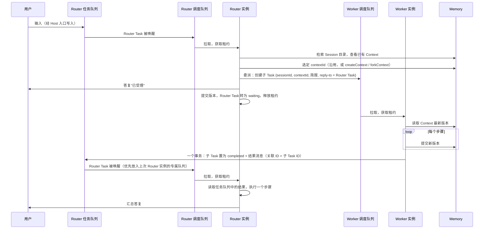
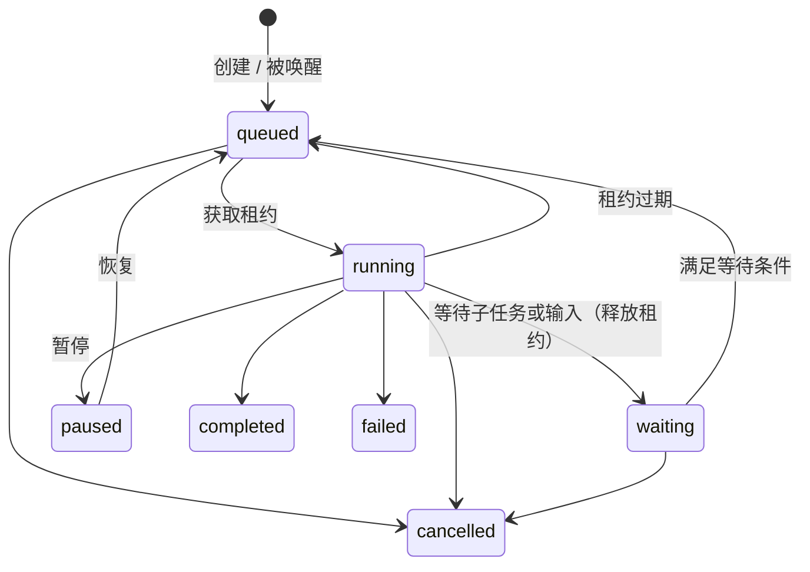

# Agent Harness 架构

版本：v0.24 · 状态：概念草案 · 日期：2026-11-19

术语见[概念模型](concepts.md)。本文只描述顶层结构，细节待概念稳定后再展开。

## 1. 职责

Harness 负责持久化执行（Durable Execution）：把用户请求变成可调度、可恢复、可替换执行者的任务，并把结果送回用户。

| 负责 | 不负责 |
| --- | --- |
| Task 生命周期、指派、并发配额 | 长期知识与用户画像（属于 Memory） |
| 消息队列：调度、投递、确认、重投递 | Context 内容的存储与检索（属于 Memory） |
| 租约与故障恢复 | LLM 调用与工具执行的具体实现（属于 Host） |
| 执行日志（只用于审计和排错） | |

## 2. 基本概念

### 2.1 Host

**Host** 指已有的 agent 程序，例如 dsh、pi。它们自己已经实现了完整的 agent 能力：调用 LLM、执行工具、管理本地会话、提供用户界面。

Genvagent 不重写这些能力，而是以插件形式嵌入 Host 运行，借用 Host 的 LLM 调用和工具执行，在其上增加任务指派、持久化和恢复。负责这层对接的代码称为 **Host Adapter**。

Harness 支持两种运行方式：

| 运行方式 | 谁执行 Agent Loop | 用途 |
| --- | --- | --- |
| 托管模式（Hosted） | Host 自己的 Agent Loop；Harness 通过 Host Adapter 挂接在步骤边界 | 主要方式，例如接入 dsh |
| 独立模式（Standalone） | Harness 自带的最小 Agent Loop，直接调用模型 SDK 和工具函数 | 测试，以及没有 Host 的场景 |

### 2.2 Agent Loop 与步骤

**Agent Loop** 是 agent 的基本执行循环：调用 LLM → 执行 LLM 请求的工具 → 把工具结果交回 LLM 再次调用 → ……，直到 LLM 给出最终答复或任务需要等待。

循环的每一圈就是一个**步骤（Step）**。Harness 不关心循环内部怎么实现，只在每个步骤的**边界**做三件事：

1. **步骤开始前**：读取 Context 最新版本，把任务队列中的新消息（用户补充、子任务结果等）纳入本步骤输入。
2. **步骤结束时**：在 Memory 提交新版本，再确认（Ack）已纳入的消息。
3. **检查控制消息**：收到取消就中断；需要等待就释放租约并退出循环。

### 2.3 实例与池

- **实例（Instance）**：一个运行中的 Router 或 Worker，通常就是一个装了 Genvagent 插件的 Host 进程。一个实例可以有多个槽位（slot），同时运行多个 Task。
- **池（Pool）**：同一角色的全部实例。Router 池和 Worker 池分开，后台任务再多也不会挤占 Router 响应用户的能力。

Worker 池的并发能力等于**所有实例的槽位总数**。扩容就是增加实例或增加每个实例的槽位：

```text
Worker 调度队列: [T1] [T2] [T3] [T4] [T5] ...
        │  各实例的消费者竞争拉取
        ├──→ Worker 实例 A（3 个槽位）: T1 运行中 │ T4 运行中 │ 空闲 → 继续拉取
        ├──→ Worker 实例 B（3 个槽位）: T2 运行中 │ T3 运行中 │ T5 运行中
        └──→ Worker 实例 C（2 个槽位）: 已满，暂不拉取
```

- 槽位满了的实例不再拉取，任务留在队列里等其他实例，这就是背压。
- 同一 Session 的多个子任务（例如交通、住宿、活动）可以分布在不同实例、不同槽位上并行执行，各自使用自己的 Context。
- 处于等待状态的任务不占槽位。

## 3. 组成

| 组件 | 职责 |
| --- | --- |
| 消费者（Consumer） | 每个实例内运行一个，负责从队列取出可运行的 Task 并获取租约，见 §4.2 |
| Agent Loop 挂接 | 托管模式下由 Host Adapter 实现，独立模式下由内置循环实现；在步骤边界执行 §2.2 的三件事 |
| 消息服务（Messaging） | 投递消息、唤醒等待中的 Task、重投递与死信 |
| 执行存储（Execution Store） | 持久化 Task、队列、租约和执行日志，提供事务 |
| Host Adapter | 把 Host 的入口、Agent Loop 和取消能力映射到上述组件 |

## 4. 消息队列的使用

### 4.1 队列一览

队列分两层：**调度队列只告诉实例"哪个 Task 可以运行"，任务队列才存放真正要处理的内容。**

| 队列 | 存放内容 | 生产者 | 消费者 |
| --- | --- | --- | --- |
| Router 调度队列 | 可运行的 Router Task ID | 消息服务（唤醒时） | Router 池，竞争拉取 |
| Worker 调度队列 | 可运行的 Worker Task ID | Router 或父任务（委派时）、消息服务（唤醒时） | Worker 池，竞争拉取 |
| 专属队列 `sticky.<实例>` | 以该实例为亲和目标的 Task ID | 消息服务 | 仅该实例；超时未取走则回退到对应调度队列 |
| 任务队列 `task.<taskId>` | 用户输入、补充、取消、子任务结果 | 用户入口、Router、父任务、子任务 | 该 Task 当前的租约持有者 |

分两层的原因：

- 一个 Task 可能积累多条消息，但只需要被调度一次，进入运行后一次性读取。
- 处于等待状态的 Task 也能接收消息，不需要占用任何实例或槽位。

### 4.2 谁在监听

每个实例运行一个消费者，只在有空闲槽位时拉取，所以槽位数就是并发上限：

```text
有空闲槽位时：
  长轮询自己的专属队列 → 没有任务再拉取本角色的调度队列
  → 取到 Task ID，在执行存储中获取租约（Task 状态 queued → running，原子操作）
       成功 → 确认这条调度通知，启动 Agent Loop
       失败 → Task 已被别人执行或已结束，确认并丢弃这条通知
```

Task 运行期间，持有租约的实例同时监听该 Task 的任务队列：

- 普通消息（补充、子任务结果）：留在队列里，到下一个步骤开始前纳入输入。
- 取消消息：立即通过 Host Adapter 中断当前步骤。

调度通知可能重复或过期，靠"获取租约"这一步去重，所以不需要队列本身做到恰好一次。

### 4.3 唤醒规则

向一个 Task 投递消息时，消息服务在**同一个事务**里完成：

1. 把消息写入目标 Task 的任务队列；
2. 根据目标 Task 的状态决定是否唤醒：

| 目标状态 | 处理 |
| --- | --- |
| waiting，且满足等待条件 | 状态改为 queued；有亲和目标就把 Task ID 放入其专属队列，否则放入对应角色的调度队列 |
| waiting，不满足等待条件 | 只写入消息，例如父任务在等三个子任务，目前只到了一个 |
| running | 只写入消息，当前持有者在下一个步骤开始前读取 |
| queued | 只写入消息，Task 被拉取后一并读取 |
| paused 或终态 | 只写入消息，不自动重启 |

写消息和唤醒必须在同一事务里，否则可能出现消息到了、Task 却一直睡着（丢失唤醒）。如果执行存储是数据库，这是一个本地事务；如果改用外部消息中间件，就需要事务性发件箱（transactional outbox）来保证这一点。

### 4.4 完整流程：委派与结果回馈

下图只跟踪**一个**子任务的路径。实际中 Router 可以一次委派多个子任务，它们由 Worker 池中不同的实例、槽位并行执行，各自把结果写回 Router 的任务队列。



要点：

- **委派不阻塞**：Router 委派后立即答复"已受理"，然后转为 waiting 并释放租约，不占槽位等待结果。
- **结果是新消息**：子任务结果作为一条新消息进入 Router 的任务队列，触发 Router 的一个新步骤，不是原委派工具调用的第二次返回。
- **Router 正在运行时**：结果只写入任务队列，不触发唤醒，由当前 Router 在下一个步骤开始前读取。
- **多级委派**：父任务是 Worker 时规则相同，reply-to 指向父 Task 的任务队列。父任务等待时同样释放槽位，不会因为子任务占满 Worker 池而死锁。

### 4.5 投递语义

- 所有队列都是至少一次投递，消费端按消息 ID 或 Task ID 去重。
- 消息只有在处理效果已持久化后才确认：模型输入在版本提交后确认，控制消息在相应状态变更后确认。
- 超过重投递次数上限的消息进入死信队列，由上层决定如何处置。

## 5. 任务生命周期



- Router 在发布任务前确定 `contextId`（沿用、新建或分叉），Worker 直接使用，不自行判断相关性，见[指派规则](concepts.md#42-指派规则)。
- 同一 Context 同一时刻只能有一个未结束的 Task，Harness 在发布时检查：已有时，新要求作为消息发给那个 Task；确需并行则分叉。
- Router 的对话 Task 在没有新消息时处于 waiting，等待条件是"任意新消息"；Router 实例不需要常驻。

## 6. 并发与故障模型

- **租约与防护令牌**：执行者凭令牌更新 Task 状态、确认消息；令牌失效后，旧执行者的写入一律被拒绝。
- **版本的乐观并发**：提交 Context 版本必须基于当前链尾，失去租约的旧执行者提交会失败。这是 Memory 侧的第二道保护。
- **步骤的原子性**：一个步骤以提交一个版本为提交点。提交前崩溃则整步重做，因此 Harness 把 `Step ID + 工具调用 ID` 作为幂等键传给工具；无法幂等的工具，在恢复时标记为"结果未知"。
- **重复消息**：新版本中记录本步骤纳入的消息 ID；如果版本提交后、确认前崩溃，重投递的消息会被识别并直接确认。
- **取消**：取消是一条消息。"已收到取消"不等于"已经停止"，以终态为准。

## 7. Host 接入

完整接入需要 Host 在每次 LLM 调用前后提供可等待的挂钩，使 Harness 能够：

1. 在调用前确认实际请求与 Context 最新版本一致；
2. 在步骤结束时提交版本并确认消息，然后才放行后续动作；
3. 在收到取消时中断当前步骤。

另外，Host 的用户入口要先把输入写入 Router 的任务队列，不能绕过队列直接驱动 Agent Loop。

满足这些条件的 Host 支持可恢复执行；不满足的只开放记忆检索和轨迹导入。dsh 的 `llm/stream` 钩子是首选挂接点，需要先做原型验证（spike）确认可行。

**Host 自身的上下文管理**：有些 Host 自带会话分支和压缩能力，Host Adapter 需要把这些操作映射到 Memory 的版本模型，不能让 Host 的本地会话与 Memory 各自演进。以 pi 为例：

| pi 的操作 | 映射到本系统 |
| --- | --- |
| 正常对话一轮 | 提交一个新版本 |
| 自动或手动压缩（`/compact`） | 两种方式二选一：关闭 pi 自身的压缩，改为调用 Memory 的 `compactContext`；或保留 pi 的压缩，把结果以 `compact` 类型提交 |
| `/tree` 跳到历史节点继续，丢弃当前路线 | 提交一个回退版本，附带放弃摘要（对应 pi 的分支摘要） |
| `/tree` 跳到历史节点继续，保留当前路线 | 从对应历史版本分叉出新 Context |
| `/fork`、`/clone` 新建会话 | 分叉出新 Context |

pi 的本地会话文件只作为 Host 的运行投影，权威状态以 Memory 中的版本为准。

## 8. 待细化

- 执行存储选型：数据库实现队列，还是外部消息中间件加事务性发件箱
- 等待条件的表达方式：全部子任务、任一子任务、指定消息
- 调度策略：优先级、公平性、亲和超时；何时需要引入独立调度器
- 取消向子任务传播的规则
- 任务简报的内容规范
- dsh 原型验证的结论与完整适配方案
- pi 的 `/tree` 操作在"丢弃"与"保留"当前路线之间如何判定
