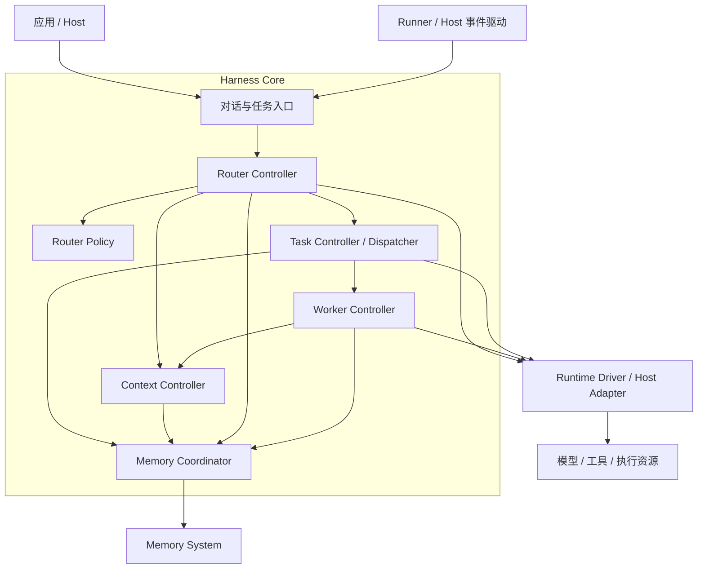

# Agent Harness 架构设计

版本：v0.14 · 状态：架构草案 · 日期：2026-11-18

## 1. 系统定位与边界

Agent Harness 将用户输入推进为对话答复和任务结果，负责路由、执行循环、任务调度及运行时接入。系统以可嵌入的 Core 为主体，既可独立运行，也可通过插件集成到 dsh、pi 等宿主。

| 边界 | 职责 |
| --- | --- |
| Harness Core | 定义执行对象、状态转换、Router/Worker 循环、Context 使用策略和任务协作规则 |
| Runner / Host Adapter | 驱动 Core，接入进程生命周期、宿主事件和实际调用边界 |
| Runtime Driver | 提供模型、工具、Worker 执行资源及动作状态核对能力 |
| Memory System | 持久保存用户资料、Session、Context 版本、执行状态与知识；提供版本领取、提交和恢复依据 |

用户通过 Router 交互。Router 在授权范围内访问统一用户记忆，按需选择跨项目资料；Worker 访问分配任务所需的内容。Harness 本地保存运行副本、连接及临时资源，跨进程恢复状态以 Memory 为准。

长期知识维护、Session 摘要和 Trace 导入属于 Memory。文件句柄、工具资源及外部环境的完整恢复不在首版范围内。

## 2. 执行模型

### 2.1 执行角色

| 角色 | 责任 | 执行边界 |
| --- | --- | --- |
| Router | 理解用户意图，回应、澄清、分派、补充任务及汇总结果 | 短对话循环，不同步等待长任务完成 |
| Worker | 推进具体任务，调用模型与工具，产生结果或待处理问题 | 独立任务循环，可继续分派 subagent |

角色与进程解耦。Worker 是可替换的执行资源，Task 是持久工作身份，Context 版本是执行内容依据。替换 Worker 不改变任务归属，也不创建新的业务 Session。

### 2.2 执行单位

| 对象 | 定义 |
| --- | --- |
| Turn | Router 处理一次用户输入或重要任务通知的对话轮次，可包含多次 LLM 交互 |
| Task | 具有目标、约束和完成条件的可调度工作，关联工作 Session、起点及续接版本 |
| Run | 执行者推进一个 Task 或 Router Turn 的一次执行尝试，绑定驱动方式和执行位置 |
| Interaction | 一次 LLM 调用的基础版本、追加输入和输出；完成后发布一个 Context 后继版本 |
| Action | Core 发出的逻辑动作，包括模型调用、工具调用、任务分派、等待或结束 |

一个 Turn 可以分派多个 Task；Task 的生命周期可跨越多个 Turn 和 Run。暂停、重试或更换执行者可建立新 Run。Action 与 Interaction 通过稳定身份关联，动作完成不自动等同于任务完成。

任务输入承载补充、纠正和取消；任务通知承载等待、完成和失败等变化。二者均持久保存，读取不等于处理完成。普通进度用于查询，不逐条触发 Router 模型调用。

### 2.3 与 Memory 对象的关系

| 对象 | Harness 的使用规则 |
| --- | --- |
| Session | 一项工作的资料边界；一个 Session 可容纳多个 Task、Worker 和 Context |
| Context | 用于 LLM 交互的有序内容；读取时指定不可变版本，调用前显式追加本轮输入 |
| Context 版本 | 每个任务保存自己的续接引用；同一 Context 可有多个并行分支，不使用全局唯一 head |
| Version Claim | Memory 分配的具体版本执行权；同一版本最多一个有效持有者，不同版本可并行 |
| Event | 执行 Session 内的单一元数据流；正文保存在 Context 或其内容引用中 |

Router 的连续对话可使用独立 Session 和稳定续接位置；分派任务按工作归属选择目标 Session。同一工作的 subagent 默认共享 Session，使用不同 Context 或不同派生版本。fork 不要求新建 Session。

同一 Router 对话分支的 Turn 按顺序推进；该顺序约束不扩展为 Session 级写入锁。多个 Worker 可以同时推进同一 Session，乃至同一 Context 的不同版本。

## 3. Core 架构



| Core 组件 | 核心职责 |
| --- | --- |
| Router Controller | 消费输入和通知，推进短 Turn，持久保存回复及处理位置 |
| Router Policy | 基于用户意图、相关记忆和任务状态，提出回应、澄清、新建、继续或分叉决策 |
| Task Controller / Dispatcher | 持久登记任务，安排执行资源，管理父子关系、排队、并发、取消和恢复 |
| Worker Controller | 推进任务循环，处理模型与工具结果，决定继续、等待、完成或失败 |
| Context Controller | 选择确定版本及新增材料，组织追加输入，执行显式 fork、恢复和 compact |
| Memory Coordinator | 封装 Memory 调用、版本领取、幂等提交、任务输入和通知确认 |

Router Policy 可由模型实现，Controller 负责验证并落实决策。模型建议不直接授予执行权，也不构成持久状态变更。

### 3.1 执行循环归属

Router loop 和 Worker loop 的状态转换规则均属于 Core：

```text
读取执行状态 → 准备输入 → 发出 Action → 接收结果 → 提交状态 → 继续 / 等待 / 结束
```

Runner 或 Host 提供外层事件驱动；Runtime Driver 执行 Core 决定的模型、工具和资源动作。事件循环的运行位置不改变业务执行规则的归属。

同一 Run 采用唯一调用驱动方式。独立模式由 Runner/Driver 发起调用；插件模式由 Host 发起调用，Adapter 在请求边界调用 Core。两条路径不得重复执行同一 Action。

## 4. 执行语义

### 4.1 LLM 交互提交

Router 与 Worker 共用以下协议：

1. 根据任务或对话续接引用，确认指定版本的有效领取；未持有时向 Memory 原子领取，关联任务时校验其当前状态。
2. 将用户输入、任务通知、工具结果和选取材料保存为本轮追加输入，调用 startInteraction 建立持久交互。
3. Driver 使用固定基础版本、追加输入和已确定配置调用模型。
4. Core 接收输出，通过 commitContextVersion 发布后继版本；Memory 校验领取凭证及交互身份，并一致更新完成事件、输入消费和续接位置。
5. 继续执行时将领取转移至后继版本；等待或结束时释放领取。

最后一次模型输出必须随版本提交，不能依赖下一轮调用补存。重试同一次已提交 Interaction 返回已有结果；失效凭证不能提交后继版本。正文不进入 Event，也不维护独立 Worker History。

模型生成的工具调用先作为输出持久化，再交给 Driver 执行；工具结果以关联调用身份保存为 Context 待处理内容，供后续交互使用。结果未知时先核对状态，不将未知结果标记为成功。

### 4.2 Router 循环与异步分派

输入先进入持久队列，并关联稳定的 Router 对话任务及续接位置。Router 为用户输入或重要通知建立 Turn，按需检索用户资料和 Session 摘要，随后执行回应、澄清或任务控制。

任务分派先创建或核对目标 Session、Context 起点和 Task，再按稳定任务身份幂等登记。分派操作返回 `TaskAccepted(taskId)` 后 Router 即可保存回复并结束 Turn；Dispatcher 独立安排 Worker 执行。

Worker 完成后，通过持久通知触发新的 Router Turn。完成结果不作为原分派工具调用的第二次返回。通知身份用于定位唯一 Turn，回复持久化后才确认消费；重复通知复用已有 Turn 和回复记录。

当前模型调用期间到达的输入保持排队，在后续安全边界处理。Router 不修改正在执行的请求，也不因等待 Worker 完成而阻塞下一轮对话。

### 4.3 Worker 循环与子任务

Dispatcher 从可执行 Task 创建 Run，分配执行资源并领取任务约定版本。领取失败时重新核对任务状态，释放无用资源，不通过另建 Session 绕过冲突。

Worker 在交互边界读取未处理输入，按交互提交协议推进。需要并行工作时，创建子 Task 并分配不同版本；从同一内容起点出发的子任务先 fork，再分别领取。父任务可以继续执行，也可以保存续接位置、释放领取并等待结果。

子结果以版本和消息引用交付。父任务从自己的续接版本读取所需结果，核对最新约束后形成新增输入。任务完成持久保存结果、释放领取并发送通知，不自动结束整个 Session。

### 4.4 补充、取消与恢复

安全边界指前序结果已持久确认、下一动作尚未发起的位置。取消请求可先交 Driver，中断结果另行核对。

| 场景 | 处理规则 |
| --- | --- |
| 用户补充或纠正 | Router 写入目标任务输入；父任务传播到适用子任务；各分支在安全边界消费，不改写已发布版本 |
| 取消 Turn | 停止当前对话动作，不自动取消已分派 Task |
| 取消 Task | 明确目标及子任务传播范围，保存请求并调用 Driver 取消；接收取消不代表外部动作已经停止 |
| 暂停或更换 Worker | 保存续接引用及待处理状态，释放或回收旧领取；新 Run 重新领取明确版本 |
| 未完成动作 | 根据持久 Interaction、Task 和 Driver 状态核对结果，再决定重试、继续等待或终止 |
| Memory 不可用 | 停止发起需要新领取或预先持久化的新动作；已有结果待恢复后核对提交，不确认尚未保存的完成状态 |

版本领取保证唯一有效提交，不保证旧进程已停止，也不保证外部副作用只发生一次。恢复不依赖 Session 级锁、Context 最后存储版本或事件正文重放。

### 4.5 Context 策略

首版采用追加与显式 compact。召回材料和工具结果作为明确输入保存；消息顺序、配置和来源保持可追溯，不增加可自由改写的 Context → ModelInput 层。

compact 保留目标、约束、重要精确值、未完成工具交换及可取回来源，经校验后发布派生版本。回滚仅改变指定任务的续接位置，并明确追加仍然有效的要求。其他分支不受影响。

Memory Agent 可以提供压缩候选、记忆修订和 notes；Harness 在后续安全边界选择采用。后台维护和 Host 原生压缩均不得静默替换正在使用的版本。

## 5. 接口边界

以下为逻辑接口，不冻结 SDK 签名。Harness 可作为库暴露这些能力，无需独立 HTTP 部署。

### 5.1 Core 与运行环境

| 接口 | 提供方 → 调用方 | 操作与契约 |
| --- | --- | --- |
| 对话入口 | Core → 应用 / Host Adapter | openConversation、submitUserMessage、cancelTurn、readReplies；返回稳定对话、Turn 和回复身份 |
| 任务入口 | Core → 应用 / Router Controller | dispatchTask、getTask、postTaskInput、cancelTask；先持久登记再返回受理结果 |
| 通知入口 | Core → Memory Coordinator / Host Adapter | acceptTaskNotification；按通知身份恢复或创建唯一 Turn |
| 执行推进 | Core → Runner / Host Adapter | advance、acceptCompletion；发出下一 Action 或等待状态，按 Action 身份处理结果 |
| 运行能力 | Runtime Driver → Core | allocateWorker、invokeModel、executeTool、cancel、reconcile、releaseWorker；报告真实执行状态 |
| 宿主接入 | Host Adapter → Runner / Core 装配层 | 声明能力，注册或解除宿主事件、请求边界和原生位置映射 |

Core 接收模型完成结果后，须经 Memory 提交才确认对应持久进度。Runtime Driver 负责调用与状态核对，不能隐式增加、重排或压缩已确定的输入。

### 5.2 Memory 依赖

| 依赖能力 | Memory 接口 | Harness 用途 |
| --- | --- | --- |
| 工作与上下文 | createSession、getSession、discoverSessions、createContext、readContextVersion | 定位工作及明确执行起点 |
| 版本操作 | forkContextVersion、restoreContextVersion、compactContextVersion | 并行分支、指定任务恢复和显式压缩 |
| 执行提交 | claimContextVersion、renewVersionClaim、releaseVersionClaim、startInteraction、commitContextVersion | 版本级唯一执行权、交互持久化与幂等提交 |
| 任务协作 | recordTask、getTask、listTasks、postTaskInput、readTaskInputs、readTaskNotifications | 调度、输入队列和结果通知 |
| 进度与证据 | getSessionSummary、readEvents、appendEvents、readContent | 查询进度和原文，记录允许由执行者报告的事实 |
| 用户记忆与维护 | getUserOverview、getProfile、recall、proposeMemory、submitFeedback、requestMemoryMaintenance、requestSessionReview | 资料选择、知识候选、纠正和生命周期检查请求 |

Memory 的摘要与生命周期维护不代替 Harness 调度。所有 Harness 离线时，排队任务和输入继续保留，业务执行等待可用执行者。完整契约见 [Memory System 对外接口](integration-protocol.md#5-对外接口)。

## 6. 插件架构

### 6.1 扩展点

| 扩展点 | 可替换实现 | 约束 |
| --- | --- | --- |
| Router Policy | 路由模型、工作选择和任务拆分策略 | 输出声明式路由决定，由 Core 检查并执行 |
| Context Policy | 资料选择、预算和 compact 策略 | 基于确定版本输出新增内容或派生候选，保留约束与来源 |
| Runtime Driver | 模型、工具和 Worker 执行环境 | 以稳定 Action 身份调用并回报状态，遵守取消和结果核对语义 |
| Host Adapter | dsh、pi 等宿主的事件及请求边界映射 | 保证单一调用路径、输入边界和结果捕获范围 |
| Memory Client | 本地或远程连接、认证和传输 | 遵守相同领域接口及一致性契约 |

插件通过注册与能力声明装配，不依赖 Core 的私有实现。Run 绑定实际使用的驱动与策略配置；切换实现须在明确边界记录，不改变在途请求。

Host 原生会话、分支或消息位置映射到稳定 Task 和 Context 版本引用，不仅映射到 Session。原生导航或 fork 需转换为显式版本操作，不因并行或分叉自动建立新 Session。

### 6.2 接入能力

| 接入范围 | 必要能力 | 保证范围 |
| --- | --- | --- |
| 记忆检索 | 能请求召回并向宿主提供材料 | 使用统一用户记忆，不接管执行状态 |
| Trace 导入 | 能导出稳定来源身份和内容快照 | 由 Memory importTrace 建立导入 Session/Context；不创建执行 Event 或领取 |
| 完整执行接入 | 能在请求前暂停或放行、使用指定输入、捕获结果、处理取消并恢复明确版本 | 运行 Core 的 Router/Worker 循环和版本提交协议 |

完整接入要求 Adapter 对实际发送的上下文负责。Host 后续钩子或自动压缩若会改变输入，必须纳入显式版本与输入记录；无法控制时仅启用已满足的接入范围。compact 由唯一责任方发起，防止 Host 与 Core 重复处理。

dsh、pi 的具体钩子按目标版本验证；本文不假定二者已满足完整接入条件。仅导出 Trace 时遵循 Memory 的一 Trace 一 Session 规则，不套用在线多 Worker 的执行映射。

## 7. 执行数据与运行方式

### 7.1 关键数据结构

| 结构 | 关键数据 | 持久归属 |
| --- | --- | --- |
| TurnRef | Turn、输入或通知身份、Router 对话任务、来源与结果版本、回复引用 | Memory 中的任务输入、交互及消费元数据 |
| TaskSpec | 任务身份、父任务、目标、约束、完成条件、Session、起点版本 | Memory Task |
| RunState | 执行尝试身份、任务或 Turn、执行者、驱动配置、续接版本、在途 Action | Memory 执行元数据；本地持有运行副本 |
| ContextRef / Claim | contextId、versionId、有效执行凭证及期限 | Memory 版本与领取记录 |
| Action | 动作身份、类型、关联 Run/Interaction、输入输出引用和执行状态 | 持久 Task/Interaction 及动作元数据；Driver 提供实际调用状态 |
| RouteDecision | 回应或任务操作、目标 Session/Task、版本来源、约束 | Core 验证后落实为对话或任务记录 |
| HostBinding | 宿主实例、原生会话/分支位置、Task/Context 版本映射、适配器配置 | 可恢复的适配元数据，不授予执行权 |

这些结构描述执行语义，不新增独立对话存储。消息和结果正文统一引用 Memory 内容；本地模型客户端、连接和工具句柄不作为持久工作身份。

### 7.2 运行方式

| 模式 | 驱动关系 |
| --- | --- |
| 独立运行 | Runner 驱动 Core，Runtime Driver 执行模型、工具及 Worker 分配 |
| 宿主插件 | Host 驱动调用，Adapter 在必要边界推进 Core，执行规则仍由 Core 定义 |
| 多执行实例 | 多个 Dispatcher/Worker 共享 Memory，以任务状态和具体版本领取协调并发 |

输入、通知和调用结果使用稳定身份重试。回复读取返回稳定回复标识，应用层按标识去重；内部幂等提交不等同于网络交付或外部操作的 exactly-once。

## 8. 数据流与验证范围

用户请求由 Router 的 Turn T0 分派 Task P。持久登记成功后返回 TaskAccepted，Router 保存回复并结束 T0。P 在工作 Session S 内建立两个子任务：

```text
Context C
  v3 ──fork──→ v4 ──子任务 A 交互──→ v7
   ├──fork──→ v5 ──子任务 B 交互──→ v8
   └──父任务 P 交互──→ v6 ──追加子结果并汇总──→ v9
```

P、A、B 分别领取 v3、v4、v5，执行事件统一写入 S。子任务完成后通知 P；P 从自身续接版本 v6 汇总，提交 v9 并完成任务。顶层通知触发 Router 的新 Turn T1，读取结果并保存用户答复。A 更换 Worker 时从任务记录的确切版本恢复，不影响 B 或 P。

| 验证场景 | 判定条件 |
| --- | --- |
| Worker 并行执行 | 同一 Session、同一 Context 的不同版本可并行，Router 仍能处理后续输入 |
| 进程替换与重复提交 | 新执行者恢复任务续接位置；旧领取被拒绝；重复提交不创建新版本 |
| 补充、取消及重复通知 | 输入在安全边界生效；取消范围明确；重复通知复用同一 Turn 和回复 |
| 插件执行边界 | 同一 Action 只有一条调用路径，实际输入与持久版本一致，原生压缩显式纳入版本 |
| 不确定结果与服务恢复 | 未确认结果不标记成功，恢复后先核对状态再继续 |

首版包含短 Router 循环、独立 Worker 循环、版本级并发、任务输入与通知、追加和显式 compact，以及独立运行和 Host 适配接口。CLM 路由策略与资源虚拟化作为后续扩展，不改变现有版本和持久化契约。

---

文档基准：Harness 执行语义以本文为准，持久对象与提交契约以 [Memory System 架构](integration-protocol.md)为准。[接口实现参考](integration-reference.md)中的旧 Session 级领取、History 和 SDK 载荷待按当前架构对齐。
