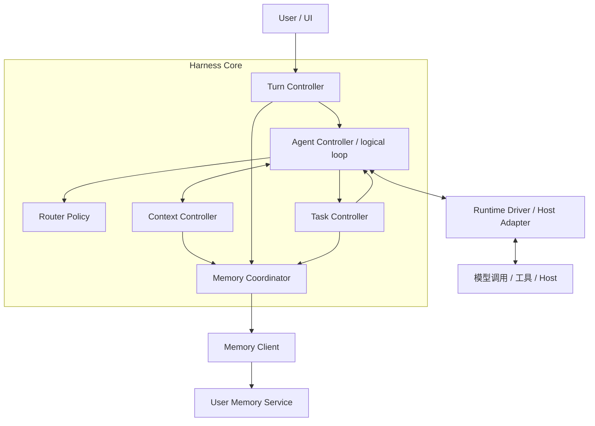

# Agent Harness：Core、执行循环与插件接入

状态：设计草案 v0.5；2026-11-17。按执行概念、接口函数、关键结构说明设计。共享协议见[交互逻辑与接口](integration-protocol.md)。

## 1. Harness Core 的组成

Harness Core 是 Router 和 Worker 的执行控制核心，拥有逻辑 agent loop。它管理从输入到完成的状态转换，决定何时检索、何时调用模型、何时执行工具、何时派发任务及何时结束本轮。

| Core 内部模块 | 职责与输入输出 |
| --- | --- |
| Conversation / Turn Controller | 接收用户输入，创建 turn，管理排队、纠正、取消与最终答复 |
| Agent Controller | 对 Router/Worker 运行同一 step 状态机；根据上下文和上一步结果产生下一动作 |
| Router Policy | 使用用户统一 Memory，决定直接回答、检索、委派或继续任务；可以由模型实现 |
| Task Controller | 保存任务分派，创建 Worker session，追踪结果与回传，按任务标识去重 |
| Context Controller | 追加消息、选择 notes、管理工具交换、压缩与 CLM 编辑、建立版本 checkpoint |
| Memory Coordinator | 事件规范化、持久发送日志、Memory 调用、版本提交、恢复与变更处理 |

Runtime Driver 与 Memory Client 是 Core 的端口实现。Host Adapter 是针对 dsh、pi 的 Runtime Driver：将 Host 扩展点映射为 Core 的动作与完成事件。UI、模型 SDK、工具进程、文件系统和凭据存储属于运行环境。



Router 与 Worker 是角色，Agent Controller 是执行机制。Memory Agent 属于另一个系统，不作为 Harness 的 Worker 调度。

## 2. loop 的归属与执行模式

### 2.1 Core 管理的逻辑循环

一个 turn 可以包含多个 agent step，Worker 也可以在同一 turn 内完成多个模型与工具交换。Core 的循环为：

```text
接收并持久化输入
  → 追加工作上下文
  → 检索与组装候选
  → 保存、应用、确认 context
  → 请求一次模型调用
  → 持久化模型输出并追加 context
  → 解释决策
      ├─ 工具调用 → 执行并持久化结果 → 追加 context → 下一 step
      ├─ Worker 任务 → 等待或处理其他已分派任务 → 追加结果 → 下一 step
      ├─ 需要更多记忆 → 检索并更新 context → 下一 step
      └─ 答复 / 澄清 / 失败 / 取消 → checkpoint → 保存终态 → 结束 turn
```

advance 每次只决定下一动作。若存在未确认动作，它返回同一待处理动作或等待状态；不会因为再次调用 advance 就再次发起模型或工具请求。动作 ID、执行状态和结果关联均写入 Memory 事件流。

Context Controller 只接收已提交且已被当前执行选用的事件进行消息投影。排队输入在 startTurn 时才按原事件引用追加；迟到任务结果也必须由 Router 明确接纳。当前用户目标、约束和工具协议保持受保护；被移出视图的历史仍有原始证据。状态事件推进消费序号，但不直接成为模型消息。

### 2.2 逻辑 loop 与运行时驱动

Core 管理执行语义，Runtime Driver 执行具体动作。插件化要求允许已有 Host 驱动回调，但不意味着把 Router、任务和上下文控制留在 Core 外。

| 模式 | 谁推进 Core | 谁实际发起模型/工具调用 | 适用方式 |
| --- | --- | --- | --- |
| Core-owned | Core Runner 持续调用 advance，等待完成事件后继续 | 独立 Runtime Driver 按 Core 动作调用 SDK/工具 | 独立运行、模拟测试、完整参考实现 |
| Host-driven | Host Adapter 在安全边界调用 advance，将 Host 完成事件交回 Core | Host 原生 loop 只执行 Core 允许的下一动作 | dsh/pi 插件接入 |

在 Host-driven 模式下，Core.advance 仍决定调用前的上下文与逻辑状态；Driver.execute(invoke_model) 表示放行匹配 actionId 的 Host 请求，不再启动另一个模型调用。每个 session 在配置时只选择一种驱动模式。

Host 的调用栈可能包含自己的循环，但不能与 Core Runner 同时推进同一 session。如果 Host 无法阻止后续请求、无法应用上下文或无法持久化关联标记，则该 Adapter 只能提供同步/检索能力，不能声称实现完整受控 loop。

### 2.3 turn、step 与任务状态

| 状态 | 进入条件 | 后续动作 |
| --- | --- | --- |
| turn queued | 新输入已持久化，上一 turn 尚未结束 | 等待或按显式纠正/取消处理 |
| turn running | 当前 turn 已开始 | 推进 Router step |
| step preparing | 已取得新输入或工具/任务结果 | 检索并提交 context |
| step model_pending | 模型动作已登记并放行 | 等待完成或核对未知结果 |
| step action_pending | 模型已返回工具/委派决策 | 执行工具、派发 Worker 或等待 |
| turn completed / awaiting_user | 答复或澄清已持久化并 checkpoint | 向用户呈现完成状态 |
| turn failed / canceled | 失败或取消已记录并 checkpoint | 不再安排新动作，保留诊断及迟到结果 |

工具调用或 Worker 任务可能在取消后才完成。Core 保存结果用于核对，并按原 turn/task 关联隔离；除非 Router 显式选择继续使用，否则不进入新 turn 的输入。

## 3. 接口函数

### 3.1 应用与 Runtime 回调到 Core

```typescript
interface HarnessCorePort {
  openConversation(registration: SessionRegistration): Promise<BindingState>;
  submitUserMessage(routerBindingId: ID, inputId: ID, content: Content): Promise<TurnHandle>;
  cancelTurn(turnId: ID): Promise<void>;
  advance(bindingId: ID): Promise<AgentAction>;
  acceptCompletion(actionId: ID, completion: ActionCompletion): Promise<void>;
}
```

openConversation 只创建或恢复 Router 关联；Worker 由 Task Controller 注册。submitUserMessage 的 inputId 来自 UI/Host 的稳定消息标识，返回已持久化的 turn handle，不等待整轮模型与任务完成。

acceptCompletion 将已完成输出归一化为事件，先通过 Memory 确认，再调用 Context Controller 更新工作副本。Host 的最终消息与 tool-result 生命周期通知按原生身份归并，不能将同一工具结果保存两次。早期可变 hook 的参数和流式 token 不作为最终消息。

### 3.2 Core 调用运行时

```typescript
interface RuntimeDriver {
  capabilities: AdapterCapabilities;
  applyContext(plan: ContextPlan): Promise<HostApplicationReceipt>;
  ensureWorker(task: TaskSpec): Promise<SessionRegistration>;
  execute(action: AgentAction & { kind: "invoke_model" | "execute_tool" }): Promise<void>;
  cancel(actionId: ID): Promise<void>;
  reconcile(actionId: ID): Promise<RuntimeActionState>;
}

interface HostAdapter {
  attach(core: HarnessCorePort): Promise<RuntimeDriver>;
  detach(): Promise<void>;
}
```

execute 确认运行时接收动作，不等于动作已经成功；完成结果通过 acceptCompletion 返回。Driver 按 actionId 持久记录接收与执行状态，重复提交返回已有状态，不重复启动动作。reconcile 用于核对崩溃前的动作；无法确定外部执行结果时返回 unknown，Core 不自动重放该动作。这不构成对任意外部工具的 exactly-once 承诺。

dispatch_task 交给 Task Controller：先保存任务，再 ensureWorker，取得稳定 SessionKey 后向 Memory 注册 Worker binding、写入 assignment，并推进 Worker 的 advance。ensureWorker 按 taskId 幂等，只建立执行容器；不能绕过 Core 自行开始模型调用。wait、finish_task 和 finish_turn 由 Core 处理，不传给 Driver.execute。

applyContext 在安全边界修改工作视图并持久化 marker。Core 随后调用 Memory.activateContext，确认后才能 execute 模型动作。Host-driven 模式须安排正确的 hook 顺序，不能在早期 hook 中等待必须等该 hook 返回后才触发的完成回调。

### 3.3 Core 内部协作接口

| 模块 | 函数 | 责任 |
| --- | --- | --- |
| Turn Controller | enqueueInput / startTurn / finishTurn | 稳定输入去重、轮次排队、终态与交付 |
| Agent Controller | advance / recordAction / acceptCompletion | 选择下一动作、保存执行意图、处理完成结果 |
| Router Policy | decideRoute(context, memory) | 生成答复、检索或 TaskSpec；不直接操作进程 |
| Task Controller | dispatchTask / acceptTaskResult / resumeTask | 先保存分派，再创建或查找 Worker；结果关联到原调用 |
| Context Controller | appendMessages / buildContext / editContext | 事件投影、组装候选、校验 CLM 编辑 |
| Context Controller | checkpoint | putContext → applyContext → activateContext |
| Memory Coordinator | commitEvents / recoverSession / pollChanges | 持久投递、断点恢复、notes 更新与失效 |

Router Policy 和 Context Policy 可替换，Agent Controller 的持久化和状态转换约束不可由策略绕过。CLM 的 context.inspect、context.edit 是受控工具，编辑发生在可编辑块，仍需 checkpoint 才影响下一次模型输入。

### 3.4 Core 调用 Memory

Core 使用[公共 Memory 函数](integration-protocol.md#42-core--memory-的主接口)。关键关系如下：

- commitEvents 调用 appendEvents，取得 acceptedThrough 与 userRevision。
- appendMessages 消费已提交事件；不通过 recall 获取本 session 的新增输入。
- Router 首次准备读取 getUserOverview；后续按 changes 更新目录，并使用 recall 跨项目查询。
- checkpoint 调用 putContext 与 activateContext；应用动作通过 Runtime Driver 完成。
- dispatchTask 创建 Worker binding，先保存 assignment，再推进 Worker 的 advance。
- Worker 通过 proposeNote 提交项目 notes 候选；Memory Agent 在服务端校对发布。

## 4. 关键数据结构

共享的 UserDomain、Message、SessionBinding、RecordInput、WorkingContext、ContextVersion 和引用类型由协议定义。以下只定义 Harness 的执行状态。

### 4.1 turn、step 与动作

```typescript
interface TurnHandle {
  turnId: ID;
  conversationId: ID;
  routerBindingId: ID;
  inputEvent: EvidenceRef;
  status: "queued" | "running" | "completed" | "awaiting_user" | "failed" | "canceled";
}

interface StepState {
  stepId: ID;
  bindingId: ID;
  turnId: ID;
  status: "preparing" | "model_pending" | "action_pending" | "completed" | "failed";
  inputContext?: ContextRef;
  pendingActionIds: ID[];
  resultRefs: EvidenceRef[];
}

type AgentAction = {
  actionId: ID;
  bindingId: ID;
  turnId: ID;
  stepId?: ID;
} & (
  | { kind: "invoke_model"; context: ContextRef }
  | { kind: "execute_tool"; call: ToolCall }
  | { kind: "dispatch_task"; task: TaskSpec }
  | { kind: "wait"; pendingActionIds: ID[] }
  | { kind: "finish_task"; result: TaskResult }
  | { kind: "finish_turn"; status: "completed" | "awaiting_user" | "failed" | "canceled";
      output?: EvidenceRef }
);

type ActionCompletion =
  | { kind: "model"; message: Message }
  | { kind: "tool"; message: Message }
  | { kind: "task"; result: TaskResult }
  | { kind: "error"; message: string; outcome: "failed" | "unknown" };

interface RuntimeActionState {
  actionId: ID;
  status: "not_started" | "running" | "completed" | "failed" | "unknown";
  completion?: ActionCompletion;
}
```

TurnHandle、StepState 和动作状态可从绑定的事件流重建；内存索引只是加速。已完成的输入、调用意图与结果必须持久化。finish_turn 先确认最终消息所在的 context checkpoint，再追加含该 ContextRef 的终态事件；响应丢失按稳定事件 ID 核对。上下文激活本身不证明 invoke_model 已执行；模型或工具结果未知时使用 reconcile。

### 4.2 Worker 分派与回传

```typescript
interface TaskSpec {
  taskId: ID;
  userId: ID;
  conversationId: ID;
  parentTurnId: ID;
  routerBindingId: ID;
  dispatchActionId: ID;
  delegateToolCallId: ID;
  projectId?: ID;
  goal: string;
  constraints: string[];
  inputRefs: EvidenceRef[];
  readGrant: ReadGrant;
  maxSteps: number;
}

interface TaskResult {
  taskId: ID;
  resultId: ID;
  workerBindingId: ID;
  status: "completed" | "needs_input" | "failed" | "canceled";
  output: Content;
  sourceRefs: EvidenceRef[];
  noteProposalIds: ID[];
}

interface TaskState {
  spec: TaskSpec;
  status: "created" | "running" | "waiting_input" | "completed" | "failed" | "canceled";
  workerBindingId?: ID;
  result?: TaskResult;
  deliveredToRouterEventId?: ID;
}
```

一个任务的 Worker binding 以 taskId 建立稳定映射，重复 dispatch 查找原 Worker。新任务从 TaskSpec 与选定材料构建 context，不复制 Router 的完整历史。TaskSpec.userId 必须匹配创建该任务的用户域；默认 Worker 的 readGrant 为 task 类型。

TaskResult 对 Router 表现为 delegate 的 tool result。Worker 的 finish_task 先确认输出与最终 checkpoint，Task Controller 再经原 dispatchActionId 的 acceptCompletion 将结果写入 Router 流；两个流不使用跨系统事务，通过稳定结果投递 ID 保证可重试。needs_input 交由 Router 向用户提问。

### 4.3 context 与同步检查点

```typescript
interface ContextPlan {
  planId: ID;
  bindingId: ID;
  baseNativeRevision: string;
  version: ContextVersion;
  desired: WorkingContext;
}

interface ContextPatch {
  baseVersion: ContextRef;
  replacementEditableBlocks: WorkingBlock[];
  explanation: string;
}

interface SyncState {
  binding: SessionBinding;
  writer?: WriterLease;
  acceptedThrough: number;
  projectedThrough: number;       // 当前工作副本已消费的位置，可高于已保存快照
  nextSequence: number;
  activeContext?: ContextRef;
  headRevision: number;
  pendingPlanId?: ID;
  pendingActionIds: ID[];
  lastApplicationMarkerId?: ID;
  changesCursor?: string;
}

interface AdapterCapabilities {
  driveMode: "core_owned" | "host_driven";
  durableEventExport: boolean;
  durableMarkers: boolean;
  safeRequestGate: boolean;
  contextRewrite: "none" | "regions" | "full_working_view";
  requestCapture: "working_view" | "model_messages" | "provider_payload";
  branchLifecycle: boolean;
  nativeResume: boolean;
  workerDispatch: boolean;
  actionReconciliation: boolean;
}
```

projectedThrough 只是当前工作副本的消费位置，进程恢复以 Memory context 的 coveredEventSequence 为基准。不能因为本地检查点记载“已消费”就跳过尚未持久化的上下文增量。

## 5. 持久化、恢复与能力边界

本地 stateDir 保存 hostInstanceId、用户与 SessionKey 到 binding 的映射、事件 ID/序号、未确认批次、待激活计划及 marker。用户切换项目不会改变映射；切换账号必须选择对应用户的绑定。

恢复时先核对 Memory head、writer 和本地 marker，再补传事件，重放未覆盖增量，并重建 turn/task/action 状态。未知工具结果由 Driver 查询执行环境；未知任务投递由 Task Controller 按 taskId 核对。完整顺序见[协议恢复步骤](integration-protocol.md#72-恢复步骤)。

| 适配等级 | 可提供能力 |
| --- | --- |
| Sync / Recall | 导出记录、检索注入；Host 自行执行，不能宣称受控 Router/Worker loop |
| Controlled loop | 请求 gate、上下文改写、动作关联；Core 决定每一步，Host 执行 |
| Recoverable orchestration | 在上述基础上支持持久 marker、任务分派与动作核对，满足完整恢复契约 |

第一版的完整 Router/Worker 行为以 Core-owned 参考 Driver 为基线验证，再验证 Host-driven 映射。参考 Driver 仅实现模型、工具和动作回调，不额外建设通用任务平台或第二套应用界面。

## 6. dsh 与 pi 接入

以下扩展点沿用 2026-11-16 的资料核对结果，仅为候选映射。完整 Host-driven 支持需固定版本，并验证 Core 的请求控制、结果关联和 Worker 分派能否通过这些扩展点实现。

### 6.1 dsh 适配

核对日期：2026-11-16，依据官方仓库 master 文档。这里给出候选映射；实现时需固定 Host 版本，并通过契约验证后才声明支持能力。

| Genvagent 需求 | dsh 接入点与约束 |
| --- | --- |
| 插件加载/卸载 | Cordis 插件的 apply(ctx)、依赖注入及受生命周期管理的注册 |
| 会话开启/恢复 | agent/created；读取原生 session 与恢复位置 |
| 同步最终记录 | session/event；工具最终结果使用 tools/result，避免把流式 delta 重复记为最终消息 |
| 请求前检索注入 | agent/pre-step；它处理进入该步骤的新消息，不等同于任意重写完整历史 |
| 工作历史替换 | 通过受支持的 session surface replacement 或 compaction backend，保留原始 log 和替换来源 |
| 上下文操作工具 | ctx.tools.register()，继续使用 Host 工具权限检查 |
| 子 agent / steering | Host 公开 agent 与 subagent 能力，按 adapter 实际支持程度开放 |

dsh 使用追加 session log 派生模型消息；surface replacement 可以改变后续工作视图而保留原记录。适配时必须遵守 replacement 范围、来源覆盖和工具配对规则，不能直接覆盖 JSONL。compaction backend 还要求其原生 bracket 与恢复标记。[Session 契约](https://github.com/deepseek-ai/deepseek-harness/blob/master/docs/subsystems/session.md)、[Compaction 契约](https://github.com/deepseek-ai/deepseek-harness/blob/master/packages/compaction/compaction/README.md)

插件依赖公开 Agent 接口而非具体 agent-loop 实现。请求 gate、上下文应用确认和 capture 覆盖范围要在固定版本上验证；只有检索注入时按 Recall 等级发布。[核心扩展点](https://github.com/deepseek-ai/deepseek-harness/blob/master/docs/subsystems/core.md)、[插件 cookbook](https://github.com/deepseek-ai/deepseek-harness/blob/master/docs/cookbook/extension-cookbook.md)

### 6.2 pi 适配

核对日期：2026-11-16，依据 earendil-works/pi 官方 main 文档。pi adapter 以原生 TypeScript extension 加载。

| Genvagent 需求 | pi 接入点与约束 |
| --- | --- |
| 生命周期 | session_start、session_shutdown；同时处理 session 替换和分支操作 |
| 请求视图变换 | context 可以改变对话消息，保留 Host system/tool 处理；更广变换需谨慎使用 context_with_system |
| 更靠近供应商的捕获 | before_provider_request；仅在当前 transport 暴露该阶段时可用 |
| 最终消息/工具结果 | message_end 及 tool_execution_end；对同一 toolCallId 去重并等待规范化消息记录 |
| Host 压缩 | session_before_compact；与 Genvagent 上下文改写确定唯一责任，避免双重压缩 |
| 持久插件状态 | pi.appendEntry() 等原生状态记录，用于恢复 marker 和同步位置 |
| 上下文工具 | pi.registerTool()；继续由 Host 执行工具和权限流程 |

context handler 之间会链式变换，不能假设本插件一定最后执行。可在后续 provider hook 核对最终请求并确认激活；若该传输不支持所需 hook，则降低 capture 能力或不启用 strict 模式。hook 内必须传递取消信号。[官方 Extensions 文档](https://github.com/earendil-works/pi/blob/main/packages/coding-agent/docs/extensions.md)

pi 会话通过 id/parentId 表达树状历史。只导出当前分支对应的可见路径，并保存原生位置；导航到旧节点后另起执行分支时创建新的 binding。持久 marker 是插件元数据，不应被当成重复的用户消息注入模型。[Session 格式](https://github.com/earendil-works/pi/blob/main/packages/coding-agent/docs/session-format.md)


## 7. 配置与交付

```typescript
interface HarnessConfig {
  memoryEndpoint: string;
  credentialRef: string;          // 解析为已认证 user；Worker 使用受限委托
  stateDir: string;
  driveMode: "core_owned" | "host_driven";
  defaultProjectId?: ID;          // 任务/notes 默认标签，不是 Router 检索边界
  syncMode: "strict" | "buffered";
  contextMode: "recall" | "rewrite";
  routerStrategy: string;
  maxContextTokens: number;
  maxWorkerSteps: number;
}
```

首次连接协商 Memory 与 Adapter 能力。driveMode 与实际 Driver 不一致、strict 所需 gate/marker 缺失或委派能力不可用时，不以完整编排模式启动。

交付顺序为 Core 状态机与模拟 Driver、独立参考 Driver、pi/dsh Host-driven Adapter。验收使用相同输入轨迹，比较事件、动作、context 与任务投递；特别验证每个模型请求只发生一次驱动、最终消息已保存、重启不会丢失轮次与任务关联。

插件卸载保存本地未确认数据、取消可取消动作并释放 lease。崩溃恢复不依赖 shutdown hook 必然执行。Memory notes 作为数据读取，不作为动态插件代码执行。
