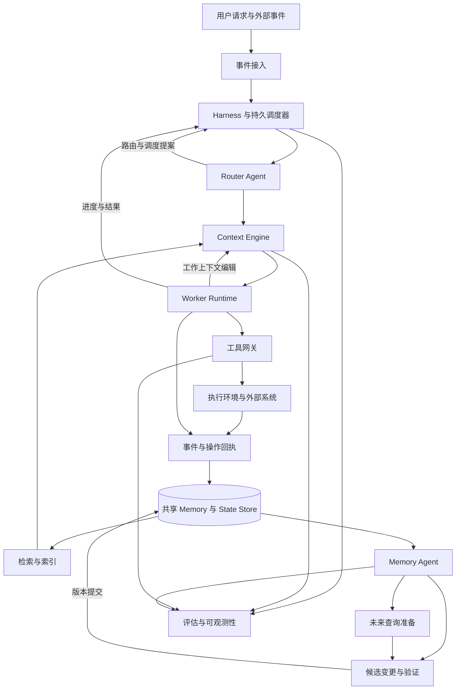
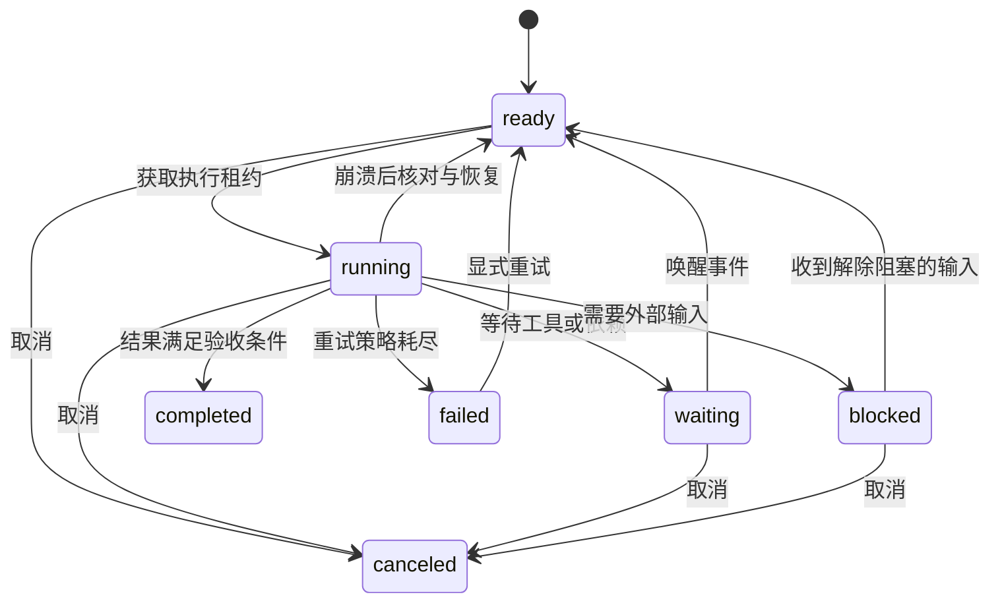
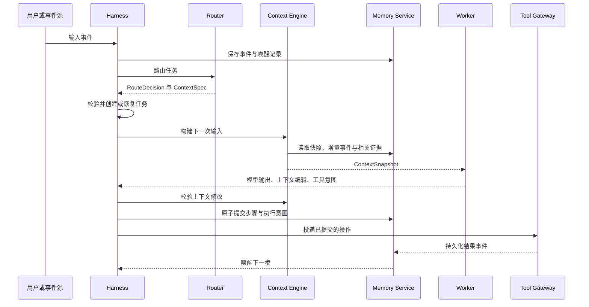

# Genvagent 整体架构与关键数据结构

状态：设计草案 v0.1

日期：2026-11-16

范围：agent harness、共享 memory system、动态上下文管理及后台记忆维护。

Genvagent 将任务身份、执行进度、历史记录和记忆持久化，使 agent 的执行进程能够停止、恢复或替换。Router 负责组织任务，worker 负责执行，Context Engine 构建并维护每次模型调用的输入，Memory Agent 在后台整理经验和准备后续任务可能需要的知识。

核心决策是：**统一管理持久状态，同时分别处理原始证据、执行状态、长期记忆和工作上下文。** 工作上下文允许模型编辑；原始证据用于追溯；任务状态由确定性程序维护；长期记忆以带来源的版本化记录更新。

本文的数据结构使用 TypeScript 风格记法表达接口契约，不预设最终实现语言。字段是关键字段集合，后续数据库设计可以补充索引、审计字段和序列化细节。文中组件和接口均为目标设计；当前仓库仅包含文档。

阅读导航：

- [目标与设计基础](#1-目标与设计基础)、[整体架构](#2-整体架构)、[模块边界](#3-模块边界与写入所有权)
- [通用结构](#4-通用数据结构)、[Harness](#5-harness-与持久执行)、[Router](#6-router-agent)、[Context Engine](#7-context-engine-与-clm)
- [Memory Service](#8-memory-service-与长期记忆)、[检索](#9-检索与索引)、[Dreaming](#10-memory-agent-与-dreaming)、[未来查询准备](#11-未来查询准备)
- [工具与适配](#12-工具网关模型与环境适配)、[持久化与一致性](#13-持久化一致性与失效)、[接口](#14-核心接口契约)、[运行流程](#15-主要运行流程)
- [评估](#16-评估与可观测性)、[实现阶段](#17-实现阶段与仓库组织)

## 1. 目标与设计基础

### 1.1 系统目标

1. **进程与持久状态分离**：进程可以替换，任务、上下文和记忆可持续存在。
2. **跨任务共享知识**：agent 在授权作用域内复用证据、经验和决策背景。
3. **主动维护记忆**：后台检查错误、冲突、重复与过期内容，生成新版本。
4. **模型管理工作上下文**：模型可以决定保留、移出、重组或重新载入哪些信息，并实际改变下一次输入。
5. **为未来任务准备信息**：基于可预测的查询模式预先整理 notes，并衡量收益。
6. **可解释、可恢复、可评估**：能够说明记忆来自哪里、每次调用看到了什么、为何执行某个工具，以及中断后从哪里恢复。

初始范围为一个部署内的多个项目和并发任务。数据模型从第一版保留 tenant、project、user 等作用域，跨租户部署与大规模调度以后续需求为准。

### 1.2 研究依据及采用范围

| 研究或系统 | 可借鉴的机制 | Genvagent 中的落点 |
| --- | --- | --- |
| DeepSeek Super-agent | 协调与任务执行分工、持久任务状态、事件输入及恢复 | Harness、Router、worker 与持久任务账本 |
| Anthropic agent memory 与 dreaming | 根据记录修订记忆、组织表示、调整后续会话加载内容 | 原始证据与派生记忆分离、后台候选版本 |
| Context Language Models | 模型编辑自身实际上下文，修改进入下一轮输入 | ContextDocument、ContextEdit、Context Engine |
| Sleep-time Compute | query 到来前，对已有信息进行可复用的预计算 | 预测查询模式、预备 notes、计算预算与收益统计 |

DeepSeek 官方仓库明确将其发布内容定位为研究原型，且部分文章设计尚未实现；Genvagent 的统一 memory、并发控制和协议设计是本项目的工程选择。[官方说明](https://github.com/deepseek-ai/dsh-superagent-prototype/blob/main/README.md)、[执行与恢复机制](https://github.com/deepseek-ai/dsh-superagent-prototype/blob/main/docs/003-execution.md)

Anthropic 将可搜索记录、记忆 notes、知识表示和注入上下文区分处理；其 Dreams 接口保留输入 store，生成独立输出 store。本设计借鉴分层与候选版本发布，不依赖该托管接口。[研究文章](https://www.anthropic.com/research/components-of-agent-memory)、[Dreams 文档](https://platform.claude.com/docs/en/managed-agents/dreams)

CLM 的关键是编辑进入模型下一轮真实上下文，现有模型即可参与该流程；Genvagent 首版不要求训练专用模型。[论文](https://arxiv.org/abs/2609.37725)、[官方 harness](https://github.com/facebookresearch/context-language-models/blob/main/clm/clm_harness/README.md)

Sleep-time Compute 的收益与未来 query 的可预测性相关，因此预计算必须计入总成本，并用未提前暴露的后续任务评估。[论文](https://arxiv.org/abs/2504.13171)

### 1.3 必须保持的约束

- 保存所有可持久化的显式上下文及其来源，包括大文件的内容引用；不假设能保存或迁移模型内部隐状态、服务端 KV cache 或未暴露的推理内容。
- 原始记录是“发生过什么、观察到了什么”的依据；记录中的断言仍可能错误。
- 执行状态由状态机和工具回执决定。自然语言 note 不能单独证明外部操作已经完成。
- 共享存储具有访问边界。每个 agent 只获取当前任务授权范围内的视图。
- 工作上下文中的删减不删除原始证据；长期记忆修订不改写历史版本。
- Memory Agent 提出语义变更；数据库和校验程序保证版本、并发和结构约束。
- 系统可以保留不确定或冲突状态，不通过强行合并制造虚假的一致性。
- 任何模型产生的上下文编辑或记忆内容都不能授予新的工具权限。

## 2. 整体架构



### 2.1 三个运行周期

| 周期 | 触发 | 主要活动 | 完成条件 |
| --- | --- | --- | --- |
| 在线执行 | 用户输入、工具完成、任务唤醒 | 路由、读取状态、构建上下文、推理、执行、记录 | 一个可持久化的执行步骤完成 |
| 后台整理 | 增量事件、冲突、过期、任务结束 | 证据核对、记忆修订、压缩、索引更新 | 候选记忆通过校验并发布，或被拒绝 |
| 未来查询准备 | 高频模式、未完成任务、可复用分析 | 预测 query 类别、生成 notes、记录依赖与失效条件 | 在预算内生成可检索的预备信息 |

后台任务不阻塞在线执行。重要新事件和用户纠正先进入持久状态，并可被当前任务读取；它们不必等待 dreaming 完成。

### 2.2 状态分层

| 层 | 主要对象 | 持久化方式 | 更新主体 |
| --- | --- | --- | --- |
| 原始事件与证据 | Event、Artifact、Observation | 追加事件与不可变内容引用 | 接入层、工具网关、模型调用记录器 |
| 执行状态 | Task、AgentRun、Checkpoint、ActionRecord | 事务更新，保留状态变更事件 | Harness、工具网关 |
| 长期记忆 | MemoryItem、MemoryRevision、ConflictSet | 不可变修订与版本化索引 | Memory Service 接受合规提案 |
| 工作上下文 | ContextDocument、ContextSnapshot | 可编辑文档与不可变调用快照 | Context Engine 接受 agent 编辑 |

“统一 memory system”表示统一的状态与内容服务接口。它不要求所有内容都放在一张表或一份 Markdown 中。运行环境由独立生命周期管理器维护，memory 保存其引用和检查点。

## 3. 模块边界与写入所有权

| 模块 | 主要职责 | 拥有的写入 | 不拥有的决策 |
| --- | --- | --- | --- |
| Event Intake | 规范化输入、去重、确定来源身份 | 原始事件与投递记录 | 不自行提升内容权限 |
| Harness | 任务状态机、调度、预算、中断与恢复 | Task、AgentRun、Lease、Checkpoint、Job | 不凭摘要确认外部操作成功 |
| Router | 任务分解、分派、依赖与上下文需求 | RouteDecision 提案 | 不直接执行数据库状态迁移 |
| Context Engine | 检索、输入组装、上下文编辑与快照 | ContextDocument、ContextSnapshot、ContextEdit 结果 | 不修改原始证据与系统授权 |
| Worker Runtime | 运行 agent loop，提出工具调用和记忆候选 | StepRecord、模型输出、提案 | 不直接写共享数据库 |
| Memory Service | 记忆版本、来源、冲突、失效与发布 | MemoryRevision、Snapshot、MemoryHead | 不把模型自评视为事实验证 |
| Retrieval | 作用域过滤、关键词与语义检索、来源扩展 | 索引与 RetrievalTrace | 不扩大调用者可见范围 |
| Memory Agent | 后台校对、合并、压缩与知识整理 | MemoryChangeSet 提案 | 不绕过发布校验写当前版本 |
| Query Preparation | 未来 query 假设、预计算预算与收益统计 | QueryHypothesis、PreparationPlan、NoteUsage | 不将假设自动变成已验证事实 |
| Tool Gateway / Environment | 授权校验、幂等、执行回执、环境管理 | ActionRecord、EnvironmentRef、工具事件 | 不依赖文本记忆提供授权 |
| Observability / Evaluation | 追踪、重放、成本与质量评估 | Trace、EvaluationCase、EvaluationResult | 不回写业务事实 |

Query Preparation 首版可以作为 Memory Agent 的一个任务类型；Retrieval、Memory Service、Context Engine 也可以同进程部署。模块边界首先用于约束读写职责。

## 4. 通用数据结构

### 4.1 标识、作用域与版本引用

```typescript
type ID = string;                 // 全局唯一标识；数据库可使用 UUID
type Timestamp = string;          // UTC ISO 8601
type Version = number;            // 单个聚合对象内递增，不表示全局顺序
type ContentHash = string;        // 带算法前缀的内容摘要，如 sha256:...
type JsonValue = null | boolean | number | string
  | JsonValue[] | { [key: string]: JsonValue };

interface ScopeRef {
  tenantId: ID;
  projectId?: ID;
  userId?: ID;
  taskId?: ID;
}

interface ObjectVersionRef {
  objectId: ID;
  version: Version;
}

interface PrincipalRef {
  kind: "user" | "service" | "agent";
  id: ID;
}

interface AccessPolicyRef {
  policyId: ID;
  version: Version;
}

interface ArtifactRef {
  artifactId: ID;
  contentHash: ContentHash;
  mediaType: string;
  byteSize: number;
}

interface SourceRef {
  kind: "event" | "artifact" | "memory_revision";
  id: ID;
  version?: Version;
  selector?: string;              // 消息块、行号、JSON Pointer 等定位表达式
  contentHash: ContentHash;
}
```

`ScopeRef` 各字段是同时满足的限制；缺省字段的可见性由 `AccessPolicyRef` 决定，不能解释为自动公开。例如 project note 不能因为没有 `userId` 就跨租户共享。

派生内容的可见受众默认不得宽于任一输入来源允许的受众。确需生成更广范围可见的内容时，必须通过明确的授权转换流程。来源链、摘要和向量索引均遵守相同规则。

`SourceRef` 应定位到不可变内容。外部 URL 作为附加元数据保存，同时保存本次观察的内容或其快照，避免链接内容变化后无法追溯。

### 4.2 原始事件

```typescript
interface EventEnvelope {
  id: ID;
  streamId: ID;                   // 一个输入流或任务流
  sequence: number;               // 流内连续顺序
  type: string;                   // user.message / tool.succeeded / task.canceled ...
  scope: ScopeRef;
  actor: PrincipalRef;
  access: AccessPolicyRef;
  occurredAt: Timestamp;         // 来源声称的发生时间
  recordedAt: Timestamp;         // 本系统写入时间
  deduplicationKey?: string;     // 在来源命名空间内唯一
  correlationId: ID;
  causationId?: ID;
  payload: JsonValue | ArtifactRef;
  contentHash: ContentHash;
}

interface EventCursor {
  streamId: ID;
  sequence: number;
}

interface SourceHead {
  id: ID;
  scope: ScopeRef;
  identityKey: string;            // 稳定来源身份，如仓库 + 分支 + 文件路径
  version: Version;
  latestObservation: SourceRef;
}

interface ScopeWatermark {
  scope: ScopeRef;
  inputGeneration: number;        // 影响该 scope 的新证据写入时递增
  cursors: EventCursor[];
}
```

事件顺序只在流内保证。跨流依赖通过 `causationId`、显式依赖和来源版本表达，不根据时间戳推断全局因果顺序。正常压缩和 dreaming 不修改事件；保留期与删除由独立流程管理。

`SourceRef` 记录本次实际读取的不可变版本；`SourceHead` 用于判断某个逻辑来源后来是否出现新观察。`ScopeWatermark` 用于发现包括新来源在内的增量证据。它们共同避免“旧证据仍存在，因此错误地认定没有更新”的问题。

## 5. Harness 与持久执行

### 5.1 Task 与 AgentRun

Task 是持续存在的工作单元；AgentRun 是一次执行尝试。任务重试会创建新的 run，保留原有任务身份与操作账本。

```typescript
type TaskStatus = "ready" | "running" | "waiting" | "blocked"
  | "completed" | "failed" | "canceled";

interface Task {
  id: ID;
  scope: ScopeRef;
  parentTaskId?: ID;
  goal: string;
  acceptanceCriteria: string[];
  constraints: string[];
  goalVersion: Version;
  status: TaskStatus;
  stateVersion: Version;
  dependencyTaskIds: ID[];
  inputRefs: SourceRef[];
  priority: number;
  activeRunId?: ID;
  budget: Budget;
  authority: AuthorityGrantRef;
  resultRefs: SourceRef[];
  waitCondition?: WaitCondition;
  createdAt: Timestamp;
  updatedAt: Timestamp;
}

interface Budget {
  maxModelCalls: number;
  maxInputTokens: number;
  maxOutputTokens: number;
  maxCostUsd: number;
  maxWallTimeSeconds: number;
}

interface AuthorityGrantRef {
  grantId: ID;                    // 控制面签发，agent 内容不能创建
  version: Version;
}

interface WaitCondition {
  kind: "tool" | "dependency" | "user_input" | "timer" | "resource";
  referenceIds: ID[];
  wakeAt?: Timestamp;
}

interface AgentRun {
  id: ID;
  taskId: ID;
  attempt: number;
  role: "router" | "worker" | "memory";
  status: "created" | "running" | "waiting" | "succeeded"
    | "failed" | "interrupted" | "canceled";
  agentConfigRef: ObjectVersionRef;
  contextId: ID;
  checkpointId?: ID;
  environmentId?: ID;
  lease: RunLease;
  startedAt?: Timestamp;
  endedAt?: Timestamp;
}

interface RunLease {
  ownerId: ID;
  epoch: number;                  // 每次重新获取所有权时递增
  expiresAt: Timestamp;
}
```

`Task.goalVersion` 用于识别用户更正后的目标，`stateVersion` 用于并发写入。用户修改目标时产生事件并更新版本；下一次调用必须使用新版本，旧上下文不能掩盖纠正。

每个 task 默认只允许一个有效执行 owner。并发子任务拥有各自的 task、run 和上下文。执行器提交状态或发起新工具调用时携带 lease epoch，拒绝旧 owner 的写入；已在外部开始的操作仍须通过账本核对。

### 5.2 状态转换



`completed` 的判断依赖任务类型：可执行检查、明确输出契约或必要的人工验收。worker 的“已完成”文本是候选信号。取消时阻止新的执行，尝试终止已有操作，并继续记录迟到的外部回执；不能假设取消撤销了已发生的副作用。

### 5.3 检查点、步骤与队列

```typescript
interface Checkpoint {
  id: ID;
  taskId: ID;
  runId: ID;
  stepNumber: number;
  taskStateVersion: Version;
  contextRef: ObjectVersionRef;  // 步骤提交后的工作上下文，含已接受编辑和输出
  lastInputSnapshotId: ID;       // 最近一次实际模型输入，用于追溯
  memorySnapshotIds: ID[];
  inputCursors: EventCursor[];
  pendingActionIds: ID[];
  environmentCheckpointRef?: ArtifactRef;
  createdAt: Timestamp;
}

interface StepRecord {
  id: ID;
  taskId: ID;
  runId: ID;
  stepNumber: number;
  attempt: number;
  status: "prepared" | "model_completed" | "committed" | "aborted";
  inputEventIds: ID[];
  contextSnapshotId: ID;
  modelInvocationId: ID;
  outputRef?: ArtifactRef;
  actionIds: ID[];
  contextEditIds: ID[];
  committedAt?: Timestamp;
}

interface ScheduledJob {
  id: ID;
  kind: "run_task" | "resume_task" | "reconcile_action"
    | "dream" | "prepare_note" | "refresh_index";
  targetId: ID;
  deduplicationKey: string;
  state: "queued" | "claimed" | "done" | "failed";
  priority: number;
  availableAt: Timestamp;
  attempt: number;
  maxAttempts: number;
  lease?: RunLease;
}
```

一个步骤的已处理输入游标、模型输出引用、上下文编辑结果、工具执行意图和后续 outbox 事件在同一事务中提交。实际工具执行在提交之后发生。只把输入放进请求而尚未提交步骤，不算输入已经处理完成。

若进程在模型返回后、提交前崩溃，可以重试推理并记录新的 attempt；不可假设重复推理产生相同输出。工具调用只有持久执行意图后才能发出。

检查点指向步骤提交后的 context version，避免仅恢复上一次模型输入而丢掉刚刚接受的编辑。新的 run 从该版本派生自己的 ContextDocument，原 run 的文档保持可追溯，旧 owner 不能写入新文档。

## 6. Router Agent

Router 使用任务索引、事件摘要和按需读取的证据进行决策，不需要常驻所有 worker 的完整上下文。它的职责包括创建或恢复任务、拆解依赖、选择执行能力、分配预算、处理输入归属，以及确定初始 ContextSpec。

### 6.1 路由决策与任务计划

```typescript
interface RouteDecision {
  id: ID;
  triggerEventIds: ID[];
  basedOnTaskVersions: ObjectVersionRef[];
  action: "create" | "resume" | "attach_input" | "decompose"
    | "cancel" | "respond" | "ignore";
  targetTaskIds: ID[];
  taskDrafts: TaskDraft[];
  explanation: string;            // 简短决策依据，用于审计
  evidenceRefs: SourceRef[];
  status: "proposed" | "accepted" | "rejected";
  rejectionReason?: string;
}

interface TaskDraft {
  taskId: ID;                     // 预分配，接受提案后成为正式 Task.id
  goal: string;
  acceptanceCriteria: string[];
  constraints: string[];
  scope: ScopeRef;
  dependsOnTaskIds: ID[];         // 可引用已有任务或同批预分配的 task ID
  workerProfileId: ID;
  contextSpec: ContextSpec;
  budget: Budget;
}

interface WorkerProfile {
  id: ID;
  version: Version;
  capabilities: string[];
  modelProfileId: ID;
  allowedToolNames: string[];
  environmentKind: "none" | "sandbox" | "repository";
  maxConcurrentRuns: number;
}
```

Harness 验证任务依赖无环、输入未被重复认领、预算可用、调用者有相应授权，再接受 RouteDecision。`allowedToolNames` 是能力上限，实际权限还需与任务授权和当前策略求交集。

worker 可以提出拆分或重新分派请求，最终由同一路由与校验流程处理。父任务通过子任务状态与结果引用跟踪进展，无需把子任务全部历史复制到自身上下文。

### 6.2 初始上下文需求

```typescript
interface ContextSpec {
  taskId: ID;
  goalVersion: Version;
  readableScopes: ScopeRef[];
  mandatoryRefs: SourceRef[];
  informationNeeds: string[];
  preferredMemoryKinds: MemoryKind[];
  tokenBudget: number;
  outputReserveTokens: number;
  toolResultReserveTokens: number;
  freshness: FreshnessRequirement;
}

interface FreshnessRequirement {
  mode: "snapshot" | "bounded_staleness" | "latest_required";
  maxAgeSeconds?: number;
  mustIncludeEventIds: ID[];
  externalRevalidationRequired: boolean;
}
```

“latest”只表示在读取时纳入已提交且有权访问的最新记录。对外部系统当前状态的要求，由 `externalRevalidationRequired` 触发重新读取，不能仅靠内部记忆的时间戳满足。

## 7. Context Engine 与 CLM

### 7.1 工作文档与调用快照

ContextDocument 是可编辑的工作表示；ContextSnapshot 是某次调用实际采用的不可变输入。两者都存储在共享状态服务中，但每个 run 的写入所有权独立。

```typescript
interface ContextDocument {
  id: ID;
  ownerRunId: ID;
  version: Version;
  taskId: ID;
  goalVersion: Version;
  blocks: ContextBlock[];
  memorySnapshotIds: ID[];
  eventCursors: EventCursor[];
  estimatedTokens: number;
  updatedAt: Timestamp;
}

interface ContextBlock {
  id: ID;
  category: "policy" | "goal" | "constraint" | "state" | "evidence"
    | "memory" | "working_note" | "message" | "tool_exchange";
  content: JsonValue | ArtifactRef;
  sourceRefs: SourceRef[];
  access: AccessPolicyRef;
  editPolicy: "protected" | "editable";
  tokenEstimate: number;
  retainReason?: string;
  dependencyRefs: ObjectVersionRef[];
}

interface ContextSnapshot {
  id: ID;
  contextRef: ObjectVersionRef;
  taskStateVersion: Version;
  goalVersion: Version;
  policyVersion: Version;
  memorySnapshotIds: ID[];
  normalizedMessagesRef: ArtifactRef;
  providerRequestRef: ArtifactRef;
  requestHash: ContentHash;
  tokenCount: number;
  createdAt: Timestamp;
}
```

请求快照记录送给模型的内容和参数，不包含 API 密钥、认证头等传输凭据。供应商特有的不可编辑消息块按 adapter 规则保存或重新构建，不将不同模型的消息格式视为可无损互换。

### 7.2 上下文编译

Context Engine 从任务状态与最新有效策略生成 protected blocks，再叠加工作内容、所选记忆以及尚未处理的新事件。最终输入顺序建议为：

1. 稳定策略、工具定义与角色说明。
2. 当前目标、约束、用户纠正及必要的执行状态。
3. 被选择的长期记忆与证据。
4. 当前计划、工作笔记与近期交互。

被选内容必须满足权限、版本和依赖检查。上下文保留输出与工具结果余量；超限时先请求 agent 整理可编辑区域，必要时将大结果保存为 ArtifactRef 并仅加载片段。关键约束超出预算时报告明确错误，不静默删掉约束。

### 7.3 上下文编辑协议

```typescript
type ContextOperation =
  | { op: "insert"; afterBlockId?: ID; block: ContextBlock }
  | { op: "replace"; blockId: ID; content: JsonValue | ArtifactRef;
      sourceRefs: SourceRef[] }
  | { op: "remove"; blockId: ID; archivedRef: SourceRef }
  | { op: "reorder"; blockIds: ID[] };

interface ContextEdit {
  id: ID;
  contextId: ID;
  expectedVersion: Version;
  proposedBy: PrincipalRef;
  operations: ContextOperation[];
  explanation: string;
}

interface ContextEditResult {
  editId: ID;
  status: "accepted" | "conflict" | "invalid" | "over_budget";
  resultingVersion?: Version;
  errors: string[];
  tokensBefore: number;
  tokensAfter?: number;
}
```

模型可以自由改写可编辑区域，包括维护状态表、删减冗余结果、改变表示和创建可复用的整理方法；这些操作不是仅限于固定摘要模板。首版通过结构化操作提交，后续可增加“导出为文件、编辑、解析回写”的接口。

校验器负责以下约束：

- `expectedVersion` 必须匹配，禁止覆盖并发更新。
- agent 不能插入或修改 protected 类别，也不能通过编辑设置更宽的 access。
- 编辑后的来源引用必须存在且可访问；内容中的事实正确性仍需证据检查。
- 保留供应商要求的工具调用与工具结果配对，无法安全分割时按整个 exchange 处理。
- 移出的内容必须已有不可变归档引用；删除工作块不删除事件。
- 编辑实际作用于下一次请求，并保存编辑前后快照。

用户纠正、权限撤回等控制面更新在编译时重新注入，不依赖 agent 自愿保留。worker 只编辑自己的上下文；router 通过需求和输入事件影响 worker，避免多人同时改写同一文档。

### 7.4 缓存与压缩

默认继续追加近期交互，在确有收益时重组上下文，尽量保持稳定前缀。记录实际 cache read/write、输入费用和延迟，以评估编辑带来的成本。托管 API 未提供的缓存能力不纳入恢复保证。

工作上下文压缩服务于当前任务，由当前 agent 主导；长期记忆整理服务于跨任务复用，由 Memory Agent 主导。两者使用共同的证据与版本接口，但可以采用不同表示和触发条件。

## 8. Memory Service 与长期记忆

### 8.1 逻辑记忆与不可变修订

```typescript
type MemoryKind = "fact" | "preference" | "decision" | "procedure"
  | "episode" | "prospective_note" | "index";

type EpistemicStatus = "observed" | "supported" | "inferred"
  | "unverified" | "disputed";

interface MemoryItem {
  id: ID;
  scope: ScopeRef;
  kind: MemoryKind;
  logicalKey?: string;            // 如 project/runtime/python；不代替作用域判断
  createdAt: Timestamp;
}

interface MemoryRevision {
  id: ID;
  memoryId: ID;
  revision: Version;
  parentRevisionId?: ID;
  content: string | ArtifactRef;
  structuredClaim?: StructuredClaim;
  evidenceRefs: SourceRef[];
  epistemicStatus: EpistemicStatus;
  lifecycle: "active" | "stale" | "superseded" | "retracted";
  applicability: Applicability;
  observedAt: Timestamp;
  validFrom?: Timestamp;
  validTo?: Timestamp;
  expiresAt?: Timestamp;
  dependencies: MemoryDependency[];
  access: AccessPolicyRef;
  verificationId?: ID;
  createdBy: PrincipalRef;
  createdAt: Timestamp;
}

interface StructuredClaim {
  subject: string;
  predicate: string;
  value: JsonValue;
  qualifiers: Record<string, JsonValue>;
}

interface Applicability {
  repositoryId?: ID;
  branch?: string;
  commit?: string;
  environment?: string;
  conditions: string[];
}

interface MemoryDependency {
  source: SourceRef;
  relation: "derived_from" | "requires" | "supports" | "contradicts";
  onChange: "invalidate" | "revalidate" | "historical_only";
}
```

`supported` 表示在声明范围内存在通过检查的证据，不表示永久正确。主体、谓词相同也不一定构成冲突：分支、环境、有效时间可能不同。`observedAt`、有效时间和写入时间分别保留。

procedure 保存可复用方法及前提，decision 保存决策和依据，episode 保存经历摘要，prospective_note 保存为未来问题准备的材料。上述类型都保留证据引用，不能仅因被重复引用就提高可信状态。

### 8.2 冲突与验证结果

```typescript
interface ConflictSet {
  id: ID;
  scope: ScopeRef;
  revisionIds: ID[];
  kind: "contradiction" | "temporal_overlap" | "scope_ambiguity";
  status: "open" | "resolved";
  explanation: string;
  resolution?: {
    selectedRevisionIds: ID[];
    evidenceRefs: SourceRef[];
    verificationId: ID;
  };
}

interface VerificationResult {
  id: ID;
  candidateRef: ID;
  checks: VerificationCheck[];
  outcome: "pass" | "fail" | "uncertain";
  verifierConfigRef: ObjectVersionRef;
  verifiedAt: Timestamp;
}

interface VerificationCheck {
  kind: "source_exists" | "scope_matches" | "claim_supported"
    | "freshness" | "conflict" | "executable_check";
  outcome: "pass" | "fail" | "uncertain";
  evidenceRefs: SourceRef[];
  explanation: string;
}
```

结构、来源存在性和版本由程序检查；语义支持关系可结合模型、原始文档与可执行检查。检查不充分的候选保留 inferred/unverified/disputed 状态，不升级成 supported。

例如“项目使用 Python 3.11”与“项目使用 Python 3.12”同时出现时，应先检查 commit、环境和配置来源。明确升级则保留历史有效区间；范围不同则并存；证据不足则建立 ConflictSet。

### 8.3 快照与发布指针

```typescript
interface MemorySnapshot {
  id: ID;
  scope: ScopeRef;
  parentSnapshotId?: ID;
  manifestRef: ArtifactRef;       // memoryId -> revisionId；首版可用关系表表示
  sourceWatermarks: EventCursor[];
  policyVersion: Version;
  createdAt: Timestamp;
}

interface MemoryHead {
  scope: ScopeRef;
  snapshotId: ID;
  generation: number;
}
```

首版每个可独立发布的 scope 使用一个 MemoryHead，读取获得稳定快照。跨 scope 读取携带多个 snapshot ID；首版不承诺跨 scope 原子发布，涉及同一不变量的记忆应置于同一发布边界。

工作上下文使用“已发布快照 + 当前任务相关的新事件”构建。索引尚未更新时，可以按精确 ID 或事件范围读取新数据，保证当前任务看得到已提交的新输入。

快照可复现历史读取，但不冻结授权。来源删除、授权撤回及关键失效事件需要在每次读取和工具执行前重新检查。旧快照不能绕过当前有效访问控制。

## 9. 检索与索引

首版采用元数据过滤、关键词检索、可选向量检索及来源链接扩展。索引是可重建的派生数据，长期记忆修订与原始证据是恢复依据。

```typescript
interface MemoryQuery {
  id: ID;
  principal: PrincipalRef;
  taskId: ID;
  query: string;
  scopes: ScopeRef[];
  snapshotIds: ID[];
  kinds: MemoryKind[];
  requiredRefs: SourceRef[];
  freshness: FreshnessRequirement;
  maxCandidates: number;
  tokenBudget: number;
}

interface RetrievalHit {
  source: SourceRef;
  memoryId?: ID;
  revisionId?: ID;
  excerpt: string;
  scoreComponents: Record<string, number>;
  estimatedTokens: number;
  epistemicStatus?: EpistemicStatus;
  freshnessState: "current" | "stale" | "unknown";
  conflictIds: ID[];
}

interface RetrievalTrace {
  id: ID;
  queryId: ID;
  indexWatermarks: EventCursor[];
  candidateRefs: SourceRef[];
  selectedRefs: SourceRef[];
  excluded: { source: SourceRef; reason: string }[];
  latencyMs: number;
  fallbackUsed: boolean;
}
```

流程为：解析范围与意图 → 访问过滤 → 多路召回 → 去重与重排 → 展开必要证据和冲突 → 按 token 预算选择 → 返回来源和 trace。

权限过滤必须在向 agent 暴露候选、片段、计数或来源信息之前生效。向量检索需选择支持相应过滤的实现；检索阶段过量召回不能成为权限绕过方式。

用户纠正、当前目标与 requiredRefs 直接读取并固定保留，不与普通相关性评分竞争。索引落后时从权威记录补读；未找到证据时返回空结果或不确定状态，不能以相似但范围错误的记忆代替。

## 10. Memory Agent 与 Dreaming

### 10.1 后台任务与候选变更

```typescript
interface DreamJob {
  id: ID;
  scope: ScopeRef;
  trigger: "new_events" | "task_finished" | "conflict"
    | "expiration" | "scheduled" | "manual";
  baseSnapshotId: ID;
  expectedHeadGeneration: number;
  inputWatermarks: ScopeWatermark[];
  inputEventRanges: { streamId: ID; after: number; through: number }[];
  targetMemoryIds: ID[];
  policyRef: ObjectVersionRef;
  budget: Budget;
  status: "queued" | "running" | "validating" | "published"
    | "rejected" | "failed" | "canceled";
  changeSetId?: ID;
}

interface MemoryChangeSet {
  id: ID;
  scope: ScopeRef;
  baseSnapshotId: ID;
  expectedHeadGeneration: number;
  readSet: SourceRef[];           // 实际读取的不可变证据
  expectedSourceHeads: ObjectVersionRef[];
  inputWatermarks: ScopeWatermark[];
  proposedRevisions: MemoryRevision[];
  conflictChanges: ConflictSet[];
  verificationIds: ID[];
  explanation: string;
  status: "proposed" | "validated" | "committed" | "rejected";
}
```

同一发布 scope 内首版串行运行整理任务，以减少候选冲突；在线 worker 仍可持续写入事件与候选记忆。后台实现扩大并发时，必须保留提交校验。

### 10.2 处理流水线

1. **选材**：以增量事件和明确目标为主，必要时回查历史证据。
2. **提取**：提出事实、偏好、决策、失败经验与方法候选，保留来源范围。
3. **校对**：检查已有记忆、环境版本、用户纠正和冲突。
4. **整理**：去重、分拆适用范围、调整摘要、生成索引及来源链接。
5. **验证**：对候选逐项运行结构与证据检查，标记不确定性。
6. **发布**：校验 base generation、read set 及相关增量事件，原子更新 MemoryHead。
7. **传播**：同事务写入 outbox，触发索引更新、依赖失效与任务通知。

发布时若 MemoryHead 已改变，则返回冲突并重新读取、合并和验证。若 head 未变，但期间出现影响候选结论的新事件，也必须重新检查；只做 head 的 CAS 不足以保证新鲜度。提交同时比较 SourceHead 版本和所读 scope 的 inputGeneration，相关检查与发布在同一事务边界内完成。

未完成、失败或取消的 DreamJob 不改变当前 MemoryHead。候选可以保留供诊断，但不能出现在正常记忆查询结果中。

### 10.3 压缩、更新与回滚

- 长日志保留原始内容，另建 episode 摘要和精确引用。
- 频繁复用的记忆形成短索引，详细内容按需读取。
- 重要数字、命令、标识符和约束按任务要求原样保留，避免仅存有损概括。
- 来源变化触发依赖项 stale/revalidate，不默认重写全部记忆。
- 优先从原始证据或明确版本重建，避免只依赖上一轮摘要。
- 回滚生成新的 head generation；复用旧内容前检查当前授权、删除状态与依赖，不能复活已删除的来源或覆盖新的有效纠正。

正确性维护不等于持续重读所有记忆。首版优先整理被纠正、被频繁访问、依赖已改变或存在冲突的条目。

## 11. 未来查询准备

### 11.1 查询假设与准备计划

```typescript
interface QueryHypothesis {
  id: ID;
  scope: ScopeRef;
  queryPattern: string;
  triggerSignals: SourceRef[];
  likelyTaskIds: ID[];
  horizonEndsAt: Timestamp;
  estimatedReuseCount: number;
  estimatedSavingPerUseUsd: number;
  rationale: string;
}

interface PreparationPlan {
  id: ID;
  hypothesisId: ID;
  sourceRefs: SourceRef[];
  deliverable: "evidence_map" | "procedure" | "comparison" | "diagnostic_note";
  estimatedBuildCostUsd: number;
  estimatedMaintenanceCostUsd: number;
  budget: Budget;
  status: "proposed" | "scheduled" | "running" | "done" | "discarded";
  outputMemoryIds: ID[];
}

interface NoteUsage {
  id: ID;
  memoryRevisionId: ID;
  taskId: ID;
  queryId: ID;
  usedAt: Timestamp;
  signal: "retrieved" | "included" | "cited" | "applied" | "rejected";
  evaluationResultId?: ID;
}
```

预备 note 使用 `MemoryKind = prospective_note`，并记录适用条件、证据、依赖版本和过期时间。与事实类记忆使用同一发布和失效机制。

候选优先级可从以下估计开始，数值只用于调度，不能被当成已证实的收益：

```text
预期净收益
  = 预计复用次数 × 单次预计节省成本
    - 生成成本 - 维护成本
```

首批适合的内容包括：重复排障的诊断步骤、未完成任务的后续证据、跨文件关系索引、昂贵但经常复用的比较结果。生成 note 只授权内部读取和整理，不自动授权执行其中建议的外部动作。

“被检索”并不等于“有用”。收益评估要结合任务结果与有无 note 的对照；相关来源更新后，即使 note 命中频繁也需重新验证。

## 12. 工具网关、模型与环境适配

### 12.1 工具描述与操作账本

```typescript
interface ToolDescriptor {
  name: string;
  version: Version;
  inputSchema: JsonValue;
  outputSchema: JsonValue;
  effect: "read" | "write";
  idempotency: "native_key" | "reconcilable" | "none";
  reconciliationTool?: string;
  requiredCapabilities: string[];
}

interface ActionRecord {
  id: ID;
  taskId: ID;
  originatingRunId: ID;
  originatingStepId: ID;
  leaseEpoch: number;
  toolName: string;
  toolVersion: Version;
  argumentsRef: ArtifactRef;
  intentKey: string;              // 一次业务操作的稳定标识，恢复时复用
  externalIdempotencyKey?: string;
  status: "prepared" | "dispatched" | "succeeded" | "failed"
    | "outcome_unknown" | "canceled";
  authority: AuthorityGrantRef;
  externalOperationId?: string;
  resultRef?: ArtifactRef;
  reconciliationEvidenceRefs: SourceRef[];
  createdAt: Timestamp;
  updatedAt: Timestamp;
}
```

工具调用采用“持久意图 → 执行 → 持久回执”。`intentKey` 在 task 内唯一，同一业务操作重试时复用，不能仅根据参数 hash 判断重复，因为两次参数相同的操作也可能都是合法意图。

投递器通过状态 CAS 与执行租约认领 ActionRecord，避免重复消费者同时发出同一操作。恢复时可在新 epoch 下接管尚未发出的 prepared 意图，保留 action ID 与 intentKey，并记录接管事件；已经 dispatched 的意图先核对结果，不能按未执行操作直接接管重发。

在网络超时或进程中断后，`dispatched` 不能直接视为失败。支持原生幂等的工具可按契约重试；可核对的工具先查询外部状态；无法判定且重复执行会产生额外副作用的工具进入 outcome_unknown 并等待明确处理。

系统以至少一次投递、幂等与外部核对实现可靠恢复，不宣称对任意外部工具提供 exactly-once 执行。

### 12.2 模型调用与环境

```typescript
interface ModelInvocation {
  id: ID;
  runId: ID;
  stepId: ID;
  contextSnapshotId: ID;
  provider: string;
  model: string;
  parameters: JsonValue;
  responseRef?: ArtifactRef;
  usage?: UsageRecord;
  status: "prepared" | "running" | "completed" | "failed";
}

interface UsageRecord {
  inputTokens: number;
  outputTokens: number;
  cacheReadTokens?: number;
  cacheWriteTokens?: number;
  billedCostUsd?: number;
  estimatedCostUsd?: number;
  latencyMs: number;
}

interface EnvironmentRef {
  id: ID;
  kind: "sandbox" | "repository" | "remote";
  ownerTaskId: ID;
  locator: string;
  baseRevision?: string;
  checkpointRef?: ArtifactRef;
  status: "creating" | "ready" | "unavailable" | "released";
  credentialBindingIds: ID[];    // 凭据绑定引用；不保存秘密值
}
```

Model Adapter 负责消息格式、工具协议、token 估计与供应商响应规范化。Environment Adapter 负责目录、sandbox、worktree 或远程环境的创建、检查与恢复。

更换模型或执行进程时，优先恢复显式状态和规范化上下文；模型私有消息块按 adapter 能力转换。进程恢复不保证 shell 进程、内存中的变量或服务端 cache 同时恢复，这些资源需要单独核对。

## 13. 持久化、一致性与失效

### 13.1 首版存储建议

采用 PostgreSQL 存储结构化状态、事件索引、记忆版本和任务队列；大文件与请求快照存放对象存储或本地内容寻址目录。首版可使用 PostgreSQL 全文检索，语义检索按评测结果加入；中文检索需要选择适当的分词或字符检索方案。[全文检索](https://www.postgresql.org/docs/current/textsearch-intro.html)、[并发控制](https://www.postgresql.org/docs/current/mvcc.html)

| 数据集合 | 主键或唯一约束 | 关键访问模式 |
| --- | --- | --- |
| events | id；stream_id + sequence；来源内 deduplication_key | 流增量读取、task 因果链 |
| source_heads / scope_watermarks | 来源身份键；scope | 最新观察、发布时的新鲜度检查 |
| tasks | id；state_version 用于 CAS | 活跃任务、依赖、等待条件 |
| runs / checkpoints / steps | id；run + step + attempt | 恢复、调用重放、输入处理进度 |
| scheduled_jobs / outbox | id；deduplication_key | 到期领取、租约回收、重试 |
| actions | id；task_id + intent_key | 未确认操作核对、结果查询 |
| context_documents / snapshots | id；文档版本 | 最新视图、历史调用输入 |
| memory_items / revisions | id；memory_id + revision | 精确读取、历史修订、来源追溯 |
| memory_heads / snapshot_entries | scope；snapshot_id + memory_id | 原子发布、稳定读取 |
| memory_dependencies / conflicts | 关系 ID；冲突 ID | 来源变化时反向定位 |
| dream_jobs / change_sets | id | 候选审查、失败恢复 |
| retrieval_indexes / traces | source revision + 索引配置版本 | 检索、重建、相关性诊断 |
| artifacts | id；内容 hash 可用于去重 | 内容读取、完整性核验 |

复合唯一约束中的 scope 字段需要明确规范化，避免 NULL 的数据库语义使唯一性约束失效。

### 13.2 事务边界

1. 输入事件去重、持久化与唤醒 outbox 一起提交。
2. 任务状态变更和相应调度事件一起提交。
3. 执行步骤提交与输入游标推进一起完成，工具意图持久化后才执行。
4. 记忆候选修订、快照关系、head CAS 和失效 outbox 一起发布。
5. 索引异步更新并记录 watermark；读取需要时直接补读权威存储。

Outbox 是事务中写入的待投递事件表，由后台投递器重试。消费者按事件 ID 去重。数据库事务不跨越模型推理或远程工具执行。

```typescript
interface OutboxRecord {
  id: ID;
  aggregateId: ID;
  eventId: ID;
  topic: string;
  payload: JsonValue;
  status: "pending" | "claimed" | "delivered" | "failed";
  attempt: number;
  availableAt: Timestamp;
  lease?: RunLease;
}
```

事件接入在同一事务内推进相关 ScopeWatermark，记忆发布检查并锁定其读过的 watermark 行。首版允许 scope 内任意新证据导致重验，以换取简单正确的发布边界；后续再细化到依赖对象。多 scope 锁按稳定顺序获取，冲突或事务重试发生在提交阶段，不在锁内运行模型。

内容对象先写入并确认持久化，再在数据库事务中发布引用。事务失败可能留下未引用对象，由延迟垃圾回收处理；已发布引用不能指向尚未持久化的内容。

### 13.3 新鲜度与失效传播

来源改变 → 定位反向依赖 → 将相关记忆或索引标记待复核 → 通知受影响任务 → 下一次编译重新选择内容。

任务通常可在一个模型调用内使用稳定快照，调用之间吸收新事件。遇到取消、授权撤回、目标更正或明确关键纠正时，在下一次外部动作前重新检查；不能因模型调用已经开始就沿用过期授权。

相同 MemoryItem 在并发修改时通过 base revision 与 head generation 检测冲突。首版采用重读、重新生成候选和验证，避免不透明的自动文本合并。

### 13.4 删除与保留

正常运行中的事件和修订不可变不等于永久不能删除。删除流程需要传播到派生 notes、索引、上下文快照、缓存与内容存储，并按保留策略处理备份。

可先建立 tombstone 阻止后续读取和 dreaming 再次派生，再异步清理内容；所有重放、回滚和旧快照读取都检查 tombstone。保留删除审计时不保留被要求删除的正文。

## 14. 核心接口契约

接口可先以进程内方法实现，后续再封装为 RPC。以下是语义契约，不指定网络协议。

| 接口 | 关键输入 | 关键输出或保证 |
| --- | --- | --- |
| `events.append` | EventEnvelope、来源去重键 | 事件 ID 与流序号；重复调用返回既有事件 |
| `harness.apply_route` | RouteDecision、任务预期版本 | 事务接受或明确拒绝 |
| `harness.claim_run` | task ID、owner ID | AgentRun 与 fencing epoch |
| `harness.commit_step` | StepRecord、lease epoch、预期状态版本 | 原子保存步骤、游标、编辑与工具意图 |
| `context.build` | ContextSpec、调用者身份 | ContextDocument 与来源选择记录 |
| `context.apply_edit` | ContextEdit、lease epoch | 新版本或 conflict/invalid/over_budget |
| `context.snapshot` | context version、有效策略与模型配置 | 可追溯的实际请求快照 |
| `memory.read` | revision/snapshot、调用者身份 | 精确版本；执行当前访问和删除检查 |
| `memory.search` | MemoryQuery | RetrievalHit[] 与 RetrievalTrace |
| `memory.propose` | MemoryChangeSet | 候选 ID，不立即改变已发布记忆 |
| `memory.commit` | validated change set、预期 head、read set | 原子发布或要求重新验证 |
| `dream.schedule` | scope、触发原因、事件范围、预算 | 去重后的 DreamJob |
| `tools.dispatch` | 已提交 action ID、当前授权 | 执行回执或 outcome_unknown |
| `tools.reconcile` | action ID | 基于外部证据的状态更新 |

`harness.commit_step` 通过 Context Engine 校验器接受编辑，并在自身事务内提交；agent 不能使用独立编辑调用绕开步骤与输入游标的原子性。独立的上下文整理也作为一个无外部工具动作的步骤记录。

## 15. 主要运行流程

### 15.1 在线任务



模型可以只编辑上下文，不调用外部工具；也可以输出最终结果。两者都通过相同步骤持久化流程。

### 15.2 Dreaming 发布

```text
读取 base snapshot + 明确事件范围
  → 生成候选修订和依赖
  → 校验证据、作用域、时间和冲突
  → 检查期间相关来源是否发生改变
  → 以 expected generation 提交新快照
  → 发布索引与失效事件
```

若相关来源变化或发布冲突，保留候选供诊断，重新选材和验证后再提交。若验证为 uncertain，可以发布明确标记为未验证或冲突的记忆，不能据此覆盖已支持事实。

### 15.3 崩溃恢复

1. 调度器发现 run 租约过期，终止旧所有权并取得新的 epoch。
2. 读取最近已提交检查点、任务目标版本、待处理输入与操作账本。
3. 将遗留 dispatched 操作视为需要核对，查询外部回执或幂等接口。
4. 检查工作目录、仓库 revision 和环境可用性，必要时恢复环境。
5. 读取当前有效授权、关键纠正和记忆失效信息。
6. 构建新上下文，明确已完成、待确认和待执行的事项。
7. 创建新 run，继续处理尚未提交完成的输入。

不确定的外部写入未解决前，阻塞依赖该结果的后续动作。其他独立任务可以继续运行。

### 15.4 用户纠正记忆

用户纠正产生事件 → 更新当前任务约束或目标版本 → 标记相关记忆待复核 → 当前上下文立即看到纠正 → Memory Agent 核对适用范围并发布新修订。

用户陈述在偏好和目标方面可以直接确定当前意图；关于外部系统的事实仍根据来源与任务要求核对。系统保留“谁在何时做了什么纠正”的依据。

## 16. 评估与可观测性

### 16.1 评估数据结构

```typescript
interface EvaluationCase {
  id: ID;
  scenario: "continuation" | "correction" | "conflict" | "recovery"
    | "context_pressure" | "prospective_query" | "scope_isolation";
  initialStateRef: ArtifactRef;
  inputTimelineRef: ArtifactRef;
  expectedOutcomesRef: ArtifactRef;
  heldOutFutureQueriesRef?: ArtifactRef;
}

interface EvaluationResult {
  id: ID;
  caseId: ID;
  systemConfigRef: ObjectVersionRef;
  traceRefs: ArtifactRef[];
  metrics: Record<string, number>;
  passedChecks: string[];
  failedChecks: string[];
  onlineCostUsd: number;
  backgroundCostUsd: number;
  externalToolCostUsd: number;
}

interface TraceSpan {
  id: ID;
  traceId: ID;
  parentSpanId?: ID;
  operation: string;
  taskId?: ID;
  runId?: ID;
  stepId?: ID;
  dreamJobId?: ID;
  relatedRefs: SourceRef[];
  attributes: Record<string, JsonValue>;
  status: "running" | "ok" | "error";
  startedAt: Timestamp;
  endedAt?: Timestamp;
}
```

每个 trace 至少关联 task、run、step、model invocation、context snapshot、memory snapshot、tool action、dream job。记录模型输入、工具回执、来源链和简短决策解释，不依赖模型暴露内部推理过程。

### 16.2 主要指标

| 类别 | 指标 |
| --- | --- |
| 任务质量 | 成功率、验收条件通过率、后续任务完成率 |
| 记忆正确性 | 有证据支持率、纠正后错误复发率、过期记忆使用率 |
| 记忆保留 | 关键事实保留率、原始证据可达率、冲突遗漏率 |
| 执行可靠性 | 恢复成功率、重复外部副作用次数、结果未知操作数量 |
| 上下文效率 | 每次输入 token、有效证据占比、编辑失败率、缓存复用 |
| 系统成本 | 在线、dreaming、预计算、存储与工具的合计成本 |
| 响应速度 | 首次响应、关键步骤及端到端的 p50/p95 延迟 |
| 共享边界 | 跨 scope 泄漏、权限撤回后的读取、删除后的再派生 |

对照实验依次启用：普通摘要 → 检索记忆 → dreaming → CLM → 预备 notes。使用相同模型和任务序列，并明确比较的是相同预算还是相同质量下的成本。

未来 query 在 notes 生成阶段必须不可见。只用检索命中次数无法证明收益，需要对后续任务成功率、延迟和总成本做对照。故障注入覆盖工具发出前、外部成功但回执未提交、上下文编辑提交中、记忆发布和索引更新之间等窗口。

## 17. 实现阶段与仓库组织

### 17.1 分阶段交付

| 阶段 | 交付范围 | 验收条件 |
| --- | --- | --- |
| M1 持久执行 | 单 worker、事件、Task/Run、上下文快照、工具账本、检查点 | 重启后能继续；不盲目重复外部写入 |
| M2 共享记忆与路由 | 多任务、Router、scope 过滤、MemoryRevision、基础检索 | 跨任务复用证据，读取范围正确 |
| M3 后台整理 | DreamJob、候选变更、验证、冲突、发布、失效 | 错误可纠正，失败候选不污染当前记忆 |
| M4 上下文自主编辑 | ContextEdit、预算控制、快照重放、缓存成本统计 | 编辑进入下一次输入，关键约束不丢失 |
| M5 未来查询准备 | QueryHypothesis、准备计划、notes 反馈与对照评估 | 在保留任务质量的条件下得到可重复的收益 |

M1 即定义 ContextDocument 与 edit 的边界，但先使用固定组装策略；M4 再让模型主动编辑。M2 可接受 worker 的带来源候选，并明确标记未验证；M3 引入系统性的后台整理。

### 17.2 计划中的代码目录

```text
Genvagent/
  README.md
  docs/
    architecture.md
  src/                         # 以下目录在实现阶段创建
    contracts/                 # 通用标识、作用域、版本与事件
    harness/                   # Task、Run、调度、检查点
    router/                    # 路由决策和上下文需求
    runtime/                   # worker loop 与步骤提交
    context/                   # 组装、编辑、校验、请求快照
    memory/                    # 修订、冲突、快照、发布、失效
    retrieval/                 # 检索、索引、来源扩展
    dreaming/                  # 整理流水线与语义验证
    preparation/               # 未来 query 与预备 notes
    tools/                     # 工具网关、幂等、外部核对
    adapters/                  # 模型、环境、存储实现
    observability/             # trace、成本、运行诊断
  migrations/                  # 数据库 schema 与迁移
  evals/                       # 连续任务与故障场景评估
  tests/                       # 状态机、事务和协议约束验证
```

### 17.3 实现前需要确定的参数

- 首个任务域：建议选择一个真实代码仓库的编码与排障任务，便于检查结果和故障恢复。
- 模型与供应商：决定消息适配、token 计量、预算和缓存统计方式。
- 语言：Python 或 TypeScript 均可，优先服从现有工具与模型 SDK 的集成需求。
- 规模：第一版并发 worker 数量、事件量、文档大小及可接受延迟。
- 保留与新鲜度：原始事件保留期、哪些事实需要实时核对、后台整理预算。

这些参数影响实现与容量配置，不改变本文定义的状态分层、模块所有权、版本提交和可追溯性约束。
