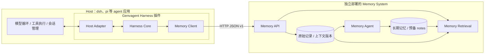

# Genvagent 两个系统的架构与边界

状态：设计草案 v0.4；2026-11-17。当前仓库仅包含设计文档。

Genvagent 分为 **Agent Harness** 和 **Memory System** 两个可独立实现的系统。Genvagent Harness 以插件接入 dsh、pi 等 agent 应用；Memory System 是独立服务，使用相同协议支持单机和集群部署。两者只通过版本化接口协作。

## 1. 设计文档

| 文档 | 主要内容 |
| --- | --- |
| [交互模型与对接协议](integration-protocol.md) | 角色与数据模型、用户数据组织、同步与检索、执行与恢复、协议类型与接口 |
| [Agent Harness](agent-harness.md) | 插件核心、Host 适配、本地同步状态、Router 与上下文管理 |
| [Memory System](memory-system.md) | 持久化、用户数据隔离、记忆检索、dreaming，以及单机和集群部署 |

建议先阅读交互模型中的概念与流程，再分别审阅两个系统及接口细节。协议是两侧的共同契约。

## 2. Host 与 Genvagent Harness 的关系

**Host** 指加载 Genvagent 插件的完整 agent 应用，例如 dsh、pi。它提供模型调用循环、工具执行、权限控制、会话管理和界面。dsh、pi 本身也属于广义的 agent harness；本项目使用 Host 表示它们相对于插件的角色。

**Genvagent Harness** 专指本项目的插件层，由 Harness Core、Host Adapter 和 Memory Client 组成。Host Adapter 使用各应用的扩展点，Core 提供 Router 与上下文管理，Memory Client 负责调用独立服务。因此 Host 与 Genvagent Harness 是应用与插件的关系，两个设计系统仍然是 Genvagent Harness 和 Memory System。

下图表示一个 Host 实例内的插件及其服务连接；每个 dsh、pi 实例分别加载对应的 Adapter。



Memory System 不依赖某个 Host 的运行进程。Memory Agent 可以在所有 Host 离线时执行整理，活动会话的下一次模型输入仍由 Harness 与 Host 决定。

## 3. 状态归属与持久化

Host 管理的状态分为会话存档、执行记录、运行环境和配置；它们具有不同的持久化方式与恢复能力。

| 数据或状态 | 更新责任 | 持久化位置与恢复依据 |
| --- | --- | --- |
| Host 会话存档 | Host | Host 自己管理的 session 文件或数据库，包含消息、分支关系、会话设置等；格式取决于 Host |
| 任务与工具执行记录 | Host | Host 提供的任务日志、工具回执等；只有 Host 实际持久化的执行状态才能用于恢复 |
| 文件、worktree、运行进程 | Host 及其执行环境 | 文件与 worktree 位于工作区；活跃进程属于操作系统运行状态，保存上下文不等于保存进程 |
| 模型配置、工具定义、授权与凭据 | Host | Host 配置或凭据存储；恢复时重新加载，凭据不进入 Memory |
| Host 身份映射、事件编号、未确认批次 | Harness Core / Adapter | 插件本地持久状态目录与同步日志，用于定位 binding、幂等重传和断点核对 |
| 原始消息、模型输出、工具结果 | Host 产生，Harness 规范化与同步 | Memory 的 records 与 blobs；Host 存档同时作为同步和核对来源 |
| 工作上下文及其当前版本 | Harness 构建，Memory 提交版本 | Memory 的 context_versions、context_heads；保留来源与已纳入的事件序号 |
| 上下文应用标记与确认 | Host Adapter | Host 持久 marker 和 Memory receipt，分别记录本地应用及服务端确认 |
| 长期知识、偏好、冲突与预备 notes | Memory Agent | Memory 的 memory_revisions、来源引用与失效记录 |

Host 存档的具体路径由 Host 配置决定，Genvagent 通过 Adapter 读取，不假设所有 Host 具有相同文件格式。插件本地目录保存传输与恢复所需的状态；已确认的原始记录、长期记忆及显式工作上下文以 Memory 中的持久化对象为准。

**上下文存储与编辑决策分离。** Harness 选择、压缩或编辑工作上下文；Memory 保存不可变版本。Memory Agent 整理长期记忆，发布修订供后续请求读取。

用户数据按 workspace/project 和 ownerUserId 归属。一个用户可在多个 Host 上建立独立 binding、记录流和上下文；同用户可复用其项目内的私有记忆，项目成员可读取已授权共享的记忆。相同项目不自动共享私有会话。[完整数据组织](integration-protocol.md#3-用户数据组织与存储)

模型内部隐状态、供应商 KV cache、凭据及活跃操作系统进程不属于可移植上下文。跨 Host 复用长期记忆不要求恢复原执行环境；恢复整个执行会话还取决于消息格式、工具状态和 Adapter 能力。

## 4. 第一版范围

第一版实现两个完整流程：

1. **Harness**：Host 记录同步 → 检索 → 构建或编辑上下文 → Host 应用 → 确认版本 → 同步执行结果。
2. **Memory**：保存证据 → 检索 → 后台校对 → 发布记忆修订 → 通知更新与失效。

Router 保留为可替换策略，先负责上下文需求和已有会话的路由；创建子 agent 仅在 Host 提供能力时启用。未来 query notes 先覆盖高频问题与未完成任务。

本轮范围不包含新的通用任务调度器、跨 Host 工具执行器、全球一致快照、专用训练流水线或完整知识图谱。单机与集群部署共用 Memory API、数据库约束和数据模型；扩容通过 API 副本和后台 worker 完成。

## 5. 独立交付与联合验收

| 交付 | 可独立验证的结果 |
| --- | --- |
| 协议与契约样例 | 用户数据隔离、重试不重复写、旧 writer 被拒绝、候选与已激活版本明确区分 |
| Harness Core + 模拟 Memory | 插件加载、事件映射、上下文修改、卸载与会话恢复 |
| Memory Service + 测试客户端 | 持久记录、检索、版本管理、独立 dreaming |
| dsh 与 pi 适配 | 原始记录不丢失、实际模型输入按能力声明变化、分支不混淆 |
| 单机与集群 Memory | 客户端仅改变 endpoint；节点重启不丢已确认写入，不重复发布记忆 |

共享类型与 Memory Client 可以复用；Harness 不导入 Memory 内部表结构，Memory 不导入 dsh 或 pi SDK。

## 6. 计划中的仓库结构

```text
Genvagent/
  docs/
    architecture.md
    integration-protocol.md
    agent-harness.md
    memory-system.md
  packages/                       # 实现阶段创建
    protocol/                     # 协议 schema 与兼容性样例
    memory-client/                # 远程调用、幂等与重试
    harness-core/                 # Host 无关能力与扩展点
    adapter-dsh/
    adapter-pi/
  services/
    memory/                       # API、存储、检索、后台 worker
  evals/                          # 两侧独立评估及联合契约验证
```

数据结构示例沿用 TypeScript 风格记法；它不限制 Memory Service 的实现语言。具体 Host API 的核对依据及适配限制记录在 Harness 文档中。
