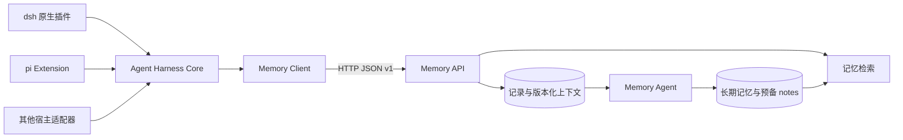

# Genvagent 两个系统的架构与边界

状态：设计草案 v0.2；2026-11-16。当前仓库仅包含设计文档。

Genvagent 分为 **Agent Harness** 和 **Memory System** 两个可独立实现的系统。Harness 以插件接入 dsh、pi 等宿主；Memory System 是独立服务，使用相同协议支持单机和集群部署。两者只通过版本化接口协作。

## 1. 设计文档

| 文档 | 主要问题 |
| --- | --- |
| [交互模型与对接协议](integration-protocol.md) | 原始记录、长期记忆与工作上下文的关系；任务中的交互流程；对应的数据与接口 |
| [Agent Harness](agent-harness.md) | 核心能力、插件扩展点、dsh/pi 适配与上下文管理 |
| [Memory System](memory-system.md) | 记录、上下文存储、记忆检索、dreaming，以及单机和集群拓扑 |

建议先阅读交互模型中的概念和任务示例，再分别审阅两个系统及接口细节。接口文档是共同契约，不构成第三个业务系统。

## 2. 总体关系



宿主继续拥有模型执行循环、工具执行、权限、界面和原生会话记录。Harness Core 提供路由策略、记忆同步与上下文编辑能力，通过适配器使用宿主扩展点。Memory System 不接管宿主执行循环，也不依赖某一种宿主运行。

## 3. 数据与行为归属

| 对象或行为 | 语义与更新责任 | 持久化位置 |
| --- | --- | --- |
| 宿主任务、工具状态、执行权限 | 宿主；Harness 通过宿主接口参与 | 宿主原生状态 |
| 原始消息、工具结果、观察记录 | 宿主产生，Harness 规范化与同步 | Memory；宿主记录可作为同步来源 |
| 本轮使用哪些信息、如何压缩工作上下文 | Harness 中的 Router / Context Controller | Memory 保存不可变版本与激活记录 |
| 上下文是否真正应用到宿主 | Host Adapter 确认 | 宿主持久 marker 与 Memory receipt |
| 事实、经验、偏好、冲突、预备 notes | Memory System / Memory Agent | Memory |
| 记忆后台整理与知识失效 | Memory System | Memory |
| 工具调用结果未知时是否重试 | 宿主的工具恢复机制 | 宿主；Memory 只保存观察证据 |

**上下文的存储位置与编辑决策分开。** 所有可持久化的显式上下文及其来源进入共享 Memory；Harness 决定工作视图如何变化。Memory Agent 可以改进长期记忆，但不能在后台直接改写正在执行的工作上下文。

模型内部隐状态、供应商 KV cache、凭据及活跃操作系统进程不属于可移植上下文。共享记忆可以跨宿主复用；执行会话能否跨宿主恢复，取决于消息格式、工具状态和 adapter 能力。

## 4. 规模收敛

第一版聚焦两个闭环：

1. **Harness**：宿主事件同步 → 检索 → 构建或编辑上下文 → 宿主应用 → 回传使用结果。
2. **Memory**：保存证据 → 检索 → 后台校对 → 发布记忆修订 → 通知失效。

Router 保留为可替换策略，先负责上下文需求和已有会话的路由；创建子 agent 仅在宿主提供能力时启用。先保留小规模未来 query notes，不单独建设预测调度平台。

本轮不设计新的通用任务调度器、跨宿主工具执行器、全球一致快照、专用训练流水线或完整知识图谱。单机与集群部署共用 Memory API、数据库约束和数据模型；扩容通过 API 副本和后台 worker 完成。

## 5. 独立交付与联合验收

| 交付 | 可独立验证的结果 |
| --- | --- |
| 协议与契约样例 | 重试不重复写、旧 writer 被拒绝、候选上下文不会被误报为已应用 |
| Harness Core + 模拟 Memory | 插件加载、事件映射、上下文修改、卸载与宿主恢复 |
| Memory Service + 测试客户端 | 持久记录、检索、版本管理、独立 dreaming |
| dsh 与 pi 适配 | 原生记录不丢失、实际模型输入按能力声明变化、分支不串线 |
| 单机与集群 Memory | 客户端配置仅改变 endpoint；节点重启不丢已确认写入，不重复发布记忆 |

共享类型与 Memory Client 可以复用；Harness 不导入 Memory 内部表结构，Memory 不导入 dsh 或 pi SDK。

## 6. 计划中的仓库结构

```text
Genvagent/
  docs/
    architecture.md
    integration-protocol.md
    agent-harness.md
    memory-system.md
  packages/                       # 实现阶段创建
    protocol/                     # 协议 schema 与兼容性样例
    memory-client/                # 远程调用、幂等与重试
    harness-core/                 # 宿主无关能力与扩展点
    adapter-dsh/
    adapter-pi/
  services/
    memory/                       # API、存储、检索、后台 worker
  evals/                          # 两侧独立评估及联合契约验证
```

数据结构示例沿用 TypeScript 风格记法；它不限制 Memory Service 的实现语言。具体宿主 API 的核对依据及适配限制记录在 Harness 文档中。
