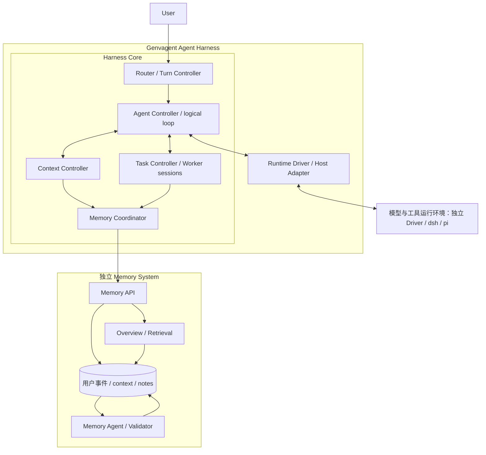

# Genvagent：用户统一 Memory 与 Router/Worker Harness

状态：设计草案 v0.5；2026-11-17。当前仓库仅包含设计文档。

Genvagent 包含两个系统：**Agent Harness** 负责用户对话、Router/Worker 执行与工作上下文；**Memory System** 按 user 聚合全部持久信息，独立部署于单机或集群。project notes 属于用户 Memory 内的专题资料。

## 1. 使用模型

用户只与 Router 对话。Router 可以读取该用户的长期目标、偏好、历史会话和所有项目 notes，根据当前对话决定直接答复或分派 Worker。Worker 执行具体任务，结果回到 Router，由 Router 对用户负责。

Router 的完整访问能力通过用户概览、跨项目检索与精确来源读取实现；每次模型调用仍只装入当前任务需要的材料。Worker 获得目标、约束、相关证据与项目资料，并维护独立 context。

| 概念 | 归属与关系 |
| --- | --- |
| User Memory | userId 对应的统一记忆域；不随项目、Host 或进程切换而改变 |
| User notes | 用户级偏好、目标和通用知识 |
| Project notes | 用户域内带 projectId 的知识；保留项目适用条件 |
| Router conversation | 用户持续对话，可在多个项目间切换 |
| Turn | 从一个用户输入到答复、澄清、失败或取消；可以包含多个 agent step |
| Worker task | Router 分派的具体工作，使用独立 session、记录流与 context |

第一版不引入跨用户团队知识库。同名项目在不同用户下分别保存；同用户跨项目引用是正常能力。

## 2. 两大系统的关系



**Host** 指 dsh、pi 这样的完整 agent 应用。Genvagent 以 Adapter 接入其扩展点；Host 提供底层模型调用、工具执行、界面、权限与工作环境。

**Harness Core 拥有逻辑 agent loop。** 它接收输入、提交上下文、决定下一动作、处理工具与任务结果、结束 turn。模型 SDK 和工具进程属于 Runtime Driver；这种划分使同一 Core 可以独立运行，也可以由 Host 回调驱动。

## 3. Core 与 loop 的边界

Core 内包含 Turn Controller、Agent Controller、Router Policy、Task Controller、Context Controller 和 Memory Coordinator。Router 与 Worker 共用 step 状态机，分别持有自己的执行状态和上下文。

| 驱动方式 | Core 的职责 | Runtime 的职责 |
| --- | --- | --- |
| Core-owned | Runner 调用 advance，驱动完整逻辑循环 | 按动作调用模型/工具并回传结果 |
| Host-driven | Adapter 在 Host 安全边界调用 advance，Core 决定允许的下一步 | Host 原生 loop 执行该步骤并发出完成事件 |

一个 session 只使用一种驱动方式。Host-driven 的底层调用栈可以仍由 Host 持有，但不能由 Host 和 Core Runner 同时发起下一模型调用。无法接入请求 gate、上下文应用和结果关联的 Adapter 仅提供 Sync/Recall，不宣称实现完整编排。

这一区分既明确 Core 的执行责任，也保留集成 dsh、pi 的插件路径。详细函数与状态机见[Harness Core](agent-harness.md)。

## 4. 每轮对话的数据流

```text
用户输入
  → Core 创建 turn，追加原始事件到 Memory
  → 将已提交 Message 追加到 Router 工作 context
  → 检索用户 Memory，保存并应用 context 版本
  → Router 模型 step
      → 直接答复
      → 或创建 Worker task，执行多个 Worker step，再回传结果
  → 追加 Router 的最终消息
  → 保存最终 context checkpoint
  → 追加引用 checkpoint 的 turn 终态
  → 对用户标记本轮完成
```

事件追加与 context 更新是两个操作。事件流保存原始来源；context 是 Core 构建的输入工作视图，允许选择和压缩。每条完成消息及时保存，在下一模型请求前和 turn 结束前提交 context checkpoint。

Memory Agent 独立整理 user/project notes，发布修订；Harness 在后续请求边界读取。后台整理不直接改写活动 context。

## 5. 状态责任与持久化

| 状态 | 更新责任 | 持久化与恢复依据 |
| --- | --- | --- |
| turn、step、task、动作与结果 | Harness Core | Memory 事件流为恢复依据，本地索引用于加速 |
| 原始消息与工具交换 | Core 规范化，Runtime 提供结果 | Memory records/blobs；Host 原生存档用于同步核对 |
| 工作 context 及其已处理位置 | Context Controller | Memory 不可变版本与 ContextHead |
| context 是否已应用 | Runtime Driver / Host Adapter | 本地持久 marker 与 Memory application receipt |
| 用户与项目 notes | Memory Agent / Validator | NoteRevision、来源、适用条件与失效状态 |
| 安装身份、会话映射、待发送批次 | Memory Coordinator | 插件/Runner 的本地 stateDir |
| 文件、worktree、工具运行进程 | Runtime / Host | 实际工作区、执行日志和工具回执 |
| 模型配置、工具定义、权限及凭据 | Runtime / Host | 运行环境配置与凭据存储；凭据不进入 Memory |

恢复 agent 的逻辑进度与恢复外部工具状态分别处理。上下文持久化不能证明工具已执行成功，恢复记录也不能触发重复外部操作。Host 存档路径与格式由 Adapter 解释，不假设所有 Host 具有相同实现。

## 6. 文档顺序与交付

1. [交互逻辑、接口函数与数据结构](integration-protocol.md)：先阅读每轮执行，再查看两侧调用与存储对象。
2. [Agent Harness](agent-harness.md)：Core 模块、loop、Runtime 端口及 dsh/pi 适配。
3. [Memory System](memory-system.md)：用户域、内部服务函数、notes 与独立部署。

第一版以 Core 状态机和参考 Driver 验证 Router → Worker → Router 的完整流程，再将同一契约映射到 dsh/pi。Memory 首先实现事件、context 和关键词检索，随后加入有预算的后台整理与预备 notes。

不引入新的通用分布式任务平台、跨地域强一致服务或完整知识图谱。单机与集群共用 Memory 协议；Harness 不导入 Memory 内部数据库结构，Memory 不导入 Host SDK。

计划仓库结构：

```text
Genvagent/
  docs/
  packages/
    protocol/                    # 公共函数契约与类型
    memory-client/               # 用户域客户端、幂等与重试
    harness-core/                # turn / step / task / context 逻辑
    runtime-driver/              # Core-owned 参考 Driver
    adapter-dsh/                 # Host-driven 接入
    adapter-pi/
  services/
    memory/                      # API、存储、检索、后台 Worker
  evals/                         # 两侧独立与联合契约验证
```
