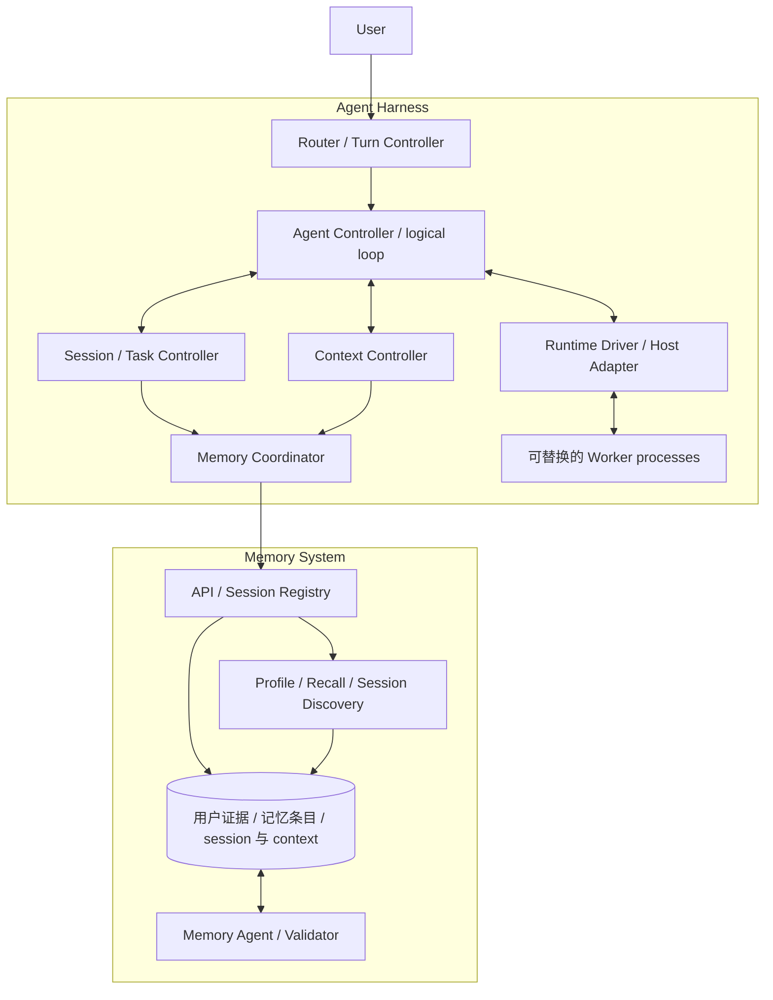

# Genvagent：统一用户记忆与可恢复的 Agent 执行

状态：设计草案 v0.6；2026-11-17。当前仓库仅包含设计文档。

Genvagent 包含两个系统：**Agent Harness** 管理 Router、任务路由、执行循环和工作上下文；**Memory System** 按 user 保存证据、可复用记忆及持久执行状态，独立部署于单机或集群。系统不要求用户有项目，也不限定为编程场景。

## 1. 用户记忆的概念模型

**User Memory 是一个用户的完整记忆域。** 画像、短期记忆、长期记忆和 notes 都在其中，但它们描述的是不同维度，不能作为互斥的同级存储分类。

### 1.1 持久对象与派生视图

```text
User Memory
  原始证据
    用户输入、模型输出、工具结果、外部材料及来源
  可复用记忆条目
    事实、偏好、目标、方法、经历、notes
    每条保留适用条件、时效、证据与修订
  持久执行状态
    sessions、context 版本、任务与执行记录

基于上述对象形成的视图
  用户画像：有关用户特征、偏好、目标与约束的记忆及来源
  短期记忆：近期对话、当前目标、待办、未决问题与进行中的 session
  长期记忆：经过整理、可跨会话复用的事实、经验、偏好与 notes
  可选集合：按用户需要组织的主题、活动、领域或项目资料
```

| 维度 | 回答的问题 | 设计含义 |
| --- | --- | --- |
| 用户归属 | 信息属于谁 | userId 是唯一记忆域；不因活动或工具切换而变化 |
| 时间与用途 | 当前需要，还是长期复用 | 短期/长期是生命周期与使用特征；短期信息也可以持久化 |
| 内容语义 | 记住的是什么 | 事实、偏好、目标、方法、经历等 |
| 表达形式 | 如何组织内容 | note 是带来源的整理文本；可以是短期或长期信息 |
| 组织方式 | 如何分组与发现 | 标签与集合可选；旅行、学习或软件项目只是例子 |

用户画像是带证据、时效和不确定性的视图，不维护一份脱离来源的“用户真相”。例如“这次旅行预算有限”先是当前任务约束，不能直接变成用户永久偏好。长期记忆也会失效、被纠正或退役。

工作 context 是某个 session 当前使用的工作视图，通常承载当前目标和短期执行状态，但不等于用户的全部短期记忆。多个 session 可以同时持有不同目标；Router 按需读取它们及可复用记忆。

集合可以不存在。一条 note 不必属于集合，也可关联多个集合；project notes 只是一种可选的资料组织方式，不进入系统的核心类型划分。第一版仍以单用户记忆域为边界，不设计跨用户团队知识库。

## 2. Process、Session、Context 与 Task

用户只与 Router 对话。Router 使用自己的持久 session/context 理解请求，选择直接处理、创建新的任务 session，或继续已有 session。实际工作由可替换的 Worker 进程执行。

| 概念 | 含义 | 是否跨进程保留 |
| --- | --- | --- |
| Worker process | 执行模型和工具的 agent 进程，加载本次被分配的状态 | 不作为业务记忆的权威来源，可释放或替换 |
| Session | 持久的逻辑工作线程；关联记录流、context 版本和任务历史 | 是，由 Memory 保存，具有稳定 sessionId |
| Context | Session 的工作状态，包括目标、约束、证据、进度和消息视图 | 是，以不可变版本及当前指针保存 |
| Task | 一次要完成的工作；Router 决定在哪个 session 上执行 | 是，独立于进程与 context 的寿命 |
| Run | 某进程在某 session 上的一次执行尝试，受 lease 约束 | 执行记录保留，运行占用可结束 |
| Runtime binding | dsh/pi 原生 session 与逻辑 session 的适配映射 | 可保留用于定位；不定义逻辑 session 的身份 |

第一版一个逻辑 session 对应一个记录流和一条 context 版本序列。同一 session 可以先后执行多个 task；一个 task 重试或换进程时可以产生多个 run。并行探索使用独立 session 或分叉，不允许两个进程同时写同一个 session。

```text
task A ── run 1 / process P1 ──┐
                             ├── session S ── context C: v1 → v2 → v3
task B ── run 2 / process P2 ──┘

process P1 也可以在释放后执行另一个 session。
进程替换不创建新的业务 context；选择新目标或分叉才创建。
```

“Worker 无状态”指它不独占跨执行的业务状态，不是执行期间没有内存、工具句柄或文件。进程退出后，业务状态从 Memory 恢复；外部工具、工作区和操作系统进程仍需运行时核对。

## 3. Router 的路由与上下文管理

### 3.1 路由对象是 session/context

Router 先读取用户画像摘要、当前对话、有关记忆和 session 目录，再决定任务去向。它选择的是工作状态及执行策略，进程由运行时按能力分配。

| 路由结果 | 使用条件 | 对持久状态的操作 |
| --- | --- | --- |
| 直接处理 | 当前 Router context 足以完成请求 | 继续 Router session，无须创建 Worker |
| 新建 | 独立问题、无合适历史状态，或需要隔离干扰 | 创建 session/context，以任务目标和选定证据初始化 |
| 继续 | 已有 session 的目标、进度和执行环境仍适用 | 取得原 session 的写入 lease，加载当前 context 与增量 |
| 分叉 | 从既有进度探索另一方案，或需要并行执行 | 从固定 ContextRef 创建新 session/context，记录来源 |
| 等待或澄清 | 目标不明确、session 正忙或外部动作未决 | 保留请求，不抢占已有执行或猜测工具结果 |

继续既有 session 不要求找到原来的 Worker。Router 依据 session 摘要发现候选，再精确读取状态；开始执行时校验版本、生命周期、授权和未完成动作，不能仅凭语义相似度恢复。

### 3.2 CLM 在 Router 中的作用

CLM 将当前上下文作为模型可编辑的对象，编辑结果进入后续模型输入，并扩展到多上下文协作。[原论文](https://arxiv.org/html/2609.37725v1)、[官方实现](https://github.com/facebookresearch/context-language-models)

本项目据此提出以下 Router 设计；这是待验证的应用方案：

- Router 可检查、改写自己的工作 context，维护当前意图、重要约束、候选 session、证据缺口和任务进展。
- Router 可按引用读取其他 session 的摘要或固定快照，决定继续、分叉或新建，再组织目标 session 的初始输入。
- 检索先补充证据，context 编辑再决定哪些信息实际进入下一轮；不是把全部记忆一直追加到 prompt。
- Core 负责来源、版本、工具交换与受保护约束校验。Router 不能通过编辑一份摘要直接改写被另一 Worker 占用的 context。

第一版将可编辑内容暴露为 context 工具；可选文件视图只是同一对象的编辑入口。修改必须通过保存、应用和确认，才能影响下一次调用。CLM 不代替 session 目录、并发控制或原始证据存储。

质量评估比较固定摘要策略与 CLM Router，在相同模型和预算下测试：任务分派是否正确、旧 session 是否选对、关键约束是否保留、无关历史是否干扰，以及延迟和 token 成本。论文结果不直接证明本系统的路由质量已提高。

## 4. 两大系统与执行 loop



Harness Core 包含 Turn Controller、Agent Controller、Router Policy、Session/Task Controller、Context Controller 和 Memory Coordinator。Core 拥有逻辑 loop：接收输入、决定下一动作、提交 context、处理结果和结束执行。

**Host** 是 dsh、pi 等完整 agent 应用。Runtime Driver/Host Adapter 提供模型调用、工具、权限、进程及原生会话适配。Core-owned 模式由 Runner 推进 Core；Host-driven 模式由安全边界的回调推进 Core，并由 Host 执行被允许的下一步。一个 run 只使用一种驱动方式。

Host 原生 session 是执行容器，逻辑 session 是持久工作身份。新的运行容器可以显式挂载已有逻辑 session，但需验证格式和外部执行环境兼容性。仅支持检索注入的 Adapter 不宣称具备完整上下文恢复能力。

## 5. 每轮执行与 context 生命周期

### 5.1 执行顺序

```text
用户输入 → 持久化消息 → 更新 Router context → Router 决策
  ├─ 直接回答
  └─ 选择 new / resume / fork
       → 确定持久 session/context
       → 分配 Worker process，建立 run 并获取 session lease
       → 加载 context 与未覆盖事件，核对未完成动作
       → 按需检索，追加或编辑 context，提交版本
       → 执行模型与工具，持续保存消息和进度
       → 保存结果与最终 checkpoint，结束 run，释放进程占用
       → 结果送回 Router，附 task / session / run / context 引用
  → Router 汇总答复，保存 checkpoint 与 turn 终态
```

每条完成消息先通过 appendEvents 保存原始事件，再由 appendMessages 更新工作副本。下一模型调用前以及 run/turn 正常结束前提交 checkpoint。进程突然退出时，从最后已确认版本和后续事件恢复。

例如用户之前规划了一次旅行，session S 保存了预算、候选方案和未决问题。今天用户说“继续之前的行程”，Router 可以让新进程 P2 继续 S；如果用户要比较另一套方案，则从 S 的固定版本分叉 S2。用户另问一个无关问题时可以新建 S3，S 不因此被删除或退役。

### 5.2 创建、继续与退役

| 情况 | Session / context 的处理 |
| --- | --- |
| 首次独立工作 | 新建 session、空 context 序列，写入目标与授权证据后生成首个版本 |
| 同一工作继续 | 沿用 sessionId/contextId，在已有记录和版本上追加新进度 |
| 并行或替代方案 | 从明确版本分叉；新流从自己的序号起步，原 session 不变 |
| 普通追加或 CLM 编辑 | 在同一个 contextId 下生成新版本；旧版本保留可追溯引用 |
| 一次 task 完成或进程释放 | run 结束，session 默认保持 open 且空闲，可继续使用 |
| 一次性工作无需继续 | 结果与 checkpoint 已保存、没有未决动作后，按策略退役 |
| 状态已被新 session 替代或长期无用 | 保留最终摘要、来源和替代关系后退役；空闲时长仅作为候选条件 |
| 已退役工作重新需要 | 读取历史作为证据，或从固定版本分叉；不直接向退役 session 写入 |

**Session 的持久生命周期为 open / retired；是否正在执行由有效 run/lease 决定。** 进程退出、工具暂时不可用、task 完成和 context 压缩都不自动等于退役。

退役冻结该 session 的继续执行能力，不删除记录、版本或长期记忆。变更必须检查 session revision、context head、最后接收位置、排队输入、未完成任务及未决动作，防止与新执行竞争。未完成工作须先明确取消或转交并保存结果，不能因没有活动进程就视为结束。物理删除由独立保留与删除策略处理。

旧 context 版本被新版本取代，与整条 context/session 退役是两回事。短期内容是否提炼为长期记忆，也不由进程或 session 是否退役决定。

## 6. 状态责任与存储边界

| 状态 | 更新责任 | 持久化依据 |
| --- | --- | --- |
| session 身份、生命周期及 context 关联 | Core 决策，Memory 校验提交 | Session Registry 与版本指针 |
| turn、task、run、动作及结果 | Harness Core | Memory 事件与执行记录 |
| 工作 context、约束及进度 | Router/Worker 经 Context Controller 编辑 | 不可变版本、来源与消费位置 |
| context 在某进程中已加载和应用 | Driver / Adapter | 带 run/epoch 的应用 receipt 与本地 marker |
| 事实、偏好、经历和 notes | Memory Agent / Validator | MemoryItemRevision 与失效状态 |
| 用户画像、短期/长期视图、集合目录 | Memory 查询与整理模块 | 基于条目、session 与来源派生，可重建 |
| 未确认批次、事件映射与原生关联 | Memory Coordinator | 本地持久日志，用于可靠投递与核对 |
| 工具外部状态、文件、运行进程及凭据 | Runtime / Host | 执行环境与其恢复机制；凭据不进入 Memory |

context 已保存不能证明外部动作成功。替换 Worker 后，未决动作必须先核对；不能通过加载旧快照重放未知结果的工具调用。

## 7. 文档与实施顺序

1. [交互逻辑与接口](integration-protocol.md)：new/resume/fork、执行附着、消息保存、context 提交和退役。
2. [Agent Harness](agent-harness.md)：Router 的 CLM 策略、Session/Task Controller、进程端口和 Host 接入。
3. [Memory System](memory-system.md)：记忆对象及视图、持久 session/context、检索、整理与部署。

第一版优先验证：无集合用户的普通问答、无状态进程执行新任务、替换进程继续旧 session、分叉不污染原状态、退役后的只读查询，以及 CLM 编辑确实改变下一请求输入。其后验证 dsh/pi Adapter 与后台整理。

实现包仍保持 protocol、memory-client、harness-core、runtime-driver、adapter-dsh、adapter-pi 和独立 memory service；不额外引入通用分布式任务平台。
