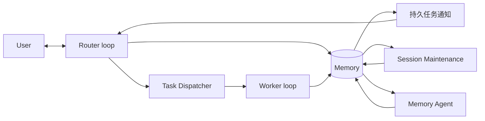

# Genvagent：统一用户记忆与可恢复的 Agent 执行

状态：设计草案 v0.8；2026-11-17。当前仓库仅包含设计文档。

Genvagent 包含两个系统：**Agent Harness** 管理 Router、任务路由、执行循环和工作上下文；**Memory System** 按 user 保存证据、可复用记忆及持久执行状态，独立部署于单机或集群。

## 1. 用户记忆的概念模型

**User Memory 是一个用户的完整记忆域。** 画像、短期记忆、长期记忆和 notes 都在其中，但它们描述的是不同维度，不能作为互斥的同级存储分类。

### 1.1 持久对象与派生视图

```text
User Memory
  Sessions：持续工作的边界
    History：输入、观察、输出与变化的可追溯记录
    Context：当前工作状态及其版本，引用历史和其他记忆
  可复用记忆条目
    事实、偏好、目标、方法、经历、notes
    每条保留适用条件、时效、证据与修订

Memory 服务另提供执行协作存储
  任务状态、输入队列、通知与临时写入权；调度由 Harness 负责

基于上述对象形成的视图
  用户画像：有关用户特征、偏好、目标与约束的记忆及来源
  短期记忆：近期对话、当前目标、待办、未决问题与进行中的 session
  长期记忆：经过整理、可跨会话复用的事实、经验、偏好与 notes
  可选集合：按用户需要组织的主题、活动、领域或项目资料
```

| 维度 | 回答的问题 | 设计含义 |
| --- | --- | --- |
| 用户归属 | 信息属于谁 | userId 是唯一记忆域；不因活动或工具切换而变化 |
| 时间与用途 | 当前需要，还是长期复用 | 短期/长期是生命周期与使用特征；短期信息也可以持久化 |
| 内容语义 | 记住的是什么 | 事实、偏好、目标、方法、经历等 |
| 表达形式 | 如何组织内容 | note 是带来源的整理文本；可以是短期或长期信息 |
| 组织方式 | 如何分组与发现 | 标签与集合可选；旅行、学习或软件项目只是例子 |

用户画像是带证据、时效和不确定性的视图，不维护一份脱离来源的“用户真相”。例如“这次旅行预算有限”先是当前任务约束，不能直接变成用户永久偏好。长期记忆也会失效、被纠正或退役。

工作 context 是某个 session 当前使用的工作视图，通常承载当前目标和短期执行状态，但不等于用户的全部短期记忆。多个 session 可以同时持有不同目标；Router 按需读取它们及可复用记忆。

集合可以不存在。一条 note 不必属于集合，也可关联多个集合；project notes 只是一种可选的资料组织方式，不进入系统的核心类型划分。第一版仍以单用户记忆域为边界，不设计跨用户团队知识库。

Session 组织 History 与 Context：前者保存经历，后者保存当前如何继续。历史落盘不等于长期知识，Context 压缩不等于记忆沉淀；事件中的执行控制记录也不默认参与知识召回。完整对象关系与接口提供方见[概念模型与能力边界](integration-protocol.md)。

## 2. Process、Session、Context 与 Task

用户只与 Router 对话。Router 使用自己的持久 session/context 理解请求，负责回应、澄清、分派和汇总；事务性工作交给可替换的 Worker 进程执行。Router 不因等待 Worker 而阻塞后续用户输入。

| 概念 | 含义 | 是否跨进程保留 |
| --- | --- | --- |
| Worker process | 执行模型和工具的 agent 进程，加载本次被分配的状态 | 不作为业务记忆的权威来源，可释放或替换 |
| Session | 持久的逻辑工作线程；关联记录流、context 版本和任务历史 | 是，由 Memory 保存，具有稳定 sessionId |
| Context | Session 的工作状态，包括目标、约束、证据、进度和消息视图 | 是，以不可变版本及当前指针保存 |
| Task | 一次要完成的工作；Router 决定在哪个 session 上执行 | 是，独立于进程与 context 的寿命 |
| Run | 某进程在某 session 上的一次执行尝试，受 lease 约束 | 执行记录保留，运行占用可结束 |
| Host session link | dsh/pi 原生会话到逻辑 session 的定位关系 | 只用于插件接入与恢复，不代表执行已经开始 |

第一版一个逻辑 session 对应一个记录流和一条 context 版本序列。同一 session 可以先后执行多个 task；一个 task 重试或换进程时可以产生多个 run。并行探索使用独立 session 或分叉，不允许两个进程同时写同一个 session。

```text
task A ── run 1 / process P1 ──┐
                             ├── session S ── context C: v1 → v2 → v3
task B ── run 2 / process P2 ──┘

process P1 也可以在释放后执行另一个 session。
进程替换不创建新的业务 context；选择独立目标或分叉才创建。
```

“Worker 无状态”指它不独占跨执行的业务状态，不是执行期间没有内存、工具句柄或文件。进程退出后，业务状态从 Memory 恢复；外部工具、工作区和操作系统进程仍需运行时核对。
后续可用独立资源管理进程代管文件句柄、子进程等资源，并向 Worker 提供稳定引用，降低进程替换的影响。这属于资源虚拟化扩展，第一版保留现有执行环境并核对外部状态，不实现该层。

## 3. Router 保持可响应，Worker 执行事务

### 3.1 Router 的职责与路由选择

Router 执行有界的对话与调度步骤：理解请求、读取必要记忆、查询任务、澄清、分派及组织答复。长时间检索、文件操作、复杂分析和业务工具调用由 Worker 执行。Router 自己可以调用记忆查询和任务控制接口，但不承担这些事务的执行循环。

| 路由结果 | 选择条件 | 操作 |
| --- | --- | --- |
| 回应用户 | 确认收到、解释现有结果、回答状态或澄清问题 | 使用 Router context 生成回复 |
| 新建工作 session | 新目标独立，或旧状态会造成干扰 | 创建 session，交给 Worker |
| 继续已有 session | 目标连续，已有进度有效，格式、授权和环境兼容 | 将新工作分配到原 session |
| 分叉 | 需要保留原方案，或并行探索 | 从固定版本创建新 session |
| 排队或澄清 | 目标不明确，或选定 session 正忙 | 记录待处理请求；不抢占写入、不猜测外部结果 |

“追加还是新建”有三个层次：每条完成消息追加到事件流；同一工作继续时更新原 context 并保存新版本；只有独立工作或分叉才创建新的 session/context。token 变多时执行 compact，不以新建 session 代替压缩。

如果用户纠正正在执行的任务，Router 把纠正写入该 task 的持久输入队列。Worker 在安全边界读取并处理，Router 不直接写入正在被 Worker 占用的 session。

### 3.2 对话 turn 与异步 task 分开

用户输入触发一个短 Router turn。分派函数在任务已经持久化后立即返回 taskId，Router 可以回复“任务已接收”并结束本 turn；task 由 Dispatcher 安排执行。Worker 结果到达后，通过新的任务通知触发 Router turn，Router 再向用户汇总。

delegate 的工具结果表示“任务已接收”，不能一直挂起到 Worker 完成。Worker 最终结果作为新的通知引用原 taskId 和来源 turnId，不冒充旧工具调用的第二次结果。

Router session 的消息更新仍然串行，但它不等待 Worker 的完整 loop。新用户输入与任务完成通知进入 Router inbox，按顺序短时处理；普通心跳不触发模型调用。运行中的模型请求也不被并发修改，纠正与取消在安全边界生效。

## 4. loop、执行环境与接入方式

**执行环境（Runtime）** 是模型客户端、工具、进程、工作目录和权限等能力的实现，不是“一个 session 的另一份状态”。Runtime Driver 是 Core 调用这些能力的接口。**Run** 则是某个进程处理某个 session 的一次执行记录，两者不是同一个概念。

Worker 有自己的执行循环：构建输入 → 调用模型 → 处理工具 → 保存输出 → 更新 context → 下一步。Router 有独立的对话事件循环，两者共用 Core 的记录和上下文组件，但调度互不等待。

| 运行方式 | 谁调用下一次模型/工具 | Core 如何参与 |
| --- | --- | --- |
| 独立运行 | Genvagent Runner 调用 Driver 的模型与工具接口 | Core 处理每次结果并决定下一步 |
| 作为 dsh/pi 插件接入 | Host 原有 loop 发起调用 | Adapter 在请求前调用 Core 准备输入，在完成后把结果交给 Core |

前者对应旧称 Core-owned，后者对应 Host-driven。区别是底层调用由谁推进，不是两套业务状态。一个 run 只用一种方式；插件接入时不能再由 Runner 重复调用模型。

Host session link 只是“这个原生会话对应哪个逻辑 session”的索引。建立索引不启动模型、不获得写入权；换进程加载已有 session 时仍要取得 session lease、读取 context 并核对外部状态。

## 5. 两个 loop 如何同步状态与 context



### 5.1 Worker 暴露什么状态

Router 需要任务的状态与结果，不需要持续接收全部 Worker prompt。Worker 将状态事件与原始消息写入 Memory；Memory 在同一事务更新可查询的 TaskSnapshot。

| 状态信息 | 保存时机 | Router 如何使用 |
| --- | --- | --- |
| queued / running / waiting_input / completed / failed / canceled | 状态改变时 | 查询任务，决定继续、询问或汇总 |
| 当前阶段、完成步骤、简短进度 | 重要步骤或阶段完成时 | 回答用户状态问题，必要时检查证据 |
| 最新 checkpoint、事件位置、结果引用 | checkpoint 或结果提交后 | 按需精确读取 Worker 的工作状态 |
| 运行活动时间、lease 有效期 | 运行时心跳 | 判断是否需要核对；失联不直接等于失败 |

等待用户、完成和失败等重要变化进入持久通知队列；普通进度可以合并。Router 通过任务查询或变化订阅取得状态，通知丢失后可以重读 snapshot。Worker 的具体消息、工具交换与 context 继续保存在自己的 session 中。

### 5.2 每一步的持久化顺序

```text
Worker 完成一条消息或工具结果
  → appendEvents：保存原始事件，更新任务进度
  → appendMessages：更新当前进程的 context 工作副本
  → 需要时 compact：保留目标、约束、工具关系与来源
  → saveCheckpoint：保存快照并推进“最新已持久化版本”
  → Driver 根据该快照准备实际模型输入
  → 记录请求使用的 checkpoint 和输入覆盖范围
  → 发起模型调用，完成后回到本循环
```

checkpoint 表示已保存的工作状态，不表示模型已经执行。加载 context 和调用模型由 Harness/Driver 完成；Memory 无须参与一次“激活运行时”的流程。下一模型调用前、正常暂停或任务完成前都保存 checkpoint。

例如 e-41 已保存，但快照只覆盖到 e-40，新进程就读取快照并补入 e-41。若快照已保存但请求尚未发出，可以从该快照准备请求；不能因此把模型调用或工具动作记成成功。

## 6. 谁管理 session 退役

### 6.1 独立的后台维护任务

**Memory System 内的 Session Maintenance 任务负责主动检查和退役 session。** 它与 Router、在线 Worker 分开，使用现有后台任务进程运行，不新增第三个系统。它执行生命周期规则；需要提取知识时把工作交给 Memory Agent。

触发来源包括 task/run 结束后的维护事件、一次性 session 的完成事件、显式退役请求，以及定时扫描闲置 session。Router 可以提出请求，但不在对话 turn 中执行清理。

| 情况 | 默认处理 |
| --- | --- |
| 可复用 session 的任务完成 | 保持 open，释放进程；后续可以继续 |
| one_shot 工作已经结束 | 加入退役检查队列 |
| 长期空闲、明确被替代或显式请求 | 产生维护候选，不直接删除 |
| 有活动 lease、排队输入、未完成 task 或未知工具结果 | 跳过并等待状态变化，不能退役 |
| 已退役的工作需要再次使用 | 只读历史，从固定版本分叉或选择材料新建 |

### 6.2 具体退役流程

1. 维护任务读取 session、任务状态、最新 checkpoint 和事件位置。
2. 确认无活动执行、待处理输入和未决工作；必要时等待 Core 处理或核对，后台任务不猜测工具结果。
3. 生成持久的 **SessionExitRecord**：结束原因、最终进度、结果与 checkpoint 引用、证据及可选替代 session。没有值得总结的内容时可用结构化记录。
4. 在一个条件事务中重新检查版本与上述前提，保存 exit record、将 session 标记 retired，并发布变化。与新执行竞争失败时重新检查。
5. 若存在值得复用的信息，另外创建记忆整理任务；失败或没有产出都不撤销已经完成的退役。

SessionExitRecord 是必需的结束记录，长期 note 是可选的知识产物。session 退役保留原始记录和 context 版本，不要求提前生成一份长期 note，也不删除已有 notes。

### 6.3 notes 的 compact 与删除

| 操作 | 负责方 | 处理方式 |
| --- | --- | --- |
| 修订与 compact | Memory Agent + Validator | 生成新修订或合并条目，保留来源及旧版本；被替代条目退出默认检索 |
| 过期或低价值归档 | Memory 维护策略 | 标记 archived，按需历史查询 |
| 来源失效 | Memory 失效处理 | 标记依赖 stale，等待修订或停止使用 |
| 按请求或保留策略删除 | Memory 删除任务 | 先屏蔽读取，再清理规定范围的正文、索引和依赖；历史查询同样受限 |

context compact、session retire、notes compact 和物理删除是四种操作。一个 session 完成，不表示其所有记忆应被合并或删除；一次性约束也不能自动成为永久偏好。

## 7. 第一版范围与后续实验

第一版采用 **消息追加 + compact**。Context Controller 按预算阈值压缩历史，保留当前目标、用户约束、精确标识、未完成工具交换与可取回来源；compact 后仍保存同一 contextId 下的新 checkpoint。

CLM 延后作为对照实验，不作为第一版依赖，也不向模型开放自由编辑 context 的工具。以后在相同模型、输入与预算下比较路由正确率、约束保留、任务质量、延迟和 token 成本。[CLM 论文](https://arxiv.org/html/2609.37725v1)

文件句柄等资源虚拟化同样延后。第一版重点验证：Router 持续响应、Worker 独立循环、任务状态可查询、消息与 context 可恢复、new/resume/fork 正确，以及后台退役和记忆维护。

## 8. 状态归属与文档

| 状态 | 管理方 | 持久依据 |
| --- | --- | --- |
| task、进度、输入队列和通知 | Harness 决策，Memory 保存与查询 | TaskSnapshot、事件、输入与通知记录 |
| session、lease 与最新 checkpoint | Core 使用，Memory 条件提交 | session 元数据、写入租约和 context 快照 |
| 模型输入及动作结果 | Driver/Core | 对应 checkpoint 的请求记录、原始输出和工具回执 |
| session 退役 | Session Maintenance | 维护 job、SessionExitRecord、生命周期变化 |
| 记忆整理、notes 修订与删除 | Memory Agent / 维护任务 | 带来源修订、状态、失效和保留策略 |
| 外部工具、文件和活跃进程 | 执行环境 / Host | 执行日志、外部状态与恢复机制 |

1. [概念模型与能力边界](integration-protocol.md)：先说明对象关系与管理责任，再说明各层接口的提供方、调用方和交互逻辑。
2. [Agent Harness](agent-harness.md)：Router/Worker 两个 loop、compact 基线和接入方式。
3. [Memory System](memory-system.md)：存储、任务视图、session 维护、notes 生命周期及部署。
4. [接口实现参考](integration-reference.md)：候选函数、载荷和传输机制，待概念模型确认后进一步细化。
