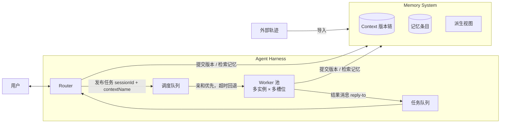

# Genvagent 概念模型

版本：v0.24 · 状态：概念草案 · 日期：2026-11-19

本文是全部设计文档的基础，只定义顶层概念、归属与关系，不涉及接口签名和实现细节。其他文档里的术语以本文为准。

## 1. 目标

Genvagent 要解决两个问题：

1. **持久化执行（Durable Execution）**：长时任务可以中断、恢复、更换执行者，面向用户的 Router 不被后台任务阻塞。
2. **统一用户记忆（Unified User Memory）**：跨会话、跨 Host 地积累、检索和纠正关于用户及其工作的记忆，每条记忆都可以追溯来源。

前者由 **Agent Harness** 负责，后者由 **Memory System** 负责。

## 2. 系统划分

| 系统 | 回答的问题 | 拥有的权威状态 |
| --- | --- | --- |
| Agent Harness | 谁在何时做什么 | Task、消息队列、租约、执行日志 |
| Memory System | 记住了什么，依据是什么 | Context 及其版本、来源资料、记忆条目 |
| Host Adapter | 如何接入 Host，即已有的 agent 程序（dsh、pi 等），借用它们的 LLM 调用与工具执行 | Host 会话与 Task 的映射（可以重建） |

划分原则：

- **单一归属（Single Owner）**：每类状态只有一个系统可以写入，另一方通过引用读取。
- **内容与控制分离**：Memory 保存内容，内容不可变、可引用、可检索。Harness 保存控制状态，控制状态可变、需要并发控制。消息只携带控制信息和内容引用。
- **单向依赖**：Harness 调用 Memory；Memory 不感知任务、调度和租约，也不调用 Harness。



## 3. Memory 侧概念

| 概念 | 定义 |
| --- | --- |
| 用户域（User Scope） | 隔离、授权与聚合的边界；所有对象归属唯一用户域 |
| 会话（Session） | 一项工作（一件事）的资料容器。可以有多个 Worker 并行，各自使用其中的一个 Context。由 Router 选定沿用或新建；不是进程，也不是锁 |
| 上下文（Context） | 一个 LLM 工作上下文，由一条**线性版本链**组成；链尾是它的最新版本（head） |
| 上下文版本（Context Version） | Context 在某一时刻的不可变**完整快照**，包括消息序列、指令和输入配置；不是相对上一版本的增量 |
| 分叉（Fork） | 以任意已有版本为起点创建一个新 Context；新 Context 记录来源版本，与原 Context 共享已有正文 |
| 内容块（Content Block） | 内容寻址（content-addressed）的不可变正文，可被多个版本共享引用 |
| 来源（Source） | 记忆的原始证据：执行产生的 Context 版本、导入的外部轨迹（Trace）、用户提供的材料 |
| 记忆条目（Memory Item） | 从来源提炼出的可复用知识，带溯源（provenance）、适用条件、有效期、修订号和生命周期状态 |
| 墓碑（Tombstone） | 对已遗忘内容的显式标记。不改写历史，但被标记的内容不再参与检索和记忆提炼 |
| 派生视图（Derived View） | 会话摘要、用户画像、检索索引；可以从权威数据重建，允许滞后 |

**标识符**：

| 标识符 | 分配方 | 定义 |
| --- | --- | --- |
| `sessionId` | Memory | Session 的全局唯一标识，创建后不变 |
| `contextId` | Memory | Context 的全局唯一标识，创建后不变；系统内部引用一律使用它 |
| `contextName` | Router | Context 在所属 Session 内的逻辑名称，例如 `交通`、`住宿`；Session 内唯一。`(sessionId, contextName)` 与 `contextId` 一一对应，绑定后永不改变 |
| `seq` | Memory | 版本序号：Context 内从 1 开始单调递增 |
| 版本引用 | — | `contextId@seq`，唯一定位一个不可变版本 |

`contextName` 是给 Router 和人看的语义名称；`contextId` 是给系统用的稳定引用。只给出名称时，Memory 通过"查找或创建"把它解析为 `contextId`。

**版本模型**：

- **提交（commit）**：在链尾之后提交一个新版本，新版本成为新的链尾；Context 内不产生分支。提交时必须声明基于哪个版本，只有该版本仍是链尾才能成功（乐观并发控制，optimistic concurrency control）。
- **读取**：LLM 调用只使用最新版本这一份快照；历史版本只用于溯源和回退，不会发给 LLM。
- **分叉（fork）**：以任意 Context 的任意版本（包括历史版本，不限于最新版本）为起点创建新 Context，记录来源版本，与原 Context 共享已有正文。原 Context 不受影响，继续前进。
- **查找或创建（get-or-create）**：按 `(sessionId, contextName)` 原子地取得 Context，不存在就新建；并发调用只会得到同一个 Context。

提交与分叉的取舍原则：**同一件工作的延续，在原 Context 上提交新版本；需要两条路线并存，才分叉出新 Context。**

| 操作 | 方式 | 理由 |
| --- | --- | --- |
| 执行一个步骤 | 提交：新版本 = 上一版本内容 + 本步骤的输入输出 | 工作的正常延续 |
| 压缩（compact） | 提交：新版本 = 摘要 + 保留的近期内容，体积回到模型上限以内；附带压缩元数据。由 Harness 发起，Memory 执行并代为提交 | 还是同一件工作；Context 身份与名称不变，任务无需换绑；与并发写入的冲突由乐观并发拦截 |
| 回退，放弃最近几步 | 提交：新版本 = 某个历史版本的内容 + 放弃摘要 | 被放弃的路线不需要继续，历史仍可追溯 |
| 回退，同时保留当前路线 | 从历史版本分叉 | 两条路线并存 |
| 并行探索 | 分叉 | 两条路线并存 |

```text
Context A（交通）: v1 → v2 → v3 → v4(压缩) → v5
                         └─fork─→ Context B（交通-备选）: v1 → v2
                                 （从历史版本 A@2 分叉；A 继续前进到 v5，互不影响）
```

**压缩与回退附带的说明信息**：

- **压缩元数据**：压缩前的大小、被压缩的版本范围、压缩前涉及的关键资源（例如读过、改过的文件），用于溯源与调试。
- **放弃摘要（abandon summary）**：回退时，用一段摘要说明放弃了哪几步、为什么放弃，并作为新版本的一部分交给 LLM，避免它重蹈覆辙。这一做法借鉴自 pi 的分支摘要（branch summary）。

版本是完整快照，所以"提交压缩版本"不是把摘要接在旧内容后面，而是让最新版本变成一份更短的内容。下一步 LLM 读到的只有这份压缩后的快照；被压缩前的旧版本照常保留，用于溯源。

| 版本 | 内容 | 大小（上限 128K） |
| --- | --- | --- |
| v3 | 简报 + 第 1～2 步 | 120K，接近上限 |
| v4（压缩） | 简报 + 摘要 + 第 2 步后半段 | 20K |
| v5 | v4 的内容 + 第 3 步 | 45K |

**记忆条目**按两个独立维度描述：

- **语义类型**：事实（fact）、偏好（preference）、目标（goal）、方法（procedure）、经历（episode）、笔记（note）。
- **时间跨度**：短期（short-term）或长期（long-term）。

用户画像是记忆条目的聚合视图，不是一份独立维护的"用户真相"。

## 4. Harness 侧概念

### 4.1 执行

| 概念 | 定义 |
| --- | --- |
| Agent 角色（Agent Role） | 指令、工具集与终止条件的配置。**Router** 是面向用户的编排角色，负责理解、澄清、委派和汇总；**Worker** 负责执行具体任务 |
| Agent 实例（Agent Instance） | 正在运行某个 Task 的执行体，可以随时替换，不持有权威状态 |
| 任务（Task） | 持久化的工作单元：目标、约束、完成条件、父任务、回复地址（reply-to）、所属 Session、contextName 和状态。Router 与用户的持续对话也是一个长期 Task |
| 租约（Lease） | Task 的独占执行权，带过期时间和防护令牌（fencing token）；令牌过期后，旧持有者的写入一律被拒绝。语义上类似消息队列中的可见性超时（visibility timeout） |
| 步骤（Step） | 一次 LLM 调用，加上它触发的全部工具执行。一个步骤结束时整体提交，在 Context 上生成一个新版本 |
| 执行日志（Execution Log） | Task 状态变化、步骤和租约事件的追加写（append-only）记录，只用于审计和故障排查，不导入 Memory |
| 执行存储（Execution Store） | Harness 自有的持久化存储，保存全部控制状态；可以选用关系数据库或消息中间件，不依赖 Memory |

### 4.2 指派规则

指派分成两类决策，分别由不同的参与方负责：

| 决策 | 性质 | 负责方 |
| --- | --- | --- |
| 属于哪件事：沿用哪个 Session、使用哪个 Context | 语义判断 | Router，借助 Memory 的 Session 目录检索 |
| 由谁来执行 | 机械分配 | 消息队列：亲和优先，超时回退为竞争拉取 |

Router 发布任务时指定：

- **sessionId**：沿用已有 Session，或新建。
- **contextName**：要使用的 Context 的名称。Router 不需要知道它是否已经存在，也不指定版本，总是从最新版本继续。
  - 不给出 contextName 时，Harness 生成一个新名称，即一次性的新 Context。
  - 可以显式给出分叉来源（某个 Context 的某个版本），用于并行探索或从历史某点重来。
- **任务简报**：目标、约束和必要的引用材料。新建的 Context 只携带任务简报，不继承父任务的完整上下文。

Worker 拉到任务后，按 `(sessionId, contextName)` 查找或创建 Context，不自己判断"相关性"。同一个 Context 同一时刻只能有一个活跃 Task；如果 Context 正被占用，从它的最新版本分叉出新 Context，而不是抢用。

**亲和（Affinity）**：Worker 进程里可能还留着上次执行时的资源，例如文件句柄、子进程、工作目录和缓存，所以任务应尽量回到上次执行同一 Context 的 Worker。采用**软亲和（soft affinity）**：

- Harness 记录每个 Context 最近一次的执行者，作为亲和目标。
- 任务先投递到亲和目标的专属队列（sticky queue）。
- 亲和目标在超时时间内没有取走任务（忙、已退出或已失联），任务回退到公共调度队列，由任意空闲 Worker 竞争拉取。
- 亲和只是性能优化，不是正确性前提：换了 Worker 时，新 Worker 从 Memory 恢复 Context，并核对、重建外部资源。

首版不单独设调度器：Worker 拉取即分配，Worker 数量就是并发上限，拉取模式天然提供背压（backpressure）。

### 4.3 消息模型

Harness 内部采用标准消息队列模型：

| 概念 | 定义 |
| --- | --- |
| 消息（Message） | 带消息 ID 的持久记录，包含类型（输入、补充、取消、结果）、载荷（正文以内容引用表示）、关联 ID（correlation ID）和回复地址（reply-to） |
| 生产者 / 消费者（Producer / Consumer） | 发送消息的一方 / 处理消息的一方 |
| 任务队列（Task Queue） | 每个 Task 一个点对点队列，以 Task ID 作为路由键（routing key）；只有当前租约持有者消费，属于独占消费者（exclusive consumer） |
| 调度队列（Dispatch Queue） | 待运行 Task 的公共队列，只存放 Task ID，不存放消息内容；按角色分为 Router 调度队列和 Worker 调度队列。对应角色的实例以竞争消费者（competing consumers）方式拉取，同一 Task 只会被一个实例取走。新任务、被唤醒的父任务、收到新输入的 Router 都进入这里 |
| 专属队列（Sticky Queue） | 每个 Worker 一个，存放以它为亲和目标的 Task；超时未取走的 Task 回退到调度队列 |
| 确认（Ack） | 消费者在处理效果已持久化后确认消息；未确认的消息在租约失效后重新投递（redelivery） |
| 死信队列（Dead Letter Queue） | 超过重投递次数上限仍无法处理的消息 |

投递语义为**至少一次（at-least-once）**，消费端必须是**幂等消费者（idempotent consumer）**，按消息 ID 去重。子任务的结果消息以子 Task ID 作为关联 ID，发往父任务的 reply-to 队列。

## 5. 核心交互

**委派（Delegation）**：

```text
用户输入 → Router
  → 检索 Session 目录，决定 sessionId（沿用或新建）和 contextName
  → 发布任务 {sessionId, contextName, 任务简报, reply-to}
     （有亲和目标则进入其专属队列，否则进入调度队列）
  → 立即答复"已受理"，结束本步骤，不等待子任务完成

Worker 拉取任务，获得租约
  → Memory 查找或创建 (sessionId, contextName) 对应的 Context
  → 逐步执行
```

**执行一步**：

```text
持有 Task 租约
  → 读取 Context 最新版本 vN（序号 seq = N），从任务队列取出未确认的消息
  → 调用 LLM，执行它请求的工具
  → 在 Memory 提交 vN+1（声明基于 vN；版本中记录 Step ID 与已纳入的消息 ID）
  → 在任务队列中确认（Ack）这些消息
```

几个关键点：

- 提交版本是一个步骤的提交点。如果在提交之前崩溃，整个步骤重做，工具可能重复执行，所以 Harness 把 `Step ID + 工具调用 ID` 作为幂等键传给工具。
- 如果在提交之后、确认之前崩溃，消息会被重投递。恢复时，消费者发现这些消息 ID 已经记录在最新版本里，直接确认，不再重复处理。
- 失去租约的旧执行者，即使还在运行，它提交的版本也会因为基于的不再是链尾而失败。

**回报（Reply）**：子 Task 结束时，在执行存储的同一事务里写入终态，并把结果消息投递到 reply-to 队列。父 Task 因此重新进入调度队列。回报是新的消息，不是原委派调用的第二次返回。

**记忆沉淀（Consolidation）**：Memory 在后台从 Context 版本和导入轨迹中提取候选记忆，经过溯源校验、去重和冲突检查后发布修订。Harness 通过检索使用记忆，通过反馈接口纠正记忆。

**遗忘（Forgetting）**：用户要求遗忘时，Memory 给相关的内容块和记忆条目打上墓碑，并传播到依赖它们的记忆条目和派生视图。历史版本保持原样。

## 6. 核心不变量

1. 同一 Task 在任一时刻最多有一个持有有效租约的执行者；同一 Context 在任一时刻最多被一个活跃 Task 使用。
2. Context 版本不可变；一个 Context 的版本线性演进，提交新版本必须基于当前链尾。
3. `(sessionId, contextName)` 与 `contextId` 的绑定一旦建立，永不改变。
4. 一个步骤恰好对应一个新版本；对同一 Step ID 的重复提交返回同一个版本。
5. 消息至少投递一次；只有在处理效果持久化之后才确认。
6. Task 终态与回报消息原子提交。
7. 派生视图可以重建，旧的派生结果不能覆盖新的派生结果。
8. 记忆条目必须能追溯到来源；同一来源的共享内容不能重复计为独立证据。
9. 带墓碑的内容不再参与检索、记忆提炼和派生视图的重建。

## 7. 术语对照

| 旧称（v0.16 及以前） | 现称 |
| --- | --- |
| 领取、Claim、Version Claim | 租约（Lease），作用对象由 Context 版本改为 Task |
| 续接版本、续接位置、上下文游标 | 已移除；Task 绑定 Context，使用其最新版本（head） |
| Task 收件箱、inbox、信箱（Mailbox） | 任务队列（Task Queue） |
| 调度队列、工作队列（Work Queue） | 调度队列（Dispatch Queue），归属从 Memory 改为 Harness |
| contextKey（v0.19） | Context 名称（contextName） |
| versionId | 版本序号（seq），版本引用写作 `contextId@seq` |
| returnTo | 回复地址（reply-to） |
| 消息消费确认 | 确认（Ack） |
| Event 流 | 执行日志（Execution Log），归属从 Memory 改为 Harness，不导入 Memory |
| Interaction、交互 | 步骤（Step） |
| History | 已移除，由 Context 版本与来源替代 |

## 8. 已定决策与待决问题

已定决策：

| 问题 | 决策 |
| --- | --- |
| 遗忘与不可变性 | 采用墓碑：显式标注，不改写历史 |
| 子任务上下文 | 默认新建 Context，只携带任务简报；需要时显式分叉 |
| 工具结果持久化粒度 | 作为步骤的一部分提交；一个步骤生成一个版本 |
| 执行日志与记忆 | 执行日志只留在 Harness，不作为来源导入 Memory |
| 压缩与回退 | 同一工作的延续在原 Context 上提交新版本（压缩版本是更短的快照）；需要路线并存时分叉 |
| 任务指派 | 软亲和：优先回到上次的 Worker，超时回退为竞争拉取 |
| 压缩的执行方 | Harness 决定何时压缩并给出目标大小；Memory 执行压缩并代为提交 |
| 跨 Session 分叉 | 允许：可以从其他 Session 的任意版本分叉 |

待决问题：

- **亲和超时**：回退等待时间如何设定，是否按任务类型区分。
- **授权模型**：单用户之外的共享与委托访问。很重要，留待后续分析。
- **墓碑的边界**：墓碑不做物理删除，如果将来有合规层面的硬删除需求，可以叠加加密擦除（crypto-shredding）。另一个问题是，已有 Context 的后续步骤是否要遮蔽带墓碑的内容。
