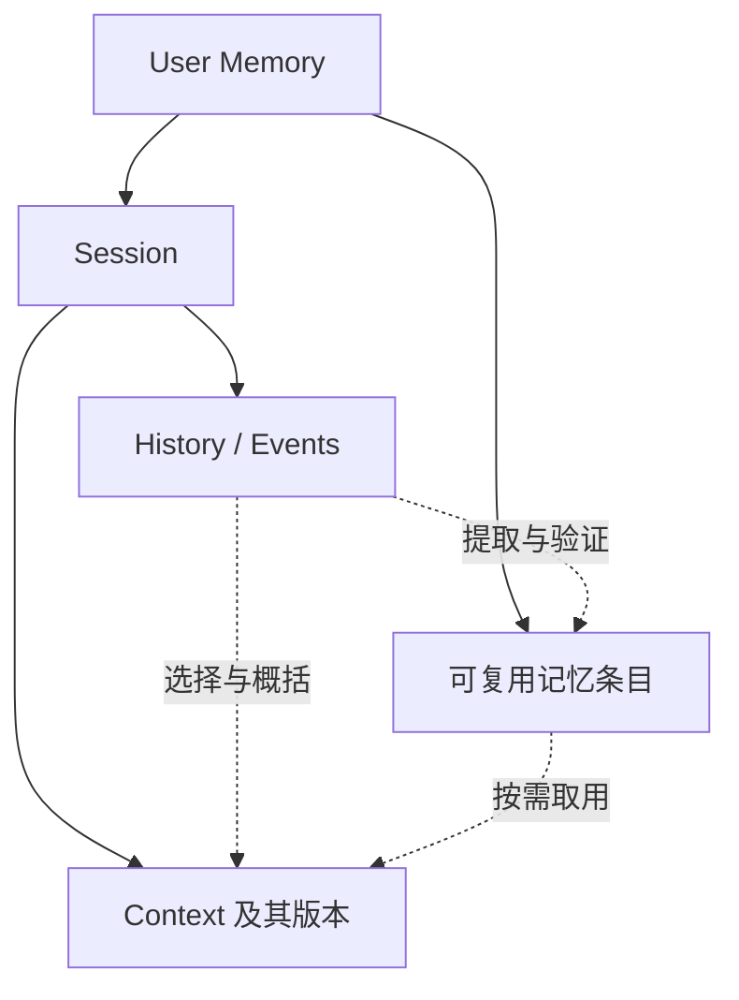

# Harness 与 Memory：概念模型与能力边界

状态：设计草案 v0.8；2026-11-17。本文定义领域对象、对象关系及两系统之间的抽象契约，不定义字段、SDK 签名或 HTTP 协议。

[整体架构](architecture.md)说明系统分工；本文回答 Memory 管理什么、Harness 使用什么。具体存储机制和接口载荷另见[实现参考](integration-reference.md)，不作为理解本模型的前置条件。

## 1. 先区分四个层次

| 层次 | 要说明的内容 | 本文的位置 |
| --- | --- | --- |
| 领域模型 | User Memory、Session、History、Context、记忆条目分别是什么，如何关联 | 第 2–4 节 |
| 系统能力边界 | 谁暴露接口、谁调用、操作哪个对象、承诺什么结果 | 第 5 节 |
| 交互逻辑 | 一次工作如何记录经历、形成 context、恢复执行和沉淀记忆 | 第 6 节 |
| 实现机制 | 函数名、字段、HTTP、数据库、锁、租约、版本比较、通知投递 | 实现参考及各系统内部设计 |

接口是对领域对象提供的能力。不能用一组 RPC 名称代替对象模型，也不能从数据库表或事件类型反推业务概念。

## 2. Memory 管理的核心对象

### 2.1 User Memory：用户的统一记忆域

User Memory 包含该用户的工作经历、会话工作状态和可复用知识。用户切换进程、Host、任务或话题，不会因此得到另一套用户记忆。

用户画像、短期记忆、长期记忆是对这些信息的不同组织与使用方式。notes 是表达形式，主题集合是可选分类；它们不构成独立的用户归属域。

### 2.2 Session：一段持续工作的边界

Session 表示一段可以持续、暂停和恢复的工作，负责把相关经历与工作状态组织在一起。它不是一次模型调用、一个 task 或一个 Worker 进程。

Memory 中，一个 Session 管理：

- 工作目的、身份和生命周期。
- 属于这段工作的 History。
- 当前 Context 及其历史版本。
- 与任务、来源和派生工作有关的引用。

同一 Session 可以先后处理多个相关 task，由不同 Worker 继续。Router 的对话也是一种 Session。是否继续原工作、另起工作或保留分支，由 Harness 根据用户意图决定；Memory 提供相应的持久对象操作。

### 2.3 History 与 Event：发生过什么

History 是 Session 的可追溯记录。Event 是其中一次已记录的输入、观察或变化，例如用户消息、工具返回、任务结果。事件是记录单元，不等于消息总线中的通知。

需要区分事件的两种用途：

| 用途 | 例子 | 如何使用 |
| --- | --- | --- |
| 工作经历与证据 | 用户要求、检索材料、工具观察、结果及纠正 | 可供回顾、Context 组装和知识提取 |
| 执行与控制记录 | 请求准备、任务状态转换、恢复位置 | 用于调度、恢复和诊断，默认不作为知识召回材料 |

这两类记录可以使用共同的底层日志机制，但不能在检索和记忆整理时不加区分地使用。任务完成通知属于协作机制；通知引用已保存的结果，不代替结果本身。

Memory 为 History 提供归属、追加、读取和来源追溯。新纠正追加为新记录，不通过修改旧原话掩盖历史。某条陈述被记录，只证明它曾被表达，不自动证明它正确。

### 2.4 Context：当前如何继续工作

Context 是 Session 当前选定的工作状态，包括目标、约束、有关消息与证据、已有结论、进度和未决问题。它可以同时取材于本 Session 的 History 和用户的其他记忆。

Context 不是全部 History，也不只是 History 的压缩文本。选择了哪些材料、采用了什么摘要、当前推进到哪一步，都是需要保存的状态，未必能仅凭原始日志自动复原。

Harness 负责构建、追加和压缩 Context；Memory 保存明确版本，并提供当前版本与历史版本的读取。保存新版本改变的是这段工作的状态，不覆盖其原始 History。

checkpoint 是 Context 版本的一种实现表示。它表达“这份工作状态已保存”，不表达“某个进程已经加载它”或“模型已经使用它”。

### 2.5 记忆条目：哪些信息值得以后复用

记忆条目表达有来源、适用条件和修订的事实、偏好、目标、方法、经历摘要或 note。它可以从会话经历中整理产生，也可以来自用户明确提出的记忆要求。

条目不附属于某个进程，其可复用范围也不局限于来源 Session。新的 Session 可以读取它，来源 Session 结束后它也可以继续存在。

条目是否值得长期保留，需要独立判断。Session 完成、退出或退役不是“所有内容转为长期记忆”的条件。

### 2.6 对象之间的关系

Session 把经历和工作状态组织起来；History 保留来源，Context 支持继续执行，记忆条目支持跨会话复用。它们通过引用关联，不能把同一份信息在不同位置的副本误当成多个独立事实。

## 3. 短期记忆、长期记忆与工作 Context

短期/长期描述信息的用途和保留策略，不按“是否落盘”划分，也不直接对应两张表。

| 概念 | 主要包含什么 | 与核心对象的关系 |
| --- | --- | --- |
| 工作记忆 | 某个 Session 当前执行所需的目标、材料和进度 | 由该 Session 的 Context 表达 |
| 短期记忆 | 当前目标、近期有关经历、待办、未决问题和临时记忆条目 | 汇集有关 Session 的工作状态、近期 History 与短期条目；可持久恢复 |
| 长期记忆 | 经筛选保留、预期跨会话复用的知识与经历 | 主要由带来源和适用条件的记忆条目表达 |
| 历史存档 | 已结束工作的原始记录和旧 Context | 仍可查询，但不会因此全部成为长期知识 |
| 用户画像 | 有关用户的事实、偏好、目标和约束 | 由有关条目与来源形成视图，不是另一套无来源事实 |

这几种视图并非互斥分区。一条长期偏好被读取到当前 Context，表示它参与了当前工作，不改变原条目的长期属性。

三个转换需要分开：

1. **Context 组装/压缩**：为当前执行选择和组织材料，改变工作视图。
2. **记忆沉淀**：从经历中提取、验证和修订可复用知识，形成记忆条目。
3. **历史保留/删除**：决定原始资料及版本如何保存，受独立的数据生命周期策略管理。

短期信息不必沉淀为长期记忆。Context compact 不自动发布长期条目；Session 退役也不自动删除长期条目。

## 4. Memory 如何管理 Session、Context 和 History

| 对象 | Memory 的管理责任 | Harness 的使用责任 |
| --- | --- | --- |
| Session | 保存稳定身份和生命周期，提供发现、创建、分叉及退役能力 | 判断新建还是继续，选择执行对象，分配 Worker |
| History | 保存有归属的经历与控制记录，支持追加和精确读取 | 报告已发生的输入、观察和结果；恢复时读取必要记录 |
| Context | 保存工作状态版本，关联其来源和已处理经历，支持恢复 | 组装、追加、compact，准备实际模型输入 |
| 记忆条目 | 检索、验证、整理、修订、失效与保留 | 提出信息需求，选用材料，提交纠正或知识候选 |

Session 的管理有两个决策来源：Harness 决定在线工作如何组织；Memory 的后台维护按既定策略管理已结束或闲置的持久对象。Memory 不因此获得启动 Worker 或执行工具的职责。

历史追加与工作状态更新是两个动作。Memory 保存 Context 时，同时记录它已处理到哪段经历；新事件已保存、Context 尚未更新是允许出现的中间状态。这个对应关系用于恢复，不能把“最新事件”直接当成“当前 Context”。

继续 Session 时，Memory 返回当前工作状态及尚未纳入的相关记录。Harness 恢复 Context，并从执行协作记录核对未完成任务和动作；仅加载 Context 不能证明外部工具已完成。

分叉表示创建独立 Session，并引用明确的历史状态；后续变化不写回父 Session。退役表示停止继续写入和执行，历史仍可查询。具体退出记录、条件检查和后台任务属于生命周期能力的实现。

## 5. 谁暴露什么接口

### 5.1 Memory 领域接口：对外服务能力

**提供方是 Memory System，调用方是 Harness Core 或独立客户端。** 这里的接口按对象和能力划分，不预设一个能力对应多少个 RPC。

| 能力边界 | 暴露的抽象对象 | 调用方表达的意图 | Memory 承诺的结果 |
| --- | --- | --- | --- |
| 会话管理 | Session | 创建、发现、选择、分叉或请求结束一段工作 | 可持久定位的工作边界与明确生命周期 |
| 会话记录 | Session 的 History | 记录经历，读取某段历史或某个来源 | 已保存且可追溯的记录 |
| 工作状态 | Session 的 Context | 保存当前工作状态，读取当前或历史状态 | 与 Session、来源相关联的版本化状态 |
| 记忆使用 | 用户记忆条目及视图 | 查找有关知识、画像或近期材料，读取证据 | 带来源、适用条件和可信状态的材料 |
| 记忆维护入口 | 记忆候选与纠正 | 提出值得保留的信息，纠正或停止使用旧知识 | 请求被记录，并进入相应验证或维护流程 |

例如，“保存 Context”的契约是持久化工作状态，不是要求 Memory 应用 prompt；“创建 Session”的契约是创建逻辑对象，不是启动进程。

### 5.2 执行协作接口：持久化运行协调

Task 状态、待处理输入和通知由 Harness 定义业务语义。为了断线恢复和 Router/Worker 异步协作，当前部署方案由 Memory 服务额外提供**执行协作存储接口**。

| 提供方 | 调用方 | 保存或查询的对象 | 领域边界 |
| --- | --- | --- | --- |
| Memory 服务的协作存储模块 | Harness 的 Dispatcher、Router、Worker Controller | task 状态、输入队列、结果通知、临时写入所有权 | 支持执行协调，不是用户知识或长期记忆 |

这些信息可能与会话记录存在引用，也可能共用数据库，但调度仍由 Harness 完成。一次 lease 续租或心跳不是用户经历，不能自动进入知识检索。

### 5.3 Harness 执行端口：系统内部调用

Runtime Driver/Host Adapter 向 Harness Core 暴露进程分配、执行容器挂载、模型调用、工具调用和结果核对能力。提供方是运行环境或 Host 适配器，不是 Memory。

这些端口属于 [Harness 设计](agent-harness.md)，不列入两系统的记忆领域契约。Host 原生会话定位也只是适配元数据，不定义逻辑 Session 的身份。

### 5.4 Memory 内部维护能力

Session Maintenance 管理退役；Memory Agent/Validator 管理知识提取与修订；保留和删除任务管理数据生命周期。它们是 Memory 的内部实现。

Harness 可以提交维护意图，但不需要了解后台 job、事务、表结构或模型调用步骤。具体内部流程见 [Memory 设计](memory-system.md)。

## 6. 用一个例子贯穿对象与接口

用户请 Router 安排行程。用户对话属于 Router Session，旅行规划属于另一个工作 Session；两者都在该用户的统一 Memory 域内。

| 阶段 | 持久对象发生的变化 | 使用的能力 |
| --- | --- | --- |
| 收到请求 | 用户消息写入 Router 的 History，成为一次 Router turn 的输入；Core 追加到 Context 并选取有关用户记忆 | 会话记录、记忆使用、工作状态 |
| 分派工作 | 创建旅行 Session，将任务要求与原始消息引用作为起点；持久保存 task 后，Router 可以回复并结束本 turn | 会话管理、会话记录、执行协作 |
| 推进规划 | Worker 恢复旅行 Context；模型输出与工具观察记录到其 History，再由 Core 追加或 compact 到 Context 并保存新版本 | 会话记录、记忆使用、工作状态 |
| 调整方案 | 新用户要求先进入 Router History；Router 通过任务输入交给 Worker，Worker 处理时记录来源并更新旅行 Context | 会话记录、执行协作、工作状态 |
| 暂停后继续 | 另一 Worker 读取同一 Session 的 Context 与后续记录 | 会话管理、工作状态、会话记录 |
| 向用户汇总 | Worker 保存结果；结果通知触发新的 Router turn，Router 读取结果，生成回复并保存自己的 History 与 Context | 执行协作、会话记录、工作状态 |
| 沉淀知识 | 将有充分依据的可复用信息提议为记忆条目 | 记忆维护入口 |
| 工作结束 | 释放执行占用；Session 可保留继续或由维护策略退役 | 执行协作、会话生命周期 |

一次 turn 是 Harness 处理一条输入并推进模型交互的执行单位，不是新的 Memory 分区。它产生的消息先作为所属 Session 的 History 持久记录，再由 Core 纳入 Context；每次保存 Context 都形成新的工作状态版本。Worker 的最终结果触发新 turn，不作为旧分派调用的第二次返回。

“这次预算有限”是当前工作的临时约束，不应自动成为长期画像。如果用户明确要求“以后规划也尽量少换乘”，这可以作为长期偏好的候选，并保留原始要求作为来源。

原始对话保留，不代表所有对话都属于长期记忆；Context 保存，不代表模型已经调用；Session 退役，不代表知识已经提取完成。三个事实由各自的对象和流程表达。

## 7. 细节文档的使用顺序

先确认本文的对象关系与能力边界，再讨论实现参考中的函数、字段和传输协议：

- [接口实现参考](integration-reference.md)：候选 SDK/服务函数、载荷和 HTTP 映射；尚未冻结。
- [Harness 内部设计](agent-harness.md)：执行 loop、Driver 和 Router/Worker 协作。
- [Memory 内部设计](memory-system.md)：对象管理、维护、存储及一致性实现。

第一版的行为约束保持不变：统一用户 Memory，Router 不阻塞等待 Worker，Worker 可替换，context 使用 append + compact，Memory 可独立部署。CLM 与资源虚拟化仍是后续扩展。
