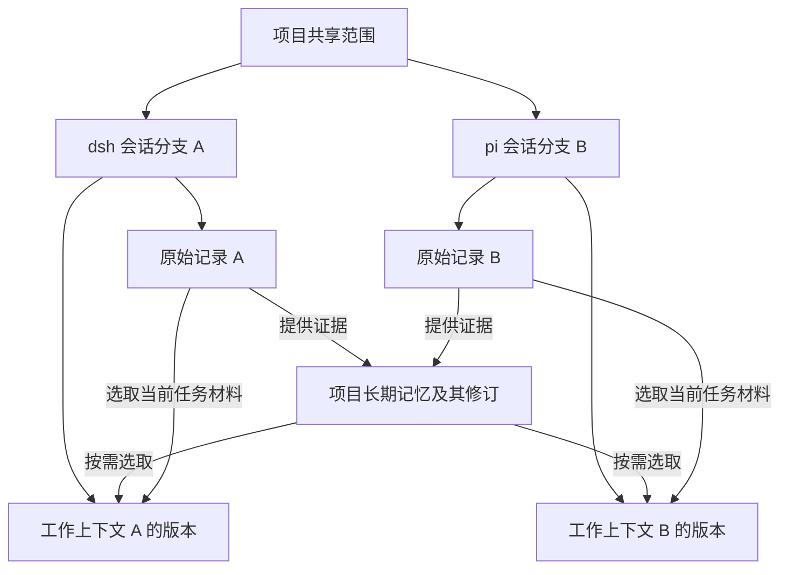
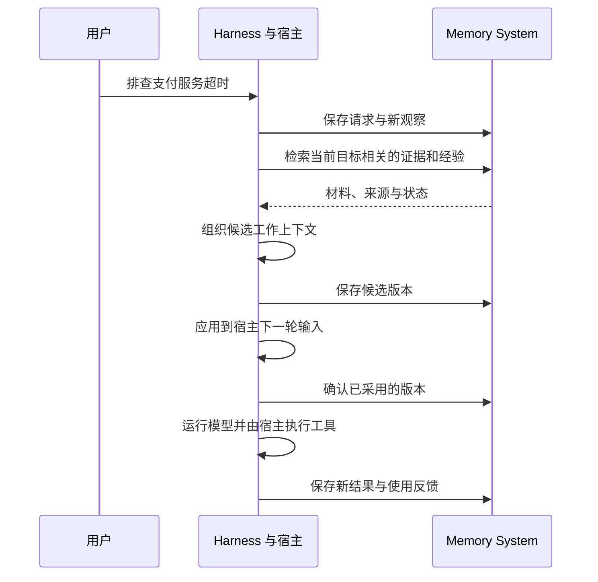

# Agent Harness 与 Memory System 的交互模型与协议

状态：设计草案 v0.3；接口尚未实现。

Harness 与 Memory 的协作围绕一个循环展开：**Harness 把执行中发生的事情交给 Memory 保存，从 Memory 取回相关知识，形成下一轮工作的上下文；Memory 在后台把这些经历整理成后续任务可复用的记忆。** 两侧还要记录当前采用了哪一份上下文，使进程重启后能够核对和继续工作。

本文先解释这个循环中的对象、职责和交互，再给出数据结构与接口。理解系统关系可先阅读第 1–6 节；实现时从[概念到协议的映射](#7-从概念模型到协议)进入[数据结构](#8-数据结构与操作语义)、[HTTP 接口](#9-http-接口清单)和[故障处理](#10-幂等并发与错误)。

## 1. 两侧分别负责什么

**Agent Harness 负责当前任务怎么继续。** 它以插件接入 dsh、pi 等宿主，理解当前目标，选择需要的信息，组织模型下一轮看到的内容，并把执行产生的消息和结果同步出去。实际模型调用、工具执行和权限仍由宿主负责。

**Memory System 负责信息怎么保留和复用。** 它保存经历和上下文版本，回答检索请求，并由后台 Memory Agent 检查来源、修订错误、整理经验和生成预备 notes。Memory 可以独立部署在单机或集群，后台整理不要求宿主在线。

两侧的分工是：**Harness 决定当前使用哪些信息以及如何组织它们；Memory 负责持久保存这些信息，并维护可供未来使用的知识。** 存储工作上下文不赋予 Memory 后台改写活动会话的权限。

## 2. 原始记录、长期记忆与工作上下文

下面以“排查支付服务超时”为例。同一段工作会产生三种不同的信息，它们的用途和更新方式不同。

| 概念 | 含义与例子 | 谁产生或整理 | 如何变化 |
| --- | --- | --- | --- |
| 原始记录 | 当时发生的事：用户提出问题、工具读取配置、压测返回结果 | 宿主产生，Harness 同步，Memory 保存 | 追加保存；后来发现结论有误，也保留当时的观察 |
| 长期记忆 | 从经历中提炼、可供复用的知识：某环境的连接池配置、已验证的排障步骤 | Memory Agent 整理；Harness 可提交观察和纠正 | 带来源、适用条件和修订历史，可能被更新或标记为不确定 |
| 工作上下文 | 当前 agent 为继续这个任务选出的材料：目标、关键约束、相关配置、已排除的原因、下一步计划 | Harness 构建与编辑，Memory 保存版本 | 随任务推进更新；下一轮可以移出长日志而保留来源引用 |

原始记录回答“当时看到或做了什么”，长期记忆回答“有哪些经验可以复用”，工作上下文回答“这一轮需要看到什么”。一段工具输出可以同时成为后两者的来源，但三者保持独立。

### 2.1 一份记录如何产生两种用途

假设一次压测显示，在特定环境和配置下发生连接池耗尽。Harness 可以立即把结果加入当前工作上下文，让 agent 决定下一步排查。稍后，Memory Agent 再结合配置版本和其他证据，整理出适用于该环境的诊断 note。

Harness 从当前视图移出这段完整压测日志，只表示本轮不再展开它；原始记录仍可读取。Memory Agent 修订诊断 note，也不会自动替换正在执行的工作上下文，Harness 会在后续请求边界决定如何吸收更新。

### 2.2 来源让信息可以被核对

长期记忆和工作上下文都需要保留来源：这条判断来自哪次观察，使用了哪一个版本的 note。来源用于重新读取细节、发现过期判断，以及解释一次回答为什么依赖某条信息。

“保存了一个说法”与“验证了这个说法”也要区分。例如用户说“连接池已经扩容”，原始记录应保存这句话；是否已经完成部署，还需要相应环境或工具结果支持。

## 3. 信息如何归属和关联

项目是共享知识的范围，会话分支是一次连续工作的范围。dsh 和 pi 可以连接同一个项目、复用长期记忆，同时各自拥有独立的原始记录流和工作上下文。



这些对象都能保存在 Memory 中；它们的归属和修改责任不同。协议需要表达以下关系：

- **共享范围**：哪些客户端在同一个 workspace/project 内工作，哪些信息可以共享。
- **会话关联**：宿主中的某个会话分支，对应 Memory 中的哪条记录流和哪份工作上下文。这个关联在插件重启后仍然存在。
- **记录流**：同一分支同步过哪些事件，Memory 已经收到了哪里，哪些还需要补传。
- **上下文版本**：每次保存的工作视图是什么，宿主当前确认采用的是哪一版。
- **知识来源**：当前工作视图引用了哪些原始记录和记忆修订，便于核对与更新。

如果用户在宿主中从旧节点另开一条分支，新分支可以继承那个时刻的上下文，但拥有新的记录流和当前版本指针。旧分支后来的输入不会因此变成新分支的当前输入。

工作上下文的版本持久化后保持不变；“当前采用版本”是另一个可更新的指针。这样既能继续推进任务，也能回查过去某一轮准备了什么材料。进程只是临时执行者，这些持久关联使换进程后仍能找到同一份工作。

## 4. 一次任务中怎样交互

### 4.1 在线执行

延续支付服务超时的例子，一次完整交互如下：

1. **识别这次工作。** Harness 确定项目和当前会话分支；首次接入建立关联，重启后找到既有记录与上下文。
2. **保存新经历。** 把用户请求以及已经发生的新观察同步到 Memory。此时只是留下记录，不要求后台已提炼成知识。
3. **取回相关材料。** Harness 根据目标询问 Memory：“当前环境有哪些已知限制、类似问题如何排查？”Memory 返回相关材料、来源和可信状态。
4. **形成工作视图。** Harness 将这些材料与当前目标、近期结果和计划组合，得到下一轮的候选上下文，并保存该版本。
5. **在宿主中采用它。** adapter 将候选应用到宿主的下一轮输入，确认应用结果，再继续模型调用。记录“保存”和“采用”两个事实，是为了处理这两个动作之间的中断。
6. **继续留下经历。** 模型输出和工具结果进入原始记录，Harness 更新当前工作视图。任务需要时重复检索与整理，不要求每个步骤都进行完整召回。



这条在线路径要求原始记录和工作视图能够及时读写；它不等待 dreaming 完成。

### 4.2 后台整理与后续复用

Memory Agent 在后台阅读上述经历，检查已有 notes，把有证据支持的排障经验发布为新的长期记忆。它也可以为可能出现的后续问题，提前整理带适用条件的诊断 note。

后来，用户在 pi 中继续处理同一项目的类似问题。pi 的 Harness 从共享 Memory 检索到这条经验，构建自己的工作上下文。它复用了知识；是否需要导入 dsh 的执行会话，是另一项取决于宿主格式与恢复能力的操作。

### 4.3 纠正与继续工作

如果用户补充“刚才使用的是旧环境配置”，Harness 先保存纠正并立即调整当前任务的目标或约束，再向 Memory 反馈受影响的 note。Memory 重新核对来源，发布修订或标记冲突，并通知正在使用相关知识的客户端。

客户端在下一次构建上下文时重新读取被影响的材料。这个流程既让当前任务及时响应，也让其他宿主后续读取到修订后的知识。

## 5. 两个系统具体交换什么

下面先定义交互语义。无论以后通过本机调用还是远程服务实现，这些请求与确认的含义都应一致。

| 交互 | Harness 提供什么 | Memory 返回或保存什么 | 完成后能说明什么 |
| --- | --- | --- | --- |
| 建立或恢复工作关联 | 项目、宿主会话与分支身份 | 对应记录流、当前上下文版本、同步位置 | 两侧在谈论同一次工作 |
| 保存经历 | 已发生的消息、工具结果和观察，以及来源身份 | 可追溯的记录与接收位置 | 这些材料已经持久化；尚不代表内容被验证 |
| 检索与精确读取 | 当前问题、搜索范围、必须包含的来源 | 原始证据或长期记忆、版本、来源与状态 | Harness 获得了可供组织输入的材料 |
| 保存工作视图 | 候选上下文、所依据的旧版本、已经吸收的记录范围 | 不可变的候选版本 | 该版本可被取回；尚不代表宿主采用了它 |
| 确认采用视图 | adapter 确认的应用结果和候选版本 | 已采用版本指针与确认记录 | 宿主已在声明范围内应用该视图；尚不代表模型调用完成 |
| 反馈纠正与使用结果 | 纠正的原始依据、被影响的记忆版本或使用反馈 | 已记录的反馈，供后台核对 | 反馈已接收；记忆修订可以稍后完成 |
| 获取知识变化 | 客户端上次看到的位置 | 新修订、失效和删除通知 | 客户端知道哪些本地材料需要重新读取 |

这里没有“让 Memory 执行工具”或“让 Memory 调度宿主任务”的交互。Memory 的后台模型用于整理知识；宿主的模型用于推进当前任务。两侧交换信息及其使用状态，各自拥有自己的执行责任。

## 6. 这些交互需要哪些保证

**接收确认必须可靠。** 如果 Memory 确认保存，插件重启后就应能取回。网络超时不一定意味着写入失败，因此重试同一操作不能产生第二条经历或重复推进上下文版本。

**当前视图只能由有效的执行者推进。** 旧插件进程与恢复后的新进程可能短暂同时存在；系统必须能拒绝旧执行者覆盖新进度。同样，基于旧上下文准备的候选也不能静默覆盖已经变化的当前版本。

**保存、采用和执行分别确认。** 候选已保存但宿主尚未采用时，恢复应继续使用旧的已采用版本；宿主已采用但远端确认未完成时，恢复应核对并补交确认。模型和工具是否真的执行过，仍依据宿主记录。

**历史可以回查，当前输入要纳入新变化。** 检索或恢复时明确使用哪一个版本、哪些记录已经同步。用户纠正不能因为后台整理尚未完成而被忽略，来自另一个分支的消息也不能被当成当前分支的新输入。

后面的序号、版本检查、写入租约、幂等键和应用回执，分别用于落实这些保证。它们是交互语义的实现手段。

## 7. 从概念模型到协议

| 前面的概念或交互 | 协议表示 | 对应操作 |
| --- | --- | --- |
| 项目共享范围、会话关联 | Scope、SessionBinding | 注册、读取绑定 |
| 当前有效执行者 | WriterLease | 获取、续期、释放写入所有权 |
| 原始记录与接收位置 | RecordInput、AppendRequest、AppendReceipt | 追加与读取事件 |
| 知识及其来源 | EvidenceRef、RecallRequest、RecallResponse | 检索、读取修订、反馈 |
| 不可变工作视图 | ContextRef、ContextVersion | 保存与读取候选版本 |
| 当前采用版本与应用确认 | ContextHead、HostApplicationReceipt、ActivateRequest | 激活版本、读取当前指针 |
| 知识更新与失效 | changes 记录与客户端游标 | 拉取后续变更 |

这里的 binding 表示稳定的会话关联，stream 表示原始记录流，head 表示当前采用版本的指针，lease 表示临时写入所有权。它们不分别构成新的业务系统。

首版传输采用 HTTP + JSON，以 `/v1` 为路径前缀。单机与集群使用同一契约，仅 endpoint 不同；客户端不访问服务端数据库或文件路径，也不依赖请求落到某个固定节点。

MCP 可以作为检索等模型可调用能力的附加入口。完整 Harness 接入还需要原生插件负责会话同步、下一轮上下文应用与宿主确认，这些职责由第 4–5 节的交互决定。

## 8. 数据结构与操作语义

下列类型由 protocol 包定义。其他文档引用同一份类型。本节逐项落实前面的概念，不增加新的执行职责。

### 8.1 共享范围与会话关联

共享范围限定知识可见性；会话关联将宿主分支对应到持久记录流与工作上下文。较大正文使用内容引用传输。

```typescript
type ID = string;
type Timestamp = string;          // UTC ISO 8601
type JsonValue = null | boolean | number | string
  | JsonValue[] | { [key: string]: JsonValue };

interface Scope {
  workspaceId: ID;
  projectId: ID;
}

interface BlobRef {
  blobId: ID;
  sha256: string;
  mediaType: string;
  byteSize: number;
}

type Content = { type: "inline"; value: JsonValue }
  | { type: "blob"; ref: BlobRef };

type EvidenceRef = { kind: "event"; eventId: ID }
  | { kind: "memory"; memoryId: ID; revision: number };

interface ContextRef {
  contextId: ID;
  versionId: ID;                  // 不可变版本 ID；不是可移动的 latest 指针
}

interface SessionBinding {
  bindingId: ID;
  scope: Scope;
  host: "dsh" | "pi" | "other";
  hostVersion: string;
  hostInstanceId: ID;
  nativeSessionId: string;
  nativeBranchId: string;
  streamId: ID;
  contextId: ID;
  parentContext?: ContextRef;
}
```

`hostInstanceId` 是宿主安装实例的持久标识；临时连接使用另一个 owner ID。项目映射由配置指定，不能根据相同的本地目录名自动合并项目。Binding 与 scope 创建后不可改绑。

绑定唯一键为 `(scope, hostInstanceId, nativeSessionId, nativeBranchId)`。注册重试返回相同绑定。宿主分支、fork、回退后形成新执行分支时创建新 binding 和 stream，显式引用当时的 parentContext，不能复用旧分支的写指针或读取它后来的事件。

鉴权在服务层进行：token 绑定服务身份及可访问的 scope，具体对象 ID 也必须再次检查权限。请求体中的 scope 不能扩展 token 权限。API 凭据不进入事件、上下文或模型输入。

### 8.2 能力协商与写入所有权

先确认两侧支持的协议与上下文格式，再为当前插件实例分配写入所有权；这落实第 6 节关于旧执行者不能覆盖新进度的要求。

`GET /v1/capabilities` 返回协议版本、支持的 context formats、可选 features、批量事件和 inline payload 大小上限。主版本不兼容时停止连接；小版本只增加可选字段或能力。必需能力缺失时明确拒绝对应运行模式。

```typescript
interface ServerCapabilities {
  protocolMajor: number;
  protocolMinor: number;
  contextFormats: string[];
  features: string[];
  maxInlineBytes: number;
  maxBatchEvents: number;
}

interface WriterLease {
  bindingId: ID;
  ownerId: ID;                    // 当前插件实例，不是用户身份
  epoch: number;
  expiresAt: Timestamp;           // 以服务端时间为准
}

type LeaseRequest =
  | { action: "acquire"; ownerId: ID; requestedTtlSeconds: number }
  | { action: "renew"; ownerId: ID; epoch: number; requestedTtlSeconds: number }
  | { action: "release"; ownerId: ID; epoch: number };
```

一个 binding 同时只有一个有效 writer。客户端通过 lease 接口获取、续租或释放；新 owner 只能在旧租约释放或过期后获取更高 epoch。所有事件写入、上下文准备与激活携带 lease，服务端在提交事务中验证 epoch 与有效期。

acquire/renew 返回 WriterLease，release 返回 released 确认。requestedTtlSeconds 是客户端请求，服务端可按上限缩短；客户端以响应中的 expiresAt 安排续租。renew/release 必须同时匹配 ownerId 与 epoch。

lease 只控制 Memory 写入，不代表远程控制宿主进程。插件丢失租约后必须停止受管理的模型步骤和新的上下文修改；已经开始的外部工具仍由宿主管理。需要多个并行 agent 时，为每个执行分支创建独立 binding。

### 8.3 原始记录与同步位置

本组结构对应“保存经历”：保留宿主事件身份，并明确 Memory 已接收的连续范围，以便断线后补传。

#### 8.3.1 事件结构

```typescript
interface RecordInput {
  eventId: ID;
  sequence: number;               // 当前 stream 内，从 1 开始连续递增
  nativeEventId: string;
  nativePosition: JsonValue;      // 宿主序号或树节点位置，保持为 opaque 数据
  kind: "message" | "tool_call" | "tool_result" | "observation"
    | "model_request" | "model_result" | "context_marker" | "feedback";
  producer: "user" | "host" | "agent";
  occurredAt: Timestamp;
  content: Content;
  sourceRefs: EvidenceRef[];
}

interface AppendRequest {
  afterSequence: number;
  records: RecordInput[];
}

interface AppendReceipt {
  acceptedThrough: number;
  projectRevision: number;
}
```

`POST /v1/streams/{streamId}/events:append` 原子接受一个批次。新批次的 afterSequence 必须等于服务端已接收位置，序号不能跳跃。eventId 在 scope 内唯一，nativeEventId 在 stream 内唯一；相同内容重复发送不产生第二条事件，同一标识对应不同内容则报错。

客户端先将 nativeEventId、sequence、eventId 的映射写入本地持久同步日志，再发送，重启后复用。传输 sequence 表示规范化事件流顺序；宿主并行工具的实际关联与因果关系保留在 nativePosition/content 中，不能靠网络到达时间重建。

服务端确认意味着事件和引用内容已持久化。批次成功而响应丢失时，用原 Idempotency-Key 重试得到原 receipt。读取绑定状态也能核对 acceptedThrough；不从内存计数器推断进度。

#### 8.3.2 原始材料与派生信息

保存最终消息和工具结果，流式 token delta 默认不作为独立语义记录。必要的供应商私有字段可以放在带 host format 的 opaque content 中；它们能否恢复由 adapter 决定。

生成的摘要标明 producer 与 sourceRefs，不能伪装成用户原话或工具原始结果。工作上下文的修改不会覆盖这些事件。历史读取使用 `GET /v1/streams/{streamId}/events?after=...&limit=...`，返回连续分页及 nextSequence。

### 8.4 工作上下文版本与应用确认

**“已保存候选”“宿主已应用”“模型已调用”是三个不同事实。** 采用不可变 ContextVersion 和可移动 ContextHead，避免把一次存储成功误报为上下文已经生效。

```typescript
interface ContextVersion {
  ref: ContextRef;
  basedOnHeadRevision: number;
  format: string;                 // 如 genvagent.context.v1 或已协商的 native format
  body: Content;
  bodyHash: string;               // 协议规定的规范化表示的 SHA-256
  coveredEventSequence: number;  // 该视图已经吸收本 binding 的哪些输入
  sourceRefs: EvidenceRef[];
  recalledAtRevision: number;
}

interface ContextHead {
  contextId: ID;
  revision: number;               // 第一次激活前为 0
  activeVersion?: ContextRef;
}

interface HostApplicationReceipt {
  markerId: string;               // 宿主持久 marker，恢复时可再次读取
  nativePosition: JsonValue;
  appliedBodyHash: string;
  coverage: "working_view" | "model_messages" | "provider_payload";
}

interface ActivateRequest {
  version: ContextRef;
  expectedHeadRevision: number;
  hostReceipt: HostApplicationReceipt;
}
```

#### 8.4.1 一次更新的顺序

1. Harness 将新输入同步至 Memory，取得 acceptedThrough。
2. 检索证据，读取当前 ContextHead，构建候选工作视图。受保护指令与工具协议由 Harness/adapter 校验。
3. `PUT /v1/contexts/{contextId}/versions/{versionId}` 保存候选。服务端检查输入已存在、来源可访问、格式受支持以及 base revision。
4. adapter 在宿主支持的安全边界应用候选，写入并持久化包含 ContextRef、bodyHash 和宿主位置的 marker。
5. `POST /v1/contexts/{contextId}:activate` 以 expectedHeadRevision 和 writer epoch 提交。服务端重新检查权限与来源删除状态，原子推进 head 并保存 receipt；候选、receipt 的 hash 必须匹配，expectedHeadRevision 必须等于候选 basedOnHeadRevision。
6. 收到确认后放行受管理的模型请求。模型请求与结果另记事件，不能由 activation 推断已调用模型。

这是可恢复的分步协议，不是跨宿主和 Memory 的分布式事务。prepare 不改变 active head。activate 的重复调用返回首次结果；旧 head、旧 lease 或不匹配 receipt 被拒绝。

`coveredEventSequence` 只能覆盖已实际吸收的连续事件前缀；被移出视图的历史通过来源引用保留。候选保存后新增输入不会被自动视为已处理，下一次编译仍需合并。

放行前 adapter 再次检查宿主位置与取消状态。如果准备后到达用户纠正或发生分支切换，应重新构建候选；不能通过激活旧视图把这些输入标记为已处理。

#### 8.4.2 输入覆盖与真实生效

`working_view` 表示确认了插件管理的工作区域，`model_messages` 表示捕获了完整模型消息，`provider_payload` 表示捕获了供应商实际请求 payload。请求快照不包括鉴权头。

adapter 必须声明能确认的覆盖层次，不能把早期 hook 中的候选称为最终 provider payload。其他插件或宿主后处理仍可能改变请求；若不能在最后阶段捕获，保存原生记录以便核对，并仅宣称已验证的覆盖范围。

如果宿主只支持追加注入，则启用 recall 模式，不开放需要任意替换的 CLM 功能。不能持久化 marker 或在 Memory 确认前阻止请求的 adapter，不能宣称支持本节的 strict 恢复保证。

### 8.5 知识读取与反馈

本组结构对应“取回材料”和“反馈纠正”。检索结果保留来源与不确定性，最终工作上下文由 Harness 组织。

```typescript
interface RecallRequest {
  scope: Scope;
  bindingId: ID;
  corpora: ("branch_records" | "project_memories" | "project_records")[];
  query: string;
  requiredRefs: EvidenceRef[];
  minProjectRevision?: number;
  maxItems: number;
  maxBytes: number;                // 最终 token 预算由 Harness 按实际模型计算
}

interface RecallItem {
  ref: EvidenceRef;
  text: string;
  sourceRefs: EvidenceRef[];
  epistemicStatus: "supported" | "inferred" | "unverified" | "disputed";
  stale: boolean;
  validUntil?: Timestamp;
}

interface RecallResponse {
  readRevision: number;
  items: RecallItem[];
  missingRequiredRefs: EvidenceRef[];
}
```

`POST /v1/recall` 返回带证据与状态的材料，最终取舍与 prompt 编排属于 Harness。`GET /v1/memories/{memoryId}?revision=...` 精确读取历史修订。revision 必须保存在使用记录中，不用 latest 引用代替历史证据。

默认使用 branch_records 与 project_memories：前者限定当前分支及其固定继承范围，后者是项目共享知识。搜索其他任务原始记录必须显式请求 project_records 并通过权限检查；共享长期记忆不意味着把兄弟分支的后续输入混进当前会话。

minProjectRevision 约束可见数据范围。索引落后时服务端补读权威存储，或等待到请求 deadline 后明确返回 NOT_READY；不能返回成功但遗漏已确认的必需输入。readRevision 不证明所有旧 notes 仍然正确，单条记忆的 stale/epistemicStatus 仍须保留。

用户纠正以原始事件先保存，并由 Harness 立即更新本轮约束。`POST /v1/feedback` 引用该 eventId、目标 memory revision，以及 `correction | stale | useful | rejected` 类型，触发后台整理。agent 自评 useful 不直接提升事实可信度。

`GET /v1/changes?scope=...&after=...` 返回访问范围内的 memory.updated、memory.invalidated、source.deleted 等变更、opaque nextCursor 和 hasMore。投递至少一次，客户端按 change ID 去重；游标过期返回 410，客户端重新读取当前记忆状态。SSE 是可选加速，周期拉取是基础能力。

## 9. HTTP 接口清单

所有写入使用 `Idempotency-Key`。事件写入、上下文准备与激活还携带 `X-Genvagent-Writer-Id` 和 `X-Genvagent-Writer-Epoch`；首次注册不要求已有 lease，lease 操作按 LeaseRequest 检查。具体认证值通过 Authorization 传输。服务端不接受跨 scope 的引用。

| 接口 | 返回与边界 |
| --- | --- |
| `GET /v1/capabilities` | ServerCapabilities |
| `PUT /v1/bindings/{bindingId}` | 注册宿主会话映射；已存在时核对配置并返回原绑定 |
| `GET /v1/bindings/{bindingId}` | binding、acceptedThrough、ContextHead、writer 状态 |
| `POST /v1/bindings/{bindingId}/lease` | acquire/renew/release；返回 WriterLease 或占用错误 |
| `POST /v1/streams/{streamId}/events:append` | AppendReceipt；批内原子提交 |
| `GET /v1/streams/{streamId}/events` | 原始事件分页 |
| `PUT /v1/contexts/{contextId}/versions/{versionId}` | 保存并返回不可变 ContextVersion，未激活 |
| `GET /v1/contexts/{contextId}/versions/{versionId}` | 精确读取版本 |
| `GET /v1/contexts/{contextId}/head` | 当前 ContextHead |
| `POST /v1/contexts/{contextId}:activate` | 新 ContextHead，原子保存应用 receipt |
| `POST /v1/recall` | RecallResponse |
| `GET /v1/memories/{memoryId}` | 指定 revision 或当前修订及其状态 |
| `POST /v1/feedback` | 已持久化的 feedback ID，不保证 dreaming 已完成 |
| `GET /v1/changes` | 变更分页及 nextCursor |
| `POST /v1/blobs`、`GET /v1/blobs/{blobId}` | 大内容上传和授权读取，上传后返回 BlobRef |

内容在 inline 上限内传 JSON，超过上限先上传 blob。服务端校验 sha256、大小和可见范围；blob 持久化后才能发布引用。未被引用的上传内容允许延迟回收。

DreamJob 的创建、查看和取消是 Memory 自身管理接口，不属于 Harness 必需契约。宿主可以在任务结束时发送 observation，Memory 根据策略自行调度整理。

### 9.1 激活请求示例

假设 ctx-a 当前 head revision 为 7，候选 ver-b 已保存，宿主已持久化 marker-42。以下 hash 用占位值表示；实际请求使用匹配候选正文的真实摘要。

```http
POST /v1/contexts/ctx-a:activate
Authorization: Bearer <credential>
Idempotency-Key: activate-plan-42
X-Genvagent-Writer-Id: plugin-process-9
X-Genvagent-Writer-Epoch: 3
Content-Type: application/json
```

```json
{
  "version": {"contextId": "ctx-a", "versionId": "ver-b"},
  "expectedHeadRevision": 7,
  "hostReceipt": {
    "markerId": "marker-42",
    "nativePosition": {"entryId": "entry-108"},
    "appliedBodyHash": "sha256:<64-hex-digits>",
    "coverage": "working_view"
  }
}
```

成功响应：

```json
{
  "contextId": "ctx-a",
  "revision": 8,
  "activeVersion": {"contextId": "ctx-a", "versionId": "ver-b"}
}
```

响应丢失后重复同一请求仍返回 revision 8，不产生 revision 9。若从未成功且 head 已被其他请求推进，则返回 VERSION_CONFLICT，附当前 revision。

## 10. 幂等、并发与错误

### 10.1 全局规则

- Idempotency-Key 在 `(调用身份, scope, HTTP method, 规范化资源路径)` 内唯一；同 key 不同 payload 返回 IDEMPOTENCY_CONFLICT。
- 处理成功和幂等结果在同一事务中保存。响应丢失重试时先返回已有结果，再做当前版本检查，避免把已成功请求误报为过期写入。
- 事件 ID、nativeEventId、context version ID 的唯一性与资源寿命一致；即使过期幂等响应被清理，也不能静默重复追加。
- 客户端串行同步同一 stream。多个 context 可并行，但不能跨 binding 共享 writer lease。
- 查询带 deadline。客户端对超时、限流与短暂不可用使用退避重试，取消只停止等待，不代表服务端已撤销提交。
- JSON 请求摘要使用 RFC 8785 JCS 的 UTF-8 输出计算 SHA-256。Context body 在 v1 中为 JSON，bodyHash 对解引用后的 JSON 正文计算，不包含 Content 的 inline/blob 包装，因此改变存储方式不改变正文摘要。BlobRef.sha256 始终对原始 blob 字节计算。摘要字符串使用 `sha256:` 加 64 位小写十六进制。[JCS 规范](https://www.rfc-editor.org/rfc/rfc8785)
- 协议中的序号、revision、epoch 和大小计数均为非负安全整数；拒绝重复 JSON 属性、非有限数值和不能可靠表示的计数，跨语言实现使用相同序列化测试向量。

| HTTP / code | 客户端处理 |
| --- | --- |
| 400 / INVALID_ARGUMENT | 修正请求，不自动重复 |
| 401、403 / UNAUTHORIZED、FORBIDDEN | 更新认证或报告访问失败 |
| 404 / NOT_FOUND | 明确报告缺失；不以空记忆伪装成功 |
| 409 / VERSION_CONFLICT | 重读 head，重建候选；不盲目覆盖 |
| 409 / LEASE_LOST | 停止受管理写入，恢复所有权后核对状态 |
| 409 / SEQUENCE_GAP、IDEMPOTENCY_CONFLICT | 核对本地同步日志与服务端 receipt |
| 410 / CURSOR_EXPIRED、SOURCE_DELETED | 全量同步当前视图或停止使用被删除证据 |
| 412 / NOT_READY | 等待数据可见或补传缺失事件 |
| 413 / PAYLOAD_TOO_LARGE | 使用 blob 或缩小批次 |
| 429、503 / RATE_LIMITED、UNAVAILABLE | 遵循 Retry-After 和总 deadline |

错误体统一包含 code、message、retryable、requestId；版本冲突附 currentRevision，序号冲突附 acceptedThrough。错误不能包含调用者无权读取的资源正文。

### 10.2 断点恢复

| 中断位置 | 恢复规则 |
| --- | --- |
| 事件发送成功但未收到响应 | 原 key 重试，或读取 acceptedThrough 后补传 |
| 仅保存了候选上下文 | head 保持不变；候选可丢弃或重新验证 |
| 宿主已应用，activate 尚未确认 | 读取持久 marker 与远端 head，用原请求补交；期间不开始新的受管理模型调用 |
| activate 成功但插件崩溃 | 对比宿主 marker、远端版本和原生消息位置，恢复后吸收未处理输入 |
| 应用期间发生版本冲突 | 停止放行，读取新 head 并从原始记录重新构建；不能把旧候选标为有效 |
| Memory API 节点重启 | 任意健康节点根据共享存储返回相同版本与幂等结果 |
| 工具可能执行但没有回执 | 交给宿主核对外部状态；同步重试绝不重放工具 |

## 11. 不可用策略与删除

默认 `strict` 模式：涉及共享上下文的写入或激活未确认时暂停新的受管理步骤。宿主已执行的结果先写原生日志或插件 spool，Memory 恢复后补传。即使 shutdown hook 没有机会执行，也能从持久数据补传。

可配置 `buffered` 模式：宿主依赖本地持久上下文继续工作，并明确显示“尚未同步”。恢复后先同步事件，再核对 head；若远端已被另一 writer 推进，建立新分支进行合并，不能覆盖。此模式不承诺进程所在机器丢失后还能恢复全部未同步内容。

授权撤回和来源删除始终在读取时检查。删除通过 source.deleted 变更传播到记忆、上下文与客户端缓存；旧版本读取也要受限制，不能通过历史快照复活已删除材料。普通 compaction 不执行物理删除。

## 12. 必需的联合契约验证

1. 相同事件批次和 activate 请求重试，不增加事件或 head revision。
2. 两个 writer 争用同一 binding，只有有效 epoch 能提交。
3. 模型上下文实际改变，同时宿主原始记录保持可追溯。
4. fork 和分支切换后，事件、context head 和 receipt 不串线。
5. 上传后断线、应用后断线、确认后断线均按同一协议恢复。
6. 已确认的新事件在指定 minProjectRevision 下可读，索引落后不返回伪成功。
7. 单机和集群 endpoint 通过相同契约样例；更换 API 节点不改变结果。
8. 不同宿主共享 notes；不兼容的 native context 明确拒绝无损恢复声明。
