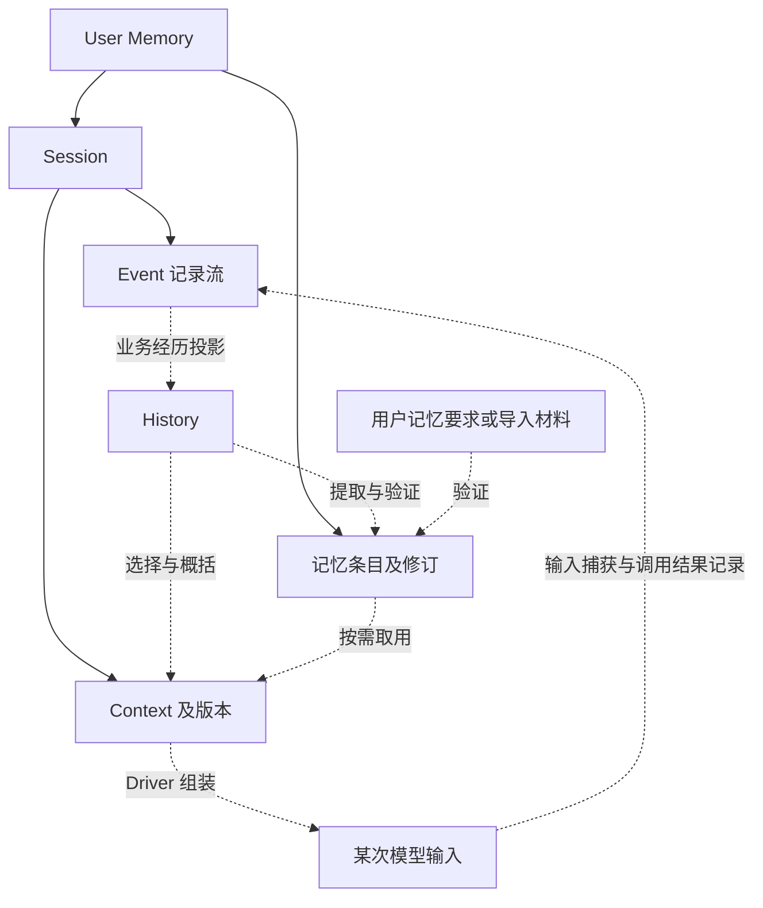
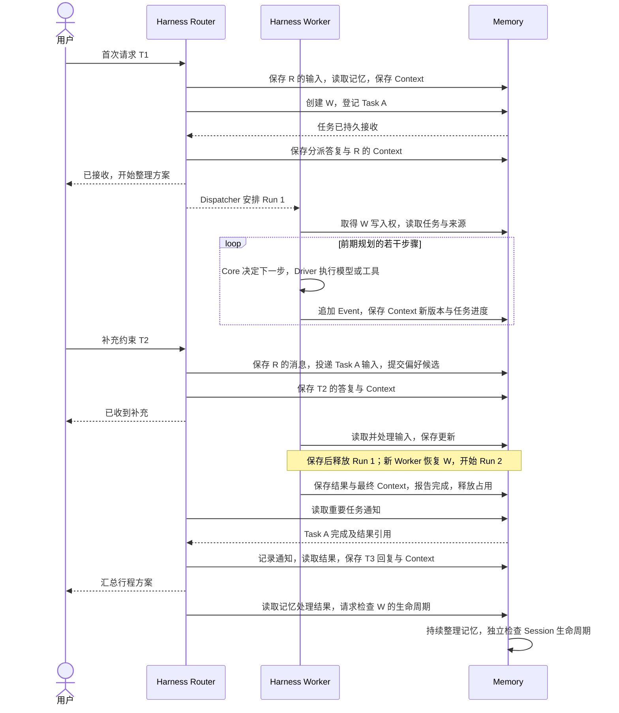

# Harness 与 Memory：对象模型、交互接口与整体流程

状态：设计草案 v0.10；2026-11-18。本文先说明共享对象与管理责任，再给出逻辑存储格式和对外接口，最后串联完整工作流程。记录格式和函数名用于明确契约，不绑定数据库、文件系统、SDK 或 HTTP 实现。

[整体架构](architecture.md)说明系统分工；[Harness 设计](agent-harness.md)定义执行对象与 Core，[Memory 设计](memory-system.md)定义持久管理与维护。本文连接两侧，说明它们交换什么、通过哪些接口交换。具体存储机制和接口载荷另见[实现参考](integration-reference.md)，不作为理解本模型的前置条件。

## 1. 先区分四个层次

| 层次 | 要说明的内容 | 本文的位置 |
| --- | --- | --- |
| 领域模型 | Event、History、Context、模型输入与记忆条目的区别、来源及生命周期 | 第 2–3 节；Harness 执行对象见其设计文档 |
| 逻辑接口 | 谁暴露接口、谁调用、操作哪个对象、输入什么意图、返回什么结果 | 第 5 节 |
| 交互逻辑 | 一次工作如何记录经历、形成 context、恢复执行和沉淀记忆 | 第 6 节 |
| 存储与实现 | 本文规定逻辑记录及正文格式；后续再确定物理存储、SDK 和传输机制 | 第 4 节；实现参考 |

接口是对领域对象提供的能力。不能用一组 RPC 名称代替对象模型，也不能从数据库表或事件类型反推业务概念。

## 2. Memory 管理的核心对象

### 2.1 User Memory：用户的统一记忆域

User Memory 包含该用户的工作经历、会话工作状态和可复用知识。用户切换进程、Host、任务或话题，不会因此得到另一套用户记忆。

用户画像、短期记忆、长期记忆是对这些信息的不同组织与使用方式。notes 是表达形式，主题集合是可选分类；它们不构成独立的用户归属域。

### 2.2 Session：一段持续工作的边界

Session 表示一段可以持续、暂停和恢复的工作，负责把相关经历与工作状态组织在一起。它不是一次模型调用、一个 task 或一个 Worker 进程。

Memory 中，一个 Session 管理：

- 工作目的、身份和生命周期。
- 属于这段工作的 Event 记录流，以及从中读取的 History。
- 一条 Context 版本链、当前版本和历史版本。
- 与任务、来源和派生工作有关的引用。

同一 Session 可以先后处理多个相关 task，由不同 Worker 继续。Router 的对话也是一种 Session。是否继续原工作、另起工作或保留分支，由 Harness 根据用户意图决定；Memory 提供相应的持久对象操作。

### 2.3 Event 与 History：记录单元和经历视图

**本文约定：Event 是单条不可变记录，History 是按顺序组织的工作经历视图。** 一个 Session 有自己的 Event 记录流；新发生的输入、输出、观察和控制变化都追加到这个流中。History 从其中选出与工作经历有关的记录，保留原始事件的身份、顺序和来源。

| 概念 | 保存或呈现什么 | 主要用途 |
| --- | --- | --- |
| Event | 一次用户输入、模型输出、工具观察、纠正或控制变化；每条有身份、所属 Session、顺序与内容 | 原始事实记录与精确追溯 |
| Session Event 流 | 这个 Session 的全部业务及控制事件，按追加顺序排列 | 恢复、审计及构建派生视图 |
| History | Event 流中用户要求、对话、工具观察、成果等业务经历的有序视图 | 回顾工作、选取 Context 材料和提取知识 |

例如，用户要求、模型答复和工具返回会出现在 History 中；请求已准备、执行状态切换等控制事件保留在 Event 流里，默认不作为对话经历呈现。History 可以跳过控制事件，因此它保留的事件序号不必连续。

History 不需要另一份独立的原始正文：可以在读取时过滤 Event 流，也可以维护可重建的投影。**appendEvents 追加原始记录，readEvents 读取记录流，readHistory 读取工作经历视图。** 一条用户消息属于一个 Event，也可出现在 History 中，但并不是两份独立事实。

事件是记录单元，不等于任务通知。通知引用任务结果并等待 Router 处理；Router 接收通知的事实才会作为 Event 记录到自己的 Session。新的纠正同样追加为新事件，不改写旧原话。某条陈述被记录，只证明它曾被表达，不自动证明内容正确。

### 2.4 Context、版本与实际模型输入

**本文将 Context 定义为继续工作所需的选定材料与工作状态，ModelInput 定义为某一次实际模型调用的输入。** 两者有关联，但不是同一个对象。

| 对象 | 内容 | 与其他对象的关系 |
| --- | --- | --- |
| Context | 当前目标、约束、选定消息与证据、摘要、已有结论、进度和未决问题 | 取材于 History、其他用户记忆及 Harness 的组织结果 |
| ModelInput | 本次调用实际使用的消息、系统指令、工具定义及必要运行配置 | Driver 将一个明确的 Context 版本转换并组装为实际请求 |

不是所有 History 都进入 Context。Harness 会选择、概括或移出不再需要的材料；Event 流中的控制记录通常只用于执行恢复。Context 也可以包含来自其他 Session 的记忆，所以它既不是完整事件流，也不一定是本 Session History 的简单子集。

实际请求中如何表达 Context，由 Runtime Driver / Host Adapter 决定。请求记录绑定它使用的 Context 版本，并保存实际捕获的输入内容；Host 只能提供部分输入时须说明覆盖范围。保存 Context 不表示请求已经发出，保存请求准备记录也不表示调用成功。

#### 一个 Session 与多个版本、调用的关系

第一版采用 **一个 Session 对应一个逻辑 Context，Context 有多个不可变版本，同时只有一个当前版本**。这里的“多个 context”应区分为同一 Context 的多个快照，而不是每次模型调用都新建一个 Context 身份。

```text
Session W
  Context C-W：v1 → v2 → v3（当前）
  模型调用 Q1 使用 v1
  模型调用 Q2 使用 v2
  模型调用 Q3 也可以使用 v2
  v3 已保存，尚未发生模型调用
```

Context 版本与模型调用不是一一对应：一次追加、compact 或状态调整可以产生新版本；同一版本也可以支持多次调用。每次请求都必须明确引用所用版本。是否重试调用仍取决于动作状态，不能因为版本相同就认为可以重复执行。

Harness 构建 Context，Memory 保存版本和当前指针。checkpoint 是一个 Context 版本的持久表示，不再另设一套独立的“checkpoint 状态”。

#### 继续、fork 与回滚

| 操作 | Session / Context 身份 | 版本如何变化 | 对执行意味着什么 |
| --- | --- | --- | --- |
| 继续、追加或 compact | 保持原身份 | 在当前版本后保存新版本，保留旧版本 | 使用新状态推进后续工作 |
| fork | 创建新 Session 和新 Context | 从明确的来源版本初始化，保留来源引用 | 后续独立推进，源 Session 不变 |
| 回滚工作状态 | 保持原身份 | 以旧版本为基础，发布一个新的当前版本，记录恢复来源 | 从重新确认的工作状态继续，不撤销已发生的外部操作 |

分叉后的 Session 追加自己的新事件，继承材料通过来源版本和证据引用读取，不把父 Session 的旧消息当成新输入再次执行。未完成工具动作的执行权也不随快照复制。

回滚采用“新增恢复版本”，不删除版本，也不把原始事件流倒退。例如当前为 v4，选择 v2 恢复后产生 v5：其前一版本是 v4，恢复来源是 v2。Harness 必须结合 v2 之后仍然有效的用户约束、已发生事实和未决动作准备 v5，Memory 再保存它；不能照搬旧正文而丢失新纠正。

恢复来源、版本先后关系和已处理事件范围分别记录。发布恢复版本前要确认当前执行已到安全边界；回滚不恢复旧 Task 状态、重置输入消费情况或撤销工具副作用。需要保留两条可继续的方案时使用 fork，而不是让两个执行者并写同一个 Context。

### 2.5 记忆条目：从哪些来源形成

记忆条目表达有来源、适用条件和修订的事实、偏好、目标、方法、经历摘要或 note。其来源可以是一个或多个 Session 的经历、用户直接提交的记忆要求或导入材料，以及已有记忆的整理结果。

条目归属于用户，可以引用来源 Session，但不受其生命周期限制。新的 Session 可以读取它，来源 Session 结束后它也可以继续存在。

**生成记忆不需要等待 Session 退役。** 活动会话中的明确偏好、任务阶段性成果、后台增量整理和退役后的回顾都可以产生候选。具体触发与验证流程见第 3 节；Session 退役只是一种触发机会。

### 2.6 对象之间的关系



事件流保留发生过什么，History 呈现工作经历，Context 表达选定工作状态，模型输入对应一次具体调用，记忆条目支持后续复用。读取这些对象不等于把它们的全部内容一起放进 LLM。

## 3. 短期记忆、长期记忆与工作 Context

### 3.1 记忆层次与对象关系

短期/长期描述信息的用途和保留策略，不按“是否落盘”划分，也不直接对应两张表。

| 概念 | 主要包含什么 | 与核心对象的关系 |
| --- | --- | --- |
| 工作记忆 | 某个 Session 当前执行所需的目标、材料和进度 | 由该 Session 的 Context 表达 |
| 短期记忆 | 当前目标、近期有关经历、待办、未决问题和临时记忆条目 | 汇集有关 Session 的工作状态、近期 History 与短期条目；可持久恢复 |
| 长期记忆 | 经筛选保留、预期跨会话复用的知识与经历 | 主要由带来源和适用条件的记忆条目表达 |
| 历史存档 | 已结束工作的 Event、History 视图和旧 Context | 仍可查询，但不会因此全部成为长期知识 |
| 用户画像 | 有关用户的事实、偏好、目标和约束 | 由有关条目与来源形成视图，不是另一套无来源事实 |

这几种视图并非互斥分区。一条长期偏好被读取到当前 Context，表示它参与了当前工作，不改变原条目的长期属性。

三个转换需要分开：

1. **Context 组装/压缩**：为当前执行选择和组织材料，改变工作视图。
2. **记忆沉淀**：从经历中提取、验证和修订可复用知识，形成记忆条目。
3. **历史保留/删除**：决定原始资料及版本如何保存，受独立的数据生命周期策略管理。

短期信息不必沉淀为长期记忆。Context compact 不自动发布长期条目；Session 退役也不自动删除长期条目。


### 3.2 记忆如何生成

| 触发来源 | 读取哪些材料 | 可能产生什么 |
| --- | --- | --- |
| 用户明确要求记住或纠正 | 用户原话或直接提交的材料 | 偏好、事实或已有条目的修订候选 |
| 活动 Session 的增量整理 | 新增的一段 History、阶段性结果及必要 Context | 当前目标、短期 note、可复用经验候选 |
| Task 完成或 Session 退役 | 结果、相关 History、最终 Context；已退役时还包括退出记录 | 经历摘要、方法或长期 note，也可以没有产出 |
| 定时整合、冲突修复和预写 notes | 多个 Session 的证据、现有条目及已知目标 | 合并修订、冲突标记、面向未来查询的准备材料 |

记忆生成经过统一流程：

1. **固定来源范围。** 记录所读事件、Context 版本和记忆修订，避免把持续变化的资料当成同一份输入。
2. **提出候选。** Harness、用户客户端或 Memory Agent 提供要记住的内容、适用范围及来源；Context 摘要本身不能替代原始证据。
3. **验证与去重。** Memory 检查来源、时间范围、与旧知识的冲突及是否已处理过同一来源，必要时保留不确定性或拒绝候选。
4. **发布条目或修订。** 为被接受的内容保存正文、来源和当前修订；产生可读取的变化记录。提案已受理不等于已发布。
5. **后续使用与维护。** Harness 通过查询选用，Memory 根据纠正、失效和使用反馈继续修订。

Session Maintenance 只负责退出记录与生命周期检查，Memory Agent 负责知识整理。前者可以触发后者，二者不相互等待完成；Memory Agent 也可以直接整理仍开放的 Session。

预写 note 可以整理已知约束、常用方法和未来需要确认的问题。对未来需求的预测须保留为假设，不能变成用户已确认的事实。记忆提取不会修改活动 Context，后续由 Harness 决定是否选用新条目。

## 4. Memory 如何管理 Session、Context 和 History

### 4.1 管理责任与恢复

| 对象 | Memory 的管理责任 | Harness 的使用责任 |
| --- | --- | --- |
| Session | 保存稳定身份和生命周期，提供发现、创建、分叉及退役能力 | 判断新建还是继续，选择执行对象，分配 Worker |
| Event / History | 保存有归属的 Event 流，提供 History 视图及来源读取 | 报告输入、观察与结果；恢复时读取必要的业务及控制事件 |
| Context | 保存工作状态版本，关联其来源和已处理经历，支持恢复 | 组装、追加、compact，准备实际模型输入 |
| 记忆条目 | 检索、验证、整理、修订、失效与保留 | 提出信息需求，选用材料，提交纠正或知识候选 |

Session 的管理有两个决策来源：Harness 决定在线工作如何组织；Memory 的后台维护按既定策略管理已结束或闲置的持久对象。Memory 不因此获得启动 Worker 或执行工具的职责。

事件追加与工作状态更新是两个动作。Memory 保存 Context 时，同时记录已处理事件的位置和实际选用的来源；前者用于恢复，后者说明正文依据。已处理不表示对应事件正文仍在 Context 中。新事件已保存、Context 尚未更新是允许出现的中间状态。

继续 Session 时，Memory 提供当前版本、版本来源及尚待处理的事件。Harness 恢复 Context，并核对当前任务、输入和未完成动作。回滚后的恢复还要区分被弃用的旧方案与仍须生效的新约束，不能把历史动作重新执行一遍。

分叉表示创建独立 Session，并引用明确的历史状态；后续变化不写回父 Session。退役表示停止继续写入和执行，历史仍可查询。具体退出记录、条件检查和后台任务属于生命周期能力的实现。

### 4.2 逻辑存储格式：结构化元数据、正文与引用

Memory 需要持久保存以下逻辑记录，**不在本文选择数据库或文件系统**。统一约定是：元数据用可序列化的结构化记录表示，正文声明格式，大正文或二进制资料通过内容引用关联。数据库可以保存记录与正文，文件实现也可以使用 JSON / JSONL 和正文文件表达同样的关系。

| 逻辑记录 | 至少表达哪些关系 | 逻辑格式与保存规则 |
| --- | --- | --- |
| User / Session 元数据 | 用户归属、Session 身份、目的、生命周期、Context 身份与当前版本、分叉来源 | JSON 对象或等价数据库记录；当前版本是可更新指针 |
| Event | Session、事件身份与顺序、类型、内容及来源 | 每事件一个 JSON 记录；文件形式可用 JSONL 追加；大正文使用内容引用 |
| History | 从哪些事件选择业务经历，按什么顺序读取 | 派生查询或可重建投影；不另存一套可独立修改的原始对话 |
| Context 版本 | Context / 版本身份、前一版本、分叉或恢复来源、已处理事件位置、材料与来源 | 不可变 JSON 文档；正文按有序块保存目标、约束、消息、摘要等 |
| 模型输入记录 | 调用身份、所用 Context 版本、实际捕获的输入及覆盖范围 | 控制事件关联的 JSON 正文或内容引用；输出另记事件 |
| 记忆条目与修订 | 用户归属、条目身份、修订、类型、短期/长期用途、适用范围、来源及状态 | 不可变修订记录，加当前修订与生命周期指针；正文可为 Markdown、文本或结构化 JSON |
| 来源材料与大正文 | 所属用户、内容身份、格式及被哪些记录引用 | 文本、文档或二进制正文；可放文件、数据库大对象或对象存储 |
| 检索索引、画像、Session 摘要 | 所依据的记录或修订 | 可重建派生数据，不作为原始事实的唯一存储 |

字段名仅作格式示意，以下展示的是关系，不是完整传输 schema。

一个 Context 版本的示意正文：

```json
{
  "sessionId": "W",
  "contextId": "C-W",
  "versionId": "v3",
  "parentVersionId": "v2",
  "coveredEventSequence": 18,
  "blocks": [
    {
      "kind": "constraint",
      "text": "周日中午前回来；本次只出方案，不预订。",
      "sourceRefs": ["event:W:e18", "event:R:e1", "event:R:e9"]
    }
  ]
}
```

例如 e18 是 Worker 处理用户补充的记录，引用 Router 的 e9；e1 是原始“不预订”要求。已处理位置为 18，不意味着前 18 条事件都被放进 blocks。若以后从 v2 恢复得到 v5，记录其前一版本 v4 和恢复来源 v2，并保存重新核对后的正文及处理范围。

一条已发布记忆修订的示意：

```json
{
  "userId": "U",
  "memoryId": "travel-preference",
  "revision": 2,
  "kind": "preference",
  "horizon": "long_term",
  "applicability": ["未来的行程规划"],
  "content": {
    "format": "text/markdown",
    "text": "规划行程时尽量减少换乘。"
  },
  "sourceRefs": ["event:R:e9"],
  "epistemicStatus": "supported"
}
```

当前条目另有指针指向 revision 2，并记录 active、archived 等生命周期状态。修订正文不可变；用户纠正后发布 revision 3，而不是覆盖 revision 2。被引用的事件内容若因授权删除而失效，依赖它的记忆与旧 Context 读取也需遵循失效或删除策略。

### 4.3 数据库和文件如何表达同一模型

| 对象 | 数据库实现可以如何表示 | 文件实现或导出可以如何表示 |
| --- | --- | --- |
| Session 与当前版本 | 元数据记录、版本指针 | Session 的 metadata.json |
| Event 流 | 按 Session 与序号组织的事件记录 | Session 的 events.jsonl |
| Context 版本 | 独立版本文档 | contexts 下按 Context、版本组织的 JSON 文件 |
| 记忆条目 | 修订记录与当前指针 | 条目 metadata.json、各修订 JSON；较长 note 正文可单独为 .md 文件 |
| 大正文 | 大对象或外部内容地址 | 独立正文文件及引用 |

这是一种逻辑表示的两种映射，不要求同时维护数据库和文件两套权威数据。Note 采用 Markdown 只改变正文形式，来源、修订和状态仍由结构化记录管理。采用文件实现也必须保证追加、版本发布和当前指针更新的可恢复性，不能靠任意编辑文件绕过对象操作。

## 5. 两系统的交互接口

### 5.1 Memory 的对外契约与调用方向

**Memory System 暴露可独立使用的服务接口，Harness 是其中一种客户端。** 笔记应用、资料导入工具或其他 Agent 也可以直接使用记忆查询、提案和维护接口，不必先建立 Task 或 Run。

Harness 内由 Memory Coordinator 接入这些接口。针对 Session 的执行写入仍须遵守串行推进规则；普通记忆查询和用户直接提交的记忆要求不绑定 Harness 的执行身份。

| 接口边界 | 提供方 | 调用方 | 操作对象 |
| --- | --- | --- | --- |
| Memory 领域 API | Memory System | Harness、独立应用或用户客户端 | Session、Event / History、Context、记忆条目与维护意图 |
| Memory 执行协作 API | Memory System 的协作存储模块 | Harness 的 Router、Dispatcher、Worker | Task、任务输入、通知和写入所有权 |
| Harness 应用入口 | Harness Core | 应用、Host Adapter | 用户输入、Turn、任务控制与回复 |
| Harness 运行能力接口 | Runtime Driver / Host Adapter | Harness Core | 执行资源、模型请求、工具调用与实际结果 |

下面第 5.2 节是 Memory 自身的对外领域接口，第 5.3 节是它额外提供的执行协作接口。Memory 的内部模型调用、Validator、数据库事务和后台任务执行函数都不属于公共 API。

所有调用均指定或由认证身份确定用户域，并受访问范围限制。调用协议不依赖 Memory 部署于单机还是集群，也不依赖调用方是否使用 dsh/pi。Memory 不调用 Harness 来推进任务；Harness 主动读取状态与通知。

### 5.2 Memory System 对外领域 API

以下规定每项操作的输入意图、结果和语义，不展开参数类型与传输字段。函数名是逻辑操作名，尚未冻结为 SDK。客户端通过这些操作访问第 4 节的记录，不直接编辑底层文件或表。

#### 5.2.1 Session API：组织持续工作

| 操作 | 调用方提供什么 | 返回或产生什么 |
| --- | --- | --- |
| createSession | 用户域、工作目的及初始属性 | 新 Session 身份及空的工作状态定位；不启动进程 |
| discoverSessions / getSession | 查询条件或 Session 身份 | 会话摘要或明确状态，包括生命周期及当前 Context 版本引用 |
| forkSession | 来源 Session、明确的 Context 版本、新工作目的 | 新 Session 与新 Context 的初始版本、来源关系；不转移旧执行占用 |
| requestSessionReview | 待检查 Session、维护意图 | 可追踪的检查请求；后台确认无未决工作后才可退役 |

forkSession 是领域操作，具体实现可以复用带固定来源的 createSession；不要求为了函数名另建一套存储。退役是生命周期变更，删除历史另有数据生命周期语义。

#### 5.2.2 Event / History API：记录与追溯

| 操作 | 调用方提供什么 | 返回或产生什么 |
| --- | --- | --- |
| appendEvents | 目标 Session、一组已发生的输入、观察或控制变化及来源 | 持久事件身份与保存位置；业务事件可进入 History 视图 |
| readEvents | Session、事件范围及可选类型条件 | 原始 Event 记录流中的事件，包括恢复所需的控制记录 |
| readHistory | Session、经历范围及可选业务内容条件 | 有序工作经历视图，保留事件身份和来源；默认不包含执行控制日志 |
| readEvidence | 指向事件、原始材料或记忆修订的明确引用 | 授权范围内的原文及来源状态；不替代为检索摘要 |

History 的读取不会生成 Context。客户端要组织模型输入，仍需选择材料并保存自己的工作状态。

#### 5.2.3 Context API：保存、读取与恢复版本

| 操作 | 调用方提供什么 | 返回或产生什么 |
| --- | --- | --- |
| saveCheckpoint | Session、基于哪个当前版本、候选 Context 正文、来源及已处理事件范围 | 不可变新版本及更新后的当前版本定位 |
| readCheckpoint | 当前版本定位或指定历史版本 | 该版本的完整工作状态及来源；不加载进程或执行模型 |
| listContextVersions | Context 身份及查询范围 | 版本先后关系、分叉或恢复来源及当前版本位置 |
| restoreContext | 要恢复的历史版本、当前状态依据、调用方重新核对后的候选 Context | 一个新的当前版本，保留前一版本和恢复来源；原事件、Task 及外部结果不回退 |

restoreContext 表达“发布一次有来源的工作状态恢复”。Harness 负责结合最新约束准备正文，Memory 负责检查写入条件并保存；可以组合 readCheckpoint 与 saveCheckpoint 实现，不能仅把指针移回旧版本。读取历史本身不改变当前状态。

#### 5.2.4 Memory API：独立读写与维护知识

| 操作 | 调用方提供什么 | 返回或产生什么 |
| --- | --- | --- |
| getUserOverview / getProfile | 用户域与视图需求 | 带来源的用户记忆概览或画像，不把全部内容放入模型输入 |
| recall | 查询意图、来源范围、适用条件及结果预算 | 相关记忆或经历片段，附引用、适用范围和可信状态 |
| getMemory / listMemoryRevisions | 条目身份、当前或指定修订 | 记忆正文、状态、来源或修订历史 |
| proposeMemory | 待记内容、来源、适用范围；修订已有条目时指定目标 | 已受理的新增或修订候选；验证后才发布有效条目 |
| submitFeedback | 有关条目或证据、纠正原话及反馈意图 | 已记录的反馈及后续校验依据，不直接覆盖旧修订 |
| requestMemoryMaintenance | 要整理的来源范围及意图，如增量提取、冲突修复或预写 note | 可追踪的整理请求；可作用于活动 Session，无须先退役 |
| requestMemoryLifecycle | 目标记忆或来源范围、归档或遗忘意图 | 受理状态和处理范围；归档与删除遵循各自生命周期规则 |
| getMemoryOperation | 提案或维护请求的操作引用 | 待处理、完成或拒绝等状态，以及已发布条目/修订和处理结果 |
| readChanges | 上次读取位置及关注范围 | 新条目、修订、失效或生命周期变化，供客户端更新视图 |

直接提交记忆时，Memory 也要持久保存用户原始提交或导入材料作为来源。客户端无需伪造一次 Agent 对话来“记住一条 note”。例如笔记应用可调用 proposeMemory，读取操作结果，再用 getMemory 或 recall 取回已发布内容，全程不创建 Task、Run 或模型调用。

这些接口暴露维护意图与结果，不暴露内部任务锁、模型调用步骤或提交事务。Session 维护请求也返回可追踪的操作引用。Harness 与普通客户端使用同一套知识语义。

### 5.3 Memory 执行协作接口

这些接口由 **Memory 的协作存储模块提供**。Task 的执行规则与调度仍由 Harness 定义；Memory 保存可恢复的状态、输入和通知。

| 接口组 / 抽象对象 | Harness 调用方 | 逻辑操作 | 返回或承诺什么 |
| --- | --- | --- | --- |
| 任务登记与查询 / Task | Router、Dispatcher | 持久登记工作（recordTask）；读取一个或一组任务（getTask、listTasks） | 已接收的任务身份与状态，或当前进度、结果和来源引用；登记不表示已开始执行 |
| 任务进展 / Task 状态与结果 | Worker Controller | 报告阶段、等待、完成或失败；通过 appendEvents 保存对应执行事实 | 更新可查询的任务状态，并为重要变化产生通知；进度须有已保存记录支持 |
| 任务输入 / 补充、纠正、取消 | Router 写入，Worker 读取 | 提交输入（postTaskInput）；读取待处理输入（readTaskInputs）；处理后记录效果并确认消费 | 输入被可靠接收，且能区分待处理与已处理；接收取消不等于操作已停止 |
| 任务通知 / 结果与待澄清变化 | Router Controller | 读取重要通知（readTaskNotifications）；将接收事实追加到 Router Event 流 | 可恢复的通知及其来源；记录接收后可识别重复投递，不重复建立 Turn |
| 执行占用 / Session 写入所有权与 Run | Dispatcher、Worker、Router Controller | 取得、续期和释放写入权（claimSession、renewSessionClaim、releaseSession） | 当前执行者可否推进指定 Session；释放占用不自动完成 Task 或退役 Session |

任务进展在逻辑上属于执行协作；候选实现复用 appendEvents，把执行事实与任务状态关联起来。不会因为使用相同写入口，就把任务状态和用户知识混成一个对象。

读取任务输入不代表消费完成；效果记录才是确认依据。读取通知也不代表用户已看到结果；Router 将接收事实记入自己的 Event 流、形成新的 Turn，再生成并保存回复。

Host 插件可选使用 **原生会话定位接口**（linkHostSession、resolveHostSession）。它同样由 Memory 提供存储，但只服务于 Adapter 定位，不参与 Session 业务身份、写入授权或任务调度。

### 5.4 Memory 的变化如何回到 Harness

| Memory 侧的新信息 | Harness 如何取得 | 对执行的影响 |
| --- | --- | --- |
| 普通任务进度 | 查询任务状态 | 用于状态答复与调度，不必触发模型 |
| 等待输入、完成、失败或取消等通知 | 轮询持久通知；订阅可作为后续延迟优化 | Router 记录通知后创建新的 Turn |
| 新记忆条目、纠正或失效 | 后续 recall 或 readChanges，再取相应修订 | 在安全边界更新选用材料，不直接改写正在执行的 Context |
| Session 维护结果 | 读取 Session 的当前生命周期 | 后续路由据此选择继续、分叉或新建 |

第一版以主动读取为基础；Memory 不需要知道 Harness 的回调地址，也不需要 Harness 在线才能完成自己的后台维护。

Harness 内部的 acceptTaskNotification 是把已读通知交给 Router 的入口，不是 Memory 调用的远程执行接口。模型调用、工具执行和 Worker 分配也都属于 Harness 内部边界。

### 5.5 两系统共同遵守的交互规则

1. **先记录事实，再推进工作视图。** 原始消息与结果追加为 Event，业务经历形成 History 视图；Harness 选取材料更新 Context，并保存版本与处理位置。
2. **持久接收与实际完成分别表达。** 任务受理、Context 保存、输入受理、外部动作完成各有对应事实。
3. **每个 Session 串行推进。** Router 可以给 Worker 投递输入，但不能绕过它直接改写正在执行的 Context。
4. **重要任务通知开启新的对话轮次。** 分派调用在任务被持久接收后返回；Worker 最终结果通过通知触发新 Turn。
5. **维护与在线执行分别负责。** Memory 整理记忆和管理退役；Harness 继续或停止执行，双方通过已保存状态协调。

## 6. 完整例子：规划行程，中途纠正，换 Worker 后继续

### 6.1 初始对象

以下是一个设计示例。用户对 Router 说：

> 帮我做一个杭州周末两天的行程，预算 2000 元。先给方案，不预订。

该用户的 Memory 已有一条带来源的偏好：“优先考虑公共交通”。例子中使用以下对象：

| 对象 | 用途 |
| --- | --- |
| Router Session R | 持续承载用户对话，有自己的 Event 流、History 视图与 Context 版本 |
| 工作 Session W | 承载本次行程规划，有自己的 Event 流、History 视图与 Context 版本 |
| Task A | 本次规划目标、约束、状态和结果；关联 W 与发起它的对话 |
| Turn T1 / T2 / T3 | 首次请求、用户中途补充、任务完成后的汇总 |
| Run 1 / Run 2 | 两个 Worker 先后推进 W 的执行尝试 |

R 与 W 都属于同一个用户记忆域。Task 与 Turn 的标识用于关联工作，不构成新的记忆域。

### 6.2 从输入到结果的交互

| 步骤 | Harness 做什么 | 调用 Memory 的哪些接口 | Memory 中形成什么 |
| --- | --- | --- | --- |
| 1. 接收请求，开启 T1 | Router 定位或创建 R，记录用户消息，读取已有 Context、有关历史与用户偏好 | getSession / createSession、claimSession、appendEvents、readCheckpoint、readEvents、recall | R 的输入记录；被选用的偏好仍保留原条目与来源 |
| 2. 准备 Router 工作状态 | Core 把新要求和召回材料纳入 R 的 Context，再推进本轮路由 | saveCheckpoint；请求与输出按执行记录保存 | R 的新工作版本，保留“预算 2000”和“不预订”等约束 |
| 3. 分派并结束 T1 | 创建 W；登记 A，引用 R 的原始要求；任务持久受理后回复“已接收，正在整理方案” | createSession、recordTask；appendEvents、saveCheckpoint，结束占用时 releaseSession | A 处于已排队状态；R 保存分派与答复；无需等待 W 完成 |
| 4. Worker 开始 Run 1 | Dispatcher 分配 Worker；Worker 取得 W 写入权，读取任务要求及其引用，建立首个工作 Context | claimSession、getTask、readCheckpoint、readEvents、readEvidence、recall；appendEvents、saveCheckpoint | W 的任务起点、来源与首个工作版本；首次执行没有旧 Context 时由这些材料初始化 |
| 5. 多步规划 | Worker 的请求分别绑定 C-W 的明确版本；输出与观察追加为 Event，选入 Context 后发布新版本；材料变多时 compact | appendEvents、saveCheckpoint；需要时 renewSessionClaim | Event 流增长，业务经历进入 History；Context 从 v1 推进到 v2，原始记录未被压缩删除 |
| 6. 用户补充，开启 T2 | 用户说“周日中午前回来；以后安排也尽量少换乘”；Router 记录后向 A 送入补充，同时把长期偏好作为记忆候选提交 | 对 R 使用 appendEvents、saveCheckpoint；postTaskInput、proposeMemory | R 保存原话；A 有待处理输入；记忆候选可立即进入验证，无须等待 W 完成或退役 |
| 7. Worker 处理并换执行者 | Run 1 读取补充，记录处理效果并更新 Context；在无未决动作的边界暂停，释放占用。新 Worker 开始 Run 2，从 W 继续 | readTaskInputs、appendEvents、saveCheckpoint、releaseSession；再次 claimSession、readCheckpoint、readEvents、getTask | A 与 W 保持原身份；补充要求保存在 C-W 的 v3；新的 Run 读取同一版本与后续事件继续 |
| 8. 完成规划 | Worker 保存结果原文和最终 Context，再报告 A 完成并释放占用 | appendEvents、saveCheckpoint、appendEvents（报告终态）、releaseSession | W 保存方案及来源；A 引用结果，Memory 产生完成通知 |
| 9. 通知触发 T3 | Router 读取并记录通知，查询结果，生成对用户的答复，保存 R 的新状态 | readTaskNotifications、appendEvents、getTask、readEvidence、saveCheckpoint | R 保存通知、结果引用和汇总回复；T3 与已结束的 T1 分开 |
| 10. 整理记忆与生命周期 | 客户端读取偏好提案结果；阶段性或退役后的整理可补充其他知识。Harness 请求检查 W 是否适合退役 | getMemoryOperation、readChanges；requestMemoryMaintenance、requestSessionReview | 已验证的偏好或 note；W 保持可继续或满足条件后退役并留退出记录；知识发布与退役独立 |

表中省略重复的读取、写入占用和每次模型调用记录，但它们遵循相同规则。模型与工具由 Driver/Host 实际调用，Memory 负责保存记录。Task 受理后，Worker 启动与 Router 结束 T1 可以独立推进。

### 6.3 两条执行线如何交汇

下图只画主要交互。Router、Dispatcher 与 Worker Controller 均属于 Harness Core；实际模型/工具调用经 Driver 或 Host 完成。



### 6.4 最后留下什么，下一次如何使用

| 留下的内容 | 属于什么 | 后续用途 |
| --- | --- | --- |
| 用户原话、工具材料、过程与结果 | R 或 W 的业务 Event，经 History 视图读取 | 回顾、查证、恢复和知识提取 |
| 当前方案、预算、返程时间、执行进度 | W 的 Context；属于本次工作所需的短期信息 | 继续修改这次行程时恢复 |
| A 的状态、结果通知和 Run 记录 | 执行协作存储 | 查询完成情况、恢复和避免重复执行 |
| 经验证的“以后尽量少换乘” | 用户长期偏好条目，引用 T2 的原话 | 以后规划时由 recall 取用 |
| 为未来规划整理的 note | 有来源的记忆条目，注明适用条件 | 提前整理常用约束和待确认事项，供后续请求选用 |

Memory Agent 可以在后台结合已有资料准备“下次行程规划需确认的事项”这类 note；推测的未来需求不能被写成用户已经确认的事实。“这次预算 2000 元”和“周日中午返程”留在本次工作资料里，不自动变成永久偏好。

若用户继续修改这次行程，Router 可以把新 Task 分配到仍开放的 W；若开始另一趟旅行，则创建新的工作 Session，召回长期偏好及适用 note。若 W 已退役，需要从明确历史分叉或选择材料新建。

即使中途某条事件已经保存、Context 尚未保存，新的 Run 也能从旧版本和后续记录恢复。若外部操作结果未知，则先由 Driver 核对；读取快照本身不构成再次执行操作的理由。

## 7. 实现细节的阅读位置

上述对象、逻辑存储格式、对外接口和流程是两系统共同遵守的设计。本轮只修订本文，其他文档中的候选接口与载荷尚未同步本轮补充。进一步讨论实现时，再分别阅读：

- [Harness 设计](agent-harness.md)：执行对象、Core、loop 和插件边界。
- [Memory 设计](memory-system.md)：持久管理、维护与部署。
- [接口实现参考](integration-reference.md)：候选 SDK、字段、传输协议和 Host 具体适配，尚未冻结。

第一版保持统一用户 Memory、Router 持续响应、Worker 可替换、append + compact 和 Memory 独立部署。CLM 与资源虚拟化属于后续扩展。
