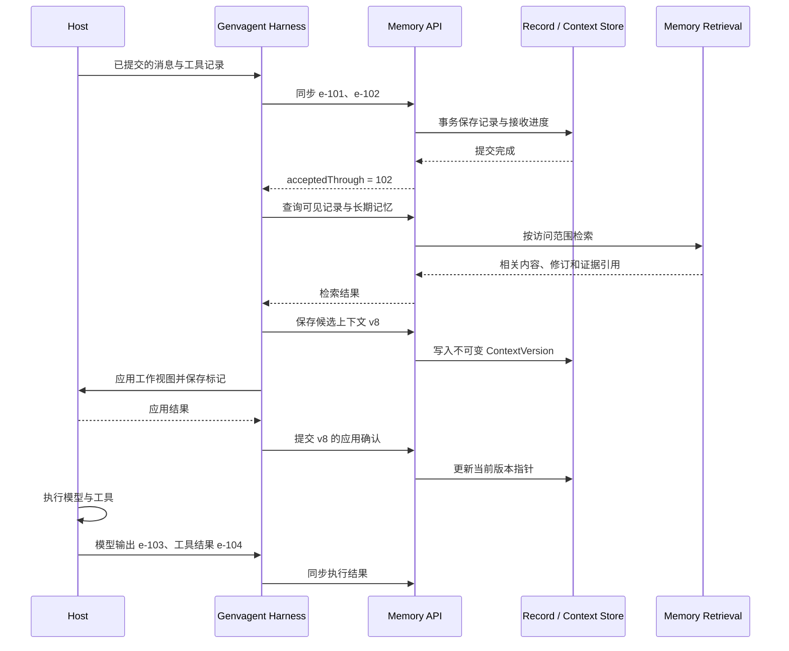

# Agent Harness 与 Memory System 交互模型与协议

状态：设计草案 v0.4；2026-11-17。接口尚未实现。

本文定义 Genvagent Harness 与 Memory System 之间的数据模型、所有权、同步、检索和恢复契约。前七节说明概念及执行流程，后续章节定义数据结构、HTTP 接口和异常处理。接口中的每个标识都对应一个明确的持久化对象。

## 1. 系统角色与边界

| 术语 | 定义 | 主要职责 |
| --- | --- | --- |
| Host | 加载 Genvagent 插件的完整 agent 应用，例如 dsh、pi | 提供模型调用循环、工具执行、权限控制、会话管理和界面 |
| Genvagent Harness | 本项目提供的插件层，由 Harness Core、Host Adapter 和 Memory Client 组成 | 接入 Host 事件，管理工作上下文，执行 Router 策略，与 Memory 交换数据 |
| Host Adapter | Genvagent Harness 内针对某个 Host 的适配模块 | 将 Host 的会话、消息、工具结果和扩展点转换为 Genvagent 的统一表示 |
| Memory System | 独立部署的持久化与记忆服务 | 保存记录和上下文版本，执行记忆检索、修订与后台整理 |

dsh、pi 本身也属于广义的 agent harness。本文使用 Host 表示它们相对于 Genvagent 插件的角色；后文的 Harness 专指 Genvagent Harness。Host 与 Genvagent Harness 之间是应用与插件的关系。

Host 管理模型和工具的执行状态，Genvagent Harness 管理输入上下文及同步进度，Memory System 管理持久化数据。Memory Agent 是 Memory System 内部的后台组件，可以在 Host 离线时整理记忆；它不调度 Host 的工具，也不直接修改活动会话的模型输入。

## 2. 信息模型

### 2.1 原始记录与长期记忆

| 对象 | 定义 | 生命周期 | 所有权与来源 |
| --- | --- | --- | --- |
| Record | 一次可观察事件的持久化表示，例如用户消息、模型输出、工具结果、文件读取结果 | 按记录流追加；正文和来源标识不因摘要生成而改变 | 访问策略继承所属会话关联，另记录实际产生者 |
| MemoryRevision | 从一个或多个 Record 派生的知识、偏好、决策或方法的某次修订 | 后台验证后发布；更新生成新修订，保留旧版本和冲突状态 | 必须记录证据引用、适用范围、所属用户和可见性 |
| WorkingContext | Harness 为下一次模型调用构建的、有序且受容量约束的信息表示 | 随执行步骤更新；每次持久化产生不可变版本 | 引用已选 Record 和 MemoryRevision，由 Harness 决定内容 |

Record 保证可追溯性；MemoryRevision 提供跨会话复用；WorkingContext 决定当前调用可使用的信息。它们是三类独立对象，派生关系由来源引用维护。删除工作上下文中的一段日志只改变输入选择，不删除对应 Record。

来源关系同时承担校验作用。一个用户消息可以直接作为“用户提出了某项要求”的证据；如果它描述的是外部系统状态，则还需要对应观察才能把该描述发布为已验证事实。MemoryRevision 的可信状态与来源记录的存在性分别管理。

### 2.2 工作上下文的内容与组装

工作上下文包含当前目标、必须保留的用户约束、相关证据、检索得到的记忆、执行进度和必要的消息/工具交换。Harness 的 Context Controller 负责选择与排序，Host Adapter 将其转换为 Host 支持的消息表示。

Host 的系统指令、工具定义和授权由 Host 提供并保持受保护。下一次请求使用这些受保护部分和经校验的工作上下文。模型可通过上下文编辑工具修改可编辑内容，但必须保留来源和工具调用/结果配对。

工作上下文是显式输入的序列化表示，不包含模型内部隐状态、API 凭据或正在运行的操作系统进程。它的恢复能力与 Host 执行环境的恢复能力分别定义。

### 2.3 上下文版本的提交状态

“候选上下文”指**已经完成组装、准备作为下一次模型输入，但尚未完成应用确认的新版本**。该术语表示版本提交状态，不表示检索候选集合。

| 状态 | 持久化与执行事实 | 可否视为当前版本 |
| --- | --- | --- |
| 已组装 | Harness 已生成正文，尚未获得 Memory 持久化确认 | 否 |
| 已保存候选 | Memory 已保存不可变版本；当前版本指针仍指向旧版本 | 否 |
| Host 已应用、确认待提交 | Adapter 已修改 Host 工作视图，并保存本地应用标记 | 需要完成或恢复确认流程 |
| 已激活 | Memory 已接受应用回执并推进当前版本指针 | 是；模型是否已调用仍由调用记录判断 |

例如当前版本为 v7，Harness 根据新输入构建 v8。保存 v8 后仍以 v7 为已确认版本；只有 Host 应用 v8 且确认事务成功，当前指针才移动到 v8。激活成功不等于模型已返回结果。

## 3. 用户数据组织与存储

### 3.1 身份、归属与可见性

userId 表示用户的稳定身份，与 Host 进程 ID、模型生成者 ID 和 API 服务账号不同。Memory 从认证信息确定有效用户；服务账号代用户请求时必须具备相应委托权限，不能仅信任正文中的 userId。

workspaceId/projectId 确定数据所属项目。每个会话关联还记录 ownerUserId；其记录流和工作上下文继承该所有权。一条记录由模型或工具生成，也仍归属于该会话的用户，实际作者另外记录为 producer 与 actorId。

原始会话、上下文和派生个人记忆默认 private，仅所有者及被明确授权的服务可读。经授权共享的数据可以标记为 project，供具有项目访问权限的成员使用。相同 projectId 只确定数据分区，不自动授予其他用户读取私有会话的权限。

第一版的个人记忆仍位于一个 project 内；跨项目用户画像不在当前范围。可见性不能因 dreaming 而扩大：依赖私有证据的 note 保持相同用户的 private 范围，只有满足共享授权的来源才能形成 project 可见的知识。

### 3.2 Memory 中的逻辑组织

SessionBinding（会话关联）将某个用户在某个项目中的 Host session/branch，映射为 Memory 中的一条记录流和一个工作上下文版本序列。记录流按 sequence 连续追加；上下文序列保存每次构建的版本，ContextHead 单独指向当前已确认版本。它们共同支持同步进度查询与确定性恢复。

下图是逻辑归属，不是服务端目录结构。一个用户可以有多个 Host 会话，同一个会话可以产生多个独立分支。

```text
workspace w-1 / project genvagent
  user user-42
    binding b-dsh-1
      Host identity: dsh / installation h-1 / session s-9 / branch main
      record stream: stream-dsh-1
      context versions: ctx-dsh-1 / v7, v8, ...
      active context: ctx-dsh-1 / v8
    binding b-pi-1
      Host identity: pi / installation h-2 / session s-3 / branch main
      record stream: stream-pi-1
      context versions: ctx-pi-1 / ...
    private memories: m-17 / revision 1, 2, ...
  user user-77
    bindings and private memories owned by user-77
  project-visible memories
    explicitly shared revisions readable by authorized project members
```

Memory 使用数据库保存这些对象和关联，大正文保存到 blob store。不会把一个用户的全部内容拼接成单个 Markdown 文件。

| 集合 | 定位键或关联 | 保存内容 |
| --- | --- | --- |
| bindings | bindingId；另有用户、项目和 Host 会话身份的唯一映射 | owner、可见性、Host 会话位置、streamId、contextId |
| records | streamId + sequence；eventId 用于精确引用 | 消息/工具结果正文、产生者、时间与来源 |
| context_versions | contextId + versionId | 序列化工作上下文及已纳入的记录位置 |
| context_heads | contextId | 当前已确认采用的 versionId 和指针修订号 |
| memory_revisions | memoryId + revision | 私有或项目可见的知识正文、证据和适用条件 |
| blobs / retrieval indexes | blobId；Record 或 MemoryRevision 的引用 | 大正文；可重建的关键词/语义检索索引 |

对一个用户的完整记录查询，先按有效用户和项目找到可访问的 bindings，再读取其各条记录流。精确定位记录、读取上下文和语义检索是不同操作。

### 3.3 数据示例

以下示例沿用本项目的文档工作：user-42 在 dsh 会话中要求“先定义概念模型，再描述 HTTP 接口”。示例标识仅用于说明数据关系。

| 对象 | 示例内容 | Memory 中的位置 |
| --- | --- | --- |
| 原始用户消息 e-101 | 用户对文档结构的明确要求 | stream-dsh-1 的第 101 条记录，owner 为 user-42 |
| 文件读取结果 e-102 | integration-protocol.md 某个内容版本的文本或 blob 引用 | 同一记录流第 102 条；保存文件内容摘要 |
| 工作上下文 v8 | 当前目标、e-101 的约束、e-102 的相关片段、待修改章节 | ctx-dsh-1 的不可变版本 v8 |
| 长期记忆 m-17:r1 | user-42 在本项目要求设计文档按“概念模型→交互→接口”组织 | 私有 memory revision，证据引用 e-101 |

m-17:r1 记录的是明确限定于该项目的要求。后续 pi 会话以同一用户访问同一项目时，可以读取这条私有记忆；其他用户只有在相应内容被授权共享后才能读取。

## 4. 同步、读取与检索流程

### 4.1 写入路径

Host Adapter 从 Host 已完成且可持久恢复的记录中提取用户消息、模型输出和工具结果。Harness 为每条记录建立稳定的事件 ID 和记录流序号，将映射写入本地同步日志，然后通过 Memory Client 批量发送。

Memory API 验证用户身份、binding 所有权和有效 writer；Record Store 在一个数据库事务中保存正文引用、事件序号及接收进度。服务返回“已接收至序号 N”后，Harness 才更新本地同步位置。超时重试沿用同一批次标识。

小型 JSON 正文直接存储；超过协议上限的内容先上传 blob，再在记录中引用。大文件的本地路径只能作为来源说明，不能代替服务端可读取的正文。新记录持久化后即可读取，不依赖后台记忆提取。

### 4.2 精确读取与搜索路径

| 操作 | 已知条件 | 服务端执行位置与结果 |
| --- | --- | --- |
| 读取已知记录 | eventId，或 streamId 与序号范围 | Record Store 按键返回原始正文 |
| 恢复已知上下文 | bindingId → contextId → active versionId | Context Store 返回该不可变版本 |
| 读取已知记忆 | memoryId 与 revision | Memory Store 返回对应修订及状态 |
| 搜索相关材料 | 问题、project、当前 binding、检索集合 | Memory Retrieval 查询索引，验证权威数据后返回内容和来源 |

搜索在 Memory 服务端完成。Memory Client 发送查询，Retrieval 先按 scope、有效用户、可见性和会话分支限制候选，再做关键词召回；后续可以加入向量检索和重排。返回前校验记录是否仍存在、是否过期或被撤回。Harness 只负责提出查询及选择返回材料，不直接访问 Memory 的数据库或索引文件。

协议将检索集合划分为：branch_records（当前分支及其固定继承范围）、project_memories（当前项目内该用户可读的私有及共享长期记忆）、project_records（显式选择的、当前用户有权读取的跨会话原始记录）。集合选择不能扩大访问权限。

默认从当前分支记录和可见长期记忆中检索。恢复会话时优先按标识精确读取；不能通过“搜索一段类似历史”判断应恢复哪个会话。

### 4.3 后台整理与反馈

Memory Agent 读取已提交的记录，提出带证据的 MemoryRevision，验证后发布。Harness 可以提交用户纠正或使用反馈；Memory 再据此修订知识并发布更新/失效通知。当前用户的明确要求由 Harness 立即纳入工作上下文，不等待 dreaming。

后台 note 不改变任何活动上下文的当前指针。Harness 在后续请求边界读取更新，再决定是否生成新的工作上下文版本。

## 5. 执行与恢复时序

### 5.1 正常执行

以下时序采用支持上下文改写、持久应用标记与请求阻塞的 Adapter，并启用 strict 模式。继续第 3.3 节的示例：记录流此前已接收至 100，当前上下文 v7 已纳入前 100 条记录。

1. Adapter 读取 user-42 的 dsh 会话身份，解析既有 binding b-dsh-1，并获取当前插件实例的写入所有权。
2. Harness 同步 e-101 与 e-102；Memory 确认 acceptedThrough = 102。
3. Harness 按当前分支与项目记忆范围检索文档组织要求；当前用户消息 e-101 作为必需输入保留，空检索结果不影响该显式要求。
4. Context Controller 生成 v8，包含目标、约束、文档片段和修改计划，记录 coveredEventSequence = 102；Memory 将 v8 保存为候选。
5. Adapter 将 v8 应用到 Host 的下一请求视图，持久化应用标记，再提交激活确认。Memory 将当前指针从 v7 更新到 v8。
6. Host 执行模型调用和文件修改工具。Harness 将模型输出 e-103、工具结果 e-104 同步到 Memory；它们属于下一次上下文更新应纳入的增量。



### 5.2 重启的定义与恢复入口

本文的重启指进程或插件实例重新创建；会话身份和已持久化数据不会因此重新分配。上下文压缩不属于重启。

| 情况 | 丢失的状态 | 恢复入口 |
| --- | --- | --- |
| Host 进程退出后重新运行 | Host 与插件的内存状态 | 用户通过 Host 恢复原 session，Adapter 取得原 session/branch 标识 |
| 插件 reload | Harness Core 内存和连接 | 仍在运行的 Host 提供当前 session/branch 标识 |
| Memory API 实例重启或切换节点 | API 实例内存与连接 | 客户端重连相同服务 endpoint；从共享持久存储读取原绑定和版本 |

Host 与插件的本地持久目录保存恢复所需的安装标识、会话定位信息和同步索引。这里只承诺在这些数据仍可取得时恢复同一执行会话；Host 会话存档或执行环境完全丢失时，能读取 Memory 内容并不代表能复原原有进程和工具状态。

### 5.3 确定性恢复步骤

1. **取得身份。** Adapter 从 Host 得到 nativeSessionId、nativeBranchId；从配置取得 scope 和持久 hostInstanceId。有效用户由认证信息确定。
2. **定位 binding。** 本地会话映射按上述身份和 ownerUserId 查出 bindingId。映射丢失但这些身份仍可取得时，使用 bindings:resolve 按相同唯一键查询服务端；不会新建或模糊匹配会话。
3. **读取进度。** 按 bindingId 读取 streamId、acceptedThrough、contextId、当前 ContextHead 和应用回执。重新获取 writer lease，不能复用上个进程的过期租约。
4. **核对应用状态。** 比较本地应用标记和 Memory receipt。若上次已在 Host 应用而激活确认未完成，按原请求标识核对或补交；在状态确定前不执行下一受管理步骤。
5. **补传记录。** 从 Host 会话存档或插件持久同步日志中导出尚未确认的记录，沿用原事件 ID 与序号补传。同步不会重放工具调用。
6. **读取上下文及增量。** 按当前 ContextRef 精确读取版本，再读取该版本 coveredEventSequence 之后的已提交记录。若当前为 v8、覆盖至 102，而 Memory 已接收至 104，则增量为 e-103、e-104。尚无激活版本时，从空视图和全部已提交记录构建。
7. **生成下一版本。** Harness 将增量、最新用户要求与当前 Host 配置合并，校验消息格式和工具结果，再走候选保存与激活流程。

“既有记录”在这里特指同一 binding 对应记录流中已经提交的事件；“既有上下文”特指该 binding 的 ContextHead 引用的版本。恢复依据持久身份、版本引用和序号，不依赖模型推测。

## 6. 持久化与一致性约束

| 约束 | 具体含义 |
| --- | --- |
| 数据持久性 | Memory 仅在记录和引用正文均持久化后确认接收 |
| 幂等性 | 同一事件批次或激活请求重试，返回原结果，不追加第二份逻辑数据 |
| 写入所有权 | 一个 binding 同时只有一个有效 writer；旧进程不能覆盖新进程提交的进度 |
| 版本一致性 | 候选基于明确的旧版本；提交时比较版本，冲突后重新构建 |
| 用户与分支隔离 | scope、owner、可见性和分支范围共同限制读取，项目相同不意味着私有数据共享 |
| 执行可追溯性 | 上下文持久化、Host 应用和模型/工具执行分别记录 |
| 授权持续有效 | 历史版本读取同样检查当前授权与删除状态 |

Host 保存的会话存档、工具执行记录和执行环境，由 Host 自己的恢复机制处理。Memory 的确认不能代替工具成功回执，也不授权恢复时再次执行外部操作。

## 7. 概念到接口的映射

| 对象或交互 | 主要标识 | 接口类别 |
| --- | --- | --- |
| 用户、项目、访问范围 | userId、Scope、AccessPolicy | 认证上下文与资源权限检查 |
| Host 会话与 Memory 关联 | SessionBinding、bindingId | 注册、按身份解析、按 ID 读取 |
| 原始记录同步 | streamId、sequence、eventId | 批量追加、范围读取、按事件 ID 读取 |
| 长期记忆检索 | corpus、query、EvidenceRef | recall、修订读取、反馈 |
| 工作上下文保存 | contextId、versionId | 不可变版本写入与读取 |
| 工作上下文生效 | ContextHead、HostApplicationReceipt | 激活、版本比较、应用确认 |
| 临时写入所有权 | WriterLease、epoch | 获取、续租、释放 |
| 知识修订通知 | change ID、cursor | 变更分页读取 |

首版采用 HTTP + JSON，路径前缀为 /v1。Memory Client 是 Harness 的服务访问模块；单机与集群仅改变服务 endpoint，不改变对象标识和接口语义。MCP 可提供模型调用检索的入口，会话同步与上下文应用仍由 Host Adapter 接入。

## 8. 数据结构与操作语义

下列类型由 protocol 包定义，分别对应第 2–7 节的数据对象与交互。其他文档引用同一份类型。

### 8.1 共享范围与会话关联

共享范围限定数据分区，访问策略限定用户可见性；会话关联将 Host 分支对应到持久记录流与工作上下文。较大正文使用内容引用传输。

```typescript
type ID = string;
type Timestamp = string;          // UTC ISO 8601
type JsonValue = null | boolean | number | string
  | JsonValue[] | { [key: string]: JsonValue };

interface Scope {
  workspaceId: ID;
  projectId: ID;
}

interface AccessPolicy {
  ownerUserId: ID;                // 数据归属用户，由认证或已授权委托校验
  visibility: "private" | "project";
}

interface BlobRef {
  blobId: ID;
  sha256: string;
  mediaType: string;
  byteSize: number;
}

type Content = { type: "inline"; value: JsonValue }
  | { type: "blob"; ref: BlobRef };

type EvidenceRef = { kind: "event"; eventId: ID }
  | { kind: "memory"; memoryId: ID; revision: number };

interface ContextRef {
  contextId: ID;
  versionId: ID;                  // 不可变版本 ID；不是可移动的 latest 指针
}

interface SessionBinding {
  bindingId: ID;
  scope: Scope;
  access: AccessPolicy;           // 原始记录与工作上下文继承此策略
  host: "dsh" | "pi" | "other";
  hostVersion: string;
  hostInstanceId: ID;
  nativeSessionId: string;
  nativeBranchId: string;
  streamId: ID;
  contextId: ID;
  parentContext?: ContextRef;
}
```

`hostInstanceId` 是 Host 安装实例的持久标识；临时连接使用另一个 owner ID。项目映射由配置指定，不能根据相同的本地目录名自动合并项目。Binding 的 scope 和 owner 创建后不可改绑，默认 visibility 为 private；共享策略变更由受授权的管理操作处理。

绑定唯一键为 `(scope, access.ownerUserId, hostInstanceId, nativeSessionId, nativeBranchId)`。注册重试返回相同绑定。Host 分支、fork、回退后形成新执行分支时创建新 binding 和 stream，显式引用当时的 parentContext，不能复用旧分支的写指针或读取它后来的事件。

鉴权在服务层确定有效 userId 和允许的 scope；服务账号代用户访问须具有委托权限。每个对象 ID 和来源引用均检查 owner/visibility。请求正文不能覆盖有效用户，也不能将私有内容扩大为项目共享。API 凭据不进入事件、上下文或模型输入。

本地索引失效时，`POST /v1/bindings:resolve` 接收 scope、hostInstanceId、nativeSessionId 和 nativeBranchId，按认证确定的 ownerUserId 精确查询绑定。它是只读查询，缺失时返回 NOT_FOUND；明确的新会话由注册接口创建。

```typescript
interface BindingLookup {
  scope: Scope;
  hostInstanceId: ID;
  nativeSessionId: string;
  nativeBranchId: string;
}

interface BindingState {
  binding: SessionBinding;
  acceptedThrough: number;
  contextHead: ContextHead;
  activeReceipt?: HostApplicationReceipt;
  writer?: WriterLease;
}
```

注册、按 ID 读取和 resolve 均返回 BindingState；进度与当前指针来自同一数据库读取视图。activeReceipt 对应当前 activeVersion，首次激活前两者都不存在；它与 Host 的本地 marker 一起用于恢复核对。

### 8.2 能力协商与写入所有权

先确认两侧支持的协议与上下文格式，再为当前插件实例分配写入所有权；这落实第 6 节关于旧执行者不能覆盖新进度的要求。

`GET /v1/capabilities` 返回协议版本、支持的 context formats、可选 features、批量事件和 inline payload 大小上限。主版本不兼容时停止连接；小版本只增加可选字段或能力。必需能力缺失时明确拒绝对应运行模式。

```typescript
interface ServerCapabilities {
  protocolMajor: number;
  protocolMinor: number;
  contextFormats: string[];
  features: string[];
  maxInlineBytes: number;
  maxBatchEvents: number;
}

interface WriterLease {
  bindingId: ID;
  ownerId: ID;                    // 当前插件实例，不是用户身份
  epoch: number;
  expiresAt: Timestamp;           // 以服务端时间为准
}

type LeaseRequest =
  | { action: "acquire"; ownerId: ID; requestedTtlSeconds: number }
  | { action: "renew"; ownerId: ID; epoch: number; requestedTtlSeconds: number }
  | { action: "release"; ownerId: ID; epoch: number };
```

一个 binding 同时只有一个有效 writer。客户端通过 lease 接口获取、续租或释放；新 owner 只能在旧租约释放或过期后获取更高 epoch。所有事件写入、上下文准备与激活携带 lease，服务端在提交事务中验证 epoch 与有效期。

acquire/renew 返回 WriterLease，release 返回 released 确认。requestedTtlSeconds 是客户端请求，服务端可按上限缩短；客户端以响应中的 expiresAt 安排续租。renew/release 必须同时匹配 ownerId 与 epoch。

lease 只控制 Memory 写入，不代表远程控制 Host 进程。插件丢失租约后必须停止 Memory 写入；strict 模式还停止新的受管理模型步骤和上下文修改，buffered 模式按第 11 节保留本地进度。已经开始的外部工具仍由 Host 管理。需要多个并行 agent 时，为每个执行分支创建独立 binding。

### 8.3 原始记录与同步位置

记录同步保留 Host 事件身份，并维护 Memory 已接收的连续事件位置，支持幂等写入和断线补传。

#### 8.3.1 事件结构

```typescript
interface RecordInput {
  eventId: ID;
  sequence: number;               // 当前 stream 内，从 1 开始连续递增
  nativeEventId: string;
  nativePosition: JsonValue;      // Host 序号或树节点位置，保持为 opaque 数据
  kind: "message" | "tool_call" | "tool_result" | "observation"
    | "model_request" | "model_result" | "context_marker" | "feedback";
  producer: "user" | "host" | "agent";
  actorId: ID;                    // 与 producer 对应的实际用户、Host 或 agent 身份
  occurredAt: Timestamp;
  content: Content;
  sourceRefs: EvidenceRef[];
}

interface AppendRequest {
  afterSequence: number;
  records: RecordInput[];
}

interface AppendReceipt {
  acceptedThrough: number;
  projectRevision: number;
}
```

`POST /v1/streams/{streamId}/events:append` 原子接受一个批次。新批次的 afterSequence 必须等于服务端已接收位置，序号不能跳跃。eventId 在 scope 内唯一，nativeEventId 在 stream 内唯一；相同内容重复发送不产生第二条事件，同一标识对应不同内容则报错。

记录的所有权来自 stream 对应 binding 的 AccessPolicy，producer/actorId 只描述实际产生者。API 验证产生者声明与已认证的 Host 或委托身份，不能用 actorId 改变数据归属。

客户端先将 nativeEventId、sequence、eventId 的映射写入本地持久同步日志，再发送，插件重新加载后复用。传输 sequence 表示规范化事件流顺序；Host 并行工具的实际关联与因果关系保留在 nativePosition/content 中，不能靠网络到达时间重建。

服务端确认意味着事件和引用内容已持久化。批次成功而响应丢失时，用原 Idempotency-Key 重试得到原 receipt。读取绑定状态也能核对 acceptedThrough；不从内存计数器推断进度。

#### 8.3.2 原始材料与派生信息

保存最终消息和工具结果，流式 token delta 默认不作为独立语义记录。必要的供应商私有字段可以放在带 host format 的 opaque content 中；它们能否恢复由 adapter 决定。

生成的摘要标明 producer 与 sourceRefs，不能伪装成用户原话或工具原始结果。工作上下文的修改不会覆盖这些事件。历史读取使用 `GET /v1/streams/{streamId}/events?after=...&limit=...`，返回连续分页及 nextSequence。已知 eventId 时使用 `GET /v1/events/{eventId}?workspaceId=...&projectId=...` 在指定 scope 内精确读取；服务端通过事件所属 stream 校验访问策略。

### 8.4 工作上下文版本与应用确认

**“已保存候选”“Host 已应用”“模型已调用”是三个不同事实。** 采用不可变 ContextVersion 和可移动 ContextHead，避免把一次存储成功误报为上下文已经生效。

```typescript
interface ContextVersion {
  ref: ContextRef;
  basedOnHeadRevision: number;
  format: string;                 // 如 genvagent.context.v1 或已协商的 native format
  body: Content;
  bodyHash: string;               // 协议规定的规范化表示的 SHA-256
  coveredEventSequence: number;   // 已处理的连续事件前缀，序号相对本 binding
  sourceRefs: EvidenceRef[];
  recalledAtRevision: number;
}

interface ContextHead {
  contextId: ID;
  revision: number;               // 第一次激活前为 0
  activeVersion?: ContextRef;
}

interface HostApplicationReceipt {
  markerId: string;               // Host 持久 marker，恢复时可再次读取
  nativePosition: JsonValue;
  appliedBodyHash: string;
  coverage: "working_view" | "model_messages" | "provider_payload";
}

interface ActivateRequest {
  version: ContextRef;
  expectedHeadRevision: number;
  hostReceipt: HostApplicationReceipt;
}
```

#### 8.4.1 一次更新的顺序

1. Harness 将新输入同步至 Memory，取得 acceptedThrough。
2. 检索证据，读取当前 ContextHead，构建候选工作视图。受保护指令与工具协议由 Harness/adapter 校验。
3. `PUT /v1/contexts/{contextId}/versions/{versionId}` 保存候选。服务端检查输入已存在、来源可访问、格式受支持以及 base revision。
4. adapter 在 Host 支持的安全边界应用候选，写入并持久化包含 ContextRef、bodyHash 和 Host 位置的 marker。
5. `POST /v1/contexts/{contextId}:activate` 以 expectedHeadRevision 和 writer epoch 提交。服务端重新检查权限与来源删除状态，原子推进 head 并保存 receipt；候选、receipt 的 hash 必须匹配，expectedHeadRevision 必须等于候选 basedOnHeadRevision。
6. 收到确认后放行受管理的模型请求。模型请求与结果另记事件，不能由 activation 推断已调用模型。

这是可恢复的分步协议，不是跨 Host 和 Memory 的分布式事务。prepare 不改变 active head。activate 的重复调用返回首次结果；旧 head、旧 lease 或不匹配 receipt 被拒绝。

`coveredEventSequence` 只能覆盖已实际吸收的连续事件前缀；被移出视图的历史通过来源引用保留。候选保存后新增输入不会被自动视为已处理，下一次编译仍需合并。

放行前 adapter 再次检查 Host 位置与取消状态。如果准备后到达用户纠正或发生分支切换，应重新构建候选；不能通过激活旧视图把这些输入标记为已处理。

#### 8.4.2 输入覆盖与真实生效

`working_view` 表示确认了插件管理的工作区域，`model_messages` 表示捕获了完整模型消息，`provider_payload` 表示捕获了供应商实际请求 payload。请求快照不包括鉴权头。

adapter 必须声明能确认的覆盖层次，不能把早期 hook 中的候选称为最终 provider payload。其他插件或 Host 后处理仍可能改变请求；若不能在最后阶段捕获，保存原生记录以便核对，并仅宣称已验证的覆盖范围。

如果 Host 只支持追加注入，则启用 recall 模式，不开放需要任意替换的 CLM 功能。不能持久化 marker 或在 Memory 确认前阻止请求的 adapter，不能宣称支持本节的 strict 恢复保证。

### 8.5 知识读取与反馈

知识读取返回带来源、修订和可信状态的检索结果。反馈引用具体证据与记忆版本，供后台验证和修订；最终工作上下文由 Harness 组织。

```typescript
interface RecallRequest {
  scope: Scope;
  bindingId: ID;
  corpora: ("branch_records" | "project_memories" | "project_records")[];
  query: string;
  requiredRefs: EvidenceRef[];
  minProjectRevision?: number;
  maxItems: number;
  maxBytes: number;                // 最终 token 预算由 Harness 按实际模型计算
}

interface RecallItem {
  ref: EvidenceRef;
  text: string;
  sourceRefs: EvidenceRef[];
  epistemicStatus: "supported" | "inferred" | "unverified" | "disputed";
  stale: boolean;
  validUntil?: Timestamp;
}

interface RecallResponse {
  readRevision: number;
  items: RecallItem[];
  missingRequiredRefs: EvidenceRef[];
}
```

`POST /v1/recall` 返回带证据与状态的材料，最终取舍与 prompt 编排属于 Harness。`GET /v1/memories/{memoryId}?revision=...` 精确读取历史修订。revision 必须保存在使用记录中，不用 latest 引用代替历史证据。

默认使用 branch_records 与 project_memories：前者限定当前分支及其固定继承范围；后者包含该项目内当前用户可读的私有和 project 可见记忆。project_records 显式搜索可访问的跨会话原始记录。所有集合在召回和返回前均执行 owner/visibility 检查；查询参数不能扩大访问范围。

minProjectRevision 约束可见数据范围。索引落后时服务端补读权威存储，或等待到请求 deadline 后明确返回 NOT_READY；不能返回成功但遗漏已确认的必需输入。readRevision 不证明所有旧 notes 仍然正确，单条记忆的 stale/epistemicStatus 仍须保留。

用户纠正以原始事件先保存，并由 Harness 立即更新本轮约束。`POST /v1/feedback` 引用该 eventId、目标 memory revision，以及 `correction | stale | useful | rejected` 类型，触发后台整理。agent 自评 useful 不直接提升事实可信度。

`GET /v1/changes?scope=...&after=...` 返回访问范围内的 memory.updated、memory.invalidated、source.deleted 等变更、opaque nextCursor 和 hasMore。投递至少一次，客户端按 change ID 去重；游标过期返回 410，客户端重新读取当前记忆状态。SSE 是可选加速，周期拉取是基础能力。

## 9. HTTP 接口清单

所有写入使用 `Idempotency-Key`；recall 和 bindings:resolve 虽采用 POST，语义上是只读查询。事件写入、上下文准备与激活还携带 `X-Genvagent-Writer-Id` 和 `X-Genvagent-Writer-Epoch`；首次注册不要求已有 lease，lease 操作按 LeaseRequest 检查。具体认证值通过 Authorization 传输。服务端不接受跨 scope 的引用。

| 接口 | 返回与边界 |
| --- | --- |
| `GET /v1/capabilities` | ServerCapabilities |
| `PUT /v1/bindings/{bindingId}` | 注册 Host 会话映射，返回 BindingState；已存在时核对配置 |
| `GET /v1/bindings/{bindingId}` | BindingState，含当前版本的应用回执 |
| `POST /v1/bindings:resolve` | BindingLookup → BindingState；按有效用户与 Host 身份精确查询，不创建绑定 |
| `POST /v1/bindings/{bindingId}/lease` | acquire/renew/release；返回 WriterLease 或占用错误 |
| `POST /v1/streams/{streamId}/events:append` | AppendReceipt；批内原子提交 |
| `GET /v1/streams/{streamId}/events` | 原始事件分页 |
| `GET /v1/events/{eventId}` | 必须携带 workspaceId、projectId 查询参数；按 scope 和事件 ID 读取正文并鉴权 |
| `PUT /v1/contexts/{contextId}/versions/{versionId}` | 保存并返回不可变 ContextVersion，未激活 |
| `GET /v1/contexts/{contextId}/versions/{versionId}` | 精确读取版本 |
| `GET /v1/contexts/{contextId}/head` | 当前 ContextHead |
| `POST /v1/contexts/{contextId}:activate` | 新 ContextHead，原子保存应用 receipt |
| `POST /v1/recall` | RecallResponse |
| `GET /v1/memories/{memoryId}` | 指定 revision 或当前修订及其状态 |
| `POST /v1/feedback` | 已持久化的 feedback ID，不保证 dreaming 已完成 |
| `GET /v1/changes` | 变更分页及 nextCursor |
| `POST /v1/blobs`、`GET /v1/blobs/{blobId}` | 大内容上传和授权读取，上传后返回 BlobRef |

内容在 inline 上限内传 JSON，超过上限先上传 blob。服务端校验 sha256、大小和可见范围；blob 持久化后才能发布引用。未被引用的上传内容允许延迟回收。

DreamJob 的创建、查看和取消是 Memory 自身管理接口，不属于 Harness 必需契约。Host 可以在任务结束时发送 observation，Memory 根据策略自行调度整理。

### 9.1 激活请求示例

假设 ctx-a 当前 head revision 为 7，候选 ver-b 已保存，Host 已持久化 marker-42。以下 hash 用占位值表示；实际请求使用匹配候选正文的真实摘要。

```http
POST /v1/contexts/ctx-a:activate
Authorization: Bearer <credential>
Idempotency-Key: activate-plan-42
X-Genvagent-Writer-Id: plugin-process-9
X-Genvagent-Writer-Epoch: 3
Content-Type: application/json
```

```json
{
  "version": {"contextId": "ctx-a", "versionId": "ver-b"},
  "expectedHeadRevision": 7,
  "hostReceipt": {
    "markerId": "marker-42",
    "nativePosition": {"entryId": "entry-108"},
    "appliedBodyHash": "sha256:<64-hex-digits>",
    "coverage": "working_view"
  }
}
```

成功响应：

```json
{
  "contextId": "ctx-a",
  "revision": 8,
  "activeVersion": {"contextId": "ctx-a", "versionId": "ver-b"}
}
```

响应丢失后重复同一请求仍返回 revision 8，不产生 revision 9。若从未成功且 head 已被其他请求推进，则返回 VERSION_CONFLICT，附当前 revision。

## 10. 幂等、并发与错误

### 10.1 全局规则

- Idempotency-Key 在 `(调用身份, scope, HTTP method, 规范化资源路径)` 内唯一；同 key 不同 payload 返回 IDEMPOTENCY_CONFLICT。
- 处理成功和幂等结果在同一事务中保存。重试先验证当前访问权限，再查幂等结果；存在结果时直接返回，无须重新通过写入版本检查，避免把已成功请求误报为过期写入。
- 事件 ID、nativeEventId、context version ID 的唯一性与资源寿命一致；即使过期幂等响应被清理，也不能静默重复追加。
- 客户端串行同步同一 stream。多个 context 可并行，但不能跨 binding 共享 writer lease。
- 查询带 deadline。客户端对超时、限流与短暂不可用使用退避重试，取消只停止等待，不代表服务端已撤销提交。
- JSON 请求摘要使用 RFC 8785 JCS 的 UTF-8 输出计算 SHA-256。Context body 在 v1 中为 JSON，bodyHash 对解引用后的 JSON 正文计算，不包含 Content 的 inline/blob 包装，因此改变存储方式不改变正文摘要。BlobRef.sha256 始终对原始 blob 字节计算。摘要字符串使用 `sha256:` 加 64 位小写十六进制。[JCS 规范](https://www.rfc-editor.org/rfc/rfc8785)
- 协议中的序号、revision、epoch 和大小计数均为非负安全整数；拒绝重复 JSON 属性、非有限数值和不能可靠表示的计数，跨语言实现使用相同序列化测试向量。

| HTTP / code | 客户端处理 |
| --- | --- |
| 400 / INVALID_ARGUMENT | 修正请求，不自动重复 |
| 401、403 / UNAUTHORIZED、FORBIDDEN | 更新认证或报告访问失败 |
| 404 / NOT_FOUND | 明确报告缺失；不以空记忆伪装成功 |
| 409 / VERSION_CONFLICT | 重读 head，重建候选；不盲目覆盖 |
| 409 / LEASE_LOST | 停止受管理写入，恢复所有权后核对状态 |
| 409 / SEQUENCE_GAP、IDEMPOTENCY_CONFLICT | 核对本地同步日志与服务端 receipt |
| 410 / CURSOR_EXPIRED、SOURCE_DELETED | 全量同步当前视图或停止使用被删除证据 |
| 412 / NOT_READY | 等待数据可见或补传缺失事件 |
| 413 / PAYLOAD_TOO_LARGE | 使用 blob 或缩小批次 |
| 429、503 / RATE_LIMITED、UNAVAILABLE | 遵循 Retry-After 和总 deadline |

错误体统一包含 code、message、retryable、requestId；版本冲突附 currentRevision，序号冲突附 acceptedThrough。错误不能包含调用者无权读取的资源正文。

### 10.2 断点恢复

| 中断位置 | 恢复规则 |
| --- | --- |
| 事件发送成功但未收到响应 | 原 key 重试，或读取 acceptedThrough 后补传 |
| 仅保存了候选上下文 | head 保持不变；候选可丢弃或重新验证 |
| Host 已应用，activate 尚未确认 | 读取持久 marker 与远端 head，用原请求补交；期间不开始新的受管理模型调用 |
| activate 成功但插件崩溃 | 对比 Host marker、远端版本和原生消息位置，恢复后吸收未处理输入 |
| 应用期间发生版本冲突 | 停止放行，读取新 head 并从原始记录重新构建；不能把旧候选标为有效 |
| Memory API 节点重启 | 任意健康节点根据共享存储返回相同版本与幂等结果 |
| 工具可能执行但没有回执 | 交给 Host 核对外部状态；同步重试绝不重放工具 |

## 11. 不可用策略与删除

默认 `strict` 模式：涉及共享上下文的写入或激活未确认时暂停新的受管理步骤。Host 已执行的结果先写原生日志或插件 spool，Memory 恢复后补传。即使 shutdown hook 没有机会执行，也能从持久数据补传。

可配置 `buffered` 模式：Host 依赖本地持久上下文继续工作，并明确显示“尚未同步”；这些本地变更不视为 Memory 已确认版本。恢复连接后先重新获取有效 lease 并核对远端进度，再同步事件和上下文；若远端已被另一 writer 推进，建立新分支进行合并，不能覆盖。此模式不承诺进程所在机器丢失后还能恢复全部未同步内容。

授权撤回和来源删除始终在读取时检查。删除通过 source.deleted 变更传播到记忆、上下文与客户端缓存；旧版本读取也要受限制，不能通过历史快照复活已删除材料。普通 compaction 不执行物理删除。

## 12. 必需的联合契约验证

1. 相同事件批次和 activate 请求重试，不增加事件或 head revision。
2. 两个 writer 争用同一 binding，只有有效 epoch 能提交。
3. 模型上下文实际改变，同时 Host 原始记录保持可追溯。
4. fork 和分支切换后，事件、context head 和 receipt 不串线。
5. 上传后断线、应用后断线、确认后断线均按同一协议恢复。
6. 已确认的新事件在指定 minProjectRevision 下可读，索引落后不返回伪成功。
7. 单机和集群 endpoint 通过相同契约样例；更换 API 节点不改变结果。
8. 不同 Host 在授权范围内复用 notes；不兼容的 native context 明确拒绝无损恢复声明。
9. 同项目的不同用户不能检索对方的 private 记录或记忆；同用户跨 Host 可读取已授权的同项目记忆。
10. 本地映射失效时按 Host 会话身份解析到原 binding，不创建重复记录流；上下文恢复不使用语义搜索。
