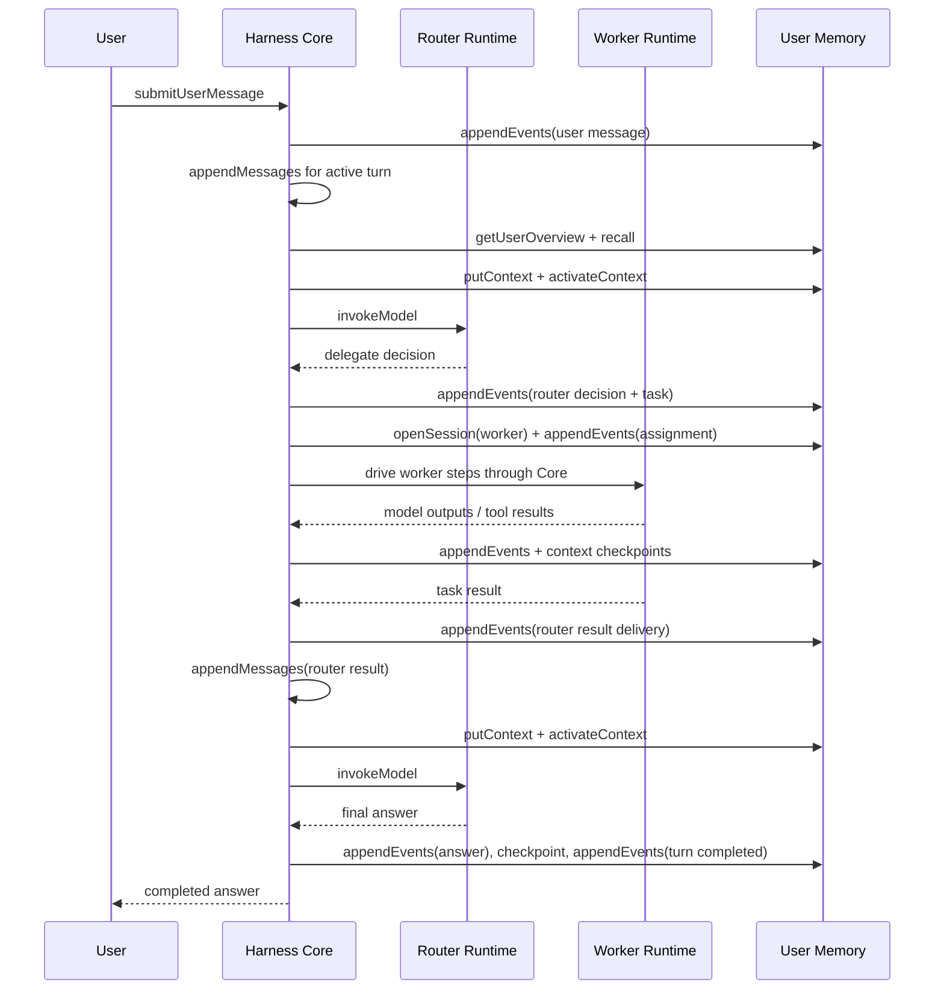

# Harness 与 Memory：交互逻辑、接口与数据结构

状态：设计草案 v0.5；2026-11-17。接口尚未实现。以 user 为 Memory 归属域，Harness Core 管理 Router/Worker 的逻辑执行循环。

本文依次描述交互概念、每轮执行过程、逻辑接口函数、数据结构和 HTTP 映射。[Harness](agent-harness.md) 展开 Core 的执行职责，[Memory](memory-system.md) 展开服务内部实现。

## 1. 系统角色

用户只与 **Router Agent** 对话。Router 使用该用户的统一 Memory 理解目标和历史，决定直接回答、继续已有任务或委派 Worker。Worker 执行具体任务，将结果交回 Router，由 Router 汇总并回复用户。

| 组件 | 职责 |
| --- | --- |
| Harness Core | 管理对话轮次和 agent step，运行 Router/Worker 的逻辑循环，管理任务与上下文，调用 Memory |
| Router Agent | Core 中面向用户的 agent 角色；跨项目检索用户信息、分配任务、处理结果、生成最终答复 |
| Worker Agent | Core 管理的任务执行角色；使用独立上下文执行分配的任务 |
| Runtime Driver / Host Adapter | 将 Core 的执行动作映射为模型调用、工具执行及 Host 生命周期事件 |
| Host | dsh、pi 等完整应用；插件模式下提供实际模型与工具运行能力、界面和执行环境 |
| Memory System | 保存用户全部会话记录、上下文版本、任务证据和 notes，提供检索及后台整理 |

Router 和 Worker 共用 Core 的 step 状态机，各自使用独立 session/context。插件接入不改变这些逻辑角色；Host 是否允许 Core 在每个请求边界控制下一步，决定该 Adapter 能提供的能力等级。

## 2. 交互概念

### 2.1 用户统一 Memory 与 project notes

**一个 user 对应一个统一 Memory 域。** project 是该域内的资料分类和任务属性，不是 Memory 的顶层分区，也不是 Router 的默认检索边界。

```text
user u-42
  user notes                  # 用户级偏好、长期目标、通用方法
  project notes
    genvagent/                # 本项目决策、约束、待办
    analytics/                # 另一个项目的知识与进度
  router conversations       # 可以讨论多个项目，不要求绑定 project
    conversation c-1
      router session / record stream / context versions
  worker sessions
    task t-1 → project genvagent / 独立记录流与上下文
    task t-2 → project analytics / 独立记录流与上下文
  tasks / evidence / blobs / changes
```

Router 可以发现该用户所有项目、会话和 notes，并跨项目检索。它先读取用户概览、当前对话及有关记忆；“可访问完整 Memory”不意味着把全部历史放入一次模型输入。

project note 仍属于该 user，记录项目范围内的要求和事实。同一项目名称在不同用户下不合并，跨用户团队知识库不属于第一版。用户级 note 与项目级 note 可以同时存在，项目约束不能未经验证提升为用户全局偏好。

Worker 默认接收任务目标、相关用户约束、选定证据及所需 project notes。它不继承 Router 的完整上下文；需要更多信息时，经受控检索或请求 Router 补充。

### 2.2 对话、轮次、步骤和任务

| 概念 | 定义与关系 |
| --- | --- |
| Conversation | 用户与 Router 的持续对话，可跨多个 project 和多个 turn |
| Session / Binding | 一个 Router 或 Worker 执行分支与 Memory 的关联，拥有独立记录流和上下文版本 |
| Turn | 从一条新的用户输入开始，到 Router 返回最终答复、等待用户补充、失败或取消结束 |
| Agent Step | 一个 agent 的一次模型调用及其决策处理；一个 turn 可以包含多个 Router step 和多个 Worker step |
| Task | Router 委派给 Worker 的工作单元，关联创建它的 turn；Worker 的输出先回到 Router |
| Message | 用户输入、assistant 输出或工具结果等模型可见消息 |
| Record / Event | 持久化事件；可以携带 Message，也可以记录任务状态、模型调用状态等非消息信息 |

第一版同一 Router conversation 串行处理用户 turn。执行中的新输入先持久化并排队；显式纠正或取消使未执行的旧计划失效，在下一个安全边界处理。Worker 并行使用独立 session；不能并发修改同一个 Router context。

排队输入先只进入记录流，不提前加入当前 turn 的模型消息。startTurn 记录输入引用，轮到该 turn 时才从原事件追加到 context；不重新写一份用户 Message。执行状态与消息投影分别恢复，context 的消费位置不表示排队输入或任务已执行完成。

Worker 遇到需要用户决策的问题时，返回待澄清结果，由 Router 询问用户。用户的回答开启下一 turn，并可继续原任务。迟到的 Worker 结果保留原 task/turn 关联，不直接追加到另一个 turn 的模型输入。

### 2.3 原始记录、工作上下文和 notes

- **原始记录**是追加式事实日志，保留消息、工具交换、任务分派及结果的来源与顺序。
- **工作上下文**是当前 agent 的模型输入工作视图，包含目标、约束、消息、证据和进度；允许追加、选择、压缩与编辑。
- **notes**是可复用知识，按 user 或 project 标注适用范围，保留证据和修订。它们可以由 Worker 提议，也可以由 Memory Agent 整理产生。

工作上下文中的消息有对应事件引用。检索到的 note 作为带 revision 的材料进入 context，不改写为用户说过的话。压缩或移出一段上下文不会删除原始事件。

SessionBinding 将 session 关联到 record stream 和 context。ContextVersion 是不可变快照，ContextHead 指向已确认应用的版本。Memory 保存这些对象；Core 决定下一版本的内容。

## 3. 一轮对话如何执行

### 3.1 从用户输入到 Router 的第一次调用

1. **创建 turn。** UI 或 Host 将稳定的输入 ID 和文本交给 Core.submitUserMessage。Core 在原 Router conversation 中分配 turnId，重复提交相同输入 ID 返回同一 turn。
2. **持久化输入。** Core 为用户 Message 建立事件 ID、sequence 和本地待发送日志，调用 Memory.appendEvents。确认后，该消息已经属于用户 Memory，无须等待模型回答或 dreaming。
3. **追加到上下文。** ContextController.appendMessages 将已提交事件投影到 Router 的工作视图。按 eventId/messageId 去重，保持 user/assistant/tool 的顺序。此时修改的是尚未提交的工作副本。
4. **读取相关记忆。** Core 读取用户概览并调用 recall，范围默认是该 user 的全部可读 notes 与历史。当前输入作为必需材料保留，项目只在任务明确后用于检索筛选。
5. **提交模型输入视图。** ContextController 组装候选版本；Memory.putContext 保存快照。Driver 应用该视图并持久化 marker，Memory.activateContext 确认后，Core 才允许受管理的模型调用。
6. **执行 Router step。** Driver 调用模型。Router 可以选择直接回答、调用工具、读取更多记忆或委派 Worker；结果重新进入同一事件与上下文处理流程。

### 3.2 Router 委派、Worker 循环与结果返回

Router 通过受控的 delegate 动作产生 TaskSpec。Core 先持久化分派事件，调用 Driver.ensureWorker 取得可恢复的 Worker session 身份，再创建独立 binding，将任务输入与选定证据写入 Worker 记录流并构建初始 context。ensureWorker 只创建或定位执行容器，不启动模型；Worker 第一次调用也必须经过 Core 的上下文提交与放行。

Worker 的循环与 Router 相同：准备上下文 → 调用模型 → 持久化输出 → 处理工具调用 → 持久化工具结果 → 追加 context → 下一 step。模型提出工具调用不代表工具已经执行；Core/Driver 记录具体 toolCallId，并在授权后调用实际工具。

Worker 完成后，先持久化最终输出和任务结果。Core 将 TaskResult 转换为 Router 的结果事件，引用 Worker 来源，并完成原 delegate 工具交换。Router 下一 step 读取该结果，决定继续委派、追问或生成答复。

Worker 和 Router 的事件序号分别递增，不能把两个流按网络到达时间直接拼接。Worker 结果进入 Router 是一次新的消息投递，投递标识由 taskId 与结果 ID 决定，重试不会重复追加。

### 3.3 一次消息追加的完整路径

```text
用户输入 / 完成的模型输出 / 已确认工具结果
  → Core 规范化为事件，保存本地发送日志
  → Memory.appendEvents：事务写入原始正文、stream 进度、user revision
  → ContextController.appendMessages：从已提交事件更新工作副本
  → ContextController.buildContext：合并目标、notes 和证据，执行预算与格式校验
  → Memory.putContext：保存候选快照
  → Driver.applyContext：应用到下一请求视图或当前工作视图，持久化 marker
  → Memory.activateContext：推进已确认版本
```

这里有两个不同的 append：**appendEvents 追加持久日志；appendMessages 更新工作上下文中的消息序列。** Memory 不会收到一条事件就自动改写 context，Core 也不能仅修改内存 context 而跳过原始记录。

以一次工具调用为例，以下只展示工作上下文中的消息部分；目标、约束和检索 notes 作为其他 blocks 保存：

| 新增 Message | append 后的消息顺序 | 下一动作 |
| --- | --- | --- |
| m1：用户请求 | 原有消息 → m1 | 保存并激活 context，调用模型 |
| m2：assistant 提出 toolCall t1 | 原有消息 → m1 → m2 | 先保存 m2，再执行工具 t1 |
| m3：工具 t1 的结果 | 原有消息 → m1 → m2 → m3 | 保存并激活含完整工具交换的 context，再调用模型 |
| m4：assistant 最终答复 | 原有消息 → m1 → m2 → m3 → m4 | 保存最终 context，再记录 turn 完成 |

每一行都先通过 appendEvents 保存对应原始消息，再进行 context 追加。delegate 也遵循同一调用/结果关系，只是结果由 Worker 的独立事件流提供。

每条已完成的语义消息及时写入 Memory；context 可以合并多条新增事件后再保存。必须在下一次模型调用前、turn 结束前建立已确认 checkpoint。普通流式 token delta 只用于展示，消息完成后才生成持久 Message；中断的输出保留不完整状态，不能冒充最终结果。

最终 Router 答复也必须追加事件及 context。Core 先完成包含最终消息的 checkpoint，再追加引用该 checkpoint 的 turn 终态事件，最后将本轮标记为完成。终态事件是控制记录，不需要为它再生成一份 prompt 快照。UI 可以先展示流式内容，但“已完成并可恢复”以持久确认状态为准。

### 3.4 贯穿示例

用户在 Router 对话中说：“继续修改 Genvagent 的协议文档，并沿用我在 analytics 项目里确定的文档组织方式。”

| 阶段 | 记录与上下文变化 | Memory 行为 |
| --- | --- | --- |
| 接收请求 | Router 创建 turn，追加 user Message | 保存原始请求，不要求为对话选择唯一 project |
| 检索 | Router 读取用户级偏好、analytics notes、Genvagent notes | 在同一 user 域跨项目检索 |
| 分派 | Router 产生文档修改任务，Worker 使用独立 context | 保存任务与分派依据，Worker 只取得所需资料 |
| 执行 | Worker 追加读取文件、修改文件的工具交换 | 每个完成的消息及时保存；请求前提交 context |
| 回传 | Worker 输出结果；Router 追加对应结果消息 | 保留两条流及结果来源关系 |
| 答复 | Router 输出总结，追加最终消息并结束 turn | 保存 Router 最终 context 与 turn 终态 |
| 后台整理 | Worker 可提议 Genvagent 项目 note | Memory 校对后发布；不自动把项目要求变成全局偏好 |



图中运行时调用前的 context 激活均包含 Driver 的实际应用与 marker 确认；详细调用契约如下。

## 4. 逻辑接口函数

接口先按调用方向定义。下列函数名是 Genvagent 的拟定契约，既不是 dsh/pi 已有 SDK，也不要求调用方直接操作数据库。

### 4.1 应用、Core 与运行时

| 调用方向 | 函数 | 语义 |
| --- | --- | --- |
| UI/Host → Core | openConversation(registration) | 按 SessionRegistration 创建或恢复 Router conversation，取得持久绑定 |
| UI/Host → Core | submitUserMessage(routerBindingId, inputId, content) | 持久化输入并创建或取得同一 turn；返回 turn handle |
| UI/Host → Core | cancelTurn(turnId) | 记录取消意图，停止安排新 step，通知运行时取消可取消动作 |
| Driver → Core | acceptCompletion(actionId, completion) | 提交模型、工具或 Worker 完成结果，按动作 ID 去重 |
| Core 内部 | advance(bindingId) | 根据持久状态选择下一动作：调用模型、执行工具、分派、等待或结束 |
| Core → ContextController | appendMessages(committedEvents) | 将已提交消息应用到工作副本，推进消费位置 |
| Core → ContextController | buildContext(bindingId, recalledItems) | 组装并校验候选版本，不执行模型 |
| Core → Driver | applyContext(plan) | 应用工作视图，返回可恢复应用回执 |
| Core → Driver | ensureWorker(task) | 按 taskId 创建或定位尚未开始模型执行的 Worker session |
| Core → Driver | execute(action) | 只执行 invoke_model / execute_tool；结果经 acceptCompletion 回流 |

Core 的 advance 是逻辑 loop 的状态转换入口；调用模型与工具的底层 SDK 可由 Host 提供。dispatch_task 由 Core 的 Task Controller 处理，wait 和 finish 由 Core 更新状态；只有模型与工具动作交给 Driver.execute。Driver 不能在 Core 仍等待保存确认或必要工具结果时自行进入下一模型 step。

### 4.2 Core → Memory 的主接口

Memory Client 绑定有效 userId。函数中的项目过滤只缩小查询，不能替换用户身份；所有返回内容都属于该用户的统一 Memory。

| 函数 | 输入 | 输出与提交语义 |
| --- | --- | --- |
| openSession | SessionRegistration | BindingState；创建或返回同一持久关联，分配 stream/context |
| resolveSession | SessionKey | BindingState；按原身份精确查找，不新建 |
| getSession | bindingId | 当前绑定、接收位置、context head、应用回执和 writer |
| updateLease | bindingId、LeaseRequest | writer lease 或释放确认 |
| appendEvents | bindingId、AppendRequest、写入凭证 | AppendReceipt；整批持久化后返回 acceptedThrough 与 userRevision |
| readEvents | bindingId、afterSequence、limit | 连续事件分页；用于恢复和来源读取 |
| getUserOverview | cursor、minUserRevision | 用户 notes 与所有项目/会话/任务的可分页目录，不限定 project |
| recall | RecallRequest | 带来源、revision 和可信状态的 RecallResponse |
| readEvidence | EvidenceRef | 精确读取事件或 note 修订，沿用当前授权与删除检查 |
| putContext | bindingId、ContextVersion、写入凭证 | 已持久化候选版本；不推进当前指针 |
| getContext | ContextRef | 该不可变版本及正文 |
| activateContext | bindingId、ActivateRequest、写入凭证 | 新 ContextHead；与应用 receipt 原子提交 |
| proposeNote | NoteProposal | proposal ID 与持久化确认；发布结果由后台校验确定 |
| submitFeedback | FeedbackInput | feedback ID；先保存反馈，再触发整理 |
| readChanges | cursor、limit | 用户域内 notes、来源与任务变更；按 change ID 去重 |

userId 从认证或授权委托确定；绑定一个 user 的客户端不能读另一个 user 的对象。Router 可发现全部用户资料，Worker 使用与 task 绑定的读取授权。Core 持有用户凭据，模型只调用受控工具，不接触凭据。

### 4.3 接口调用顺序

```text
启动：
  resolveSession / openSession → getSession → updateLease(acquire)
  → 核对 marker 与 head → 补传事件 → getContext + readEvents

处理消息：
  appendEvents → appendMessages

准备一次模型调用：
  getUserOverview / recall → buildContext → putContext
  → applyContext → activateContext → execute(invoke_model)

模型或工具完成：
  acceptCompletion → appendEvents → appendMessages → advance

本轮结束：
  appendEvents(final answer) → appendMessages
  → buildContext → putContext → applyContext → activateContext
  → appendEvents(turn completed, checkpoint ref) → 发布完成状态

提出项目 note：
  proposeNote → Memory 验证与发布 → readChanges / recall 读取新修订
```

getUserOverview 不要求每 step 全量读取；Core 可按 user revision 与 changes 缓存目录。用户明确要求立即进入本轮上下文，不等待 note 提取完成。

## 5. 共享数据结构

### 5.1 身份、引用与会话

```typescript
type ID = string;
type Timestamp = string;
type JsonValue = null | boolean | number | string
  | JsonValue[] | { [key: string]: JsonValue };

interface UserDomain {
  userId: ID;                     // 唯一 Memory 归属域；project 不在域键中
}

type NoteScope = { kind: "user" }
  | { kind: "project"; projectId: ID };

interface BlobRef {
  blobId: ID;
  sha256: string;
  mediaType: string;
  byteSize: number;
}

type Content = { type: "inline"; value: JsonValue }
  | { type: "blob"; ref: BlobRef };

type EvidenceRef = { kind: "event"; bindingId: ID; eventId: ID }
  | { kind: "note"; noteId: ID; revision: number };

interface ContextRef {
  contextId: ID;
  versionId: ID;
}

type ReadGrant = { kind: "user" }
  | { kind: "task"; taskId: ID; projectIds: ID[]; refs: EvidenceRef[] };

interface SessionKey {
  hostInstanceId: ID;             // 安装实例的持久标识
  nativeSessionId: string;
  nativeBranchId: string;
}

interface SessionRegistration {
  key: SessionKey;
  host: "dsh" | "pi" | "standalone" | "other";
  hostVersion: string;
  agentRole: "router" | "worker";
  conversationId: ID;
  taskId?: ID;
  projectId?: ID;                 // 任务标签，不改变 Memory 所属域
  readGrant: ReadGrant;
  parentContext?: ContextRef;     // 同 agent 分支继承，不用于复制 Router 给 Worker
}

interface SessionBinding extends SessionRegistration {
  bindingId: ID;
  domain: UserDomain;
  streamId: ID;
  contextId: ID;
}

interface BindingState {
  binding: SessionBinding;
  acceptedThrough: number;
  contextHead: ContextHead;
  activeReceipt?: HostApplicationReceipt;
  writer?: WriterLease;
}
```

绑定唯一键为 (userId, hostInstanceId, nativeSessionId, nativeBranchId)，不包含 project。Router 对话切换项目不会重新分配 Memory；fork 或形成新执行分支才建立新 binding。worker 的 taskId 必填，其 readGrant 必须对应同一任务。

ReadGrant 由有权委派任务的 Core 注册，Worker 凭证绑定其 binding，不能自行提升为 user 范围。task 授权允许读取自己的记录、选定 refs 和指定项目 notes；用户级 notes 通过选定 refs 提供。引用某条来源不自动授权读取来源所属的整个会话。worker 来源请求仍由服务端校验，body 中的角色字段不构成授权。

### 5.2 消息、事件与同步

```typescript
interface ToolCall {
  toolCallId: ID;
  name: string;
  arguments: JsonValue;
}

interface Message {
  messageId: ID;
  speaker: "user" | "assistant" | "tool";
  content: Content;
  toolCalls?: ToolCall[];
  inReplyToToolCallId?: ID;
  completeness: "complete" | "interrupted";
}

interface RecordInput {
  eventId: ID;
  sequence: number;               // binding 的 stream 内从 1 连续递增
  originId: string;               // 原生事件或 Core 事件的稳定去重 ID
  nativePosition?: JsonValue;
  kind: "message" | "task_created" | "task_result" | "turn_state"
    | "step_state" | "observation" | "context_patch" | "feedback";
  actor: { role: "user" | "router" | "worker" | "runtime"; id: ID };
  turnId: ID;
  taskId?: ID;
  stepId?: ID;
  projectId?: ID;
  occurredAt: Timestamp;
  payload: Content;              // message 类型解引用后符合 Message
  sourceRefs: EvidenceRef[];
}

interface AppendRequest {
  afterSequence: number;
  records: RecordInput[];
}

interface AppendReceipt {
  acceptedThrough: number;
  userRevision: number;
}

interface EventPage {
  records: RecordInput[];
  nextSequence: number;
  hasMore: boolean;
}
```

消息和操作状态分别记录。step_state 记录模型调用使用的 ContextRef、actionId 和请求/结果状态；不会再次存储一份重复的 assistant Message。task_result 可携带投递给 Router 的 tool Message，其 inReplyToToolCallId 匹配 delegate 调用。

eventId 在 user 域唯一，originId 在 binding 内唯一。appendEvents 原子接受批次，afterSequence 必须匹配当前已接收位置。Core 在发送前持久化事件映射、请求正文与幂等 key；未知结果用原 key 重试。消息产生者不改变 user 归属。

### 5.3 上下文版本与应用确认

```typescript
interface WorkingBlock {
  id: ID;
  category: "goal" | "constraint" | "note" | "evidence"
    | "progress" | "message" | "tool_exchange";
  content: Content;
  sourceRefs: EvidenceRef[];
  editable: boolean;
}

interface WorkingContext {
  format: "genvagent.context.v1";
  goal: string;
  blocks: WorkingBlock[];
}

interface ContextVersion {
  ref: ContextRef;
  basedOnHeadRevision: number;
  format: string;
  body: Content;
  bodyHash: string;
  coveredEventSequence: number;
  sourceRefs: EvidenceRef[];
  recalledAtUserRevision: number;
}

interface ContextHead {
  contextId: ID;
  revision: number;
  activeVersion?: ContextRef;
}

interface HostApplicationReceipt {
  markerId: ID;
  nativePosition: JsonValue;
  appliedBodyHash: string;
  coverage: "working_view" | "model_messages" | "provider_payload";
}

interface ActivateRequest {
  version: ContextRef;
  expectedHeadRevision: number;
  hostReceipt: HostApplicationReceipt;
}
```

coveredEventSequence 表示 Core 已处理的连续事件前缀。非消息状态事件推进消费位置但不一定产生 prompt 文本；已压缩消息通过来源引用保留。不可直接把 acceptedThrough 复制为 coveredEventSequence。

候选版本已经组装但尚未完成应用确认。putContext 不改变 head；Driver 应用并持久化 marker 后，activateContext 比较 head revision、writer epoch 和 bodyHash，原子保存 receipt 并推进 head。

工作视图 checkpoint 可以包含尚未完成的工具调用；下一次模型请求前必须满足该 Host 的工具交换要求。模型调用引用当时激活的 ContextRef，后续追加结果形成新版本，不能据最终 context 反推之前模型看到了什么。

Host 的系统指令、工具定义、授权和当前用户约束保持受保护。实际捕获到 working_view、完整 model_messages 或 provider_payload，应按 receipt.coverage 如实记录；供应商凭据不进入快照。

### 5.4 用户概览、检索与 notes

```typescript
interface UserOverview {
  userRevision: number;
  entries: {
    kind: "user_note" | "project" | "conversation" | "task";
    id: ID;
    label: string;
    summary?: string;
    sourceRefs: EvidenceRef[];
  }[];
  nextCursor?: string;
}

interface RecallRequest {
  bindingId: ID;
  query: string;
  corpora: ("user_notes" | "project_notes" | "session_events" | "user_events")[];
  projectIds?: ID[];              // 未指定时不按 project 过滤；空数组无项目匹配
  requiredRefs: EvidenceRef[];
  minUserRevision?: number;
  maxItems: number;
  maxBytes: number;
}

interface RecallItem {
  ref: EvidenceRef;
  text: string;
  sourceRefs: EvidenceRef[];
  epistemicStatus: "supported" | "inferred" | "unverified" | "disputed";
  stale: boolean;
  validUntil?: Timestamp;
}

interface RecallResponse {
  readUserRevision: number;
  items: RecallItem[];
  missingRequiredRefs: EvidenceRef[];
}

interface NoteProposal {
  proposalId: ID;
  producerBindingId: ID;
  scope: NoteScope;
  noteId?: ID;
  expectedRevision?: number;
  content: Content;
  sourceRefs: EvidenceRef[];
}

interface FeedbackInput {
  feedbackId: ID;
  sourceEvent: EvidenceRef;
  target: EvidenceRef;
  kind: "correction" | "stale" | "useful" | "rejected";
}
```

Router 默认搜索 user_notes、project_notes、当前 session_events；需要跨会话证据时显式加入 user_events。项目筛选作用于项目 notes 和带项目标签的事件，不排除 user_notes。Worker 的请求还受 ReadGrant 限制。

检索在 Memory 的索引与存储层完成。requiredRefs 直接读取，不与相关性分数竞争。索引落后于 minUserRevision 时补读权威存储，或在 deadline 后返回 NOT_READY，不能返回遗漏必需新输入的成功结果。

proposeNote 将候选持久化，由 Memory 验证后发布不可变 NoteRevision。项目 Worker 可提出该项目的 note；提升为 user 级记忆由 Router 或 Memory Agent 判断适用范围并校验。未发布候选不进入普通 recall。

### 5.5 并发与能力

```typescript
interface WriterLease {
  bindingId: ID;
  ownerId: ID;                    // 插件/Runner 实例，不是 userId
  epoch: number;
  expiresAt: Timestamp;
}

type LeaseRequest =
  | { action: "acquire"; ownerId: ID; requestedTtlSeconds: number }
  | { action: "renew"; ownerId: ID; epoch: number; requestedTtlSeconds: number }
  | { action: "release"; ownerId: ID; epoch: number };

interface ServerCapabilities {
  protocolMajor: number;
  protocolMinor: number;
  contextFormats: string[];
  features: string[];
  maxInlineBytes: number;
  maxBatchEvents: number;
}
```

每个 binding 同时只有一个 writer，Router 与各 Worker 可独立写入。新的实例在旧 lease 释放或过期后取得更高 epoch。该约束不把整个用户的在线执行串行化。

## 6. HTTP 映射

所有域内路径以 `/v1/users/{userId}` 为前缀，服务端核对有效用户或委托身份。以下以 P 代表此前缀。写操作使用 Idempotency-Key；事件写入、context 保存与激活携带 writer ID 和 epoch。

| 逻辑函数 | HTTP |
| --- | --- |
| 能力协商 | GET /v1/capabilities |
| openSession | POST P/sessions |
| resolveSession | POST P/sessions:resolve |
| getSession | GET P/sessions/{bindingId} |
| updateLease | POST P/sessions/{bindingId}/lease |
| appendEvents / readEvents | POST P/sessions/{bindingId}/events:append；GET P/sessions/{bindingId}/events |
| getUserOverview | GET P/overview |
| recall | POST P/recall |
| readEvidence | GET P/sessions/{bindingId}/events/{eventId}；GET P/notes/{noteId}?revision=... |
| putContext / getContext | PUT / GET P/contexts/{contextId}/versions/{versionId} |
| activateContext | POST P/contexts/{contextId}:activate |
| proposeNote | POST P/note-proposals |
| submitFeedback | POST P/feedback |
| readChanges | GET P/changes |
| 大正文上传/读取 | POST P/blobs；GET P/blobs/{blobId} |

sessions:resolve 和 recall 虽为 POST，但不修改状态。openSession 接收 SessionRegistration，userId 来自路径和认证；按 SessionKey 的唯一约束实现重复注册去重。projectId 不参与 endpoint 或会话唯一键。

### 6.1 用户输入事件示例

```http
POST /v1/users/u-42/sessions/router-session-1/events:append
Authorization: Bearer <credential>
Idempotency-Key: input-client-17
X-Genvagent-Writer-Id: runtime-9
X-Genvagent-Writer-Epoch: 3
Content-Type: application/json
```

```json
{
  "afterSequence": 40,
  "records": [{
    "eventId": "e-41",
    "sequence": 41,
    "originId": "client-input-17",
    "kind": "message",
    "actor": {"role": "user", "id": "u-42"},
    "turnId": "turn-8",
    "occurredAt": "2026-11-17T10:00:00Z",
    "payload": {
      "type": "inline",
      "value": {
        "messageId": "msg-17",
        "speaker": "user",
        "content": {"type": "inline", "value": "继续修改 Genvagent 文档，沿用 analytics 的组织方式"},
        "completeness": "complete"
      }
    },
    "sourceRefs": []
  }]
}
```

响应为 `{"acceptedThrough":41,"userRevision":208}`。若先前 context 覆盖至 40，Core 现在追加 e-41，并检索用户域内两个项目的 notes。后续候选 ContextVersion.coveredEventSequence 为 41，recalledAtUserRevision 至少为 208；实际调用的 ContextRef 另记在 step_state。

## 7. 一致性、故障恢复与执行边界

### 7.1 提交规则

- userRevision 对会话注册、原始事件、已发布 notes、反馈及来源失效递增，用于资料与目录的可见性判断；context 使用独立的 head revision，未发布提案和 job 内部状态不推进 userRevision。
- 原始事件、stream 进度、userRevision 和幂等结果在一个事务提交；引用 blob 必须事先持久化。
- context 候选不可变，激活使用 expectedHeadRevision 与 writer epoch。跨 Runtime 和 Memory 的应用是可恢复的分步协议。
- 幂等 key 在有效调用身份、userId、方法和规范化路径内唯一；同 key 不同正文报冲突。重试先重新鉴权，再读取已提交结果。
- JSON 使用 RFC 8785 JCS 规范化后计算 SHA-256。context 的 bodyHash 对解引用后的正文计算；BlobRef.sha256 对原始字节计算。[JCS 规范](https://www.rfc-editor.org/rfc/rfc8785)
- 序号、revision、epoch 和大小是非负安全整数。拒绝重复 JSON 属性、非有限数值和不能可靠表示的计数。
- 只有收到完成结果才能确认工具成功；context 已激活或模型已决定调用工具都不能证明外部动作已完成。

### 7.2 恢复步骤

1. 使用认证 userId 和持久 SessionKey，通过本地映射或 resolveSession 找到原 binding。project 切换不影响定位。
2. getSession 读取进度、head 和应用 receipt，取得新 lease。
3. 核对本地应用 marker；已应用但激活结果未知时，用原幂等 key 核对或补交，不能直接开始新 step。
4. 按原事件 ID、序号和批次 key 补传尚未确认的数据；补传不会重新执行工具。
5. getContext 读取当前版本，再 readEvents 读取 coveredEventSequence 之后的增量；没有版本时从空视图处理全部已提交事件。
6. 从已提交控制事件重建 turn、排队输入、pending action 与 task 状态；该重建不以 context 的 coveredEventSequence 截断控制历史。已分派任务按 taskId 查找原 Worker，未确认结果先核对，不能重新创建一份任务。
7. Core 校验工具配对、最新输入、取消状态与执行环境后，从 advance 恢复。

例如 Memory 已接收至 104，context v8 覆盖至 102，Core 重新投影 103、104 并保存新版本。如果服务已确认事件而本地 appendMessages 尚未执行，增量重放可以补齐；如果本地已执行，则按事件 ID 去重。

Host 进程重启、插件 reload 会丢失运行内存；原会话存档、安装标识和同步日志提供恢复身份。Memory API 节点重启依赖共享持久存储。文件、操作系统进程及工具外部副作用仍由运行时核对，Memory 不承诺恢复已丢失的执行环境。

### 7.3 不可用与错误

strict 模式在输入或 context 未确认时停止新的受管理 step。buffered 模式允许从本地持久状态继续，并显示未同步；恢复时取得 lease、核对进度，发生分叉则建立新分支，不能覆盖远端历史。buffered 不保证机器损坏后未同步数据仍可恢复。

| HTTP / code | 处理方式 |
| --- | --- |
| 400 / INVALID_ARGUMENT | 修正输入 |
| 401、403 / UNAUTHORIZED、FORBIDDEN | 校验身份与授权，不扩大读取范围 |
| 404 / NOT_FOUND | 区分新会话与缺失对象，不将缺失伪装为空记忆 |
| 409 / VERSION_CONFLICT、SEQUENCE_GAP | 读取权威版本或进度后重建 |
| 409 / LEASE_LOST | 停止远端写入，strict 同时停止新 step |
| 409 / IDEMPOTENCY_CONFLICT | 核对稳定事件与批次映射 |
| 410 / SOURCE_DELETED、CURSOR_EXPIRED | 停用已删除来源，或重读当前目录与变更状态 |
| 412 / NOT_READY | 等待索引可见或补传缺失输入 |
| 413 / PAYLOAD_TOO_LARGE | 上传 blob 或拆小批次 |
| 429、503 / RATE_LIMITED、UNAVAILABLE | 按 Retry-After 与总 deadline 重试 |

错误体包含 code、message、retryable、requestId；冲突附当前版本或接收位置。取消等待不代表服务端撤销提交。

删除、授权撤回和来源失效在精确读取、检索及历史快照读取时同样检查。changes 至少一次投递，客户端按 change ID 去重。compaction 不执行物理删除。

## 8. 联合验收

1. 同一用户在一个 Router conversation 中讨论两个项目，能检索两边 notes；切换项目不创建新的用户 Memory。
2. 用户输入、assistant 输出、工具结果各只保存一次；appendEvents 和 appendMessages 中间崩溃仍可恢复。
3. 一个 turn 内完成 Router → Worker → Router，Worker 消息进入独立 context，结果按原调用关系回到 Router。
4. Core-owned 与 Host-driven 两种驱动通过同一 step 状态转换与消息序列验证；不出现两个 loop 同时发起模型调用。
5. 最终答复与 turn 终态持久化后才能标记本轮完成；模型请求可追溯到当时使用的 ContextRef。
6. Worker 无法借项目过滤或来源引用取得未授予的用户资料；不同用户的同名项目保持隔离。
7. 旧 writer、并发 context 激活、重复任务投递均符合租约、版本及幂等规则。
8. 单机与集群使用相同协议；Memory Agent 可在所有 Host 离线时整理用户级与项目级 notes。
