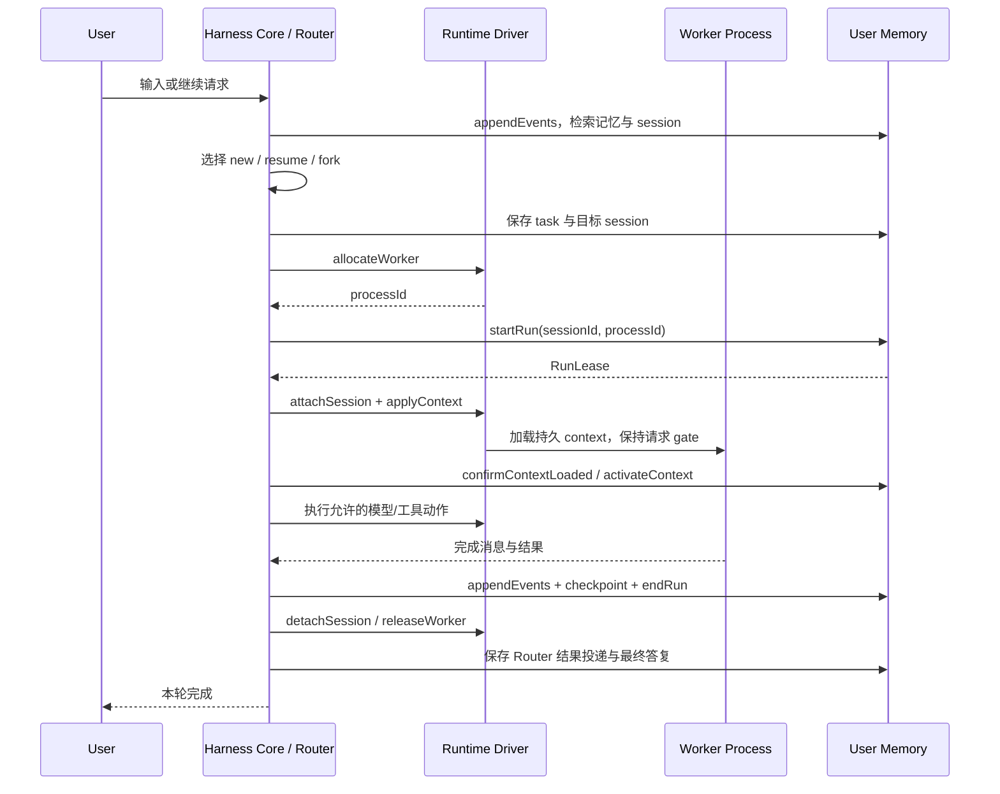

# Harness 与 Memory：持久 Session、执行附着与记忆接口

状态：设计草案 v0.6；2026-11-17。接口尚未实现。本文按交互概念、执行流程、函数、数据结构和 HTTP 映射展开；总体关系见[架构](architecture.md)。

## 1. 交互对象与所有权

Memory 的唯一归属域是 user。原始证据、可复用记忆、session/context 和执行记录均属于该域。画像、短期/长期记忆是基于这些对象的视图；标签和集合可选，不要求用户有 project。

| 对象 | 持久含义 | Harness 与 Memory 的分工 |
| --- | --- | --- |
| Session | 稳定的逻辑工作线程，关联一个 stream 和一个 context 版本序列 | Router 选择；Memory 保存身份、生命周期与关联 |
| ContextVersion | 目标、约束、消息、证据及进度的不可变工作快照 | 模型/Core 编辑；Memory 保存版本与当前指针 |
| Task | 要完成的工作，明确选择新建、继续或分叉 session | Router/Core 决策，事件保存到 Memory |
| Run | 在一个 session 上的一次执行尝试 | Core 分配进程；Memory 记录并授予单写者 lease |
| Runtime binding | Host 原生 session 到逻辑 session 的定位映射 | Adapter 创建，Memory 保存映射以便恢复 |
| Memory item | 事实、偏好、目标、方法、经历或 note 的修订 | Harness 可提议，Memory 验证、整理和发布 |

Worker process 是运行时资源，可以退出或被复用；sessionId/contextId 不由 processId 定义。同一 session 可先后承接多个 task，某个 task 换进程继续时可以产生新 run。Router 也有自己的持久 session 和执行 run。

一个 session 同时只有一个有效写入 run。并行任务使用不同 session；从相同进度并行探索时，显式从固定版本分叉。

## 2. Router 的选择与生命周期

### 2.1 new、resume 与 fork

Router 先通过用户概览、profile、recall 和 discoverSessions 获取候选信息，再按 ID 精确检查目标。Session discovery 返回摘要、head、生命周期及忙闲信息，不能仅凭语义相似度直接恢复执行。

| 路由 | 持久操作 | 执行方式 |
| --- | --- | --- |
| 直接答复 | 继续 Router session | 无须另建 task session |
| new | createSession，使用新的 stream/context | 加载任务目标与选定证据 |
| resume | getSession，检查原 context 与执行状态 | 新进程或空闲进程加载同一 session |
| fork | createSession(parentContext) | 新 stream/context 继承固定快照，原 session 不变 |
| wait / clarify | 保存等待或澄清结果 | 不抢占忙碌 session，不猜测未知外部结果 |

第一次分派即持久化 taskId → targetSessionId 的选择。重试分派沿用该选择，不能因再次调用 new 就建立另一份 session。需要改变去向时，产生明确的新路由决策并保留来源。

Task session 不永久绑定某个 Router conversation，可以在后续对话中继续使用；本次结果始终投递到创建本任务的 Router turn。授权仍按 user、session 和当前 run 校验。

### 2.2 创建、空闲与退役

Session.lifecycle 为 open 或 retired。open session 可以空闲，也可以被某个 run 占用；忙闲由 lease 与未决动作判断，不建立第二套互相矛盾的生命周期字段。

任务完成默认只结束 run，session/context 保留。one_shot 策略可以在结果和 checkpoint 已保存、没有未决动作后退役。闲置时长只能产生退役候选，不能据此丢弃未完成工作。

retireSession 使用 session revision、head revision 和最后接收序号做条件更新，并检查没有有效 run、排队输入、未完成任务或未决动作。待澄清的任务须先明确取消或转交，才能退役。退役后仍可读取记录与快照，不能追加事件、激活新版本或直接启动 run。重新使用其进度时创建分叉或新 session。

普通 compaction/CLM 编辑只产生同一 contextId 的新版本；旧版本保留。退役不等于物理删除，也不自动把全部内容提升为长期记忆。

## 3. 一轮执行与消息存储

### 3.1 Router 接收用户输入

1. UI/Host 提交稳定 inputId；Core 在 Router conversation 中创建或取得同一 turn。
2. Memory.appendEvents 持久化用户 Message 与轮次记录。
3. 当前 turn 的消息由 ContextController.appendMessages 追加到工作副本。排队输入先保存引用，轮到它时才进入模型输入。
4. Router 按需读取画像、有关记忆和 session 目录，检查或编辑自己的 context。
5. Core 保存候选、应用到当前 run、确认激活后，放行 Router 模型调用。

Router 的 CLM 编辑更新下一轮实际输入，原始事件保持可追溯。其他 session 的摘要和快照可读；若要改写它们，必须先取得该 session 的写入 run，或新建分叉。

### 3.2 分配进程并附着 session

1. **持久化路由。** Task Controller 保存 TaskSpec 及 targetSessionId；new/fork 先按稳定 sessionId 创建，resume 精确读取既有 session。
2. **分配进程。** Runtime.allocateWorker 返回具备所需能力的进程。此时不能自行调用模型。
3. **取得执行所有权。** Memory.startRun 原子检查 session 开放、head 未过期、旧 lease 已结束及授权，返回 RunLease。
4. **建立运行映射。** Driver.attachSession 将该 run 映射到暂停状态的运行容器；原生映射保存为 RuntimeBinding。
5. **加载与核对。** 读取当前 context 及未覆盖事件，恢复 task/action 状态，核对未知外部结果。新进程不能把旧进程的应用回执当成自己已经加载的证明。
6. **确认本次应用。** 原样加载现有版本使用 confirmContextLoaded；有新增输入或格式变换则生成新版本并 activateContext。
7. **推进执行。** 运行过程继续经过 Core.advance，按需检索、调用模型或工具，并持续保存消息与 context。

startRun 获取 lease 不表示外部工具已经恢复。执行环境或格式无法兼容时，停止该 run 或明确选择可兼容的运行时；不能宣称恢复成功。

### 3.3 两种 append 与 checkpoint

```text
完成的用户输入 / 模型消息 / 工具结果
  → 本地持久发送日志
  → Memory.appendEvents：追加原始事件，确认 stream 位置
  → ContextController.appendMessages：消费已提交事件，更新工作副本
  → buildContext：选择材料或执行 CLM 编辑
  → Memory.putContext：保存不可变候选
  → Driver.applyContext：应用并保存本 run 的 marker
  → Memory.activateContext：校验 lease、版本和 hash，推进 head
```

appendEvents 保存事实日志，appendMessages 更新模型工作视图，Memory 不会自动把前者转换成后者。状态事件可以推进消费位置而不成为 prompt 文本。

| 新消息 | 工作视图中的消息顺序 | 后续操作 |
| --- | --- | --- |
| m1 用户请求 | 原有消息 → m1 | checkpoint 后调用模型 |
| m2 assistant 提出工具 t1 | 原有消息 → m1 → m2 | 保存消息及动作意图，再执行工具 |
| m3 工具结果 t1 | 原有消息 → m1 → m2 → m3 | 校验工具配对，checkpoint 后调用模型 |
| m4 最终答复 | 原有消息 → m1 → m2 → m3 → m4 | 最终 checkpoint，再记录完成 |

消息及时持久化，context 可以合并多条事件后保存，但下一模型调用前和正常结束前必须 checkpoint。流式 delta 用于展示，完成消息才作为语义事件；中断输出不能标记为最终答复。

### 3.4 结果返回、释放与后续继续

Worker 完成后，保存输出和最终 checkpoint，endRun 记录结果与执行终态、释放 lease；Driver 清理本次挂载并释放进程。进程可以复用，session 默认保持 open。

TaskResult 携带 taskId、runId、sessionId、结果与证据；正常完成还必须包含最终 ContextRef，异常在首个快照前发生时不伪造该引用。Core 将结果以稳定投递 ID 追加到 Router 流，完成原 delegate 工具交换；不同流不按网络到达时间混合。

Router 生成最终答复，保存其消息与 checkpoint，再追加引用 checkpoint 的 turn 终态。用户下一次要求继续时，Router 可以再次选择同一个 task session，由另一个进程启动新 run。



## 4. 逻辑接口函数

### 4.1 Harness 内部与运行时

| 调用方向 | 函数 | 责任 |
| --- | --- | --- |
| UI/Host → Core | openConversation / submitUserMessage | 打开 Router session、稳定输入去重、创建 turn |
| Core 内部 | decideRoute / dispatchTask | 选择 new/resume/fork，保存目标 session |
| Core → Runtime | allocateWorker(requirements) | 分配进程能力，不创建业务 context |
| Core → Runtime | attachSession(processId, session, lease) | 建立暂停状态的执行挂载，返回原生映射 |
| Core → Runtime | applyContext(plan) | 应用工作视图并生成当前 run 的回执 |
| Core 内部 | advance(runId) | 决定调用模型、工具、分派、等待或结束 |
| Core → Runtime | execute(action) | 执行已被放行的模型/工具动作 |
| Runtime → Core | acceptCompletion(actionId, completion) | 归一化并持久化完成结果 |
| Core → Runtime | reconcile(actionId) | 核对未知执行结果，不能盲目重放 |
| Core → Runtime | detachSession / releaseWorker | 释放执行挂载，清理可复用进程中的工作状态 |

进程分配、session 创建和 context 加载分别是不同函数。Host-driven 模式的 execute 放行匹配 actionId 的原生调用，不再启动第二个 SDK 请求。

### 4.2 Harness → Memory

客户端绑定认证 userId；调用角色与 run 授权不能由查询参数扩大。

| 函数 | 输入/输出 | 持久语义 |
| --- | --- | --- |
| createSession | SessionCreate → SessionState | 按稳定 ID 创建 stream/context；支持固定快照分叉 |
| getSession | sessionId → SessionState | 精确状态、head、进度、当前 run 及未决动作 |
| discoverSessions | SessionQuery → SessionPage | 候选摘要与版本，用于路由，不直接获得执行权 |
| bindRuntime / resolveRuntime | RuntimeBindingInput / RuntimeKey | 保存或读取原生定位映射，不改变逻辑 session 身份 |
| startRun | sessionId、RunStart → RunLease | 原子获取 session 写入权并记录 run |
| renewRun / endRun | RunLease / RunEnd | 续租，或提交执行终态并释放占用 |
| appendEvents / readEvents | sessionId、AppendRequest / 分页参数 | 持久追加或精确读取 |
| getUserOverview / getProfile | 游标、minUserRevision | 用户资料目录或带证据的画像视图 |
| recall / readEvidence | RecallRequest / EvidenceRef | 相关性检索或精确来源读取 |
| putContext / getContext | ContextVersion / ContextRef | 不可变候选写入或版本读取 |
| confirmContextLoaded | 当前 ContextRef、RuntimeApplicationReceipt | 记录本 run 已加载既有版本，不推进 head |
| activateContext | ActivateRequest → ContextHead | 当前 run 已应用新版本，条件推进 head |
| retireSession | RetireRequest | 无活动执行、排队输入、未完成任务和未决动作时冻结 session |
| proposeMemory / submitFeedback | MemoryProposal / FeedbackInput | 保存候选或纠正，触发后台验证 |
| readChanges | cursor、limit | 用户记忆与 session 状态变更，至少一次交付 |

User overview 的集合目录可以为空；profile 也可为空。不要求先创建项目、集合或画像才能使用对话、检索或新建 session。

## 5. 共享数据结构

### 5.1 用户、记忆与引用

```typescript
type ID = string;
type Timestamp = string;
type JsonValue = null | boolean | number | string
  | JsonValue[] | { [key: string]: JsonValue };

interface UserDomain { userId: ID; }

type MemoryKind = "fact" | "preference" | "goal" | "procedure" | "episode" | "note";
type MemoryHorizon = "short_term" | "long_term";

interface BlobRef {
  blobId: ID;
  sha256: string;
  mediaType: string;
  byteSize: number;
}
type Content = { type: "inline"; value: JsonValue } | { type: "blob"; ref: BlobRef };

interface ContextRef { contextId: ID; versionId: ID; }
type EvidenceRef = { kind: "event"; sessionId: ID; eventId: ID }
  | { kind: "memory"; memoryId: ID; revision: number };

type ReadGrant = { kind: "user" }
  | { kind: "task"; taskId: ID; sessionIds: ID[]; refs: EvidenceRef[]; collectionIds: ID[] };
```

标签/集合不改变用户归属。集合只是筛选与组织方式，实际读取仍受授权约束。恢复 session 会暴露其完整工作状态，因此 grant 必须允许该 session；只有部分材料可授权时，应新建 context 或构建筛选后的分叉。

### 5.2 Session 与运行映射

```typescript
interface SessionCreate {
  sessionId: ID;                  // Core 在调用前持久化，重试复用
  role: "router" | "task";
  purpose: string;
  retention: "reusable" | "one_shot";
  parentContext?: ContextRef;     // 指向固定版本；存在时表示 fork
}

interface SessionDescriptor extends SessionCreate {
  domain: UserDomain;
  streamId: ID;
  contextId: ID;
  lifecycle: "open" | "retired";
  revision: number;
  createdAt: Timestamp;
  retiredAt?: Timestamp;
  successorSessionId?: ID;
}

interface SessionState {
  session: SessionDescriptor;
  acceptedThrough: number;
  contextHead: ContextHead;
  activeLease?: RunLease;
  pendingTaskIds: ID[];
  queuedInputRefs: EvidenceRef[];
  unresolvedActionIds: ID[];
}

interface SessionQuery {
  query?: string;
  lifecycle?: "open" | "retired";
  cursor?: string;
  limit: number;
}

interface SessionPage {
  items: {
    session: SessionDescriptor;
    head: ContextHead;
    summary: string;
    summarySource?: ContextRef;
    busy: boolean;
  }[];
  nextCursor?: string;
}

interface RuntimeKey {
  hostInstanceId: ID;
  nativeSessionId: string;
  nativeBranchId: string;
}

interface RuntimeBindingInput {
  key: RuntimeKey;
  host: "dsh" | "pi" | "standalone" | "other";
  hostVersion: string;
}

interface RuntimeBinding extends RuntimeBindingInput {
  bindingId: ID;
  sessionId: ID;
  domain: UserDomain;
}
```

同一 user 下 RuntimeKey 唯一映射到一个逻辑 session；一个 session 可以先后有多个运行映射。复用进程执行另一 session 时必须建立独立原生 session 或完成明确重置，不能把旧 key 改指向另一条历史。

fork 创建新的 stream/context，head 初始 revision 为 0，没有 activeVersion。parentContext 是固定的初始化来源，首个 run 读取它及子流新增事件，再创建、应用和激活子 context 的第一个版本；不能把父进程的回执当成子 run 已应用的证明。继承来源相对子流的初始消费序号为 0，不读取父 session 后续消息。

未决工具调用或未核对的外部效果不能被复制为可继续执行的动作。需要继承部分材料时，new session 使用选定来源初始化。context 中的保护约束与新任务要求发生冲突时，先由 Router 明确处理，不能在分叉时静默丢弃。

### 5.3 Run、租约与退役

```typescript
interface RunStart {
  runId: ID;
  taskId?: ID;                    // Router 的持续执行可以不关联单个 task
  executorId: ID;
  expectedHeadRevision: number;
  readGrant: ReadGrant;
  requestedTtlSeconds: number;
}

interface RunLease {
  runId: ID;
  sessionId: ID;
  executorId: ID;
  epoch: number;
  expiresAt: Timestamp;
}

interface RunEnd {
  outcome: "completed" | "paused" | "failed";
  finalContext?: ContextRef;
  resultRefs: EvidenceRef[];
  unresolvedActionIds: ID[];
}

interface RetireRequest {
  expectedSessionRevision: number;
  expectedHeadRevision: number;
  expectedAcceptedThrough: number;
  reason: string;
  successorSessionId?: ID;
}
```

新 run 在旧 lease 释放或过期后获得更高 session epoch；租约只约束 Memory 写入，不能终止已经运行的外部工具。过期 run 的结果不得推进新 head，需由现任 Core 核对后作为观察保存。

completed/正常 paused 要求最终 checkpoint；异常 failed 可以只保留最后已确认版本。未决动作保留到 session 状态中，不能因 endRun 或 lease 到期而当成已完成。retireSession 与 startRun 在同一 session 条件锁上竞争，避免退役后又产生有效 writer。

### 5.4 Message、事件与工作视图

```typescript
interface ToolCall { toolCallId: ID; name: string; arguments: JsonValue; }

interface Message {
  messageId: ID;
  speaker: "user" | "assistant" | "tool";
  content: Content;
  toolCalls?: ToolCall[];
  inReplyToToolCallId?: ID;
  completeness: "complete" | "interrupted";
}

interface RecordInput {
  eventId: ID;
  sequence: number;
  originId: string;
  runId: ID;
  kind: "message" | "task_created" | "task_result" | "turn_state"
    | "step_state" | "observation" | "context_patch" | "feedback";
  actor: { role: "user" | "router" | "worker" | "runtime"; id: ID };
  turnId: ID;
  taskId?: ID;
  stepId?: ID;
  occurredAt: Timestamp;
  payload: Content;
  sourceRefs: EvidenceRef[];
}

interface AppendRequest { afterSequence: number; records: RecordInput[]; }
interface AppendReceipt { acceptedThrough: number; userRevision: number; }
interface EventPage { records: RecordInput[]; nextSequence: number; hasMore: boolean; }

interface WorkingBlock {
  id: ID;
  category: "goal" | "constraint" | "memory" | "evidence"
    | "progress" | "message" | "tool_exchange";
  content: Content;
  sourceRefs: EvidenceRef[];
  editable: boolean;
}
interface WorkingContext {
  format: "genvagent.context.v1";
  goal: string;
  blocks: WorkingBlock[];
}

interface ContextVersion {
  ref: ContextRef;
  basedOnHeadRevision: number;
  body: Content;
  format: string;
  bodyHash: string;
  coveredEventSequence: number;
  sourceRefs: EvidenceRef[];
  recalledAtUserRevision: number;
}
interface ContextHead {
  contextId: ID;
  revision: number;
  activeVersion?: ContextRef;
}

interface RuntimeApplicationReceipt {
  runId: ID;
  leaseEpoch: number;
  markerId: ID;
  nativePosition: JsonValue;
  appliedBodyHash: string;
  coverage: "working_view" | "model_messages" | "provider_payload";
}
interface ActivateRequest {
  version: ContextRef;
  expectedHeadRevision: number;
  receipt: RuntimeApplicationReceipt;
}
```

eventId 在 user 域唯一，originId 在 session 内唯一；sequence 从 1 连续递增，跨 run 不重置。原始生产 runId 保留用于审计；新 run 补传旧事件时使用当前写入 lease，同时证明原稳定批次与来源，不能改写原 runId。

coveredEventSequence 表示工作视图已经处理的连续前缀，不可直接复制 acceptedThrough。控制状态的恢复不以此位置截断：排队输入、任务和未知动作仍须从控制记录重建。

putContext 保存候选但不推进 head；activateContext 校验基线版本、当前 run/epoch、来源与 hash，并保存本次应用回执。confirmContextLoaded 只允许确认当前 activeVersion。模型调用记录引用 runId 和实际使用的 ContextRef；旧 run 的回执仅是历史证据。

### 5.5 检索、画像与记忆提案

```typescript
interface UserOverview {
  userRevision: number;
  entries: {
    kind: "memory" | "collection" | "session" | "task";
    id: ID;
    label: string;
    summary?: string;
    sourceRefs: EvidenceRef[];
  }[];
  nextCursor?: string;
}

interface ProfileView {
  readUserRevision: number;
  claims: {
    key: string;
    text: string;
    refs: EvidenceRef[];
    status: "supported" | "inferred" | "disputed";
    validUntil?: Timestamp;
  }[];
}

interface RecallRequest {
  runId: ID;
  query: string;
  corpora: ("memories" | "session_events" | "user_events")[];
  horizons?: MemoryHorizon[];
  labels?: string[];
  collectionIds?: ID[];
  requiredRefs: EvidenceRef[];
  minUserRevision?: number;
  maxItems: number;
  maxBytes: number;
}

interface RecallItem {
  ref: EvidenceRef;
  text: string;
  sourceRefs: EvidenceRef[];
  epistemicStatus: "supported" | "inferred" | "unverified" | "disputed";
  stale: boolean;
  validUntil?: Timestamp;
}
interface RecallResponse {
  readUserRevision: number;
  items: RecallItem[];
  missingRequiredRefs: EvidenceRef[];
}

interface MemoryProposal {
  proposalId: ID;
  producerRunId: ID;
  memoryId?: ID;
  expectedRevision?: number;
  kind: MemoryKind;
  horizon: MemoryHorizon;
  content: Content;
  labels: string[];
  collectionIds: ID[];
  applicability: string[];
  sourceRefs: EvidenceRef[];
}
interface FeedbackInput {
  feedbackId: ID;
  sourceEvent: EvidenceRef;
  target: EvidenceRef;
  kind: "correction" | "stale" | "useful" | "rejected";
}

interface ServerCapabilities {
  protocolMajor: number;
  protocolMinor: number;
  contextFormats: string[];
  features: string[];
  maxInlineBytes: number;
  maxBatchEvents: number;
}
```

Router 默认读取有关 memories 和当前 session_events，必要时显式检索 user_events。所有可选分类过滤缺省时不限制主题；requiredRefs 精确读取，不与相关性分数竞争。profile 和 overview 同样按 run 授权过滤。

MemoryProposal.kind = note 表示整理文本，不表示独立记忆域。horizon 是目标使用时效，后台验证后才能发布；从一次性要求推导长期用户偏好必须有额外依据。

## 6. HTTP 映射

域内前缀 P 为 `/v1/users/{userId}`，服务端核对认证或委托身份。所有写入使用 Idempotency-Key；执行相关写入携带 run ID 与 session epoch。

| 函数 | HTTP |
| --- | --- |
| 能力协商 | GET /v1/capabilities |
| createSession / getSession | POST P/sessions；GET P/sessions/{sessionId} |
| discoverSessions | POST P/sessions:search |
| bindRuntime / resolveRuntime | POST P/sessions/{sessionId}/bindings；POST P/bindings:resolve |
| startRun | POST P/sessions/{sessionId}/runs |
| renewRun / endRun | POST P/runs/{runId}:renew；POST P/runs/{runId}:end |
| appendEvents / readEvents | POST P/sessions/{sessionId}/events:append；GET P/sessions/{sessionId}/events |
| putContext / getContext | PUT / GET P/contexts/{contextId}/versions/{versionId} |
| confirmContextLoaded | POST P/runs/{runId}/context:loaded |
| activateContext | POST P/contexts/{contextId}:activate |
| retireSession | POST P/sessions/{sessionId}:retire |
| getUserOverview / getProfile | GET P/overview；GET P/profile |
| recall / readEvidence | POST P/recall；GET P/sessions/{sessionId}/events/{eventId} 或 P/memories/{memoryId}?revision=... |
| proposeMemory / submitFeedback | POST P/memory-proposals；POST P/feedback |
| readChanges | GET P/changes |
| 大正文 | POST P/blobs；GET P/blobs/{blobId} |

search、resolve 和 recall 是只读 POST。Host 原生身份仅用于映射，事件、context 和生命周期 API 以逻辑 session 为准。JSON 计数使用非负安全整数，拒绝重复属性和非有限数值。

继续旅行 session 的 startRun 示例：

```json
{
  "runId": "run-12",
  "taskId": "task-continue-trip",
  "executorId": "process-p2",
  "expectedHeadRevision": 8,
  "readGrant": {
    "kind": "task",
    "taskId": "task-continue-trip",
    "sessionIds": ["session-trip"],
    "refs": [],
    "collectionIds": []
  },
  "requestedTtlSeconds": 60
}
```

请求发送到 `POST P/sessions/session-trip/runs`。服务返回新的 RunLease；session-trip 的 contextId 和事件序号保持不变。P2 仍须实际加载 v8 并提交本 run 的应用确认，才可以开始模型调用。

## 7. 一致性与恢复规则

原始事件、stream 进度、user revision、相关控制索引与幂等结果在同一事务提交。blob 先持久化后发布引用。user revision 跟随可检索资料、session 目录和失效变化；context head 使用自己的 revision，job 内部状态不触发资料版本变化。

JSON 正文按 RFC 8785 JCS 的 UTF-8 表示计算 SHA-256；context hash 对解引用后的 JSON 正文计算，blob hash 对原始字节计算。应用回执须与版本正文一致。[JCS 规范](https://www.rfc-editor.org/rfc/rfc8785)

恢复流程为：定位 session → 新 run 获取 lease → 核对旧动作与应用状态 → 原批次补传 → 读取 active context 和未覆盖事件 → 重建控制状态 → 在当前进程加载并确认 → advance。控制日志与消费位置有不同作用，不能因快照已覆盖某条排队输入就将它视为已经执行。

| 故障窗口 | 恢复行为 |
| --- | --- |
| 事件已提交，context 尚未追加 | 重放未覆盖事件，按事件 ID 去重 |
| 候选已保存，应用/激活未完成 | 核对 marker 与 head，原请求重试或重建 |
| 新进程加载旧版本 | 当前 run 独立确认加载；不复用旧回执证明 |
| 工具或任务结果未知 | reconcile 外部状态，不能盲目重放 |
| 旧进程迟到写入 | 旧 epoch 拒绝；现任 Core 可保存经核对的观察 |
| task 结果已生成，Router 尚未收到 | 按稳定结果 ID 重试投递，不重建 task/session |
| retirement 与 startRun 并发 | 条件事务只允许一种结果，失败方重新读取 |
| Memory API 节点切换 | 共享存储提供同一 session、head、epoch 和幂等结果 |

strict 模式在持久确认或 lease 失效时停止新的受管理步骤。buffered 模式可保存本地进度并标为未同步；重连必须重新核对 session 是否退役或已被推进，必要时显式新建/分叉，不能覆盖。未同步数据不承诺在整机丢失后恢复。

错误至少区分 INVALID_ARGUMENT、UNAUTHORIZED/FORBIDDEN、NOT_FOUND、VERSION_CONFLICT、SESSION_BUSY、SESSION_RETIRED、ACTION_UNRESOLVED、LEASE_LOST、SEQUENCE_GAP、IDEMPOTENCY_CONFLICT、SOURCE_DELETED、CURSOR_EXPIRED、NOT_READY 和 UNAVAILABLE。错误返回 requestId、retryable 及可公开的当前版本/进度。未知结果重试前先鉴权并查询原幂等结果。

删除和授权撤回对历史快照、profile、检索与精确读取同样生效。普通记忆整理与 session 退役不执行物理删除。变化至少一次投递，客户端按 change ID 去重。

## 8. 联合验收

1. 没有项目或集合的用户可以对话、检索、创建与继续 session。
2. new、resume、fork 分别创建新状态、继续同一状态、复制固定状态，重试不改变既定目标。
3. P1 退出后 P2 加载同一个 session/context；事件序号不重置，本 run 的加载回执可核对。
4. 同一 session 的多个 task 串行执行；并行分叉不读取父 session 的未来消息。
5. task 完成释放进程但保留可继续 session；one_shot 退役与物理删除明确区分。
6. 退役 session 可读不可写，存在活动 run、排队输入、待继续任务或未决动作时退役被拒绝。
7. Router 的 CLM 编辑改变下一请求输入，不能篡改来源、授权、受保护约束或忙碌 session。
8. append、checkpoint、加载与结果投递各故障窗口可恢复，工具未知结果不被自动重放。
