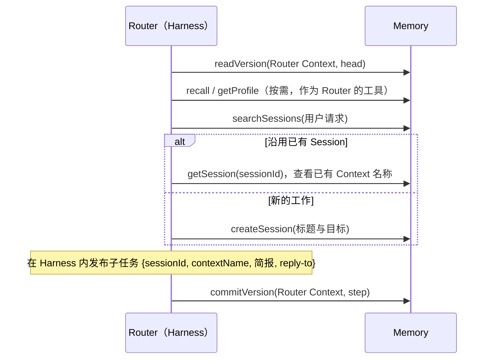
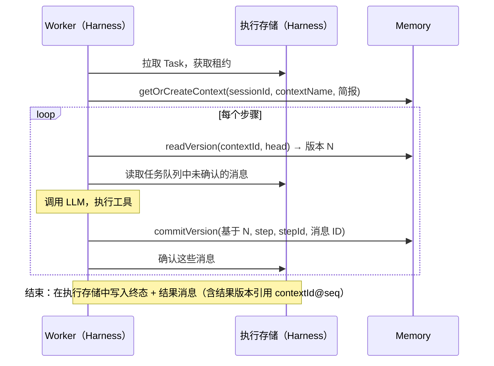

# Harness 与 Memory 交互与接口

版本：v0.24 · 状态：接口草案 · 日期：2026-11-19

本文定义两个系统的边界、Memory 对外提供的接口，以及 Harness 在各个场景下如何调用这些接口。接口只列出操作、主要输入输出和语义，不定义字段级格式和传输协议。术语见[概念模型](concepts.md)。

## 1. 边界

### 1.1 依赖方向

```text
Harness ──调用──→ Memory ←──调用── 轨迹导入工具、其他应用
Memory  ──✗──→ Harness          （Memory 从不调用 Harness）
```

### 1.2 职责划分

| 事项 | Harness | Memory |
| --- | --- | --- |
| Task、消息队列、租约、执行日志 | 拥有 | 不感知 |
| 选择 Session、决定 contextName | Router 决定 | 提供 Session 目录检索 |
| "同一 Context 同一时刻只有一个活跃 Task" | 负责保证 | 不感知 |
| Context 版本的存储与读取 | 调用方 | 拥有 |
| 提交版本的并发校验 | 声明基于哪个版本 | 执行乐观并发校验 |
| 何时压缩 | 决定并发起，给出目标大小 | 执行压缩（调用 LLM 生成摘要）并代为提交 |
| 何时回退、何时分叉 | 决定并执行 | 只存储结果 |
| 记忆条目的提炼、修订与遗忘 | 提出候选、纠正、遗忘请求 | 拥有并执行 |
| 摘要、画像、索引 | 只读使用 | 拥有，后台维护 |

### 1.3 边界规则

1. **Memory 只在请求时提交 Context 版本。** 版本由 Harness 或导入工具提交；压缩由 Harness 发起、Memory 代为执行并提交。Memory 的后台任务从不改动 Context，因此正在执行的 Context 不会被意外修改。
2. **Harness 不直接写知识层。** 记忆条目只能经由反馈接口提出，由 Memory 校验后发布。
3. **跨边界只传引用和不透明标识。** Step ID、消息 ID 由 Harness 生成，Memory 只把它们作为幂等键和元数据原样保存，不解释其含义。
4. **两个系统之间没有分布式事务。** 一致性依靠"先在 Memory 提交内容，再在 Harness 提交控制状态"的顺序，见 §5。

### 1.4 跨边界的标识

| 标识 | 生成方 | Memory 中的用途 |
| --- | --- | --- |
| `sessionId`、`contextId`、`seq` | Memory | 对象身份 |
| `contextName` | Router | Session 内的逻辑名称 |
| `stepId` | Harness | 提交版本的幂等键 |
| `messageId` | Harness | 版本中记录"本步骤纳入了哪些消息"，供恢复时去重 |
| `idempotencyKey` | 调用方 | 其他写操作的幂等键 |

## 2. Memory 接口

所有接口都在已认证的用户域内调用，引用不能跨越用户域。所有写操作都是幂等的：相同的幂等键重试返回首次结果；相同的幂等键配上不同的内容，返回幂等冲突。

### 2.1 Session

| 操作 | 输入 | 输出与语义 |
| --- | --- | --- |
| `createSession` | 标题与目标、幂等键 | `sessionId` |
| `getSession` | `sessionId` | Session 元数据、摘要，以及其下全部 Context（名称、`contextId`、最新版本序号） |
| `searchSessions` | 查询文本、过滤条件（状态、时间范围）、数量上限 | 候选 Session 列表，含标题、摘要、最近活跃时间和相关度；供 Router 决定沿用还是新建 |

### 2.2 Context

| 操作 | 输入 | 输出与语义 |
| --- | --- | --- |
| `getOrCreateContext` | `sessionId`、`contextName`、初始内容（任务简报） | `contextId`、最新版本序号、是否新建。名称已存在时返回已有 Context，忽略初始内容 |
| `forkContext` | 来源版本 `contextId@seq`、目标 `sessionId`、新 `contextName` | 新 `contextId`，第 1 个版本与来源版本内容相同，并记录来源。来源可以是任意历史版本，也可以跨 Session |
| `readVersion` | `contextId@seq`，或 `contextId` 加 `head` | 版本快照（消息序列、指令、输入配置）与版本元数据（类型、`stepId`、已纳入的消息 ID、压缩元数据或放弃摘要） |
| `listVersions` | `contextId`、范围 | 版本元数据列表，不含正文；用于挑选回退点或分叉点 |
| `commitVersion` | `contextId`、基于的版本序号、版本类型、内容、`stepId`、已纳入的消息 ID、附带信息 | 成功返回新版本序号。基于的版本不是链尾时返回 `HEAD_CONFLICT` 和当前链尾；同一 `stepId` 重复提交返回已有版本 |
| `compactContext` | `contextId`、基于的版本序号、目标 token 预算、保留策略（例如保留最近若干 token）、可选的压缩指令、幂等键 | 同步执行：Memory 调用 LLM 生成摘要，组装压缩版本并提交，返回新版本序号与压缩元数据。同样做乐观并发校验，链尾已变时返回 `HEAD_CONFLICT` |

`commitVersion` 的版本类型与内容：

| 类型 | 内容的传输方式 | 附带信息 |
| --- | --- | --- |
| `step` | 相对基础版本新增的消息（本步骤的输入、输出和工具结果） | — |
| `compact` | 完整的新内容（摘要 + 保留的近期内容）；仅用于提交 Host 自行完成的压缩，常规压缩走 `compactContext` | 压缩元数据：压缩前大小、被压缩的版本范围、涉及的文件 |
| `rollback` | 回退目标版本序号 | 放弃摘要：放弃了什么、为什么 |
| `edit` | 对指定消息的替换或移除，只影响之后的版本 | 编辑原因 |

逻辑上每个版本都是完整快照；表中的"传输方式"只是为了减少传输量，Memory 负责把它组装成完整快照。

### 2.3 检索

| 操作 | 输入 | 输出与语义 |
| --- | --- | --- |
| `recall` | 查询文本、范围（全部用户域、指定 Session 或 Context）、记忆类型过滤、数量上限 | 记忆条目、摘要片段和证据片段，每条都带溯源引用和可信度 |
| `getProfile` | 可选的主题过滤 | 用户画像视图：相关记忆条目的聚合，带溯源 |
| `readSource` | 溯源引用（版本中的消息、内容块、导入轨迹片段） | 原文；带墓碑的内容返回"已遗忘"标记，不返回原文 |

### 2.4 记忆反馈

| 操作 | 输入 | 输出与语义 |
| --- | --- | --- |
| `proposeMemory` | 候选内容、类型、来源引用、幂等键 | 候选 ID。Memory 校验后决定是否发布为记忆条目，不保证一定采纳 |
| `correctMemory` | 记忆条目 ID 加修订号、纠正内容、理由 | 新修订号；修订号不是最新时返回冲突 |
| `forget` | 目标（记忆条目、来源引用或整个 Session）、理由 | 墓碑 ID；墓碑异步传播到依赖它的条目和视图 |

### 2.5 轨迹导入

| 操作 | 输入 | 输出与语义 |
| --- | --- | --- |
| `importTrace` | 稳定来源标识、轨迹快照 | `created`、`appended`、`unchanged` 或 `conflict`，以及来源到 Session 和 Context 的映射 |
| `getImportState` | 稳定来源标识 | 导入进度，以及摘要与记忆提炼的覆盖范围 |

### 2.6 错误语义

| 错误 | 含义 | 调用方的处理 |
| --- | --- | --- |
| `NOT_FOUND` | 引用的对象不存在 | 检查引用 |
| `HEAD_CONFLICT` | 提交时基于的版本已不是链尾 | 放弃本步骤，不确认消息；通常说明租约已失效，应退出执行 |
| `IDEMPOTENCY_CONFLICT` | 同一幂等键配上了不同的内容 | 视为调用方缺陷 |
| `REVISION_CONFLICT` | 纠正记忆条目时修订号已过期 | 重新读取后再纠正 |
| `SCOPE_DENIED` | 引用越出了当前用户域 | 拒绝，不重试 |
| `UNAVAILABLE` | Memory 暂不可用 | 退避重试；期间不开始新步骤 |
| `COMPACTION_FAILED` | 压缩时 LLM 调用失败，或无法压到目标预算以内 | 不产生新版本；Harness 可调整预算后重试，或让任务进入等待 |

## 3. 场景一：Router 处理用户输入



发布子任务完全在 Harness 内部完成，不调用 Memory。

## 4. 场景二：Worker 执行一个步骤



- 结果消息只携带版本引用。Router 需要细节时，用 `readVersion` 或 `readSource` 读取。
- Context 正被其他 Task 占用时，由 Harness 判断，改为调用 `forkContext` 从其最新版本分叉。
- 压缩：Harness 在步骤开始前发现上下文接近模型上限时，调用 `compactContext` 并等待返回，然后基于新版本继续。调用期间 Harness 一直持有租约，没有其他执行者能写入这个 Context。
- 回退：Harness 用 `listVersions` 挑选回退点，以 `rollback` 类型提交；需要保留当前路线时改用 `forkContext`。

## 5. 跨系统一致性

一个步骤分两次写入，顺序固定：

1. **在 Memory 提交版本**：这是步骤的提交点，提交成功，步骤就已生效。
2. **在 Harness 确认消息、更新 Task 状态**。

| 崩溃时机 | 恢复方式 |
| --- | --- |
| 第 1 步之前 | 整个步骤重做；工具以 `stepId + 工具调用 ID` 作为幂等键 |
| 第 1 步与第 2 步之间 | 新的执行者 `readVersion(head)`，从版本元数据读出 `stepId` 和已纳入的消息 ID，补做确认，不重复执行 |
| 第 2 步之后 | 无需处理 |

失去租约的旧执行者即使继续运行，它的 `commitVersion` 也会因 `HEAD_CONFLICT` 失败，因此不会写坏 Context。

## 6. 待细化

- 字段级数据格式：版本内容、消息结构、溯源引用
- `recall` 的查询模型与排序
- `forget` 对正在使用的 Context 的影响：后续步骤是否遮蔽带墓碑的内容
- 授权模型
- 传输协议与 SDK 形态
- 压缩策略：摘要提示词、如何利用已提炼的记忆条目、Memory 调用模型的配置与费用归属
