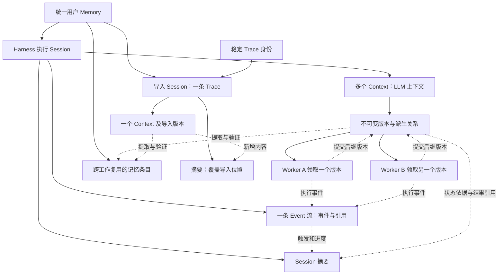
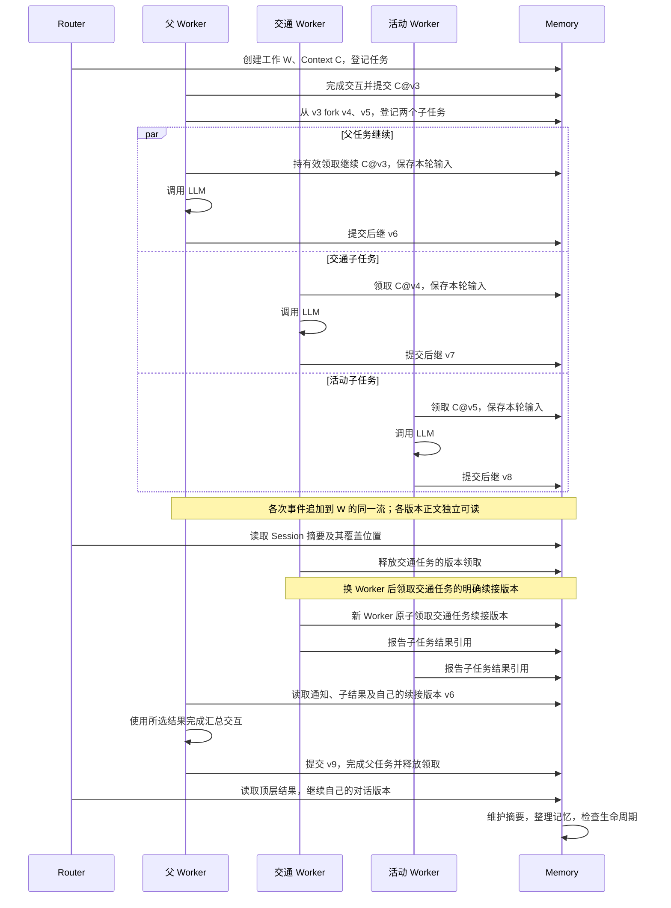

# Harness 与 Memory：对象模型、交互接口与整体流程

状态：设计草案 v0.13；2026-11-18。本文先定义 Harness 执行与外部 Trace 导入共用的 Session、Context 版本和摘要模型，再说明执行 Event、版本级分配、重复导入对齐、接口及完整流程。本轮只修订本文，其他文档中的旧接口和载荷尚未同步，以本文模型为本轮评审依据。

本文暂不设计文件句柄、工具资源和外部执行环境的恢复。具体 SDK、数据库和传输协议也不在此冻结。

## 1. 概念与设计顺序

| 层次 | 需要明确什么 | 本文位置 |
| --- | --- | --- |
| 对象模型 | Session、Event、Context、版本、Session 摘要及导入来源分别是什么 | 第 2 节 |
| 记忆关系 | 当前工作状态如何用于短期工作，如何产生长期记忆 | 第 3 节 |
| 管理与存储 | 谁保存正文、谁分配版本、如何保证执行提交和重复导入对齐 | 第 4 节 |
| 对外接口 | 提供方、调用方、操作对象及结果 | 第 5 节 |
| 执行流程 | 多 Worker 并行、交互提交、恢复和汇总如何串起来 | 第 6 节 |
| 导入流程 | 同一 Trace 首次导入、追加、重复提交、摘要和知识提取如何串起来 | 第 7 节 |

统一用户 Memory 包含用户的所有工作和记忆。项目、主题和标签可以组织资料，但不改变用户归属。

## 2. 核心对象及关系

### 2.1 Session：一个工作

**一个 Session 表示一个工作。** 它组织这个工作的目标、Context 和整体资料，不对应一个进程，也不是执行互斥锁。Session 的资料有两种进入方式：Harness 执行写入，以及外部 Trace 导入。

由 Harness 管理执行的 Session 包含：

- 一条逻辑 Event 流，记录工作过程中发生的事件。
- 多个 Context 及其版本。
- 参与执行的 Worker、任务关系和各自的续接版本引用。
- 一份可供 Router 等读取的 Session 摘要。

多个 Worker 可以同时在同一执行 Session 内工作。新建执行 Session 的依据是工作是否需要独立管理，而不是 Worker 数量。一个 Worker 启动多个 subagent，通常仍属于同一项工作。

**外部导入固定为一个 Trace 对应一个 Session、一个 Context，以及一份 Session 摘要。** 不同 Trace 各自建立 Session，不按项目、内容相似度或主子 agent 关系聚合。同一 Trace 后续增加内容时更新已有映射，不再次创建 Session。导入主要用于获取历史数据和提取知识，不要求建立 Worker、任务和 Event 流。

### 2.2 Event：执行 Session 的一条流，只记录事件

**一个 Harness 执行 Session 只有一条逻辑 Event 流。Event 记录“发生了什么”，不保存对话正文，也不重复保存完整 prompt。** 导入 Session 不创建 Event 流，也不把外部日志中的 event 逐条转换成我们的 Event；导入进度直接保存在管理元数据中。

例如：

```text
e21：Worker A 领取 C@v3
e22：Worker B 领取 C@v7
e23：Worker A 开始一次 LLM 交互，引用本轮输入
e24：Worker B 提交 C@v9，来源为 C@v7
e25：Worker A 提交 C@v8，来源为 C@v3
e26：子任务完成，结果位于 C@v9 的指定消息
```

事件可以携带事件类型、生产者、任务身份、Context 版本引用、交互引用、状态和原因等元数据。需要查看用户原话或模型输出时，按引用读取 Context 内容。

所有 Worker 都向这条流追加事件，Memory 统一分配顺序和稳定事件身份。并行的是 Worker 的执行；事件追加只需短暂协调，不要求一次 LLM 交互完成后另一 Worker 才能工作。

Event 顺序表示记录进入流的顺序。跨 Worker 的依赖和因果关系仍由来源引用、任务关系等说明，不能仅凭先后排列推断。物理上可以分页或分段保存这条流，但不在领域模型中另设每个 Worker / Context 的独立 Event 流。

### 2.3 Context：用于 LLM 交互的上下文

**Context 保存用于 LLM 交互的上下文内容。** Harness 产生的执行版本包括有序对话消息，以及实际使用的指令、材料和必要输入配置；这些内容或其固定版本引用足以还原相应输入。

导入时，一个 Trace 构建为一个 Context，保存来源中可取得的对话、材料及配置。外部来源缺失的指令、交互边界或输入配置需要明确标记，不能声称已经精确恢复原系统的每次请求。这不妨碍查阅原文、生成摘要和提取知识。

同一个 Session 可以有多个 Context。contextId 标识一组相关上下文版本，(contextId, versionId) 定位一份具体、不可变的上下文。

这里不再单独引入另一层可自由改写的“工作 Context → ModelInput”模型。Harness 读取确定的版本，加上本轮明确输入，按固定格式调用 LLM；SDK 编码不会成为再次改写上下文的机会。

对话正文保存在 Context 的消息内容或其持久内容引用中。**不另存一套 Worker History 正文**：要看对话历史，读取相关 Context 版本及其来源；要看 Harness 执行过程，读取 Session Event 流。导入资料通过来源引用查证，不依赖 Event。

### 2.4 Context 版本：随交互推进，允许分叉

正常执行时，一次完成的 LLM 交互产生一个新版本：

```text
基础版本 C@v
  + 本轮追加输入
  → 调用 LLM
  + 本轮模型输出
  → 提交后继版本 C@next
```

后继版本包含本轮新增输入和输出，最后一次答复也必须保存，不能等到下一次调用时才落盘。输入、输出在逻辑上构成完整上下文，物理上可以共享旧消息，只保存新增内容。

为避免调用期间丢失输入，Memory 在调用前保存本轮输入片段和交互引用；它们属于 Context 的待完成交互内容，Event 只引用它们。交互成功后发布不可变版本；失败或中断保留输入和状态，不把未完成交互当成完整结果。

“按交互次数推进版本”不意味着版本只能是一条直线：

```text
Worker A：领取 C@v3 → 完成一次交互 → C@v8，来源 v3
Worker B：领取 C@v7 → 完成一次交互 → C@v9，来源 v7
```

版本标识由 Memory 唯一分配，来源版本另行记录。沿某条派生路径可以统计交互次数；版本编号的大小不代替派生关系，也不表示某个分支更正确。

同一个 Context 可以有多个有效后继和多个正在推进的版本。**不存在所有 Worker 共用的唯一当前版本。** 每个任务或执行记录保存自己的续接版本；读取时明确指定版本，不能把“最后存储的版本”自动当成所有人的下一步。

| 版本操作 | 如何处理 | 影响范围 |
| --- | --- | --- |
| 完成一次交互 | 基于领取版本及本轮输入、输出，发布新版本 | 当前任务沿新版本继续，旧版本不变 |
| fork | 从明确版本产生新的派生版本，可共享相同正文 | 派生版本可独立分配；默认不需要新建 Context 或 Session |
| 回滚 | 为指定任务从选定旧版本建立恢复派生版本，更新该任务的续接位置 | 保留被放弃的历史，不移动其他 Worker 的续接位置 |
| 新建 Context | 建立新的上下文身份及初始版本 | 适合需要独立组织的一组对话，不是并行执行的必要条件 |
| 导入 Trace | 在固定 Context 中保存首次或新增的来源内容，保持不可变版本及来源引用 | 更新导入来源分支，不改变 Worker 自己的续接位置；不产生执行事件 |

fork、初始化、回滚、显式 compact 和 import 快照也可以形成有明确操作类型的版本，但不虚构一次 LLM 交互。它们与正常交互版本沿用同样的身份、来源和不可变规则。

Trace 能可靠识别完整 LLM 交互时，每次历史交互可形成一个版本；一次导入可包含多个这样的版本。不能识别边界时，以明确的 `import` 类型保存快照，不把一个文件行、用户 turn 或一次导入当成一次 LLM 调用。未完成交互保留内容和状态，不伪造完成；相同内容重复导入不生成新版本。

同一个版本要交给多个 Worker 并行探索时，Memory 先建立不同的 fork 版本，再分别分配。回滚后仍需生效的用户要求由 Harness 明确追加到新交互中，不悄悄改写旧版本。多个分支也不自动合并，汇总者选择需要的内容作为自己的新输入。

### 2.5 Worker 如何领取版本：Memory 保证唯一性

执行领取的对象是 **(contextId, versionId)**，不是整个 Context。Memory 原子检查并登记领取关系，返回上下文和有效执行凭证。

- 同一具体版本，同一时刻只有一个有效执行领取者。
- 同一 Context 的不同版本可以同时分配给不同 Worker。
- 只读查看历史版本不需要领取执行权，也不阻止其他读取。
- 提交交互结果时，Memory 校验执行凭证、基础版本和交互身份，再分配后继版本。
- 正常继续时，可以原子地把执行领取转移到后继版本，并更新该任务的续接引用；暂停或结束时释放领取。
- Worker 失联后允许回收占用并发放新凭证；旧凭证不能再提交有效后继或成功事件。

领取状态是版本之外的执行元数据，不改变版本正文的不可变性。这保证的是唯一有效执行权和有效提交；旧进程即使仍在计算，也不能凭失效凭证改变工作状态。

重试同一次已提交交互应返回原提交结果，不产生重复后继版本。多个 Worker 基于不同版本提交，不需要争抢一个 Context 全局 head。

### 2.6 Session 摘要：供 Router 查看整体状态

Session 摘要回答“这份工作资料讲了什么、目前已知状态是什么”。执行 Session 的摘要可包含整体进度、各任务的状态、正在工作的 Worker 及版本、已完成结果、阻塞事项和待用户确认的问题。导入 Session 的摘要概括 Trace 中的目标、过程、结论和未决问题，并说明来源覆盖范围；来源中的运行状态不代表 Memory 当前管理着对应 Worker。

摘要至少说明内容依据的 Context 版本、结果或消息引用，以及摘要修订和更新时间。覆盖位置按来源区分：

| 场景 | 摘要覆盖位置 | 增量依据 |
| --- | --- | --- |
| Harness 执行 | Session Event 流位置及有关 Context 版本 | 新执行事件、任务状态和被引用的正文 |
| Trace 导入 | 导入 checkpoint、Context 版本及来源记录范围 | 新导入的内容；无需 Event 位置 |

Memory 提供摘要存储及维护能力，由一个逻辑维护者按相应来源增量聚合。各 Worker 提交进度事实，不直接竞争覆盖整份摘要。摘要发布须防止旧修订覆盖新修订。

Router 可以先读摘要，再按需读取对应 Context、尚未覆盖的执行事件或新增导入内容。摘要是派生视图，可能落后；不能以摘要更新成功代替 Context 提交、任务完成或导入持久化。

### 2.7 对象之间的关系



Session 是资料归属，Context 版本保存对话内容，摘要面向整体查阅；Harness 执行另有 Event 过程记录和版本领取关系，Trace 导入维护来源映射及处理进度。

### 2.8 Trace 身份与导入来源

**Trace 身份稳定，Trace 内容可以增长。** Memory 保存 `Trace 身份 → Session ID + Context ID` 的稳定映射，同一来源的每次导入均复用它。Trace 的文件分段仍属于同一来源；不同 Trace 身份各自形成 Session，不另做工作聚合。

身份优先采用“用户 + 来源系统 + 来源中的 Trace ID”。来源 ID 仅在某个实例内唯一时，再加入稳定的来源实例标识。文件路径用于定位，内容指纹用于比较变化；两者都不能代替 Trace 身份。用户归属来自授权范围，来源项目路径只是分类信息。

来源没有稳定 ID 时，首次登记由 Memory 返回 `sourceKey`，导入工具保存它并在后续调用中复用。缺少来源 ID 和已保存映射时，不能仅凭内容相似就自动认定是同一 Trace。

导入来源是一条管理记录，保存稳定身份、Session/Context 映射、来源内容引用、导入分支版本和处理进度。它不形成另一套对话 History，也不是 Session Event 流。原始 Trace 可以作为来源附件保留，正文及原文引用使用已有内容存储能力。

导入本身不启动 Worker，也不领取执行版本。如另行通过 Harness 继续工作，从明确版本 fork，按执行契约补齐所需配置并建立执行状态；只记录此后实际执行产生的事件，不回填外部 Trace 的事件。外部内容仍沿导入分支追加，Worker 沿自己的分支推进，两者不自动合并。

## 3. 短期工作状态与长期记忆

### 3.1 不把对象类型和记忆用途混为一谈

| 概念 | 由哪些信息表达 | 用途 |
| --- | --- | --- |
| 当前工作上下文 | Worker 正在使用的 Context 版本和本轮新增输入 | 继续 LLM 交互 |
| 短期记忆 | 当前目标、有关 Context 版本、未决任务、输入和 Session 摘要 | 维持正在开展的工作，可持久恢复 |
| 长期记忆 | 经筛选发布、有来源和适用条件的记忆条目及 notes | 跨 Session 复用 |
| 历史资料 | 旧 Context 版本、交互记录、执行 Event 流，以及导入 Trace 的 Context 与来源材料 | 查证、回顾和恢复，不自动成为长期知识 |
| 用户画像 | 有关用户事实、偏好与目标的条目及来源 | 用户级派生视图，不另存无来源的“用户真相” |

长期偏好被选入一个 Context，不改变其长期记忆身份。Context 保存或 compact，也不自动发布长期记忆。

### 3.2 记忆从哪里生成

Memory Agent 根据执行事件、导入进度或维护策略确定要检查的资料，再读取**明确的 Context 版本、具体消息及已有记忆**。执行 Event 可证明一次提交或完成发生过，但用户说过什么、模型回答过什么，应到 Context 正文中查证。导入 Session 直接按已保存内容触发维护，无需补造 Event。

| 触发 | 来源 | 可能的产物 |
| --- | --- | --- |
| 用户要求记住或纠正 | Context 中的用户原话，或直接提交的持久材料 | 偏好、事实或修订候选 |
| 工作进行中的增量整理 | 新提交版本相对来源版本的新增内容 | 当前目标、阶段性 note、可复用经验 |
| 工作阶段完成或 Session 退役 | 各有关分支的固定版本、结果和摘要引用 | 经历摘要、方法或长期 note，也可无产出 |
| Trace 首次导入或追加 | 固定导入版本中的新增内容及来源记录 | Session 摘要更新、知识候选或长期 note，也可无知识产出 |
| 定时整合与未来查询准备 | 多个 Session 的 Context 内容、既有条目及已知目标 | 合并修订、冲突修复、预写 notes |

流程为：固定来源 → 提出候选 → 检查来源、适用范围、重复与冲突 → 发布条目或修订 → 接受后续纠正。

fork 共享的原始消息不应被当成多个独立证据。预写 note 中预测的需求须保留为假设。生成记忆不必等待 Session 退役，也不能直接改写 Worker 已领取的版本。

导入成功只表示历史资料已保存，不表示全部内容已成为长期记忆。提取时区分用户陈述、模型判断和工具结果；来源引用要定位到 Trace 的具体记录及其内容修订。重复导入的同一消息不能重复计为证据，来源历史被修订时应重新检查依赖它的摘要和知识。

## 4. 管理责任与逻辑存储

### 4.1 谁负责什么

| 对象或动作 | Harness 责任 | Memory 责任 |
| --- | --- | --- |
| Session | 创建工作、分派与汇总 | 保存归属、目录与生命周期 |
| LLM 交互 | 选择版本与输入，调用模型，报告结果 | 持久保存输入、输出及交互状态 |
| 版本领取与提交 | 持有效凭证执行，指定基础版本 | 原子分配、生成后继版本、拒绝失效或重复提交 |
| fork / 回滚 | 选择来源和要继续的任务 | 建立派生版本，保存关系并更新对应续接位置 |
| Event 流 | 报告执行事实与来源 | 持久追加、统一定序和按条件读取 |
| Session 摘要 | 提供进展事实，按需查看 | 聚合维护，保存覆盖位置及依据 |
| 记忆条目 | 提交候选或反馈，按需选用 | 验证、整理、发布和管理修订 |
| Trace 导入 | 不要求 Harness 参与；导入工具提交稳定来源身份和快照 | 适配来源格式、对齐内容、维护固定 Session/Context 映射及处理进度 |

### 4.2 Harness 执行的提交和恢复规则

一次正常交互的持久化顺序是：

1. Worker 原子领取明确版本；本轮输入先存入 Memory，形成待完成交互引用。
2. Memory 记录交互开始事件，事件引用基础版本及已保存输入，不携带对话正文。
3. Harness 使用基础版本与新增输入调用 LLM。
4. Memory 接收输出，校验执行凭证与交互身份，发布包含输入、输出的后继版本。
5. 版本发布、相应成功事件、输入消费和任务续接位置保持一致；再按执行意图转移或释放领取。
6. 摘要维护者随后消费 Event，更新整体视图。

事件宣告某版本已提交时，该版本必须已经可读。重复提交返回已有结果；不能出现成功事件指向不存在的上下文。具体采用数据库事务还是文件提交协议留给实现决定。

恢复先读取该任务或执行记录保存的确切版本，以及尚未完成的交互和待处理输入。**不能只重放 Event 来重建对话，也不能自动读取整个 Context 的最后存储版本。** 调用失败或结果未知时保留状态，由 Harness 决定核对或重试，不伪造完成。

执行 Session 退役检查所有有效领取、未完成任务、待处理输入和交互。历史版本仍可保留；不要求每个历史分支都再执行一遍。结束一个 Worker 不等于结束 Session。一次 Trace 导入结束仅表示该快照已处理，不能由此推断外部工作已经完成或以后不会追加。

### 4.3 逻辑存储格式

以下是必须表达的记录关系，不选择数据库产品。文件实现与数据库实现应遵守同一语义。

| 记录 | 至少包含什么 | 格式与权威来源 |
| --- | --- | --- |
| Session | 用户归属、工作目的、来源方式、Context 目录、生命周期；导入时关联 Trace 身份 | JSON 或等价结构化记录 |
| Session Event | 事件身份、Session 顺序、类型、生产者、任务/交互/版本引用及状态 | Harness 执行的一条逻辑追加流，可分段保存；不保存对话正文，导入本身不建立此流 |
| Context 及版本 | Context/版本身份、来源版本、生成原因、有序消息内容或引用；输入配置及导入来源的缺失说明 | 不可变 JSON 版本记录及正文；不设置唯一全局当前版本 |
| 待完成交互 | 基础版本、本轮输入引用、调用状态；完成后关联结果版本 | Context 所属的持久交互记录，支撑中断恢复 |
| 版本领取与执行位置 | 版本、执行者、有效凭证、期限；任务当前续接版本 | 可更新的协调记录，与不可变正文分开 |
| Session 摘要 | 状态正文、来源版本/结果、修订；执行场景覆盖 Event 位置，导入场景覆盖来源 checkpoint | 可重建的派生记录 |
| Trace 导入状态 | 稳定来源身份及 Session/Context 映射、来源引用、导入分支版本、对齐 checkpoint、摘要和提取进度、冲突或缺失说明 | 可更新的管理记录，不是 Event 流；checkpoint 绑定确定的内容和解析规则 |
| 记忆条目 | 条目身份、修订、正文、适用条件、来源及生命周期 | JSON 元数据，正文可为 Markdown 或结构化数据 |
| 内容块与外部材料 | 固定内容、格式、身份及归属 | 原始正文存一次，通过引用共享 |

一条 Event 的示意如下，只有提交事实与引用：

```json
{
  "sessionId": "S",
  "eventId": "e25",
  "sequence": 25,
  "type": "context_version_committed",
  "workerId": "worker-A",
  "contextId": "C",
  "baseVersionId": "v3",
  "versionId": "v8",
  "interactionId": "i-A"
}
```

对应 Context 版本保存本轮新增对话，并通过来源版本取得之前的内容：

```json
{
  "sessionId": "S",
  "contextId": "C",
  "versionId": "v8",
  "sourceVersionId": "v3",
  "kind": "interaction",
  "interactionId": "i-A",
  "inputProfileRef": "profile:planner:1",
  "addedInput": [
    {"role": "user", "content": "比较两种公共交通方案。"}
  ],
  "addedOutput": [
    {"role": "assistant", "content": "方案比较结果……"}
  ]
}
```

这是增量存储示意；读取 v8 时返回可完整恢复的上下文。实际请求输入为 v3 的内容加本轮 addedInput，addedOutput 是此次响应。最后一次输出因此也有持久归属，不需要另造一个保存全量请求的 ModelInput 对象。

### 4.4 数据量与输入稳定性

- Context 版本在逻辑上完整，在物理上可以采用不可变内容块、来源引用、增量和必要快照；不是每轮复制整个 prompt。
- fork 默认共享已有正文，只增加派生身份和关系。父任务接收子结果时选取内容或引用，不复制所有子对话。
- Event 不保存消息正文；History 不形成另一份持久原文。Session 摘要也只是状态概览。
- compact 发布明确的新版本，保留所需来源；它不等于物理删除，也不能覆盖正在被其他 Worker 使用的版本。

Harness 保留已确定的消息顺序和输入配置，普通交互追加新内容；序号、执行凭证和摘要更新时间不自动进入 prompt。必要的压缩或输入配置变更显式形成版本，不通过隐式转换重排旧消息。

前缀缓存取决于实际输入及推理服务的缓存条件，不取决于我们的 Context ID。固定转换和内容共享可以避免不必要的前缀变化，但不能保证缓存命中；Memory 保存上下文也不等于保存 KV。[Claude 缓存说明](https://platform.claude.com/docs/en/build-with-claude/prompt-caching)、[vLLM 前缀缓存说明](https://docs.vllm.ai/en/latest/features/automatic_prefix_caching/)

### 4.5 Trace 对齐：先确定身份，再比较内容

第一版接受同一 Trace 的完整快照，由 Memory 识别新增内容。调用方可以重复提交完整快照，不必先实现只上传差量的协议。

1. 以授权用户下的稳定来源身份或 `sourceKey`，定位已有 Session 和 Context；首次登记建立唯一映射。
2. 来源适配器将快照转换成有序内容记录，保留来源记录 ID、角色、顺序、交互边界及缺失说明。
3. 以记录 ID 判断是否是同一条记录，以规范化内容指纹判断内容是否变化；没有稳定记录 ID 时比较有序内容的共同前缀，不能按正文相同就合并不同位置的消息。
4. 只发布已经确认的新增内容及 Context 后继版本，再推进该来源的导入 checkpoint。checkpoint 定位来源记录范围及其内容指纹，并关联准确的 Context 版本，不是 Session Event 序号。

指纹覆盖正文和必要语义字段，避免 JSON 空白或对象键顺序变化被误判为历史改写。checkpoint 也应绑定适配器的解析规则版本；更换规则需要重新核对，不能把解析方式变化误认成来源变化。文件偏移可以加速读取，但不单独作为前缀未变的证明。

| 比较结果 | 第一版处理 | 返回结果 |
| --- | --- | --- |
| 未登记的 Trace 身份 | 创建一个 Session、一个 Context 和首次导入版本，保存稳定映射 | `created` |
| 与已导入内容完全相同 | 复用已有映射、版本和进度，不重复提取知识 | `unchanged` |
| 旧内容完整保留，仅尾部增加记录 | 只追加新增内容，发布后继版本并推进 checkpoint | `appended` |
| 新快照是已有内容的较短前缀 | 保留现有内容和进度，报告较旧或不完整快照；不据此回滚 | `unchanged`，附原因 |
| 同一记录内容被修改，或中间内容、顺序发生分歧 | 保留已发布版本，报告冲突位置；不按普通追加处理 | `conflict` |

仅凭快照变短或内容不同，无法区分旧导出、采集不完整和来源主动改写。第一版遇到历史分歧先返回冲突；后续若支持显式来源修订，需要有可信的来源修订顺序或明确指定的替换依据，发布新的不可变修订，并重新检查受影响的摘要和知识，不能覆盖旧版本。

同一来源的并发首次导入只能建立一组 Session/Context 映射。并发追加需校验所依据的 checkpoint，冲突者重新比较已持久内容；重试返回已有结果。内容、版本、来源映射和新 checkpoint 必须一致可见，不能先推进进度再补写正文。这是导入来源分支的协调，不是对整个 Context 设置全局 head 或 Worker 执行锁。

未完成或无法解析的尾部内容需报告缺失并保留必要来源，不能冒充完整交互。其后是否可处理，以可确认的持久内容范围为准；不能越过尚未解决的缺口宣告全部处理完成。

### 4.6 导入、摘要、知识提取分别推进

| 进度 | 记录什么 | 何时推进 |
| --- | --- | --- |
| 导入进度 | 已保存的来源记录范围、内容指纹和对应 Context 版本 | 新内容及版本已持久发布 |
| 摘要进度 | 摘要所覆盖的导入 checkpoint、版本和记录范围 | 基于确定来源的新摘要已发布 |
| 知识提取进度 | 已检查的来源范围及修订，关联候选或维护结果 | 对应范围的提取检查已完成；没有可提取知识也可完成检查 |

摘要和知识提取可以异步进行，两者不必互相等待。维护任务直接检查导入进度与各自覆盖范围的差异，无需 Session Event 流。失败后从各自已确认位置继续；重复提交相同 Trace 不重新处理已完成范围，但可以继续尚未完成的维护工作。

普通追加可使用“已有摘要 + 新增内容”更新摘要，对新增内容提取候选并与已有知识检查重复、适用条件和冲突。每次发布都绑定来源范围及修订，防止较早的任务覆盖较新的结果。来源修订时，既有覆盖标记不能直接沿用，必须重新核对受影响部分。

## 5. 两系统的交互接口

### 5.1 接口的提供方与调用方

**Memory System 提供领域存储、Trace 导入与执行协调接口；Harness 负责实际执行。** 独立应用可以导入 Trace，也可以读取 Session、Context、摘要和记忆，不要求先运行 Harness。

| 边界 | 提供方 | 调用方 | 对象 |
| --- | --- | --- | --- |
| 工作与内容服务 | Memory System | Harness、独立客户端 | Session、Context 版本、摘要、记忆，以及执行 Session 的 Event 流 |
| Trace 导入服务 | Memory System | 导入 CLI、同步程序、外部集成服务 | 稳定来源身份、快照、Session/Context 映射和处理进度 |
| 执行协调服务 | Memory System | Harness Router、Dispatcher、Worker | 具体版本的领取、任务续接位置、输入和通知 |
| 对话与执行入口 | Harness Core | 应用或 Host Adapter | 用户请求、任务安排、模型调用及结果处理 |

所有操作受用户域和授权范围约束。接口不绑定单机或集群，也不绑定 dsh/pi。以下函数名表达逻辑操作，不是已冻结的 SDK 签名。

### 5.2 Memory 对外领域接口

#### 5.2.1 Session 与摘要

| 操作 | 输入意图 | 结果 |
| --- | --- | --- |
| createSession | 开始一项 Harness 工作 | 执行 Session 身份、空 Event 流和 Context 目录；导入 Session 由 importTrace 建立 |
| getSession / discoverSessions | 定位或查找工作资料 | 来源方式、生命周期、Context 目录及状态定位；不返回一个虚构的唯一当前 Context |
| getSessionSummary | 快速查看整体状态 | 摘要、来源与修订；执行场景返回 Event 覆盖位置，导入场景返回来源 checkpoint 和 Context 版本 |
| requestSessionSummaryRefresh | 请求更新落后的摘要 | 维护请求；由摘要维护者聚合发布 |
| requestSessionReview | 请求检查是否可结束工作 | 检查结果或待处理请求；有活动领取和未决工作时不能直接退役 |

摘要更新是 Memory 的维护职责；Worker 的进度通过执行事件和任务状态输入，导入摘要通过已持久化内容及导入进度更新，不对外暴露任意覆盖整份摘要的路径。

#### 5.2.2 Context 与版本

| 操作 | 输入意图 | 结果 |
| --- | --- | --- |
| createContext | 在 Session 中建立一组上下文，指定初始内容和固定输入配置 | Context 身份和初始版本 |
| listContexts / listContextVersions | 查看上下文及派生关系 | Context 目录、版本来源、生成类型；不以编号替代父子关系 |
| readContextVersion | 读取明确的 Context 版本 | 已保存的有序上下文、来源及输入配置；导入版本同时返回来源缺失说明，不授予执行权 |
| forkContextVersion | 从明确版本建立独立执行起点 | 同 Context 下的新派生版本；正文可共享，可分别领取 |
| restoreContextVersion | 让指定任务从选定历史内容重新开始 | 恢复派生版本及该任务新的续接引用；保留其他任务位置 |
| compactContextVersion | 基于明确版本提交压缩后的候选内容 | 带来源和操作类型的新版本；旧版本仍可读 |
| startInteraction | 持领取凭证保存本轮新增输入及基础版本 | 持久交互引用；开始记录不证明模型已完成 |
| commitContextVersion | 提交该交互的输出、结果引用及继续/暂停意图 | 该次交互的唯一提交版本、一致的完成事件及续接位置；可同时转移领取 |

fork 默认仍在同一 Context 中派生版本；需要独立 Context 身份或新 Session 时，由调用方明确新建并选取来源，不因出现并行 Worker 自动改换工作归属。

回滚要求核对指定任务的当前执行状态，必要时先暂停或使旧执行失效；不能绕过仍有效的执行领取，直接替换另一个 Worker 的续接位置。compact 同样发布新版本，并明确哪个任务要采用它，不覆盖别人的版本。

#### 5.2.3 Event 与内容读取

| 操作 | 输入意图 | 结果 |
| --- | --- | --- |
| appendEvents | 报告执行进展、等待、失败等事实及有关引用 | 在所属 Session 的同一 Event 流追加元数据，并更新相应协调状态 |
| readEvents | 按 Session、位置范围及可选 Worker/任务/版本条件查询 | 同一流中筛选后的事件和游标，不生成另一份原始流 |
| readContent | 按固定版本与消息位置、内容块或记忆修订引用读取 | 授权范围内的原文及来源状态 |

Harness 执行中的版本创建、领取和成功提交等权威事件由相应 Memory 操作产生，客户端不另行手写“提交成功”。普通事件也需校验执行身份及引用，不能把指向不存在版本的事件作为成功依据。导入本身不调用 appendEvents；尚未启用 Harness 执行的导入 Session 没有 Event 流，readEvents 明确返回不适用，不伪造历史事件。

不提供一套独立保存 History 正文的接口。对话读取使用 Context 版本和内容引用；Event 查询用于执行过程，Session 摘要用于整体浏览。

#### 5.2.4 记忆读取与维护

| 操作 | 输入意图 | 结果 |
| --- | --- | --- |
| getUserOverview / getProfile / recall | 查询用户概览、画像或相关资料 | 带来源、适用条件和可信状态的条目及内容片段 |
| getMemory / listMemoryRevisions | 查看条目或历史修订 | 正文、来源和状态 |
| proposeMemory / submitFeedback | 提出新增、修订或纠正，指定 Context 消息或材料来源 | 持久候选与处理状态，验证后才发布 |
| requestMemoryMaintenance | 指定来源范围，整理、修复或预写 note | 可追踪的维护请求，不要求 Session 已退役 |
| requestMemoryLifecycle | 申请归档或按明确范围遗忘 | 处理结果和生效范围 |
| getMemoryOperation / readChanges | 查看提案、维护结果或后续变化 | 操作状态、发布修订及变化位置 |

独立客户端可以直接提交要记住的材料；Memory 保存原始材料作为来源，无需伪造一次 Worker 对话。来源删除或失效必须影响依赖内容的可用性，不能从旧副本自动重新提取被遗忘的信息。

#### 5.2.5 Trace 导入与状态

以下两个接口由 Memory 暴露，调用方是导入 CLI、同步程序或外部集成服务。用户归属由授权身份确定，来源身份和快照引用都要在该范围内校验。

| 操作 | 输入意图 | 结果 |
| --- | --- | --- |
| importTrace(sourceKey 或来源身份, snapshot) | 首次登记或再次提交同一 Trace 的完整快照；来源无稳定 ID 时首次申请登记，后续复用返回的 sourceKey | sourceKey、固定 Session/Context 身份、导入分支版本、持久 checkpoint，以及 created / appended / unchanged / conflict 和原因 |
| getTraceImportState(sourceKey) | 查询该 Trace 的映射和处理状态 | 来源身份、Session/Context 映射、导入进度、摘要覆盖、知识提取覆盖、缺失或冲突信息 |

`snapshot` 是上传内容或 Memory 可访问内容的引用。单机导入工具读取本地文件后提交；部署在集群中的 Memory 不把客户端本地路径当作自身可访问路径。首次没有稳定 Trace ID 时，导入工具保存返回的 sourceKey；响应丢失等重试也需复用同一登记请求身份，避免重复创建。

importTrace 的结果表示对应内容已经持久化或明确未被接受，不表示摘要和知识提取已经完成；后两项通过 getTraceImportState 查询。冲突响应保留既有导入进度，并说明新快照在哪里无法对齐。导入后的资料继续使用 getSession、readContextVersion、readContent、getSessionSummary 和 recall 查询，不增加另一套历史读取协议。

Memory 内部通过可插件化的 TraceAdapter 支持 Codex、Claude Code 等来源格式。适配器负责识别格式和版本、规范化记录、保留来源身份与可识别的交互边界、报告缺失；Memory 负责内部身份、对齐去重、版本发布和处理进度。适配器不调用执行领取接口，不直接写底层数据库，也不自行发布长期知识。

第一版不另设 appendTrace 接口。未来需要只上传新增片段时，可以扩展 importTrace，要求附带所依据的 checkpoint，并核对来源前缀；身份、版本和处理进度语义保持不变。

### 5.3 Memory 执行协调接口

| 操作 | 调用方与对象 | 保证 |
| --- | --- | --- |
| claimContextVersion | Dispatcher / Worker 指定 Context、版本、执行者及任务 | 原子领取该具体版本并返回内容及有效凭证；其他版本不被锁住 |
| renewVersionClaim / releaseVersionClaim | 当前领取者 | 续期或释放有效执行权，不改写上下文正文 |
| recordTask / getTask / listTasks | Router、父 Worker、Dispatcher | 保存父子关系、开始版本、当前续接版本、状态及结果引用 |
| postTaskInput / readTaskInputs | Router 或父 Worker 向任务提交输入，目标 Worker 读取 | 持久保存输入引用；原文进入待处理 Context 内容，不塞入 Event 正文 |
| readTaskNotifications | 父任务处理者或 Router 入口 | 读取定向结果、等待或失败通知，并可确认消费 |

版本领取附带任务时，Memory 同时核对任务是否可执行、所请求版本是否是其约定起点或续接位置，避免旧派发请求重新启动已推进或已完成的同一任务。新任务从历史版本开展另一条工作则是显式的新分配。

任务输入的消费确认与实际处理结果保持一致。用户纠正由父任务明确传播到有关子任务；父任务汇总时检查子结果是否仍符合最新要求。

**通知不能只寻址到 contextId**：同一个 Context 内可能有多个 Worker 正在不同版本上工作。通知交给父任务或 Router 逻辑入口，接收者从自己保存的续接版本继续；不固定投给已经失效的进程或旧版本。

子任务结果作为内容引用交给父任务。父 Worker 可以等待、释放领取并在收到通知后恢复；Router 保持短 Turn，任务分派受理后即可回应用户，不同步等待所有 Worker 完成。

### 5.4 交互契约的关键约束

1. Context 保存对话，Event 保存事件，摘要保存工作概况；三者不互相冒充。
2. 同一 Harness 执行 Session 的所有 Worker 共享一条逻辑 Event 流；LLM 执行可以并行。Trace 导入本身不建立 Event 流。
3. 执行领取限定在具体版本；同一 Context 的不同版本允许不同 Worker 同时推进。
4. 提交后继时保留来源，按任务维护续接位置，不更新一个全局唯一 head。
5. 输入、输出和版本先持久可读，再发布相应完成事实；重试不重复创建版本。
6. 摘要可以异步更新，但必须暴露覆盖位置；精确执行决策依据版本和协调状态。
7. 记忆维护读取明确内容来源，既不改写已领取版本，也不要求工作全部结束。
8. 一个外部 Trace 固定对应一个导入 Session 和一个 Context；重复或增量导入复用同一映射，不聚合不同 Trace。
9. Trace 身份用于定位，记录身份和内容指纹用于对齐；导入进度不得先于对应正文和版本持久化。
10. 导入、摘要和知识提取分别记录覆盖范围；重复来源不重复计为证据，历史分歧不静默覆盖旧版本。

## 6. 完整例子：规划行程，中途纠正，换 Worker 后继续

### 6.1 对象和版本分配

Router 接到“规划杭州周末行程，只出方案”的请求，为该工作创建 Session W。Router 自己的持续对话可保存在另一个工作范围 R。

W 内建立 Context C。父 Worker 在准备分工后得到 C@v3，再从它 fork 两个可独立领取的版本。下面的版本编号仅用于示意，均由 Memory 分配：

```text
工作 Session W
  一条 Event 流
  一份 Session 摘要
  Context C：
    v3 ──fork────→ v4 ──交通 Worker 交互──→ v7
     ├──fork────→ v5 ──活动 Worker 交互──→ v8
     └──父 Worker 交互──→ v6 ──读取子结果并汇总──→ v9

分配：
  父 Worker 领取 v3，提交后续接 v6
  交通 Worker 领取 v4，提交后续接 v7
  活动 Worker 领取 v5，提交后续接 v8
```

三个 Worker 可以同时工作，甚至使用同一个 Context 的不同版本。若另有一组需要独立组织的对话，也可在 W 中新建第二个 Context；并行本身不要求这样做。

### 6.2 从领取到汇总

| 步骤 | Harness 行为 | Memory 操作与持久结果 |
| --- | --- | --- |
| 1. 开始工作 | Router 保存自己的交互，登记顶层任务并及时回复 | 建立 W、C 及初始版本；原话保存在 Context，W 的 Event 只记录工作与任务已建立 |
| 2. 父 Worker 准备 | 领取起点，完成必要交互并得到 v3 | claimContextVersion、startInteraction、commitContextVersion；版本和对应事件一致保存 |
| 3. 并行分配 | 从 v3 fork v4、v5；父 Worker 自己继续 v3 | forkContextVersion、recordTask；三个不同版本分别领取，没有 Context 级总锁 |
| 4. 分别交互 | 三个 Worker 各用基础版本与本轮输入调用 LLM | 开始前保存输入；完成后生成 v6、v7、v8，并向同一个 Event 流追加完成记录 |
| 5. Router 查看进度 | 读取 W 的摘要，必要时查询未覆盖事件或具体内容 | getSessionSummary 返回进度、活动任务/版本、覆盖位置和来源 |
| 6. 用户补充 | 用户提出新的返程要求；Router 记录原话，向父任务提交输入，父任务传播到适用子任务 | 输入正文保存为 Context 待处理内容，队列和 Event 记录引用；各分支分别消费，不改写旧版本 |
| 7. 换一个 Worker | 交通任务在固定版本暂停，新 Worker 从该任务保存的续接版本恢复 | 释放旧领取，再领取明确版本；活动 Worker 和父 Worker 不必停止 |
| 8. 子任务完成 | 交通、活动任务各报告结果，通知父任务 | 结果保存在各自后继版本；Task 与 Event 只保存结果引用和完成状态 |
| 9. 父任务汇总 | 从自己的续接版本 v6 继续，读取子结果、核对约束、完成汇总交互 | 形成父方后继 v9；不把 v8 当成父任务“最新 Context”，也不自动合并全部子对话 |
| 10. 回应用户 | 顶层完成通知触发 Router 新 Turn，生成并保存答复 | Router 的 Context 发布新版本，W 的摘要随后更新到最新事件位置 |
| 11. 整理与结束 | Memory 提取可复用偏好或经验，并检查工作是否结束 | 来源指向 Context 版本中的原文；全部活动领取和未决工作结束后才可退役 W |

表中 v6、v7、v8、v9 对应上面的简化主路径。中途补充可能产生更多版本，实际续接引用以任务记录为准，不能硬编码编号。若子结果尚未采用新的约束，父任务应安排修订或选择仍适用的材料。

### 6.3 关键交互时序



实际续接时，Worker 或持有从提交中转移过来的有效领取，或重新原子领取保存的版本。图中的事件和摘要维护不代替 Harness 发起 LLM 调用。

### 6.4 fork、回滚与最后留下的数据

若父 Worker 要比较另一种方案，可以从 v6 再 fork 一个版本，分配给新 Worker。若要回到 v3 重做父任务，则为该任务建立恢复版本并更新其续接位置；交通和活动任务的版本、结果与执行位置不因此变化。

最终保存的内容包括：

- W 的单一 Event 流：哪些 Worker 领取了什么、发生了哪些交互、提交与完成。
- Context C 的版本及来源关系：原始要求、各个分支的输入输出和父方汇总。
- 任务与执行记录：各任务的明确续接版本、待处理输入、领取和结果引用。
- Session 摘要：整体进度及其覆盖位置，供 Router 快速查看。
- 经验证的长期记忆：引用具体对话内容，服务下一项工作。

这些数据各有职责。共享前缀或分叉来源不重复计为新事实，Event 流与摘要也不再保存一套完整对话正文。

## 7. 导入例子：同一 Trace 从 10 轮增长到 13 轮

### 7.1 首次导入固定映射

用户导入一份来自其他 agent 系统的 Trace T，内容是一次登录问题排查。来源系统及原生 Trace ID 已知，当前快照包含 10 轮可识别的完整 LLM 交互。

导入工具提交来源身份和内容引用，Memory 建立：

```text
用户 U 下的来源身份：来源系统 + Trace T
    sourceKey = K
    Session S
        Context C：v1 → … → v10
        Session 摘要：待生成
    导入 checkpoint：覆盖第 1～10 轮对应的来源记录及指纹
    摘要进度：尚未覆盖
    知识提取进度：尚未检查
```

这里没有 Event 流，没有 Worker 领取，也不需要 Harness 运行。v1～v10 是按已识别交互生成的示意版本；如果边界不可识别，就保存明确的 import 快照版本，仍使用同一个 S 和 C。轮数只用于说明，实际 checkpoint 绑定具体来源记录范围、内容指纹和 Context 版本。

### 7.2 再次导入时如何对齐

| 步骤 | 导入工具或维护者行为 | Memory 的结果 |
| --- | --- | --- |
| 1. 首次导入 | importTrace 提交 T 的前 10 轮快照 | 返回 created、K、S、C、v10 及 checkpoint；后续保存 K 或复用原生来源身份 |
| 2. 首次维护 | 摘要维护者和 Memory Agent 分别读取固定导入版本 | 发布覆盖前 10 轮的摘要，完成对应范围的知识检查，分别推进进度 |
| 3. 来源增长 | 外部 agent 又完成 3 轮；工具提交 T 的完整 13 轮快照 | 确认前 10 轮未变，只持久化第 11～13 轮并发布后继版本；返回 appended，仍是 S 和 C |
| 4. 查询状态 | getTraceImportState(K) | 导入已到第 13 轮，摘要和提取可能仍停在第 10 轮；状态明确显示两项维护尚未追上 |
| 5. 重复提交 | 工具再次提交同一个 13 轮快照 | 返回 unchanged 和已有 v13，不创建重复版本；尚未完成的维护仍可继续 |
| 6. 增量维护 | 基于原摘要及第 11～13 轮更新摘要，对新增内容提取并核对知识 | 分别发布维护结果并推进覆盖范围；旧任务不能覆盖已发布的新结果 |
| 7. 旧快照重现 | 工具误提交只有原先 10 轮的快照 | 返回 unchanged 及较旧或不完整的原因，保持第 13 轮的内容和进度 |
| 8. 历史发生分歧 | 新快照中第 6 轮内容被改写 | 返回 conflict 及差异位置，保留已有版本和进度，不把差异当作第 14 轮追加 |

整个过程保持 `K → S / C` 不变。Context 在来源分支上增加版本，原始内容可以共享；重复上传完整快照不等于重复保存完整对话。知识来源始终指向确定记录及修订，同一消息只作为同一份证据。

若另一个 Trace T2 来自相同项目、同一主 agent 的 subagent，仍独立创建另一个 Session 和 Context，不合并进 S。若同一个 T 被改名或移到另一目录，只要稳定来源身份未变，就继续使用 S 和 C。

### 7.3 Router 最终如何使用

Router 按用户域发现 S，先读取 Session 摘要及其覆盖位置，需要核对时读取 C 的指定版本和消息。跨工作可复用的知识通过已有 recall 等接口获得，保留到 Trace 原文的来源引用。主要收益是查阅历史资料和复用知识，不要求把外部工作重新执行一遍。

## 8. 文档边界与后续实现

本轮以本文统一当前模型。其他文档的结构仍可参考，但其中旧的“Event 保存对话”“Context 级独占”“唯一当前 Context head”等约定，以及执行与导入的区别尚未同步，不能直接作为当前实现契约：

- [Harness 设计](agent-harness.md)：后续同步执行对象、版本领取和任务续接。
- [Memory 设计](memory-system.md)：后续同步执行事件流、版本存储、Trace 导入对齐、摘要维护与唯一性保证。
- [接口实现参考](integration-reference.md)：旧 SDK 与载荷需要按本文重新对齐，尚未冻结。

当前范围是：统一用户 Memory；Harness 执行中的多 Worker 并行、Context 版本级分配和单一事件流；一条外部 Trace 对应一个导入 Session 与一个 Context，无导入 Event 流；稳定来源映射、快照对齐、分离的导入/摘要/知识提取进度，以及独立部署。首版导入支持完整快照和追加识别，历史改写返回冲突；差量上传和显式来源修订留作后续扩展。文件句柄、工具资源、CLM 等另行设计。
