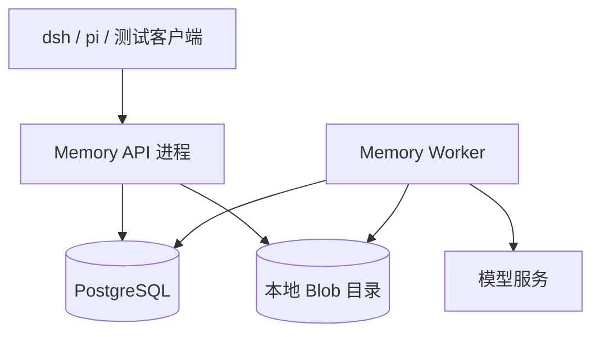
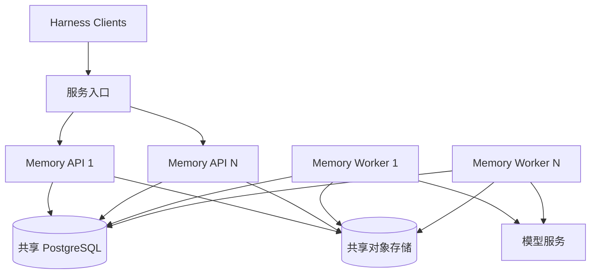

# Memory System 独立服务设计

状态：设计草案 v0.2。对外契约见[系统对接协议](integration-protocol.md)。

## 1. 定位与边界

Memory System 为不同 agent 宿主提供共享的上下文与记忆服务，独立于 dsh、pi 部署和运行。客户端可以是 Harness 插件、导入工具或测试客户端。

服务保存原始记录和工作上下文版本，提供带来源的长期记忆检索，并通过自己的 Memory Agent 校对、压缩和生成预备 notes。它不管理宿主的任务状态机、工具权限和模型执行循环。

Memory Agent 使用服务自身配置的模型客户端执行后台任务，不要求远程宿主在线，也不调用 Harness 才能完成 dreaming。可复用通用模型 SDK，但不能依赖宿主的 session/agent-loop 包。

## 2. 四个内部模块

| 模块 | 责任 | 关键结构 |
| --- | --- | --- |
| API 与资源管理 | 协议、认证、binding、writer、幂等 | SessionBinding、WriterLease、幂等结果 |
| Record / Context Store | 原始事件、大内容、上下文准备与激活 | RecordInput、ContextVersion、ContextHead、BlobRef |
| Memory Store / Retrieval | 长期记忆修订、来源、失效、检索与反馈 | MemoryRevision、ProjectState |
| Memory Agent | 提取、纠错、整理、预备 notes、候选发布 | DreamJob、MemoryChangeSet |

前两类结构由对接协议定义。活动工作上下文属于客户端管理的数据，Memory Agent 只读其证据，不在后台替 Harness 激活或改写。

## 3. 长期记忆的数据结构

ID、Timestamp、Scope、Content 和 EvidenceRef 来自对接协议。

```typescript
interface MemoryRevision {
  memoryId: ID;
  revision: number;
  previousRevision?: number;
  scope: Scope;
  kind: "fact" | "preference" | "decision" | "procedure"
    | "episode" | "prospective_note";
  key: string;                    // 逻辑主题，不自动作为跨范围合并依据
  content: Content;
  sourceRefs: EvidenceRef[];
  epistemicStatus: "supported" | "inferred" | "unverified" | "disputed";
  stale: boolean;
  applicability: string[];        // 环境、分支、有效条件
  validFrom?: Timestamp;
  validUntil?: Timestamp;
  conflictWith: EvidenceRef[];
  verifiedAt?: Timestamp;
  createdAt: Timestamp;
}

interface ProjectState {
  scope: Scope;
  revision: number;               // 事件、记忆、反馈、失效变更提交时递增
  indexedThroughRevision: number;
}
```

MemoryRevision 不可变，逻辑记忆的当前指针由事务更新。原始记录证明某次陈述或观察确实发生；它不自动证明陈述正确。supported 只表示在声明的范围和时间内有相应证据。

相同 key 的内容可能适用于不同分支和环境，不能简单采用最后写入获胜。无法判断的矛盾保留 disputed 与 conflictWith；已失效或待核对的旧结论不作为默认确定答案。

第一版保留来源关系与直接反向索引，不引入通用知识图谱。删除来源、收到纠正或已知依赖改变时标记相关记忆 stale；无法精确定位影响范围时，允许保守扩大待核对范围。

## 4. 存储与检索规则

### 4.1 原始记录与工作上下文

- 每个 binding 拥有自己的连续事件流和 context head，跨宿主通过 scope 共享长期记忆。
- 记录追加保存；上下文候选使用不可变 version ID，只有带有效 lease 与宿主 receipt 的 activate 才推进 head。
- 保存上下文 body 时验证 hash、格式和来源引用；不解析宿主工具状态来决定执行动作。
- 活动上下文的未来输入是否真正生效，由 adapter 按 coverage 声明并核对；Memory 记录事实和 receipt，不伪装为执行见证。
- 原始大内容进入 blob store，数据库保存内容 hash、可见范围和引用。服务端路径不暴露给宿主。

### 4.2 检索

首版使用 scope 和状态过滤、关键词检索、精确来源读取。向量召回和 rerank 在基线不足时加入，保持 RecallRequest/Response 不变。

检索输出原始证据或已发布记忆，以及其来源、状态、有效期和 stale 标记。Memory 不生成最终 system prompt，不决定宿主的 token 分配；Harness 使用返回材料构建工作视图。

branch_records 只读取当前执行分支及其固定继承范围；project_memories 用于共享 notes。project_records 是显式选择的跨任务证据检索范围，不能自动替换当前分支的输入流。

必需引用直接读取，不与相关性分数竞争。minProjectRevision 约束读到的项目版本：索引落后时补读未索引的记录，或明确报告 NOT_READY。严格读取走可满足版本要求的数据库节点，不能让任意只读副本返回落后结果。

readRevision 与返回正文来自同一一致性读取视图。检索索引只提供候选 ID，返回前再核对权威版本、访问范围与删除状态；不能将更新较快的索引候选直接拼接成一个不存在的历史视图。

### 4.3 反馈与变更

用户纠正、过期反馈和使用反馈先持久化，再触发后台任务。用户目标和偏好以最新明确陈述确定当前意图；对外部系统的断言仍需检查事实来源。

记忆发布或失效时，事务中写入 changes 记录。客户端主动拉取，服务无需维护对宿主的反向连接。changes 至少一次交付，不能将客户端成功收取通知视为记忆已被使用。

## 5. Memory Agent 与 Dreaming

### 5.1 任务与候选变更

```typescript
interface DreamJob {
  id: ID;
  scope: Scope;
  mode: "consolidate" | "repair" | "prepare_note";
  inputRefs: EvidenceRef[];
  readProjectRevision: number;
  status: "queued" | "running" | "validating" | "completed"
    | "failed" | "canceled";
  maxModelCalls: number;
  maxCostUsd: number;
  ownerId?: ID;
  leaseEpoch: number;
  leaseExpiresAt?: Timestamp;
  changeSetId?: ID;
}

interface MemoryChangeSet {
  id: ID;
  dreamJobId: ID;
  scope: Scope;
  readProjectRevision: number;
  expectedRevisions: { memoryId: ID; revision: number | null }[];
  candidates: MemoryRevision[];
  checks: {
    candidateMemoryId: ID;
    result: "supported" | "uncertain" | "rejected";
    evidence: EvidenceRef[];
    explanation: string;
  }[];
  status: "proposed" | "validated" | "committed" | "rejected";
}
```

Memory Agent 提出内容，验证器和数据库决定它是否符合发布条件。未发布候选不进入普通 recall。

### 5.2 流程与一致性

```text
选择增量原始记录和相关旧记忆
  → 提取带来源的候选
  → 核对范围、有效时间、重复与冲突
  → 生成 notes 或修订
  → 验证候选与并发版本
  → 原子发布并写入 changes
```

第一版同一项目只运行一个整理任务，跨项目可并行。在线写入继续进行。发布时比较 expectedRevisions，并检查 readProjectRevision 之后的新增事件是否影响结论；不能只因为旧来源仍存在就宣称信息是最新的。

可先采用保守策略：相关项目版本变化即重新验证，设置重试和计算预算；持续变化导致无法完成时保留候选等待后续处理，不通过无限重跑消耗预算。后续再按依赖范围细化检查。最终版本检查和发布发生在短数据库事务内，模型推理不持有事务锁。

验证包括来源存在、引用可读、适用条件匹配、关键数值未被改写、结论被证据支持，以及当前已知冲突。证据不足保留 inferred/unverified/disputed，不通过另一个模型的赞同自动升级为 supported。

job 完成、记忆修订、当前指针、项目 revision 与 changes 在同一事务提交。worker 丢失 lease 后不得发布；新 worker 重试使用同一 changeSet ID，避免发布重复修订。失败或取消只留下候选和诊断记录。

### 5.3 压缩与预备 notes

工作上下文压缩由 Harness 执行。Memory Agent 进行长期整理：生成 episode 摘要、合并重复知识、修订方法及维护短索引；原始记录保留可取回引用。重要标识符、约束和精确值不能只保留有损摘要。

未来 query 准备作为 prepare_note 任务运行，先从高频问题、未完成任务和昂贵的重复分析开始。生成的 prospective_note 包含适用条件、证据和有效期，来源改变后重新核对。首版不建设单独的预测调度服务。

dreaming 调用自身产生的日志标记为内部执行数据，默认不再次作为外部事实输入，防止系统反复学习自己生成的推断。生成 notes 也不授权执行 notes 中建议的外部动作。

Anthropic 的 dreaming 采用保留输入并生成整理结果的方式，本设计借鉴其候选与发布分离；未来 query notes 借鉴 Sleep-time Compute，但必须把离线计算纳入收益评估。[Dreams](https://platform.claude.com/docs/en/managed-agents/dreams)、[Sleep-time Compute](https://arxiv.org/abs/2504.13171)

## 6. 单机部署



API、worker、数据库和 blob store 可位于同一台机器；API 与 worker 可以同一可执行程序按角色启动。服务独立于客户端宿主，宿主退出后仍能执行 dreaming。

首版推荐单机和集群统一使用 PostgreSQL，以保持版本、幂等、队列和事务语义一致。blob store 单机可使用持久目录。数据库与 blob 持久卷共同备份；应用进程重启不能清空 lease epoch、幂等记录或 context head。

客户端仅配置 endpoint、凭据、workspace/project。宿主不得依赖 Memory 的本地路径。单机版本也走网络契约，避免迁移集群时重写插件。

## 7. 集群部署



API 副本无会话内存依赖，不要求 sticky session。Bindings、writer epoch、context head、幂等结果、jobs 和 changes 都存共享数据库。Blob 使用所有 API/worker 可访问的对象存储。

worker 从共享任务表领取带租约的 job；数据库原子认领、epoch 和提交条件防止两个 worker 同时发布。首版按项目串行整理，扩容主要提高跨项目吞吐；无需先引入独立消息总线。

数据库负责事务与唯一性，对象存储负责已确认内容的持久化。数据库 HA、备份、复制和对象存储冗余属于部署能力；仅增加 API 副本不等于消除数据层单点，也不提供跨地域强一致保证。

数据库故障转移必须保证已确认写入在部署声明的持久性范围内不丢失，否则不能满足协议的 durability 承诺。使用读副本时按 minProjectRevision 检查可见性，不满足则路由至主库或等待。

## 8. 持久化与事务

| 数据集合 | 关键约束 |
| --- | --- |
| bindings / writer_leases | 宿主会话映射唯一，epoch 单调递增 |
| records / stream_heads | scope 内 eventId、stream 内 nativeEventId 唯一，stream sequence 连续 |
| context_versions / context_heads / receipts | version 不可变，head CAS，receipt 可重复读取 |
| memory_revisions / memory_heads | revision 不可变，当前指针事务更新 |
| project_state / changes | scope revision 与变更通知一起提交 |
| jobs / change_sets | job 领取与发布检查 lease，changeSet 幂等 |
| idempotency_results | key、操作、调用身份与 payload hash 一致 |
| blobs / source_links | 内容完整性、作用域、反向来源查询 |

事件批次与其 receipt、stream head、项目 revision 在一个事务内提交。激活与 context head、应用 receipt 在一个事务内提交。后台发布与 job 完成、changes 在一个事务内提交。

blob 先持久化后发布引用；事务失败留下的未引用对象由延迟回收处理。索引可重建，不能成为原始记录或记忆版本的唯一副本。

## 9. 管理、删除与独立验收

Memory 自身提供 job 创建、查看、取消及项目使用量等管理能力；这些接口与 Harness 必需协议分开演进。预算耗尽停止后台 job，不阻塞在线原始记录与读取服务。

删除先阻止来源和依赖内容被读取，再按策略清理 notes、索引、上下文和 blob，并发布 source.deleted。旧快照与回滚也检查删除状态。普通 dreaming/compaction 不代替保留期管理。

独立验收使用记录导入和查询客户端即可完成：

1. 两个客户端写入同一项目、不同 binding，能够共享 notes 而不混淆上下文。
2. 同批写入重试、并发激活、旧 epoch 提交均符合协议。
3. 一条被纠正的事实有来源、修订和失效通知；不确定冲突仍明确标记。
4. Memory Agent 在所有宿主离线时仍可完成整理。
5. API 或 worker 被终止后，已确认内容可读，后台任务不会重复发布。
6. 单机数据迁移到共享数据库/对象存储后，客户端只需更新 endpoint。

质量评估关注有证据支持率、错误复发、过期使用率和后续任务收益；成本同时包含在线检索、后台模型调用、存储与预备 notes。未来 query 在生成 notes 时保持不可见。
