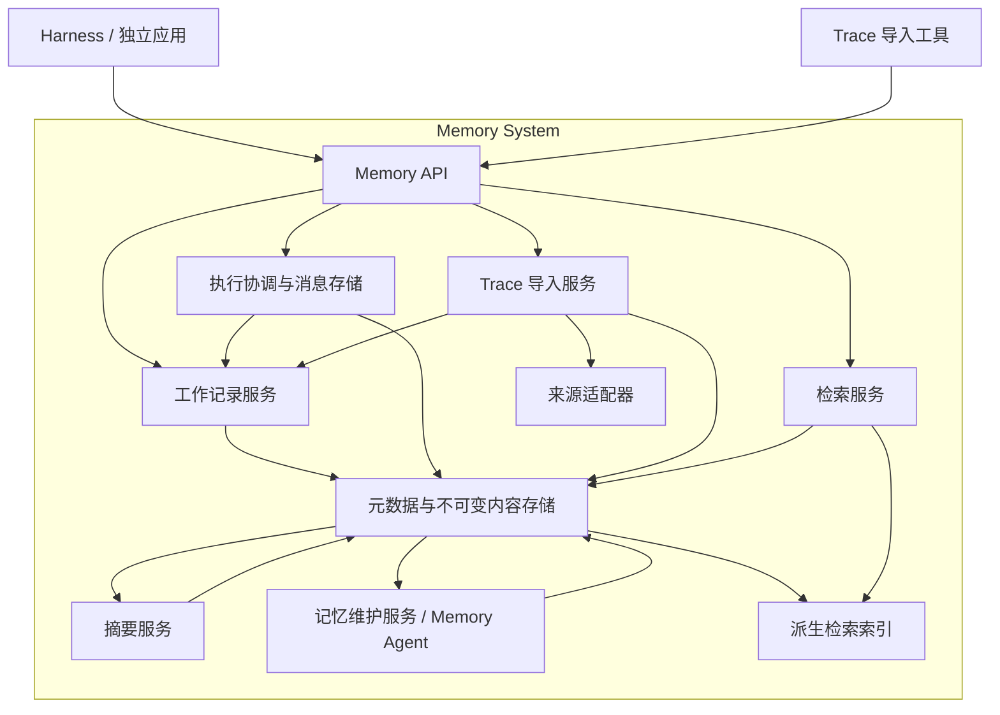

# Memory System 架构设计

版本：v0.16 · 状态：架构草案 · 日期：2026-11-18

## 1. 系统定位与边界

Memory System 是以用户为隔离与聚合边界的持久上下文、执行协调和知识管理服务。系统面向 Agent Harness、Trace 导入工具及独立应用，支持单机与集群部署。

| 参与方 | 职责 |
| --- | --- |
| Memory System | 管理 Session、Context 版本、执行状态、任务收件箱、来源资料、摘要和知识；提供持久化、一致性与检索能力 |
| Agent Harness | 管理 Router、Worker、执行循环、任务调度、业务 LLM 调用和工具执行；通过 Memory 接口保存及恢复状态 |
| Trace 导入工具 | 读取外部系统记录，提供稳定来源身份和内容快照 |
| Memory Agent | 在 Memory 内执行摘要、知识提取、冲突检查、整合、Context 压缩提案与预写 notes 等维护任务，可调用模型辅助处理 |

项目、主题和标签用于组织资料，不构成独立记忆域。Router 可在授权范围内检索用户跨项目、跨 Session 的信息。dsh、pi 等宿主通过 Harness 插件接入，Memory 不依赖具体宿主或执行循环实现。

本文定义逻辑架构、接口语义与一致性要求；具体 SDK、数据库、传输协议，以及文件句柄、工具资源和外部执行环境恢复不在本设计范围内。

## 2. 领域模型

### 2.1 用户域与 Session

Session 是工作资料的组织单元，不对应进程或执行互斥锁。系统支持两种资料写入方式：

| 属性 | Harness 执行 | 外部 Trace 导入 |
| --- | --- | --- |
| Session 边界 | 一项工作，可包含多个并行 Worker 和 subagent | 一个外部 Trace 固定对应一个 Session |
| Context | 多个 Context，每个 Context 可包含并行分支 | 一个 Trace 构建一个 Context，重复导入复用其身份 |
| Event | 每个执行 Session 一条逻辑事件流 | 导入不创建事件流 |
| 执行状态 | 任务、交互、版本领取和续接位置 | 导入不建立 Worker 或执行领取 |
| 摘要 | 工作进度、结果、阻塞和待处理事项 | Trace 的目标、过程、结论和未决问题 |

不同 Trace 独立建 Session，不按项目、内容相似度或主子 agent 关系聚合。同一 Trace 的文件分段共用来源身份。导入的主要用途是资料查阅和知识提取。

### 2.2 Context 与版本

Context 是一组用于 LLM 交互的上下文版本。`(contextId, versionId)` 唯一定位一份不可变内容，包括有序消息、指令、引用材料及必要输入配置。执行版本应足以还原相应模型输入；导入版本保留来源可提供的内容，并显式记录配置或交互边界的缺失。

正常执行时，一次完成的 LLM 交互产生一个后继版本：

```text
基础版本 + 本轮输入 → LLM 调用 → 本轮输出 → 后继版本
```

本轮输入在调用前持久化，输出与后继版本一并提交。失败或中断保留交互内容与状态，不标记为完成。

| 版本操作 | 语义 |
| --- | --- |
| interaction | 保存一次完整交互的输入与输出，引用基础版本 |
| fork | 从明确版本建立独立派生版本，默认保持 contextId，共享已有正文 |
| restore | 从历史版本建立恢复候选分支；采用时仅更新指定任务的续接位置 |
| compact | 发布显式压缩版本，保留来源，不覆盖正在使用的版本 |
| init / import | 初始化上下文或保存导入快照，不计为一次 LLM 交互 |

版本形成派生图。版本标识由 Memory 分配，编号不表达分支优先级；每个任务、导入来源分别持有续接或导入版本引用，Context 不设置全局唯一 head。分支结果由汇总方选择后作为新输入，不自动合并全部历史。

导入时，能够可靠识别的完整 LLM 交互可分别形成版本；边界不可识别时使用 import 快照。文件行、用户 turn 和导入次数均不等同于 LLM 调用次数。

### 2.3 执行记录

| 对象 | 语义 |
| --- | --- |
| Event | 记录执行事实及任务、交互、版本引用，不包含对话正文或完整 prompt |
| Interaction | 关联基础版本、本轮输入、调用状态和结果版本，支持未完成交互恢复 |
| Version Claim | 具体 Context 版本的有效执行权，包含持有者、有效期及防止失效持有者提交的凭证 |
| Task | 持久任务身份、父子关系、返回地址、续接版本、状态、可调度标记及结果引用 |
| Message / Mailbox | 按 Task ID 定向保存输入、取消和结果；正文引用 Context 内容，读取不等于消费 |

同一执行 Session 的所有 Worker 共用一条 Event 流，Memory 统一分配追加顺序。流顺序表示持久记录顺序，跨 Worker 的因果关系由显式引用表达；事件追加不串行化 LLM 执行。

执行领取粒度为 `(contextId, versionId)`：同一版本同时最多一个有效领取者，不同版本可以并行执行。只读访问无需领取。多个 Worker 从同一内容起点并行工作时，先 fork 为不同版本再分配。

### 2.4 摘要、工作记忆与知识

| 对象或用途 | 内容与来源 | 一致性定位 |
| --- | --- | --- |
| 工作记忆 | 当前 Context、未完成交互、任务、待处理输入及 Session 摘要 | 持久保存的短期工作状态 |
| Session 摘要 | 工作概况及固定来源引用 | 可重建的派生视图，允许滞后 |
| 历史资料 | 旧版本、执行事件及导入 Trace | 原始证据，不自动成为长期知识 |
| Memory Entry / Note | 经筛选的事实、偏好、经验、方法或预写资料 | 具备修订、来源、适用条件和生命周期的长期记忆 |
| 用户画像 | 用户相关记忆条目的聚合 | 用户级派生视图 |

执行摘要记录覆盖的 Event 位置及 Context 版本；导入摘要记录覆盖的来源 checkpoint、Context 版本和记录范围。摘要不替代版本提交或任务完成状态，导入摘要中的外部运行状态也不代表本系统持有对应执行权。

## 3. 逻辑架构



| 组件 | 核心职责 |
| --- | --- |
| 工作记录服务 | 管理用户归属、Session 目录、Context 版本、内容引用和执行 Event；提供确定版本的读取 |
| 执行协调与消息存储 | 管理版本领取、交互提交、任务续接、调度队列和收件箱；只维护持久状态，不选择执行者 |
| Trace 导入服务 | 管理稳定来源映射、格式适配、快照对齐、内容去重及导入 checkpoint |
| 摘要服务 | 按执行事件或导入进度更新 Session 摘要，维护覆盖范围和修订 |
| 记忆维护服务 | 提取候选、验证来源、检查冲突、合并修订、维护生命周期及预写 notes |
| 检索服务 | 提供用户概览、画像和资料召回，返回可追溯内容并校验授权与生命周期 |

上述组件为逻辑边界，可在同一进程部署。TraceAdapter 负责来源格式的识别与规范化；内部身份、版本发布和持久化由服务端统一管理。适配器不直接写数据库，也不授予执行权或发布长期知识。

原始内容与领域记录是权威数据；摘要、画像和检索索引均为派生数据。记忆维护通过受控操作发布修订，不直接改写 Worker 使用中的 Context。

## 4. 核心处理语义

### 4.1 执行提交与恢复

1. Memory 原子领取明确版本，返回内容与有效凭证；关联任务时同时核对任务状态和续接位置。
2. 调用前保存本轮输入及 Interaction，追加引用该交互的开始事件。
3. Harness 使用基础版本和新增输入调用 LLM。
4. Memory 校验执行凭证、基础版本和交互身份，持久化输出，并发布后继版本。
5. 版本发布、完成事件、输入消费、任务续接及领取转移保持原子一致；等待或结束时再通过对应操作释放领取。

同一次 Interaction 的重试返回原提交结果。领取到期或被回收后，旧凭证不能提交有效结果；该保证约束持久状态，不保证失联进程已停止计算。失败或结果未知时保留交互状态，由 Harness 决定核对或重试。

恢复使用任务保存的确切续接版本、未完成交互和待处理输入。回滚须核对并使受影响的旧执行失效，再建立恢复版本；其他任务和分支不受影响。对话正文由 Context 统一保存，不依赖事件重建，也不另设 Worker History 存储。

任务通知以父任务或 Router 逻辑入口为目标，不以 contextId 或临时 Worker 进程作为唯一地址。结果以内容引用交付，输入消费与处理结果一致确认。执行 Session 退役前须确认有效领取、未完成交互和待处理工作均已结束。

### 4.2 任务队列与收件箱

Memory 为 Harness 提供两类持久协作数据，复用现有事务存储，不要求部署额外消息中间件。

| 数据 | 作用 | 消费确认 |
| --- | --- | --- |
| 调度队列 | 保存可执行 Task 引用；Harness 决定调度顺序、名额和执行者 | 领取 Task 的具体 Context 版本时原子受理 |
| Task 收件箱 | 保存用户输入、补充、取消、子任务及顶层结果；以稳定 Task ID 寻址 | 实际效果提交时确认，普通读取不删除消息 |

submitTask 原子保存任务、独立起点、初始输入和可调度标记。finishTask 校验持久结果，原子更新终态、释放领取、向 returnTo 写入唯一通知，并按接收任务状态更新可调度标记。提交失败不会产生孤立的成功通知。

父任务等待时，releaseClaim 保存等待条件并释放领取；事务内同时检查结果是否已经到达。新消息进入等待任务的收件箱后，可使其再次入队。任务暂停、取消或已结束时按其状态处理，不盲目重启。

receive 支持分页和长轮询，返回未处理消息或候选任务。内存通知、连接推送只是唤醒优化，持久数据才是交付依据。输入消费与 Context 提交一致；终态及纯控制处理也必须关联消费确认。

领取到期只使执行权失效并暴露待核对任务，不推断业务成功。Harness 重新领取后核对未完成调用，决定恢复或结束。旧执行者不能提交版本、任务终态或消息确认。

### 4.3 Trace 身份与内容对齐

导入服务维护稳定映射：

```text
用户 + 来源系统 + 原生 Trace ID → sourceKey → Session ID + Context ID
```

原生 ID 仅在实例内唯一时加入稳定实例标识。来源无稳定 ID 时，首次登记分配 sourceKey，调用方保存并复用；登记重试使用相同请求身份。路径用于定位，内容指纹用于变化检测，均不能代替 Trace 身份。

首版接收完整快照。适配器输出有序记录及来源标识，Memory 按记录 ID 和规范化内容指纹对齐；无记录 ID 时比较有序内容的共同前缀，保留重复消息各自的位置。

| 快照关系 | 持久处理 | 结果 |
| --- | --- | --- |
| 首次登记 | 创建固定 Session/Context 映射及导入版本 | created |
| 内容相同 | 复用已有版本和进度 | unchanged |
| 已有内容为完整前缀 | 追加尾部内容及后继版本，推进 checkpoint | appended |
| 新快照为已有内容的较短前缀 | 保留现有内容和进度，标记旧快照或采集不完整 | unchanged |
| 已有记录、顺序或中间历史发生变化 | 保留已发布内容，返回分歧位置 | conflict |

checkpoint 绑定已确认记录范围、内容指纹、解析规则版本及对应 Context 版本。指纹比较忽略序列化空白和键顺序差异，保留影响内容语义的字段；文件偏移只用于读取优化。未完成或无法解析的内容保留来源和缺失说明，不越过缺口宣告处理完成。

来源映射具有唯一性。并发导入校验并更新同一来源的 checkpoint；内容、版本、映射和 checkpoint 一致发布，重试不重复创建对象。导入分支的推进独立于 Worker 的续接位置。

首版历史分歧返回 conflict，不自动覆盖。显式来源修订需可信的修订顺序或明确替换依据，并重新核对受影响的摘要和知识，作为后续扩展。

导入不创建 Event 流。若后续由 Harness 继续执行，须从明确版本 fork，补齐配置并建立执行状态；仅记录新增执行事件，不回填外部事件。

### 4.4 摘要与知识维护

维护可由执行进展、Trace 导入、显式请求或周期任务触发，不要求 Session 已结束。Context 压缩候选通过工作记录服务发布为新版本，由 Harness 决定后续采用；知识处理链为：

```text
固定来源范围 → 生成摘要或知识候选 → 检查来源、适用条件、重复与冲突 → 发布修订
```

知识来源定位到具体 Context 消息或持久材料及其修订，区分用户陈述、模型判断和工具结果。共享前缀、fork 内容及重复导入不能重复计为独立证据；预写 notes 中的预测保持假设属性。

| 导入处理进度 | 推进条件 |
| --- | --- |
| 导入 checkpoint | 对应内容、版本及映射已持久发布 |
| 摘要覆盖范围 | 基于确定来源的新摘要已发布 |
| 知识提取覆盖范围 | 对应来源范围已完成检查，候选及处理结果已保存；允许无知识产出 |

三项进度独立维护。后台任务根据覆盖差异恢复处理，无需导入 Event。普通追加可基于已有摘要和新增内容增量更新；来源修订则重新检查受影响范围。发布时校验来源与派生修订，防止旧任务覆盖新结果。

长期记忆支持反馈、纠正、归档和遗忘。来源删除或失效须传播到依赖内容与检索可用性，旧副本不得自动重新生成已遗忘的信息。

## 5. 对外接口边界

接口签名及原子语义统一定义在 [Harness 与 Memory 最小接口协议](integration-protocol.md#3-最小在线接口)，本文不维护第二份函数清单。

| 范围 | 必需能力 |
| --- | --- |
| 工作资料 | 建立 Session 与根 Context、按引用读取、显式派生版本、用户域检索 |
| 版本执行 | 唯一领取、续期、调用前保存输入、调用后提交、释放及保存续接位置 |
| 任务与消息 | 持久分派、定向发送、队列与收件箱读取、原子结束并返回结果 |
| Trace 导入 | 首次与增量导入、查询导入及维护覆盖范围 |

在线契约共 13 个操作，Trace 导入另有 2 个。Session 摘要、画像和知识由后台维护，Harness 通过读取或检索使用；知识纠正以明确来源进入维护流程。生命周期管理和管理端能力不扩展为在线执行循环的必需接口。

Memory 自动产生版本提交、任务受理和结束等权威 Event，不提供任意编造成功事件的写入入口。任务消息与 Event 分开管理；回传正文通过不可变引用访问。

## 6. 存储模型与一致性

### 6.1 逻辑记录

| 记录 | 关键数据 | 存储特性 |
| --- | --- | --- |
| Session | 用户归属、来源方式、目标、Context 目录、生命周期 | 结构化元数据 |
| ContextVersion | Context/版本身份、来源版本、操作类型、输入配置、有序内容引用、来源与缺失说明 | 不可变版本记录 |
| Interaction | 基础版本、本轮输入与输出引用、状态、结果版本 | 持久交互状态 |
| VersionClaim | 具体版本、执行者、有效凭证、有效期 | 原子更新的协调记录 |
| Task | 父子关系、returnTo、续接版本、状态、可调度标记和结果引用 | 持久执行元数据及队列索引 |
| Message / Mailbox | 消息身份、目标 Task、类型、来源及内容引用、顺序、处理状态 | 持久定向交付记录；与执行 Event 分开 |
| Event | Session 内顺序、类型、生产者、任务/交互/版本引用和状态 | 追加记录，不保存正文 |
| SessionSummary | 摘要内容、来源、覆盖范围、修订 | 可重建的派生记录 |
| TraceSource | 稳定来源身份、Session/Context 映射、导入分支、checkpoint、解析规则及各处理进度 | 可更新的来源管理记录 |
| MemoryEntry | 类型、正文、修订、来源、适用条件和生命周期 | 有修订控制的知识记录 |
| ContentBlock | 不可变正文、格式、内容身份及归属 | 消息、材料及原始 Trace 附件共享引用 |

Context 逻辑上提供完整版本，物理上可采用增量、共享内容块和快照。原始 Trace 附件用于追溯，不建立另一套可变 History。压缩生成新版本，与物理删除分别管理。

Harness 使用确定版本及本轮输入，保持已确定的消息顺序和配置；必要变更显式版本化。Memory 不引入可隐式重写内容的 ModelInput 层，不保存推理服务 KV，也不承诺缓存命中。

### 6.2 一致性边界

| 边界 | 要求 |
| --- | --- |
| 具体版本 | 同时最多一个有效领取，失效凭证不能提交 |
| 单次交互 | 唯一提交结果；版本、完成事件、输入确认、任务续接及领取转移原子一致 |
| 执行 Session | 单一逻辑 Event 流及稳定追加顺序，允许物理分段 |
| 任务与交付 | 任务分派与入队一致，任务终态与返回消息一致，等待注册检查已到达消息；重复提交不重复通知 |
| 导入来源 | 唯一对象映射；内容发布与 checkpoint 推进一致，重复提交幂等 |
| 派生记录 | 摘要、画像和索引允许异步更新，须暴露覆盖或修订；禁止旧结果覆盖新结果 |
| 记忆条目 | 修订受控发布，来源和生命周期变化影响引用及检索有效性 |

正文必须先持久可读，再发布引用它的权威元数据。事务存储或等价提交协议须保证上述边界；派生索引不承担执行协调或版本权威判断。检索结果需核对当前授权、修订与生命周期。

## 7. 部署与恢复

| 部署方式 | 组成 |
| --- | --- |
| 单机 | API、领域组件与维护任务可同进程运行，使用本地持久元数据和内容存储 |
| 集群 | API 与维护计算可多实例部署，共享持久元数据、内容存储和索引；存储层提供跨实例原子更新与唯一约束 |

用户域是访问控制与数据路由边界，可按 Session、Context 或来源进一步分区。版本领取、交互提交、任务与返回消息、来源对齐由持久存储协调，不能依赖单个服务进程的内存锁；分区部署仍须满足协议规定的事务边界。

服务恢复从已提交版本、任务续接位置及维护 checkpoint 继续。未完成交互保持待核对状态；摘要和知识提取从各自已确认范围重试。导入完成仅表示快照已处理，不推断外部工作已结束。

运行状态至少覆盖版本提交冲突、领取到期、未完成交互、任务队列及收件箱积压、Trace 对齐冲突，以及摘要和知识提取滞后。首版支持完整快照导入与尾部追加识别；显式历史替换和差量传输另行扩展。

## 8. 数据流示例

<a id="6-完整例子规划行程中途纠正换-worker-后继续"></a>

### 8.1 并行执行与恢复

行程规划 Session S 内，父任务、交通任务和活动任务共用 Context C 的不同版本：

```text
C@v3 ──fork──→ v4 ──交通任务交互──→ v7
   ├──fork──→ v5 ──活动任务交互──→ v8
   └──父任务交互──→ v6 ──追加子结果并汇总──→ v9
```

三个任务分别领取 v3、v4、v5，提交后各自续接 v6、v7、v8，所有执行事件追加到 S 的同一流。交通 Worker 更换时，新 Worker 领取交通任务保存的续接版本；用户纠正作为任务输入持久保存并由 Harness 传播。子任务结束时向父 Task 收件箱写入结果引用；父任务从 v6 恢复，核对约束后提交 v9，再结束任务并通知 Router。父任务等待期间释放领取和执行名额。摘要异步聚合进展，知识提取引用具体消息。

### 8.2 重复与增量导入

Trace T 首次导入建立 `sourceKey K → Session S / Context C`。假设交互边界可识别：

| 输入 | 导入结果 | 摘要与知识处理 |
| --- | --- | --- |
| 首次提交 10 轮 | created，发布至 v10 | 分别维护前 10 轮覆盖范围 |
| 提交相同前缀的 13 轮 | appended，仅新增第 11～13 轮，发布至 v13 | 增量处理新增内容；允许暂时落后于导入 |
| 重复提交相同 13 轮 | unchanged，复用 v13 | 不重复处理已完成范围，可继续未完成任务 |
| 再次提交旧的 10 轮 | unchanged，保持 v13 | 进度不回退 |
| 提交改写第 6 轮的快照 | conflict，保留已发布版本 | 不基于未接受内容更新知识 |

全过程复用 S 和 C，不创建 Event 流。另一个 Trace 即使属于同一项目或 subagent，仍独立建 Session。Router 通过摘要浏览资料，通过 Context 核对原文，通过 recall 复用经验证的知识。

---

文档关系：[Harness 架构](agent-harness.md)定义调度与执行，[最小接口协议](integration-protocol.md)是唯一接口规范。[早期实现参考](integration-reference.md)保留为历史材料，不作为当前契约。
