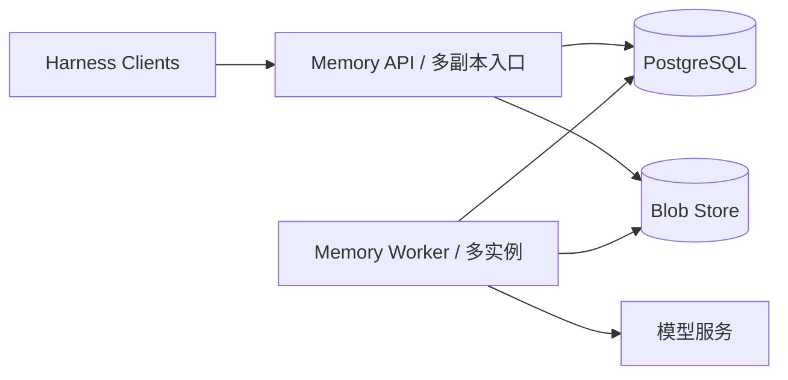

# Memory System：用户域、服务接口与后台整理

状态：设计草案 v0.5；2026-11-17。共享函数与协议类型见[交互逻辑与接口](integration-protocol.md)。

## 1. 逻辑模型与边界

Memory System 以 **userId** 为唯一 Memory 归属域。一个用户的 Router 对话、Worker 记录、工作上下文、长期偏好和所有 project notes 均进入同一域，服务独立部署于单机或集群。

projectId 表示用户域内的主题与任务分类。Router 可以跨项目检索并发现全部用户资料；无需先选择一个 project 才能打开 Memory。同名 project 不会把不同用户的数据合并。

| 数据类别 | 用途 | 写入责任 |
| --- | --- | --- |
| 原始事件与 Message | 记录用户输入、agent 输出、工具交换、任务与执行状态 | Harness Core 经 appendEvents 写入 |
| 工作上下文版本 | 保存某个 Router/Worker 的输入工作视图与消费位置 | Core 构建，经 putContext / activateContext 提交 |
| user notes | 用户级偏好、目标、跨任务适用的方法 | Router 提议或 Memory Agent 整理，Memory 验证发布 |
| project notes | 某个项目的约束、决策、状态与方法 | 项目 Worker/Router 提议或 Memory Agent 整理 |
| 用户概览与检索索引 | 发现项目、会话、任务及相关材料 | 从已提交对象派生，可以重建 |

Memory 保存事件时不调用 Router，也不自动把事件追加到活动 context。Memory Agent 整理长期知识；Context Controller 属于 Harness，决定下一模型请求的上下文。

Memory Agent 使用服务自己的模型客户端与任务预算，Host 离线时仍可运行。Memory 不控制 Worker 的工具，不决定用户 turn 何时结束。

## 2. 一次写入、读取与整理的流程

### 2.1 在线消息与上下文

1. API 根据认证确定 user 与调用角色，验证 binding、writer 和事件序号。
2. Record Store 事务保存事件正文引用、stream 进度、user revision 和幂等结果。
3. API 返回 AppendReceipt；原始记录立即可按 ID 或序号读取。
4. Harness 自行更新工作 context，随后调用 putContext 保存不可变候选。
5. Harness 在运行时应用候选，再调用 activateContext；Context Store 保存应用 receipt 并推进 head。

步骤 2 与步骤 4 可以分开提交。因此记录已保存而 context 尚未更新是合法中间状态；恢复时由 Harness 重放未覆盖事件。服务不等待 notes 提取才确认原始输入。

### 2.2 Router 检索用户信息

Router 通过 getUserOverview 得到用户级 notes、项目目录、对话及任务索引。目录按持久对象枚举并分页，不由模型猜测用户有哪些项目。摘要是辅助字段，原始来源仍可定位。

recall 默认覆盖该 user 的 notes 和当前 session 历史。Router 可显式加入 user_events，搜索其他会话证据；projectIds 只作为筛选条件。搜索由服务端 Retrieval 执行，Harness 不直接访问数据库或索引文件。

流程为：读取授权 → 解析 corpus/项目条件 → 关键词召回 → 精确读取权威版本 → 校验来源、有效期和删除状态 → 返回证据与修订。向量召回与 rerank 可在基线不足时加入，公共接口不变。

Worker 只能查询其 task 授权允许的材料。getUserOverview 同样执行授权过滤，Worker 不因持有 userId 就获得完整用户目录。Core 使用 Router 身份发现信息，再按任务传递所需引用。

### 2.3 project notes 写入与后台维护

Worker 完成项目任务后，可以 proposeNote(projectId, content, sourceRefs)。服务先保存提案，返回 proposal ID；验证器或 Memory Agent 检查证据、重复、冲突和适用范围后发布 NoteRevision。

同一用户内跨项目的来源引用是合法的。例如 Genvagent 的 note 可以引用 analytics 中已经验证的文档方法，但结论仍应注明 Genvagent 的适用条件。只有充分支持跨项目适用时，才提出独立的 user note。

用户在当前对话中的明确纠正先作为原始事件保存，由 Harness 立即处理；后台 note 发布不阻塞当前请求。后台修改不会直接推进 Router/Worker 的 ContextHead。

## 3. 服务模块与接口函数

| 模块 | 对外职责 | 内部依赖 |
| --- | --- | --- |
| API / Session Registry | 用户鉴权、会话映射、授权、lease、幂等及版本协商 | Record/Context Store |
| Record / Context Store | 事件追加、原文读取、context 候选与激活 | 数据库、blob store |
| Note Store / Retrieval | 用户概览、notes 修订、搜索、反馈与变更 | 索引、来源关系、权威存储 |
| Memory Agent / Validator | 提取、整理、修复、预备 notes、发布校验 | 受预算约束的模型客户端、job 队列 |

### 3.1 API 与存储模块

| 函数 | 输入与输出 | 事务边界 |
| --- | --- | --- |
| registerSession(domain, registration) | SessionRegistration → BindingState | 会话唯一映射、stream 与 context 的创建 |
| resolveSession(domain, key) | SessionKey → BindingState | 同一读取视图中的进度、head 与 receipt |
| changeWriter(binding, request) | LeaseRequest → WriterLease/释放确认 | 校验 owner、epoch、有效期 |
| appendBatch(binding, records, afterSequence) | AppendRequest → AppendReceipt | 记录、stream head、user revision、幂等结果一起提交 |
| readRange(binding, afterSequence, limit) | EventPage | 连续事件读取，正文通过 inline/blob 解引用 |
| saveContext(binding, candidate) | ContextVersion | 正文完整性、来源、消费位置和 base revision 校验 |
| activateContext(binding, request) | ActivateRequest → ContextHead | writer、版本比较、head 与 receipt 一起提交 |
| readContext(ref) | ContextVersion | 检查当前授权和来源删除状态 |

以上内部函数由公共 API 包装；幂等 key 与认证上下文由 API 传入。服务不依赖 Host SDK 或 Harness 的内存对象。

### 3.2 概览、检索与 note 模块

| 函数 | 输入与输出 | 语义 |
| --- | --- | --- |
| getOverview(domain, readGrant, cursor) | UserOverview | 用户域目录；Router 可枚举所有项目，Worker 受授权限制 |
| recall(domain, request) | RecallRequest → RecallResponse | 跨项目召回，返回具体证据和修订 |
| readEvidence(domain, ref) | EvidenceRef → RecallItem | 精确读取，不经过相关性排序 |
| acceptProposal(domain, proposal) | NoteProposal → proposal ID | 持久候选，不直接等同于已验证知识 |
| publishNotes(changeSet) | MemoryChangeSet → 已发布修订 | 检查并发版本、来源与适用范围后原子发布 |
| recordFeedback(domain, input) | FeedbackInput → feedback ID | 保存用户纠正或使用反馈，触发后台整理 |
| listChanges(domain, readGrant, cursor) | changes page | 按授权过滤，至少一次交付 |
| invalidateSource(domain, ref) | 失效影响范围 | 立即阻止不应读取的内容，再清理依赖索引与缓存 |

### 3.3 Memory Agent 模块

| 函数 | 输入与输出 | 职责 |
| --- | --- | --- |
| scheduleDream(userId, mode, projectIds?) | DreamJob | 选择一个用户的增量资料；项目条件可选 |
| claimJob(jobId, workerId) | 带 epoch 的 job lease | 多实例下原子认领 |
| buildChangeSet(job) | MemoryChangeSet | 生成带来源的候选与修订 |
| validateChangeSet(changeSet) | 校验结果 | 验证证据、适用范围、冲突和当前版本 |
| commitChangeSet(changeSet, lease) | 已发布 notes 与 changes | 检查有效 lease，原子发布并完成 job |

原始输入、候选、校验结果和发布版本分别保存。未发布候选不进入普通 recall。job 失败或预算耗尽保留诊断，不阻塞在线记录与读取。

## 4. 关键数据结构

UserDomain、NoteScope、Content、EvidenceRef、NoteProposal 等类型由公共协议定义；本节定义服务内持久对象。

### 4.1 用户状态与 notes

```typescript
interface UserMemoryState {
  domain: UserDomain;
  revision: number;               // 会话目录、事件、已发布 notes 等资料的单调版本
  indexedThroughRevision: number;
}

interface NoteRevision {
  noteId: ID;
  revision: number;
  previousRevision?: number;
  domain: UserDomain;
  scope: NoteScope;
  kind: "fact" | "preference" | "decision" | "procedure"
    | "episode" | "prospective_note";
  key: string;
  content: Content;
  sourceRefs: EvidenceRef[];
  epistemicStatus: "supported" | "inferred" | "unverified" | "disputed";
  applicability: string[];
  validFrom?: Timestamp;
  validUntil?: Timestamp;
  conflictWith: EvidenceRef[];
  verifiedAt?: Timestamp;
  createdAt: Timestamp;
}

interface NoteHead {
  noteId: ID;
  currentRevision: number;
}

interface NoteReadState {
  noteId: ID;
  revision: number;
  stale: boolean;                 // 当前读取状态，独立于不可变正文
  invalidatedAt?: Timestamp;
}

interface TaskIndexEntry {
  taskId: ID;
  domain: UserDomain;
  conversationId: ID;
  projectId?: ID;
  routerBindingId: ID;
  workerBindingId?: ID;
  state: string;
  latestEvent: EvidenceRef;
  indexedAtUserRevision: number;
}
```

同一 noteId 的 user 和 NoteScope 固定。项目知识提升为用户级知识时创建新的 note 并引用原证据，不移动或覆盖原项目记录。key 的匹配范围为 userId + NoteScope；相同词语不构成跨项目合并依据。

NoteRevision 正文不可变，NoteReadState 表示当前失效状态。supported 仅表示在声明条件下有证据；来源存在不自动证明陈述正确。无法确定的冲突保留 disputed/conflictWith。

TaskIndexEntry 是从事件派生的查询索引，不是 Memory 调度 Worker 的状态机。任务执行仍由 Harness 负责，索引落后时可通过 latestEvent 与原始记录核对。

### 4.2 后台任务与变更集

```typescript
interface DreamJob {
  id: ID;
  domain: UserDomain;
  mode: "consolidate" | "repair" | "prepare_note";
  projectIds?: ID[];              // 可选整理范围，不是存储分区
  inputRefs: EvidenceRef[];
  readUserRevision: number;
  targetScopes: NoteScope[];
  status: "queued" | "running" | "validating" | "completed" | "failed" | "canceled";
  maxModelCalls: number;
  maxCostUsd: number;
  workerOwnerId?: ID;
  leaseEpoch: number;
  leaseExpiresAt?: Timestamp;
  changeSetId?: ID;
}

interface MemoryChangeSet {
  id: ID;
  dreamJobId: ID;
  domain: UserDomain;
  readUserRevision: number;
  expectedRevisions: { noteId: ID; revision: number | null }[];
  candidates: NoteRevision[];
  checks: {
    candidateNoteId: ID;
    result: "supported" | "uncertain" | "rejected";
    evidence: EvidenceRef[];
    explanation: string;
  }[];
  status: "proposed" | "validated" | "committed" | "rejected";
}
```

一个 job 只处理一个 user 的资料，可以覆盖多个 project。首版每个 user 同时运行一个整理 job，不同用户并行；同一用户的 Router 与 Worker 在线执行不受此串行规则限制。

发布前检查 expectedRevisions 及 readUserRevision 之后的相关新增信息。保守实现可以在用户数据变化后重新验证，并受重试预算约束。模型推理不持有数据库事务锁。

job 完成、notes 修订、heads、user revision 和 changes 在同一事务提交。后台 worker 丢失 lease 后不能发布；重试使用同一 changeSet ID，避免重复修订。

## 5. 存储与一致性

| 数据集合 | 分区与关键关联 |
| --- | --- |
| user_state | userId → revision、索引进度 |
| session_bindings / writer_leases | userId + SessionKey 唯一映射；每个 binding 独立 writer |
| records / stream_heads | 归属 user，经 binding 关联独立 stream；sequence 连续 |
| context_versions / context_heads / receipts | 归属 binding，保存不可变正文与应用确认 |
| note_revisions / note_heads / note_read_states | 归属 user，NoteScope 区分 user/project 资料 |
| conversation_index / task_index / project_index | 用户域内可重建目录，带来源与索引进度 |
| proposals / jobs / change_sets | 用户域内候选、整理任务及发布状态 |
| changes / idempotency_results | user 变更游标；调用身份与请求正文绑定的幂等结果 |
| blobs / source_links / retrieval indexes | 用户隔离、大正文、来源反向索引与可重建检索索引 |

用户资料保存在数据库与 blob store 中，不要求对应单个 Markdown 文件。project notes 可以提供 Markdown 导入/导出，但文件形式不决定归属与一致性语义。

跨 project 引用只要属于同一 user 且符合调用授权即可。跨 user 引用拒绝；删除与授权变化对旧版本同样生效。Worker 的 task grant 在检索和精确读取时执行，不能借来源展开读取整个 Router 会话。

minUserRevision 约束检索与目录的可见数据。索引落后时补读权威存储，或返回 NOT_READY。目录分页游标绑定用户、读取授权与读取版本，不能用另一用户或 Worker 的游标扩大读取范围。

user revision 随会话注册、事件、已发布 notes、反馈与来源失效提交而递增。context 采用独立 head revision，未发布提案、job 状态和未引用 blob 不改变资料版本，避免后台任务因自身内部写入触发反复重验。

数据批次提交只短暂更新 user revision，不在模型调用期间锁定用户。首版使用单用户单调版本便于恢复与失效判断；高吞吐用户的版本分配与索引成本需在压测中单独评估。

## 6. Memory Agent 的整理策略

长期 compaction 生成 episode 摘要、合并重复知识、修订方法和维护目录；原始事件保留可取回引用。活动 context 的压缩由 Harness 执行。

用户级偏好要有明确或充分的跨任务证据。只在某项目出现的约束留在 project note；遇到不同项目要求不同，应保留适用范围，不能让最近一次项目要求覆盖用户的全部偏好。

prepare_note 从高频问题、未完成任务和昂贵的重复分析开始，生成带来源、适用条件和有效期的 prospective_note。它可以利用用户跨项目历史，但不提前执行预想中的外部动作。

dreaming 的内部推理日志标记为内部执行数据，默认不重新作为外部事实输入。验证器检查来源、关键数值、时间、适用条件和已知冲突，不因另一个模型赞同就提升为 supported。

设计参考 Anthropic 的后台记忆整理与 Sleep-time Compute 的预备计算思路；离线成本与后续任务收益一并评估。[Dreams](https://platform.claude.com/docs/en/managed-agents/dreams)、[Sleep-time Compute](https://arxiv.org/abs/2504.13171)

## 7. 单机与集群部署



单机使用一个 API、一个 Memory Worker、PostgreSQL 和持久 blob 目录；API 与 Worker 可以同一程序按角色启动。Host 退出不影响服务整理用户 Memory。

集群增加无状态 API 副本和后台 Worker，使用共享 PostgreSQL 与对象存储。会话映射、writer epoch、head、job 和幂等结果存共享数据库，不要求 sticky session。后台 job 按 user 领取，在线事件仍按 binding 并发写入。

客户端配置 endpoint 与用户凭据即可；projectId 是任务/查询参数，不属于连接身份。迁移到集群不改变用户域和协议。数据库与 blob 共同备份，已确认正文须在部署声明的持久性范围内保留；增加 API 副本不替代数据层高可用。

## 8. 独立验收

1. 一个 user 的两项目 notes 均可从 Router 发现与检索，用户级偏好只维护一份；其他用户同名项目隔离。
2. 原始消息写入后立即可读，无须等待 dreaming；context 尚未提交时可按消费位置恢复增量。
3. Worker 可以提议自己任务项目的 notes，发布后 Router 可跨项目找到，并保留适用条件。
4. Memory 不修改活动 context；所有 Host 离线时仍可完成 notes 整理。
5. 幂等追加、旧 writer 拒绝、并发 context 激活、重复 job 发布符合公共契约。
6. 检索与目录在指定 minUserRevision 下不遗漏必需数据；索引及 API 节点重启不丢权威数据。
7. 单机迁移集群仅调整服务连接；用户域、事件引用和上下文版本保持不变。

质量评估包括跨项目检索命中率、项目约束误泛化率、错误复发、过期使用率及后续任务收益；成本覆盖在线检索、后台模型、存储与预备 notes。
