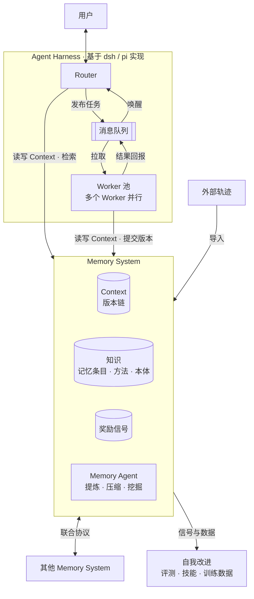

# Super Agent 架构蓝图

版本：v0.24 · 状态：蓝图 · 日期：2026-11-19

本文描述整体定位、要解决的问题和总体架构，是全部设计文档的起点。概念与术语见[概念模型](concepts.md)。

## 1. 定位

**Super Agent** 是本项目的架构名称，**Genvagent** 是按这一架构实现的产品。

Super Agent 是一种**以记忆系统为中心（Memory-centric）**的 agent 架构：

- **Memory System 是长期存在的核心。** 工作上下文、经验与知识都保存在这里。
- **Agent Harness 负责执行。** 它基于 dsh、pi 等已有的 agent 框架实现，从 Memory 读取上下文，执行后把结果写回 Memory。

一句话概括：**agent 会重启、会更换，记忆一直在，并且越用越多、越用越准。**

## 2. 要解决的问题

现有的 agent 框架，例如 Claude Code、pi、dsh，普遍有三个问题：

1. 上下文绑定在 agent 进程和它的本地会话里；
2. 记忆只属于单个 agent 或单个用户；
3. 反馈只来自当次对话。

Super Agent 针对这三点分别给出：

| 能力 | 解决的问题 |
| --- | --- |
| **Persistent Agent** | agent 进程与 Context 分离。Context 独立存在于 Memory System 中，进程退出、更换、上下文溢出都不会中断工作 |
| **Collective Memory** | 多个 Session、多个 agent、多个用户的经验和知识集中沉淀，提炼成可检索、可溯源、可纠正的知识，供后续所有 agent 使用 |
| **Self-Improving** | Memory Agent 主动挖掘历史数据，找出长期的、隐藏的奖励信号，为递归自我改进（RSI）积累数据 |

与其他系统的具体比较见[同类系统对比](landscape.md)。

## 3. 总体架构

| 组成 | 说明 |
| --- | --- |
| **Memory System** | 核心。拥有： Context 及其版本、来源证据、知识、奖励信号和派生视图； 可以独立部署，同时服务多个 Harness 和应用。 详见 [Memory System 架构](memory-system.md) |
| **Memory Agent** | Memory 内部的后台 agent，负责： 记忆提炼、摘要； 按请求执行压缩； 挖掘奖励信号； 沉淀领域本体 |
| **Agent Harness** | 执行系统，基于 dsh、pi 等 agent 框架以插件形式实现。 **Router** 面向用户，负责理解请求、委派任务、汇总结果。 **Worker 池**并行执行任务。 两者之间通过消息队列通信，委派不阻塞 Router。 详见 [Agent Harness 架构](agent-harness.md) |

Router 和每个 Worker 都直接读写 Memory，Memory 是它们共享的唯一上下文与知识来源。两个系统的边界与接口见 [Harness 与 Memory 交互与接口](integration-protocol.md)。

## 4. Memory System 的核心能力

| 能力 | 说明 |
| --- | --- |
| **Context 外置** | Context 是线性版本链，每一步提交一个不可变版本，可以从任意版本分叉；任何 Worker 都能从最新版本接着执行 |
| **知识沉淀** | 从各个 Context 和导入的轨迹中提炼记忆条目和方法经验，每条都能追溯到证据，可以纠正，遗忘时打墓碑 |
| **多范围共享** | 知识分为个人、团队或组织、领域三层。个人经验经过提炼、去除个人信息并获得授权后，才进入共享层；原始证据不跨范围共享 |
| **奖励信号挖掘** | 把"当时的动作"与"之后的结果"关联起来，例如方案被采纳或回滚、用户事后纠正、问题反复出现；积累可用于评测、技能沉淀和模型改进的数据。Context 版本引用和外部实体的确定性名称是这种跨会话关联的锚点 |
| **领域本体与联合** | 从积累的知识中沉淀领域本体，包括实体类型、关系和术语。不同的 Memory System 通过协议或接口相互查询与协作 |

## 5. 架构原则

1. **以 Memory 为中心。** 值得长期保留的东西，包括上下文、经验、知识和信号，都归 Memory 所有。
2. **进程与 Context 分离。** 进程有运行时状态，例如正在执行的步骤、子进程、文件句柄，但 Context 不归进程所有。进程丢失时，最多损失正在进行的那一步，新进程从 Memory 中的最新版本继续。
3. **单向依赖。** Harness 调用 Memory，Memory 从不调用 Harness；Memory Agent 在 Memory 内部运行。
4. **证据不可变，知识可溯源。** Context 版本只追加，历史不被改写；每条知识都能追溯到证据；遗忘用墓碑表示。

## 6. 文档导航

| 文档 | 内容 |
| --- | --- |
| [概念模型](concepts.md) | 顶层概念、状态归属、核心交互与不变量 |
| [Agent Harness 架构](agent-harness.md) | 持久化执行、消息队列、与 dsh / pi 的集成 |
| [Memory System 架构](memory-system.md) | Context 版本模型、数据分层、记忆生命周期 |
| [Harness 与 Memory 交互与接口](integration-protocol.md) | 两系统的边界、接口与调用场景 |
| [同类系统对比](landscape.md) | 与其他 agent 系统的比较和可借鉴之处 |

## 7. 待细化

- 多范围共享：个人、团队、领域三层的边界与授权；概念模型中"用户域"需要相应调整
- 工作区状态：除了 Context，长期任务还有文件、分支、运行中的服务等环境状态，如何在版本中引用，以便换进程后核对和重建
- 跨框架续接：Context 是否采用与框架无关的消息格式，使在 dsh 中开始的工作能在 pi 中继续
