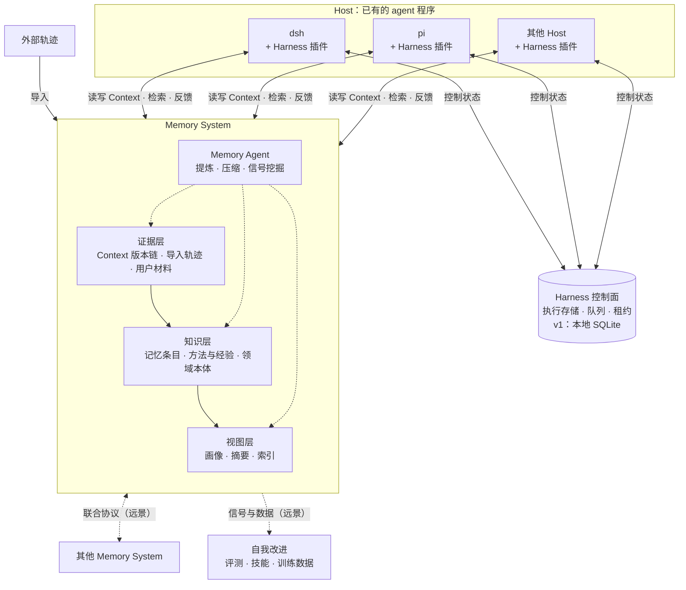

# Super Agent 架构蓝图

版本：v0.24 · 状态：蓝图 · 日期：2026-11-19

本文描述整体定位、要解决的问题、总体架构和演进路线，是全部设计文档的起点。概念与术语见[概念模型](concepts.md)。

## 1. 定位

**Super Agent** 是本项目的架构名称，**Genvagent** 是按这一架构实现的产品。

Super Agent 是一种**以记忆系统为中心（Memory-centric）**的 agent 架构：

- **Memory System 是长期存在的核心。** 工作上下文、经验与知识都保存在这里。
- **Agent 进程只是可替换的执行体。** 它们以插件形式运行在已有的 agent 程序（Host，例如 dsh、pi）里，从 Memory 读取上下文，执行后把结果写回 Memory。

一句话概括：**agent 会重启、会更换，记忆一直在，并且越用越多、越用越准。**

## 2. 要解决的问题

| 痛点 | 现状 | Super Agent 的做法 |
| --- | --- | --- |
| **长期运行的 agent 难以维持** | 上下文绑定在 agent 进程和它的本地会话里。进程退出、换机器、上下文溢出，都会让工作中断或失忆 | **分离 agent 进程与 Context**：Context 独立存在于 Memory System 中，是可版本化、可分叉的一等对象。进程随时可以替换，新进程从 Memory 读取最新版本继续执行 |
| **经验和知识无法沉淀** | 每个会话、每个 agent 各自积累，彼此看不到；会话结束，经验就散失了 | **集中沉淀**：多个 Session、多个 agent 的执行结果都进入同一个 Memory，经过提炼成为可检索、可溯源、可纠正的知识，供后续所有 agent 使用 |
| **缺少长期反馈** | agent 只能得到当次对话里的即时反馈；真正的好坏，往往在很久之后才显现，而且分散在不同的会话中 | **主动挖掘**：Memory Agent 在后台挖掘历史数据，找出长期的、隐藏的奖励信号（reward signal），为递归自我改进（Recursive Self-Improvement，RSI）积累数据 |

## 3. 总体架构

| 组成 | 角色 | 说明 |
| --- | --- | --- |
| **Memory System** | 核心 | 拥有 Context、证据、知识和派生视图；可以独立部署，服务多个 Host 和应用。详见 [Memory System 架构](memory-system.md) |
| **Memory Agent** | Memory 内部的后台 agent | 负责记忆提炼、摘要、按请求执行压缩，以及（远景）信号挖掘和本体演化。由 Memory 内部的后台执行器运行，不依赖 Harness |
| **Agent Harness** | Host 的插件 | 让 Host 具备持久化执行能力。分两部分： 数据面是插件本身，挂接在 Host 的 Agent Loop 步骤边界上； 控制面是执行存储，保存 Task、队列、租约。 详见 [Agent Harness 架构](agent-harness.md) |
| **Host** | 执行体 | dsh、pi 等已有的 agent 程序，提供 LLM 调用、工具执行和用户界面。一个装了插件的 Host 进程就是一个 Router 或 Worker 实例 |
| **轨迹导入** | 数据入口 | 把 Host 自身的历史会话等外部轨迹导入为证据 |

两个系统之间的边界与接口见 [Harness 与 Memory 交互与接口](integration-protocol.md)。

## 4. 架构原则

1. **以 Memory 为中心。** 一切值得长期保留的东西，包括上下文、经验、知识和信号，都归 Memory 所有。Harness 和 Host 只持有可以丢弃或重建的状态。
2. **单向依赖。** Harness 调用 Memory，Memory 从不调用 Harness。Memory Agent 在 Memory 内部运行，不借用 Harness 执行。
3. **进程无状态。** agent 进程不持有权威状态，崩溃或替换后，从 Memory 和控制面恢复。
4. **证据不可变、知识可溯源。** Context 版本只追加，历史不被改写；每条知识都能追溯到证据；遗忘用墓碑表示。
5. **不重写 Host。** 以插件方式借用已有 agent 程序的能力，只在步骤边界介入。
6. **从单机起步。** v1 的控制面用本地 SQLite，一个 Host 进程就是一个实例；需要多实例时，再替换为共享存储或现成的持久化执行引擎，概念模型不变。

## 5. 远景

以下两项是长期方向，当前只确立方向，不做设计。

- **长期奖励信号与自我改进。** Memory Agent 把"当时的动作"与"之后的结果"关联起来，例如方案被采纳或回滚、用户事后纠正、问题反复出现。由此积累出可用于评测、技能沉淀和模型改进的数据。Context 版本引用和外部实体的确定性名称，为这种跨会话的关联提供了稳定的锚点。
- **领域本体与联合。** Memory 从积累的知识中逐步沉淀出领域本体，包括实体类型、关系和术语。不同的 Memory System 可以通过协议或接口相互查询、协作，形成联合的知识网络。

## 6. 演进路线

| 阶段 | 目标 | 对应痛点 |
| --- | --- | --- |
| 1 | **Context 外置**：dsh 插件加本地控制面；长期任务可以跨进程、跨重启续接 | 长期运行 |
| 2 | **知识沉淀**：跨 Session、跨 agent 的记忆提炼与检索；授权模型 | 经验沉淀 |
| 3 | **信号挖掘**：定义并积累长期奖励信号 | 长期反馈 |
| 4 | **本体与联合**：领域本体的沉淀，以及 Memory 之间的联合协议 | 远景 |

## 7. 文档导航

| 文档 | 内容 |
| --- | --- |
| [概念模型](concepts.md) | 顶层概念、状态归属、核心交互与不变量 |
| [Agent Harness 架构](agent-harness.md) | 持久化执行、消息队列、Host 接入 |
| [Memory System 架构](memory-system.md) | Context 版本模型、数据分层、记忆生命周期 |
| [Harness 与 Memory 交互与接口](integration-protocol.md) | 两系统的边界、接口与调用场景 |
| [同类系统对比](landscape.md) | 与其他 agent 系统的比较和可借鉴之处 |

## 8. 待细化

- 工作区状态：长期任务除了 Context，还有文件、分支、运行中的进程等环境状态，如何在版本中引用，以便换进程后核对和重建
- 跨 Host 续接：Context 是否采用与 Host 无关的消息格式，使一个 Host 中开始的工作能在另一个 Host 中继续
